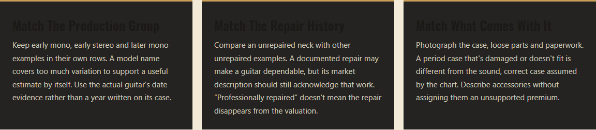
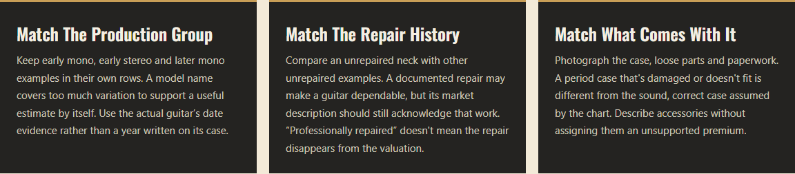
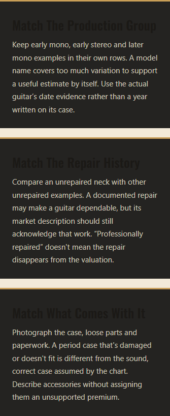
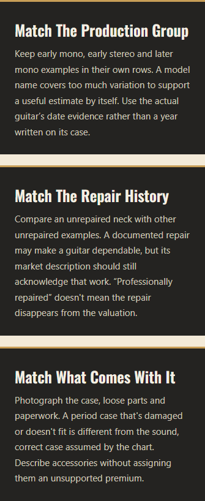

# October 30 Contrast Correction

Joe identified “Match The Production Group” as dark text on a dark card. The earlier representative visual review missed this. The rank-card background was dark while its headings inherited the light section's ink text color.

Three scoped rules in the shared model-guide stylesheet now give dark rank cards an explicit light foreground, give links inside rank/serial cards a cream foreground, and use rust rather than gold for small labels on light section, closing and author backgrounds. No prose, prices, image assets or existing-page styles changed.

## Coverage And Results

- Ten guides at 1280×800 and 375×812, with every FAQ disclosure opened: **4,670 visible text runs**. Computed foreground colors were compared with composited ancestor background colors using 4.5:1 for ordinary text and 3:1 for large text.
- Before: 202 failed measurements across both widths, comprising 12 unique rank-card headings, 88 small labels, and one serial-card link. After: **zero computed failures**.
- “Match The Production Group” improved from **1.12:1 to 13.69:1**. All four guides with rank cards have readable headings; Guild's cards already used a readable dark-section foreground.
- The existing axe-core/Playwright dependency separately checked the `color-contrast` rule on all twenty route/width cases: **zero violations**. Axe marked 330 nodes incomplete because of overlapping geometry or FAQ pseudo-element backgrounds; these are not counted as automated passes. Representative FAQ/other backgrounds and all affected rank cards were reviewed visually.
- Independent cross-model visual reviewer: PASS for all eight rank captures (Falcon, Country Gentleman, Anniversary, National × two widths), plus Guild's condition cards and expanded FAQ at both widths. Additional representative captures cover serial links, section labels, closing and author labels. See the supplemental verdict in `../independent-reviews.md`.
- Build: 372 pages. Astro check: zero errors/warnings. Copy audit: zero hard failures. All twenty viewport/layout checks pass; both top actions remain visible and there is no horizontal page overflow.
- All **105 protected HTML pages remain byte-identical**, including J-200, all thirty Rickenbacker guides and existing GuideActions consumers.

`before.json`, `after.json` and `axe.json` retain the measurements and axe's explicit incomplete findings. Before/after PNGs show the affected cards; representative additional captures show the other color contexts. This is a contrast correction with targeted visual verification, not a claim of exhaustive pixel or interaction testing across every possible width/state.

## White Falcon Example

| Width | Before | After |
|---|---|---|
| 1280px |  |  |
| 375px |  |  |
