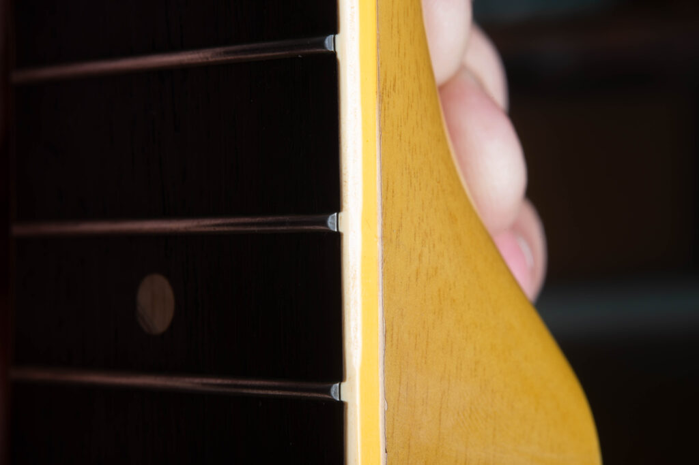
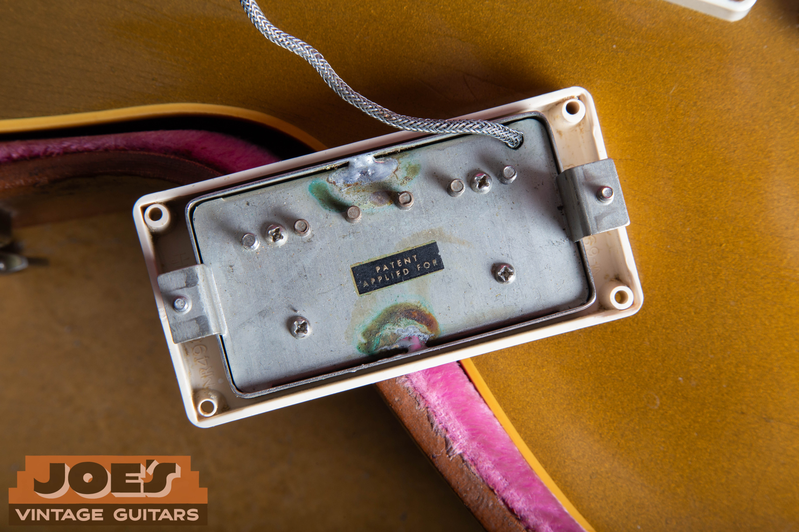

**A 1958 Les Paul can be a Goldtop or a sunburst, and those two versions belong in different price comparisons.** The finish changed during the year while the carved maple top, mahogany body, two PAF humbuckers and separate bridge and stopbar continued.

The full-guitar photo shows my **2011 R8 reissue, not a vintage 1958 example**. The close-ups below show vintage parts from my existing guides. Their captions identify the source guitars where documented, including Goldtops, a Special and ES models.

## 1958 Les Paul Value

### How Much Is A 1958 Les Paul Worth?

My range for **1958 to 1960 Sunburst Standards is $200,000 to $500,000+**; **1957 to 1958 PAF Goldtops run $135,000 to $250,000**. These are US retail estimates for all-original guitars in excellent condition with the correct original case, reviewed in July 2026. My [vintage Les Paul value guide](/vintage-gibson-les-paul-market-value-guide/) explains the ranges and their scope.

Original finish and PAFs carry much of the collector value, while repairs, replaced parts and neck alterations can move a guitar outside those ranges. I also consider the neck's condition and documented provenance when choosing comparable guitars. A sunburst refinish on a Goldtop belongs in its own comparison, separate from a factory Burst.

<blockquote class="burst-expert-note">

<strong>Expert note from Joe Dampt</strong>

I put a significantly higher value on a 1958 Burst than a comparable PAF Goldtop, even though they're essentially the same guitar aside from aesthetics.

</blockquote>

For a value specific to your guitar, [send me photos for a Gibson appraisal](/free-appraisal/gibson/).

<nav class="burst-inline-toc" aria-label="Article Contents">
<h2>Table Of Contents</h2>
<ul>
<li><a href="#1958-les-paul-value">1958 Les Paul Value</a></li>
<li><a href="#the-1958-transition">The 1958 Transition</a></li>
<li><a href="#1958-shipping-totals">1958 Shipping Totals</a></li>
<li><a href="#1958-specifications">1958 Specifications</a></li>
<li><a href="#reading-the-r8-photo">Reading The R8 Photo</a></li>
<li><a href="#neck-and-frets">Neck And Frets</a></li>
<li><a href="#paf-pickups-and-controls">PAF Pickups And Controls</a></li>
<li><a href="#hardware-and-plastics">Hardware And Plastics</a></li>
<li><a href="#serial-numbers-and-originality">Serial Numbers And Originality</a></li>
<li><a href="#1958-vs-1959-vs-1960-les-paul-standards">1958 Vs. 1959 Vs. 1960 Les Paul Standards</a></li>
<li><a href="#prepare-your-guitar-for-review">Prepare Your Guitar For Review</a></li>
<li><a href="#resources-and-related-reading">Resources And Related Reading</a></li>
</ul>
</nav>

## The 1958 Transition

Cherry Sunburst arrived in mid-1958, replacing the gold finish on this Les Paul model. The transparent center and shaded edge exposed the maple's grain and figure. Gold lacquer had concealed much of that appearance, so the finish change made the wood itself a larger part of the guitar's visual identity.

The humbuckers were already there. Gibson had moved from P-90s to PAFs during 1957, retaining the ABR-1 bridge and separate stopbar. The [1957 PAF Goldtop guide](/post/1957-les-paul-goldtop-guide/) shows that preceding configuration in detail.

There's a naming detail in my [Les Paul model chronology](/gibson-les-paul-dating-guide/): the **1958 catalog still calls it the Les Paul guitar or model, and the 1960 catalog is the first to say Les Paul Standard**. I use Standard here to identify the carved-top model people now search for under that name.

### Were All 1958 Les Paul Standards Sunbursts?

No. Gibson shipped both PAF Goldtops and Sunbursts in 1958. The change to Cherry Sunburst came during the year, while the carved maple top, two humbuckers, ABR-1 and stopbar continued. I separate these finish versions before comparing prices. The dating chronology places both in the same model's development.

## 1958 Shipping Totals

### How Many 1958 Les Pauls Were Made?

The **1958 ledger total is 434 Les Pauls** in this model branch, and it doesn't separate Goldtops from Sunbursts. These are shipments, not surviving guitars, and the figure excludes Juniors, Customs and other Les Paul models. My [Gibson shipping totals page](/post/gibson-shipping-totals-1948-1979/#lp-std-52-61) shows the model-by-model counts.

[John Shults' examination of the published shipment records](https://truevintageguitar.com/blogs/tvg-blog/1958-gibson-les-paul-standard-burst) identifies the combined total, and the [Burst Serial registry](https://www.burstserial.com/serials) also notes that it includes Goldtops.

## 1958 Specifications

These are the usual features I compare when identifying a 1958 Standard. The dating section below collects the condition checks in one place.

| Area | Typical 1958 Standard |
| --- | --- |
| Body | Single cutaway, mahogany back and carved maple top |
| Finish | Goldtop earlier in the year; Cherry Sunburst from mid-1958 |
| Neck | Mahogany, usually a full rounded profile |
| Fingerboard | Bound rosewood board, trapezoid inlays, 22 frets |
| Scale Length | Nominal 24.75 inches |
| Factory Frets | Narrow wire, before the wider-fret transition of 1959 |
| Pickups | Two PAF humbuckers |
| Controls | Two volumes, two tones and a three-way selector |
| Bridge | ABR-1 Tune-o-matic with a separate tailpiece |
| Trim | Cream body and neck binding, pickguard and pickup rings |

The [original 1958 Gibson catalog, page 16](https://www.vintageguitarandbass.com/gibson/catalogues/1958_16.php), specifies the mahogany neck, rosewood board, 22 frets and 24.75-inch scale. Its illustration still shows P-90s, while the text describes humbuckers, a useful reminder to read catalog artwork alongside the specifications.

A Junior or Special has different construction and pickups. The black Custom follows its own specification history too. The [Les Paul family identification guide](/post/vintage-gibson-les-paul-family-guide/) helps separate those models before you use the Standard's specifications.

## Reading The R8 Photo

My pictured guitar is a **2011 Gibson R8 Les Paul Standard 1958 Reissue**. Its sunburst top has broad areas of relatively plain grain. Compare it with the stronger figure on my [2022 R9 illustration](/post/1959-gibson-les-paul-standard-guide/#what-joes-r9-photo-shows) to see two different maple tops on modern reissues.

Look below the bridge pickup: the narrow adjustable bridge supports the strings, and the stopbar behind it anchors them. Cream pickup rings and a cream pickguard surround the two covered humbuckers. The four gold knobs belong to the two volume and two tone controls.

The R8 photograph makes that layout easy to follow. Its finish, pickups and aging are modern, and its plain top describes this individual reissue rather than every guitar Gibson made in 1958. I use the vintage detail photos for closer views of the period parts.

## Neck And Frets

A typical 1958 Standard has a full, rounded neck and narrow factory frets. Gibson's [historical description of the 1958 design](https://www.gibson.com/products/gibson-custom-1958-les-paul-standard-reissue-vos-iced-tea-burst) identifies those traits when explaining its reissue. I'm using that historical comparison here; the modern guitar's specification sheet describes the reissue.

The move to wider frets belongs to 1959, with overlap early in that year. A 1958 that's been refretted may now have much larger wire, so I record the fret work separately from the neck's shape. The [1959 fret discussion](/post/1959-gibson-les-paul-standard-guide/#neck-shape-frets-and-playability) explains that transition.

The photograph below gives a close view of the binding at the fret ends. I use it to show that visible detail on a documented 1958 Special; the source guitar has its own model specifications.

<figure class="burst-feature-photo">

<figcaption><strong>1958 Les Paul Special, Fret-End Detail.</strong> The small rises in the cream binding meet the fret ends. This same-year Special illustrates the binding detail; its dot inlays and fret specification belong to a different model. I don't use this photo as evidence of Standard fret size. See the <a href="/post/1955-1958-tv-yellow-les-paul-special-guide/">1950s Les Paul Special example</a>.</figcaption>
</figure>

I treat a quality refret as accepted maintenance. It takes a guitar out of the museum-quality category, but I still consider an otherwise all-original example "all original." I document fret replacement separately from neck reshaping and keep the repair records with the guitar's history.

## PAF Pickups And Controls

### What Pickups Does A 1958 Les Paul Standard Have?

A 1958 Standard has two PAF humbuckers, whether it's a Goldtop or a Sunburst. Gibson introduced these pickups during 1957, so the 1958 finish change kept the humbucker layout already in use. PAF stands for Patent Applied For. My [PAF pickup identification guide](/post/gibson-paf-patent-number-pickup-guide/) explains their construction and the details beneath the covers.

Each humbucker has two coils. One has adjustable pole screws and the other has steel slugs, with a bar magnet beneath the bobbins. The covered pickup's underside exposes the baseplate, braided lead and familiar black decal. Those details are easier to understand in the Goldtop close-up below.

<figure class="burst-feature-photo">

<figcaption><strong>1957 Les Paul Goldtop, PAF Underside.</strong> The black Patent Applied For decal, braided lead and cover-solder joints show what a covered pickup hides. This preceding-year Goldtop supplies the vintage example. Compare the <a href="/post/gibson-paf-patent-number-pickup-guide/#paf-sticker">PAF decal and construction details</a>.</figcaption>
</figure>

For an assessment, I separate the pickup type from any later work: a rewind, changed magnet or replacement cover belongs in the description. Leave soldered covers intact for an initial review. Existing service photographs can supply useful evidence without another round of disassembly.

Each pickup has its own volume and tone control, and the three-way selector chooses the neck pickup, bridge pickup or both. The control-cavity photograph shows the striped Bumblebee capacitors alongside the wiring.

<figure class="burst-feature-photo">

<figcaption><strong>1957 Les Paul Goldtop, Control Cavity.</strong> The black, color-banded parts are Bumblebee capacitors. This earlier Goldtop illustrates the component style discussed here. The <a href="/post/1957-les-paul-goldtop-guide/">1957 Goldtop guide</a> documents the source guitar.</figcaption>
</figure>

Pot codes record the component maker and date. I read them with the solder and repair history when dating the assembly. The [Gibson pot-code guide](/gibson-pot-codes/) explains the markings and the distinction between a component date and the completed guitar's date.

## Hardware And Plastics

The ABR-1 bridge and stopbar are separate pieces. Individual saddles set the string contact points on the bridge, while the tailpiece anchors the strings farther back on the top. Earlier one-piece wraparound bridges combine those jobs, which makes the arrangement a useful part of the Les Paul model sequence.

<figure class="burst-feature-photo">

<figcaption><strong>1959 ES-335, ABR-1 And Stopbar.</strong> The individual saddles sit in the narrow bridge, with the separate tailpiece below it. This ES-335 illustrates the hardware arrangement; its black plastics belong to the ES model. See the <a href="/post/1959-gibson-es-335-authentication-guide/">1959 ES-335 hardware examples</a>.</figcaption>
</figure>

For the tuners, look at the metal housing and plastic button separately. “Single-line” describes the Kluson Deluxe lettering on the housing; “single-ring” describes the molded collar at the button's base. The earlier Les Paul detail below shows both.

<figure class="burst-feature-photo">

<figcaption><strong>1956 Les Paul, Single-Line And Single-Ring Kluson.</strong> Follow the lettering along one line on the metal cover, then find the single molded ring at the button base. This earlier Les Paul demonstrates the combination discussed here. Compare the <a href="/gibson-tuner-dating-guide/#single-line-kluson">single-line Kluson reference</a>.</figcaption>
</figure>

Gold bonnet knobs have numbered skirts and tops without the metal inserts seen on later reflector knobs. Cream pickup rings, pickguard and binding complete the familiar Standard appearance.

<figure class="burst-feature-photo">

<figcaption><strong>1956 Les Paul Goldtop, Gold Bonnet Knob.</strong> The flared skirt, numbered rim and top without a metal insert illustrate the knob style used on the 1958 Standard. This detail comes from an earlier Goldtop. Compare the <a href="/gibson-knob-dating-guide/#bonnet-knob">bonnet knob shapes</a>.</figcaption>
</figure>

## Serial Numbers And Originality

### How Can I Tell A Real 1958 Les Paul From An R8?

A vintage 1958 serial and an R8 serial can both start with 8, so I compare the instrument and its records using my [Les Paul dating guide](/gibson-les-paul-dating-guide/). My [full Historic serial explanation](/post/1959-gibson-les-paul-standard-guide/#dating-and-originality-checks) shows how the model-year and build-year digits work and why the decade needs confirmation.

- A **2011 R8** reads **8 1xxx**: 8 identifies the 1958 design and 1 the build year's last digit.

### My 1958 Originality Checklist

- **Factory Goldtop Or Factory Sunburst:** Establish which finish left the factory, then record any later refinish or touch-up.
- **PAFs And Pickup Routes:** Check the humbuckers, their installation and any routing changes associated with a conversion.
- **Neck And Fret Work:** Compare the full rounded profile and narrow factory fret specification with any refret, reshaping or fingerboard work.
- **Finish And Repair Records:** Match the ownership history and repair receipts to the top, neck, headstock and heel.

I separate the guitar's age from its finish history when choosing Goldtop or Burst comparisons. The [Les Paul model and dating reference](/gibson-les-paul-dating-guide/) covers the remaining construction and component checks.

## 1958 Vs. 1959 Vs. 1960 Les Paul Standards

### What's The Difference Between A 1958 And A 1959 Les Paul?

1958 spans the Goldtop-to-Cherry-Sunburst change and usually has narrow factory frets. The 1959 Standard continues the sunburst design and moves to wider frets, with some early overlap. Both share the carved maple and mahogany construction, two PAFs, ABR-1 and stopbar. My [1959 Les Paul value and specs guide](/post/1959-gibson-les-paul-standard-guide/) covers the following year's details.

The next change is within 1960, when slimmer necks and later knob and tuner-button appointments enter the comparison. My [1960 Les Paul neck and hardware guide](/post/1960-gibson-les-paul-standard-guide/) shows those details with vintage-part photographs. Across these years, I compare the actual neck, finish and condition alongside the date.

## Prepare Your Guitar For Review

Send photographs of the front and back, both sides of the headstock, serial, neck heel and any damage. Include the bridge, pickup covers, controls, tuner backs, case and paperwork. I can use that set to identify which details need a closer look.

Add what you know about ownership and repairs, including uncertain dates. Keep loose parts and receipts with the guitar, and leave polishing or parts changes until after the review. You can request a [Gibson appraisal](/free-appraisal/gibson/) or read about [selling a Gibson Les Paul](/sell-my-gibson-guitar/).

## Resources And Related Reading

- [Les Paul dating guide](/gibson-les-paul-dating-guide/): catalog names, model changes and Historic serial formats.
- [PAF and patent-number pickup guide](/post/gibson-paf-patent-number-pickup-guide/): pickup construction and inspection photographs.
- [Gibson shipping totals](/post/gibson-shipping-totals-1948-1979/): the combined 1958 count and later Sunburst shipments.
- [Vintage Les Paul value guide](/vintage-gibson-les-paul-market-value-guide/): price ranges, condition and valuation method.

## Send Me Your Les Paul Photos

Call me at [(602) 900-6635](tel:+16029006635) or [send me your photographs and questions](/contact-me/). If you'd like to know who'll be reviewing the guitar, [read about my background](/about-me/).
