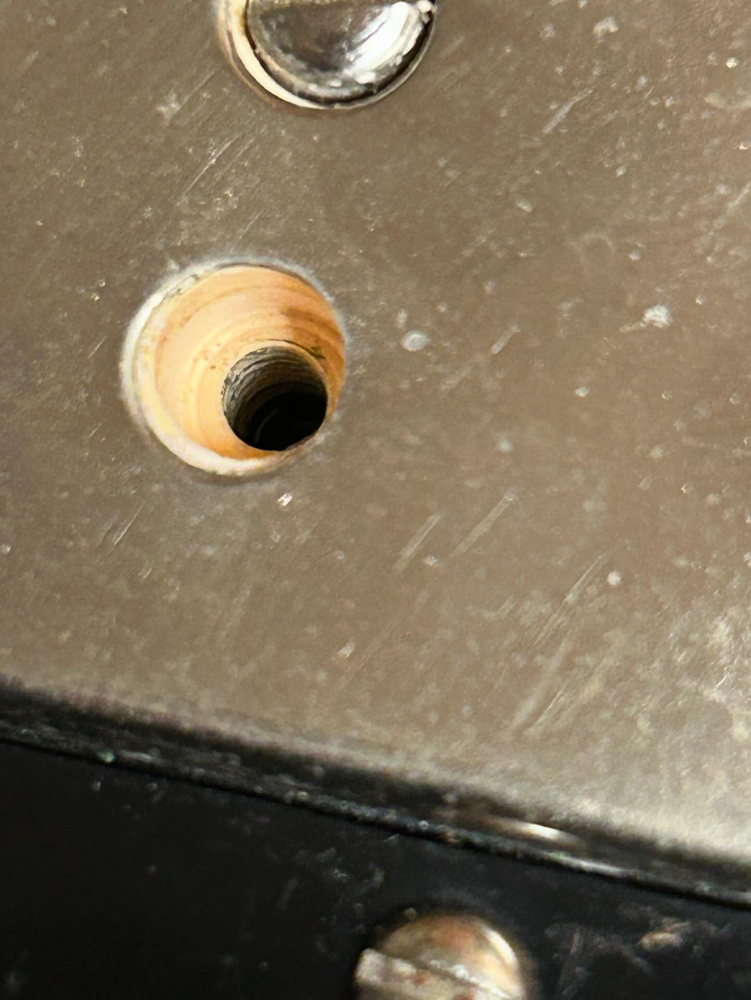
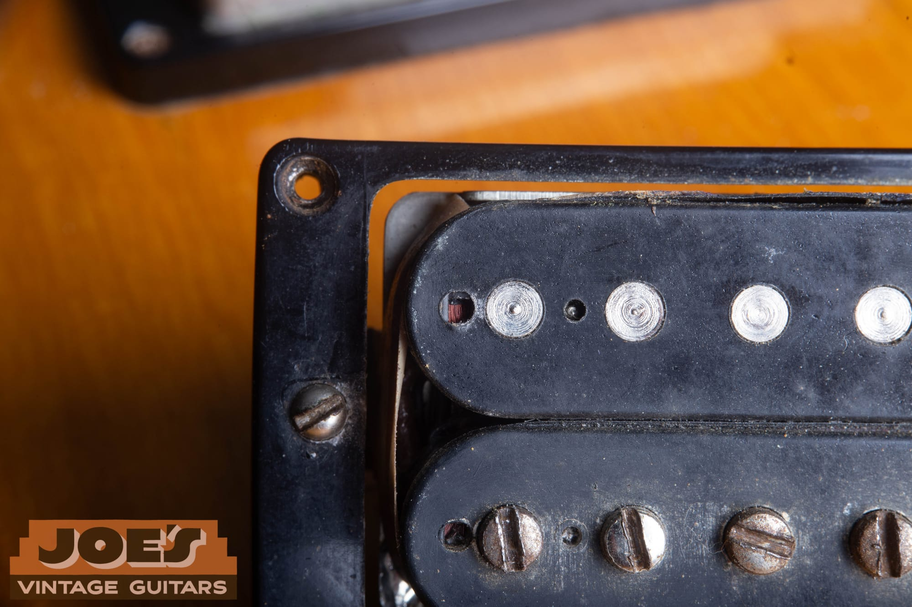
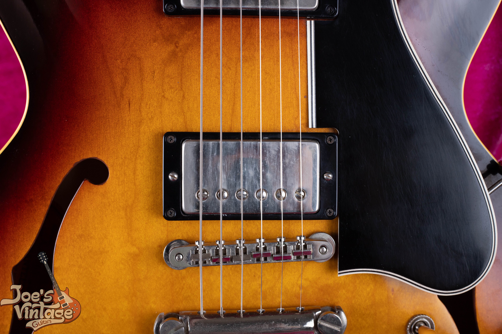
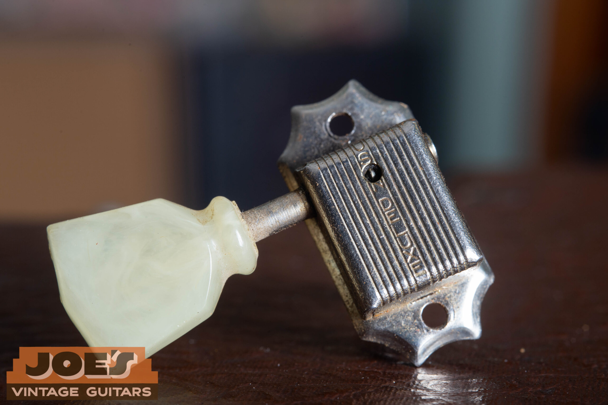

**A 1959 Les Paul Burst combines a sunburst maple top, mahogany body and two PAF humbuckers, with 643 Sunbursts recorded as shipped that year.** Its value depends on the individual guitar's finish, parts, repairs and documented history.

My full-guitar illustration is a **2022 R9 reissue, not a vintage 1959 Les Paul**. The close-ups show vintage parts from my existing guides, including ES-335s and earlier Goldtops. Each caption identifies the donor where documented so you can compare the feature in context.

## 1959 Les Paul Value

### How Much Is A 1959 Les Paul Worth?

My range for **1958 to 1960 Sunburst Standards is $200,000 to $500,000+**, which includes the 1959 Burst. These are US retail estimates for all-original guitars in excellent condition with the correct original case, reviewed in July 2026. My [vintage Les Paul value guide](/vintage-gibson-les-paul-market-value-guide/) explains the condition categories and how I compare guitars.

Original finish and PAFs strongly affect collector value; repairs, replacement parts and neck alterations can put a guitar outside the range. Within the category, I weigh the maple top's appearance, neck condition and documented provenance. I keep a refinished guitar or a modern R9 in its own price comparison.

<blockquote class="burst-expert-note">

<strong>Expert note from Joe Dampt</strong>

Provenance and original-owner photos can change my assessment of a 1959 Les Paul's value.

</blockquote>

<nav class="burst-inline-toc" aria-label="Article Contents">
<h2>Table Of Contents</h2>
<ul>
<li><a href="#1959-les-paul-value">1959 Les Paul Value</a></li>
<li><a href="#why-the-1959-standard-matters">The 1959 Standard In The Burst Timeline</a></li>
<li><a href="#1959-shipping-totals">1959 Shipping Totals</a></li>
<li><a href="#1959-specifications">1959 Specifications</a></li>
<li><a href="#what-joes-r9-photo-shows">What My R9 Photo Shows</a></li>
<li><a href="#maple-tops-and-sunburst-color">Maple Tops And Sunburst Color</a></li>
<li><a href="#neck-shape-frets-and-playability">Neck Shape, Frets And Playability</a></li>
<li><a href="#pafs-and-the-1959-sound">PAFs And The 1959 Sound</a></li>
<li><a href="#controls-bridge-and-small-parts">Controls, Bridge And Small Parts</a></li>
<li><a href="#dating-and-originality-checks">Dating And Originality Checks</a></li>
<li><a href="#r9-reissues-versus-original-1959-guitars">R9 Reissues Versus Original 1959 Guitars</a></li>
<li><a href="#resources-and-related-reading">Resources And Related Reading</a></li>
</ul>
</nav>

<h2 id="why-the-1959-standard-matters">The 1959 Standard In The Burst Timeline</h2>

1959 sits between the Goldtop-to-sunburst change of 1958 and the neck and hardware changes of 1960. The core construction continued: a single-cutaway mahogany body, carved maple top, two humbuckers, ABR-1 bridge and separate stopbar. I use that continuity to identify the model before examining details of the year.

The catalog wording followed its own timeline. My [Les Paul dating guide](/gibson-les-paul-dating-guide/) explains that the **1958 catalog still says Les Paul guitar or model, and the 1960 catalog is the first to use Les Paul Standard**. Standard is the familiar name used here for the 1959 carved-top Burst.

## 1959 Shipping Totals

### How Many 1959 Les Pauls Were Made?

Gibson's records show **643 Sunburst Les Pauls shipped in 1959**. That's the shipment total for the Burst branch, separate from Customs, Juniors and other Les Paul models. A ledger counts shipments, not surviving guitars or an exact assembly date for each instrument. My [Gibson shipping totals page](/post/gibson-shipping-totals-1948-1979/) shows the model-by-model figures.

The same table records **635 Sunbursts in 1960 and just 2 in 1961**. That steep drop supports 1960 as the last main production year of the single-cutaway Burst, while allowing for a small number of later shipments. The [1960 Standard guide](/post/1960-gibson-les-paul-standard-guide/#the-change-to-the-sg-body) follows the change to the SG body.

## 1959 Specifications

I use these specifications as the starting comparison, then describe each guitar's condition and service history separately.

| Feature | Typical 1959 Standard |
| --- | --- |
| Body | Mahogany back with a carved maple top and single cutaway |
| Finish | Cherry sunburst top with nitrocellulose lacquer |
| Neck | Set mahogany neck with a rounded profile |
| Fingerboard | Bound rosewood, trapezoid inlays, 22 frets |
| Scale | Nominal 24.75 inches |
| Pickups | Two PAF humbuckers |
| Controls | Two volumes, two tones and a three-way switch |
| Hardware | ABR-1 Tune-o-matic and separate tailpiece; nickel-finished hardware |
| Appearance | Cream trim, gold bonnet-style knobs and maple figure that varies by guitar |

The bound rosewood fingerboard, trapezoid inlays and cream body trim help distinguish this model from the other Les Paul branches. The [Les Paul family identification guide](/post/vintage-gibson-les-paul-family-guide/) compares the Standard with the Custom, Junior and Special.

<h2 id="what-joes-r9-photo-shows">What My R9 Photo Shows</h2>

My photographed **2022 Gibson R9 Les Paul Standard 1959 Reissue** has pronounced horizontal maple figure across a red-to-amber sunburst. Two covered humbuckers sit in cream rings beside the cream pickguard. The bridge, stopbar and four gold knobs show the Standard's layout clearly.

Compare its top with the plainer [2011 R8 illustration](/post/1958-gibson-les-paul-standard-guide/#reading-the-r8-photo). The difference is visible in these two modern guitars. It isn't a rule dividing every vintage 1958 top from every vintage 1959 top.

The R9 is a modern instrument throughout this discussion. Its finish, pickup covers, wear and vintage-style case illustrate a reissue's appearance. The vintage close-ups below provide separate examples of period construction, with their source models identified.

## Maple Tops And Sunburst Color

### Did Every 1959 Les Paul Have A Flame Top?

No. Maple figure varies, and a heavily striped top isn't a requirement for a 1959 Standard. Lighting and viewing angle also change how visible the figure is. I compare the wood's appearance separately from its date and condition. The [Les Paul dating guide](/gibson-les-paul-dating-guide/) explains how finish and construction fit into the identification.

A Burst's appearance combines the wood beneath the finish with the finish itself. Straight grain and flame figure describe different visual characteristics. Bookmatching describes the relationship between the pieces of wood, while the carved surface changes the way light reaches them.

The red dye can fade considerably. Names such as lemon, tea and honey describe colors collectors see today, so I distinguish that current appearance from the factory finish history. A protected area can retain more color than an exposed surface.

For useful photographs, include the complete top, binding and edges under consistent light. A straight-on beauty shot can conceal the carve in reflections. I also want to see any repaired or touched-up area clearly, before polishing or other work changes its appearance.

## Neck Shape, Frets And Playability

The 1959 neck is generally rounded, with variation in depth and shoulders between guitars. I describe the actual profile because the phrase “1959 neck” covers more than one feel. Fingerboard edges, fret height and setup also change the playing experience.

Wider fretwire is commonly associated with 1959 compared with the narrower 1958 specification. A refretted guitar may have wire chosen for a later owner's preference. I distinguish the installed frets from the factory specification and record any fingerboard or binding work.

### What's The Difference Between A 1959 And A 1960 Les Paul?

A 1959 Standard generally has a rounded neck, gold bonnet knobs and single-ring tuner buttons. Early 1960 guitars can resemble it, while later examples move toward slimmer necks, reflector knobs and double-ring buttons. Both years retain PAFs, the carved maple top and mahogany body. My [1960 Les Paul guide](/post/1960-gibson-les-paul-standard-guide/) shows the changes and comparison photos.

When you're evaluating playability, compare the guitar in your hands: remaining fret height, nut condition, neck relief and the bridge's adjustment room. A worn fret, a refret and a reshaped neck are separate findings. They explain more about the individual guitar than a promise that every 1959 neck feels the same.

## PAFs And The 1959 Sound

PAF stands for Patent Applied For, the wording on the early Gibson humbucker's familiar baseplate decal. The pickup reached Les Pauls during 1957, before the Burst finish arrived. Each humbucker uses two coils, one with adjustable pole screws and one with steel slugs, above a bar magnet.

The [PAF and patent-number pickup guide](/post/gibson-paf-patent-number-pickup-guide/) explains the baseplate, bobbins, leads, magnets and winding details. I assess them together, including any rewind or replacement component. A resistance reading adds electrical information to that description, while the guitar's controls and setup affect the playing comparison.

<figure class="burst-feature-photo">

<figcaption><strong>1962 ES-335, PAF Example.</strong> The Patent Applied For decal, baseplate, lead and cover joints illustrate the pickup family used on the 1959 Standard. This example comes from a later ES-335. See the <a href="/post/gibson-paf-patent-number-pickup-guide/#paf-what">documented ES-335 PAF</a>.</figcaption>
</figure>

### Bobbin Color And Pickup Covers

**From spring 1959 into mid 1960, Gibson's bobbin supplier ran short of black material and shipped cream bobbins, which were mixed into production as they arrived.** That supply window explains the black, zebra and double-white combinations described in my [PAF bobbin-color reference](/post/gibson-paf-patent-number-pickup-guide/#paf-open).

### What Is A Zebra PAF Pickup?

A zebra is **one pickup with one black bobbin and one cream bobbin**. On PAF zebras, the cream bobbin is almost always the slug coil. Two cream bobbins in one pickup are called double white. My [PAF guide](/post/gibson-paf-patent-number-pickup-guide/#paf-open) connects these combinations to the supplier's spring 1959 to mid 1960 cream-bobbin window.

The distinction applies inside each pickup, rather than to the neck and bridge pickups as a pair. Covers conceal the bobbins, so I keep cover condition and solder history separate from the color description. Leave an intact cover in place for an initial review.

<figure class="burst-feature-photo">

<figcaption><strong>1959 ES-335, Cream Bobbin Detail.</strong> Cream material is visible through a pole-screw opening in this existing inspection photo. It shows one bobbin; the other remains hidden. The <a href="/post/1959-gibson-es-335-authentication-guide/">1959 ES-335 guide</a> records the source guitar.</figcaption>
</figure>

The ES-335 photograph reveals cream material at one pole-screw opening. It provides a close view of that bobbin without showing the color of the other one. The open-pickup photograph below shows black bobbins and the slug side of the construction.

<figure class="burst-feature-photo">

<figcaption><strong>Already-Open PAF From My Pickup Guide.</strong> Black bobbins, round steel slugs and a glimpse of winding wire provide a second construction example. The source doesn't assign this pickup to a 1959 Les Paul. See the <a href="/post/gibson-paf-patent-number-pickup-guide/#paf-open">open-pickup reference</a>.</figcaption>
</figure>

## Controls, Bridge And Small Parts

Each pickup has a volume and tone control, with a three-way selector for the neck, bridge or combined setting. I listen through the switch positions and move the controls through their travel. A description should record intermittent controls or repair work alongside the component information.

Inside the cavity, the pots, capacitors and solder provide another view of the guitar's history. The [Gibson pot-code reference](/gibson-pot-codes/) explains component-maker and date markings. I compare those markings with the installation and service records.

<figure class="burst-feature-photo">

<figcaption><strong>1957 Les Paul Goldtop, Bumblebee Capacitors.</strong> These striped black capacitors illustrate the period component style discussed here. The source guitar is an earlier Goldtop. See the <a href="/post/1957-les-paul-goldtop-guide/">Goldtop electronics example</a>.</figcaption>
</figure>

The ABR-1 bridge and stopbar form separate assemblies. The bridge has individual saddles and height-adjustment wheels; the stopbar anchors the strings behind it. The same-year ES-335 below makes that arrangement visible at close range.

<figure class="burst-feature-photo">

<figcaption><strong>1959 ES-335, Bridge And Tailpiece.</strong> This same-year Gibson shows the ABR-1 bridge, six metal saddles, height-adjustment wheels and separate stopbar. Its black plastics belong to the ES-335. Compare the <a href="/post/1959-gibson-es-335-authentication-guide/">1959 ES-335 construction details</a>.</figcaption>
</figure>

On the tuners, one line of Kluson Deluxe lettering identifies the casing style, while one molded ring identifies the button style. These are separate details. The [Kluson tuner chronology](/gibson-tuner-dating-guide/) shows both and explains how to compare them with the mounting evidence.

<figure class="burst-feature-photo">

<figcaption><strong>1956 Les Paul, Kluson Close-Up.</strong> One vertical line of lettering and one molded button ring show the tuner combination associated with the 1959 Standard. This example comes from an earlier Les Paul. See the <a href="/gibson-tuner-dating-guide/#single-line-kluson">Kluson casing and button chronology</a>.</figcaption>
</figure>

The gold bonnet knobs have plain tops without the metal inserts of later reflectors. Cream rings and pickguard accompany the Standard's covered humbuckers. The [Gibson knob guide](/gibson-knob-dating-guide/) supplies closer comparisons between the bonnet and reflector shapes.

<figure class="burst-feature-photo">

<figcaption><strong>1956 Les Paul Goldtop, Bonnet Knob.</strong> The numbered skirt and plain top illustrate the gold knob style associated with 1959 Standards. This is a vintage part on an earlier Goldtop. Compare the <a href="/post/1960-gibson-les-paul-standard-guide/#reflector-knobs-and-double-ring-tuners">1960 knob and tuner examples</a>.</figcaption>
</figure>

## Dating And Originality Checks

A vintage 1959 solidbody typically has an ink-stamped serial beginning with 9 on the back of the headstock. The full number, spacing and surrounding finish belong in the photograph. A modern R9 can use a very similar format.

Historic reissues use the common **M YNNN** format described in my [Les Paul dating guide](/gibson-les-paul-dating-guide/). M identifies the year being reissued: 8 for 1958, 9 for 1959 or 0 for 1960. Y is the last digit of the year the reissue was built, followed by its production sequence.

The examples show why I check the instrument and its paperwork together:

- A **2011 R8** reads **8 1xxx**: 8 identifies the 1958 design and 1 the build year's last digit.
- A **2022 R9** reads **9 2xxx**. That format looks just like a vintage 1959 serial.
- The **2014 R0's 0 4285** identifies a 1960 reissue, with 4 matching its documented 2014 build year.

The build-year digit repeats each decade. I use the paperwork and physical features to establish the decade; the serial's 4 alone doesn't distinguish 2014 from another year ending in 4.

### How Can I Tell A Real 1959 Les Paul From An R9?

I check construction, components and paperwork alongside the serial. A 2022 R9 can read 9 2xxx, which looks like a real 1959 serial. In the reissue format, 9 identifies the 1959 design and 2 is the build year's last digit. My [Les Paul dating guide](/gibson-les-paul-dating-guide/) explains how the physical evidence resolves the decade and model.

### My Short Originality Checklist

- **Finish And Wood:** Factory finish, touch-up or refinish; headstock, heel and body repairs.
- **Pickups And Controls:** PAF construction, coil repairs, component dates and solder history.
- **Neck And Hardware:** Neck reshaping, fret work, tuner holes and replaced bridge or plastics.
- **Records:** Serial, ownership history, case, receipts and retained parts that agree with the guitar.

My [Les Paul dating and identification guide](/gibson-les-paul-dating-guide/) covers the full inspection sequence. I keep the findings specific so a refret, a pickup rewind and a repaired headstock each get their own description.

An older Goldtop converted to humbuckers and a sunburst finish also needs its own description. The conversion's starting model, routes, finish and hardware work remain part of its history. I separate that category from a factory 1959 Burst when assessing the guitar.

## R9 Reissues Versus Original 1959 Guitars

R9 identifies a modern Historic interpretation of the 1959 design. I establish its manufacturing year, exact model and condition from the instrument and documentation. A certificate is useful when it agrees with the guitar's details.

Historic specifications have changed over time, so I use documentation for the particular reissue. For the pictured guitar, that means a 2022 R9. Its price belongs with modern examples of that model and condition, rather than the vintage range at the beginning of this article.

For the adjacent vintage years, compare the [1958 Goldtop and Burst specifications](/post/1958-gibson-les-paul-standard-guide/) and [1960 neck, knob and tuner changes](/post/1960-gibson-les-paul-standard-guide/). Those comparisons help explain the design being recreated.

## Resources And Related Reading

- [Les Paul dating guide](/gibson-les-paul-dating-guide/): model history, catalog names and Historic serial numbers.
- [PAF and patent-number pickup guide](/post/gibson-paf-patent-number-pickup-guide/): bobbin colors, construction and inspection details.
- [Gibson shipping totals](/post/gibson-shipping-totals-1948-1979/): 1959, 1960 and final 1961 Sunburst shipments.
- [Vintage Les Paul value guide](/vintage-gibson-les-paul-market-value-guide/): price categories and condition comparisons.

## Send Me Your Les Paul's Details

Send front and back photographs, the serial and both sides of the headstock, neck heel, hardware, case and known repairs. Add ownership history and service receipts so I can compare the physical details with the records.

Call me at [(602) 900-6635](tel:+16029006635), [send your photographs and questions](/contact-me/), or read about [selling your Gibson guitar](/sell-my-gibson-guitar/). You can also [read about my background](/about-me/) before arranging a review.
