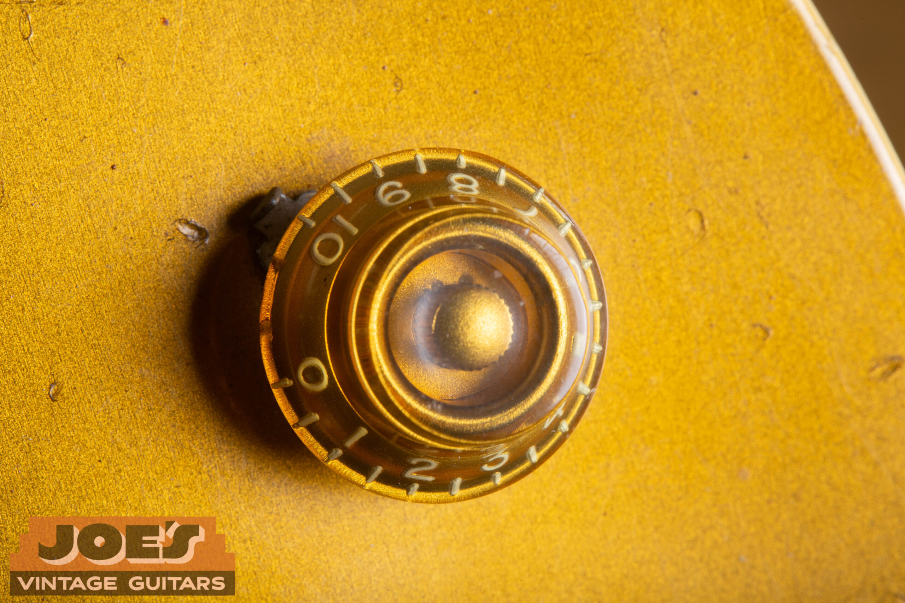
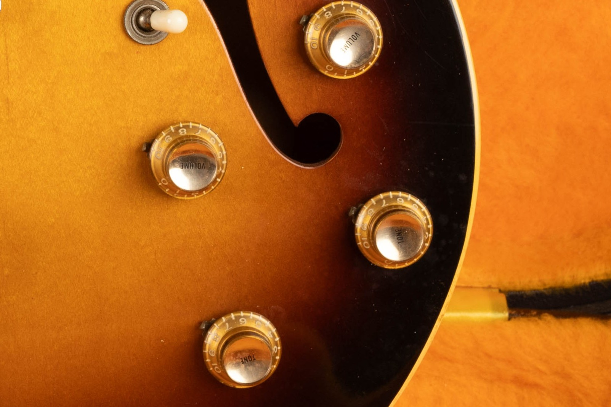
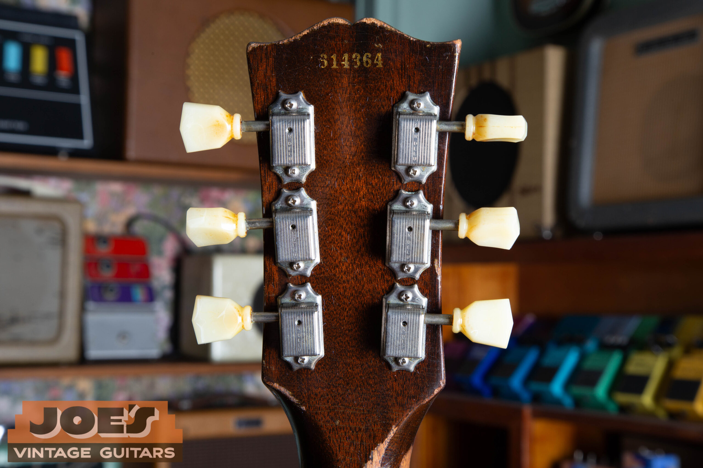
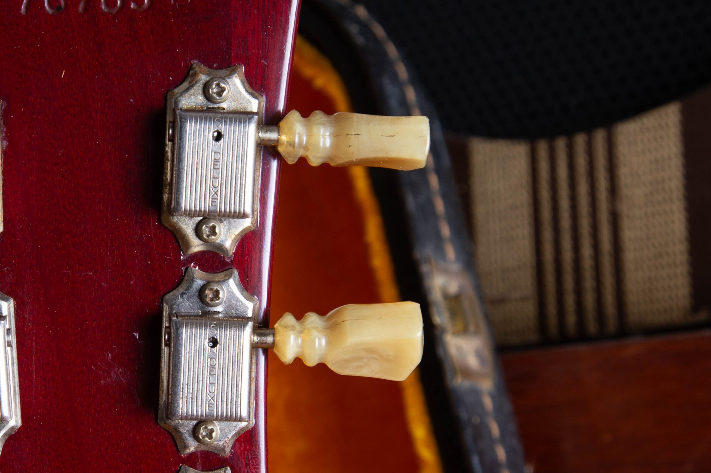
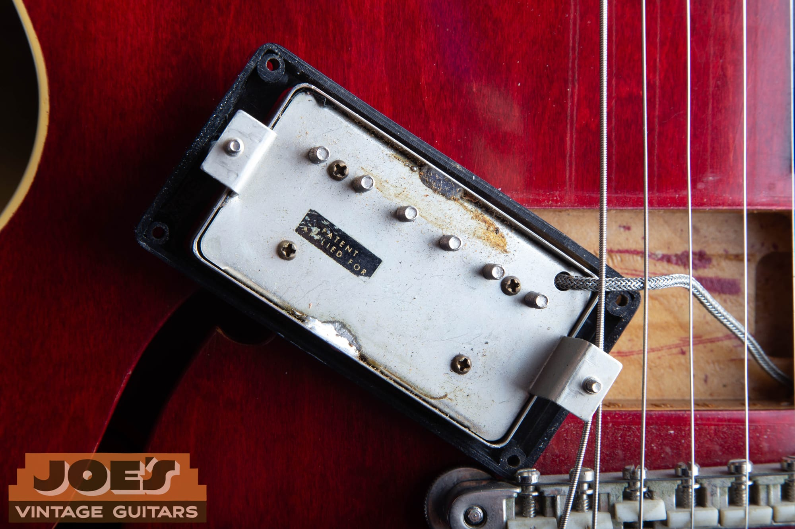
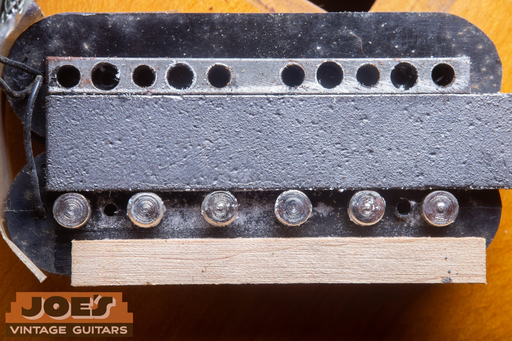
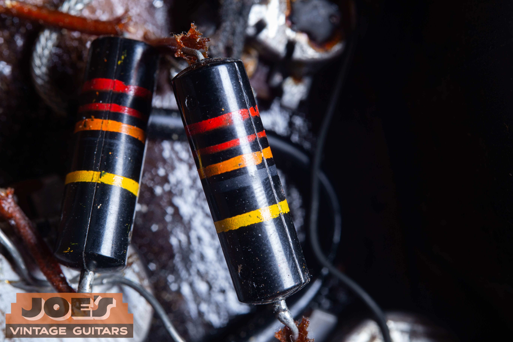
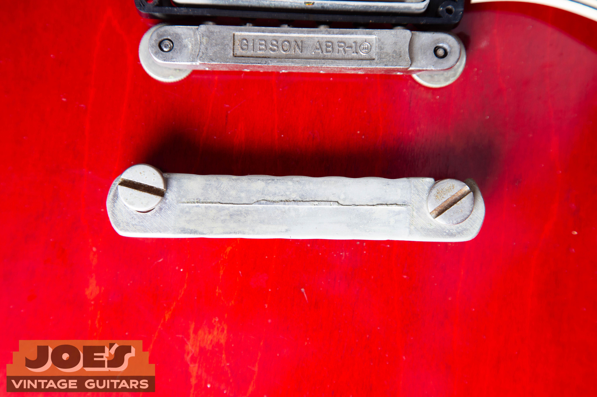

**1960 was the last main production year of the single-cutaway Les Paul Burst, with neck and hardware changes within the year.** I compare those details alongside the finish, PAFs and repair history when assessing its value.

My full-guitar photo shows a **2014 R0 reissue, not a vintage 1960 example**. The detail photographs show vintage parts from my existing guides, including bonnet and reflector knobs and single-ring and double-ring tuner buttons. Captions identify the source guitars where documented.

## 1960 Les Paul Value

### How Much Is A 1960 Les Paul Worth?

My range for **1958 to 1960 Sunburst Standards is $315,350 to $501,650+**, including the 1960 Burst. These are US retail estimates for all-original guitars in excellent condition with the correct original case, reviewed in July 2026. My [vintage Les Paul value guide](/vintage-gibson-les-paul-market-value-guide/) explains the range and the comparisons behind it.

Original finish and PAFs carry much of the collector value, while repairs, replaced components and neck alterations can put a guitar outside that range. I consider the neck's condition and documented provenance alongside the finish and parts. In my experience, a 1960 sits toward the lower end of that range, and a 1960 with a fuller 1959-style neck is worth more.

<blockquote class="burst-expert-note">

<strong>Expert note from Joe Dampt</strong>

The slim neck is a turnoff for many players and collectors, making 1960 the least expensive Burst year in my experience. Necks vary, though, and I'd value a 1960 with a 1959-style profile more highly.

</blockquote>

For a value specific to your guitar, [send me photos for a Gibson appraisal](/free-appraisal/gibson/).

### The 1960 Catalog Price

Gibson's [1960 catalog](https://www.vintageguitarandbass.com/gibson/catalogues/1960_10.php) lists the Cherry Sunburst Les Paul Standard at **$265**, with the plush-lined case priced separately at **$42.50**. Those are the catalog's US prices at the time. I keep that new-guitar price separate from today's vintage appraisal range.

<nav class="burst-inline-toc" aria-label="Article Contents">
<h2>Table Of Contents</h2>
<ul>
<li><a href="#1960-les-paul-value">1960 Les Paul Value</a></li>
<li><a href="#1960-was-a-transition-year">1960 Was A Transition Year</a></li>
<li><a href="#1960-shipping-totals">1960 Shipping Totals</a></li>
<li><a href="#1960-specifications">1960 Specifications</a></li>
<li><a href="#what-joes-r0-photo-shows">What My R0 Photo Shows</a></li>
<li><a href="#neck-profiles-and-frets">Neck Profiles And Frets</a></li>
<li><a href="#reflector-knobs-and-double-ring-tuners">Reflector Knobs And Double-Ring Tuners</a></li>
<li><a href="#sunburst-finishes-and-maple-tops">Sunburst Finishes And Maple Tops</a></li>
<li><a href="#paf-pickups-controls-and-bridge">PAF Pickups, Controls And Bridge</a></li>
<li><a href="#serial-numbers-and-originality">Serial Numbers And Originality</a></li>
<li><a href="#the-change-to-the-sg-body">The Change To The SG Body</a></li>
<li><a href="#r0-reissues-and-other-1960-style-les-pauls">R0 Reissues And Other 1960-Style Les Pauls</a></li>
<li><a href="#resources-and-related-reading">Resources And Related Reading</a></li>
</ul>
</nav>

## 1960 Was A Transition Year

The name also has a catalog date. My [Les Paul dating guide](/gibson-les-paul-dating-guide/) explains that the **1958 catalog still calls it the Les Paul guitar or model, and the 1960 catalog is the first to say Les Paul Standard**. That wording accompanies the familiar single-cutaway Burst before the body change that followed.

My [1958 Les Paul guide](/post/1958-gibson-les-paul-standard-guide/) follows the earlier Goldtop-to-sunburst change. The carved maple top, mahogany body, two PAFs, ABR-1 and stopbar continued into 1960 while the neck and smaller appointments changed.

## 1960 Shipping Totals

### How Many 1960 Les Pauls Were Made?

Gibson recorded **635 Sunburst Les Pauls shipped in 1960**, compared with **643 in 1959 and just 2 in 1961**. These are shipment totals for the Burst branch, not survivor counts or totals for every Les Paul model. My [Gibson shipping totals page](/post/gibson-shipping-totals-1948-1979/) documents the figures, which support 1960 as the last main single-cutaway Burst production year.

The two later shipments are useful context for the transition. A shipment year records when a guitar went out, rather than necessarily when it was assembled. I distinguish that ledger entry from the larger change to the thin, double-cutaway SG body.

## 1960 Specifications

The core construction remained familiar. Neck profile, knobs, tuner buttons and finish appearance require a closer comparison within the year.

| Area | Usual 1960 Standard Specification |
| --- | --- |
| Body | Single-cutaway mahogany back and carved maple top |
| Neck | One-piece mahogany; fuller early profiles and slimmer later profiles |
| Fingerboard | Bound rosewood with trapezoid inlays, 22 frets |
| Scale Length | Nominal 24.75 inches |
| Factory Frets | Wide wire carried over from 1959 |
| Pickups | Two PAF humbuckers |
| Controls | Two volumes, two tones and a three-way switch |
| Bridge | ABR-1 Tune-o-matic with a separate tailpiece |
| Knobs | Earlier bonnet-style and later reflector-style appointments |
| Tuners | Single-line Kluson Deluxe; single-ring buttons until around mid-1960, then double-ring |
| Finish | Cherry Sunburst; later examples use brighter, more fade-resistant red |

The [original 1960 Gibson catalog, page 10](https://www.vintageguitarandbass.com/gibson/catalogues/1960_10.php), specifies a one-piece mahogany neck, rosewood fingerboard, 22 frets and 24.75-inch scale. It also advertises the low, wide frets and slim neck associated with the later 1960 design.

These specifications belong to the Standard branch. A Junior, Special or Custom needs its own comparison. My [Les Paul family identification guide](/post/vintage-gibson-les-paul-family-guide/) shows the differences in body construction, trim and pickup layout.

<h2 id="what-joes-r0-photo-shows">What My R0 Photo Shows</h2>

My **2014 Gibson Custom Shop R0 reissue** has visible maple figure, a shaded sunburst, two covered humbuckers, cream pickup rings and a cream pickguard. Its four gold knobs have reflective inserts. You can see those inserts in the front photograph above.

Compare the knobs with the gold bonnet styles on my [2011 R8 illustration](/post/1958-gibson-les-paul-standard-guide/#reading-the-r8-photo) and [2022 R9 illustration](/post/1959-gibson-les-paul-standard-guide/#what-joes-r9-photo-shows). These modern reissues help explain the visible design differences. The vintage knob and tuner close-ups below provide separate period-part examples.

## Neck Profiles And Frets

### Did Every 1960 Les Paul Have A Thin Neck?

No. Early 1960 examples can retain a fuller profile associated with 1959, while later guitars move toward slimmer necks. I compare depth, shoulders, fret condition and any reshaping together.

Published measurements give the difference some scale. [Well Strung Guitars' measurements of its own inventory](https://wellstrungguitars.com/the-history-of-gibsons-burst-by-year/) include early 1959 examples around **0.92 inches at the first fret and 1.00 inch at the twelfth**, compared with some slim 1960 examples at **0.80 to 0.84 inches and 0.88 to 0.94 inches**, respectively. They're that dealer's observations, not measurements of my pictured R0 or fixed specifications for every Burst.

Wide fretwire continued into 1960. A quality refret is accepted maintenance; I still describe an otherwise all-original 1960 as "all original," though it's no longer museum quality. The [Les Paul value guide's condition notes](/vintage-gibson-les-paul-market-value-guide/) cover how fret work affects value.

A neck shave is different from a refret because it removes wood from the profile. Repairs and reshaping belong in the condition description. That keeps a factory slim neck and a neck altered after manufacture from being treated as the same history.

### What's The Difference Between A 1959 And A 1960 Les Paul?

Early 1960 guitars can resemble 1959, while later examples move toward slimmer necks and reflector knobs. Double-ring tuner buttons appear around mid-1960. Both years have PAF humbuckers, a carved maple top, mahogany body, ABR-1 bridge and stopbar. My [1959 Les Paul guide](/post/1959-gibson-les-paul-standard-guide/) provides the preceding year's specifications and comparison photos.

## Reflector Knobs And Double-Ring Tuners

Gold reflector knobs have contrasting inserts on top marked Volume or Tone. They're associated with the later 1960 appearance. Earlier bonnet knobs have a plain top without that metal insert.

The photographs compare those shapes on other vintage Gibsons. The 1956 Goldtop supplies the earlier bonnet example, and the 1960s ES-330 supplies the reflector example. The source guitars are different models, but the knob styles make the distinction visible.

<figure class="burst-feature-photo">

<figcaption><strong>Earlier Bonnet Style: 1956 Les Paul Goldtop.</strong> The top has no metal Volume or Tone insert. This earlier Goldtop illustrates the bonnet style that can appear on early 1960 Standards. Compare the <a href="/gibson-knob-dating-guide/#bonnet-knob">bonnet knob reference</a>.</figcaption>
</figure>

<figure class="burst-feature-photo">

<figcaption><strong>Reflector Style: 1960s ES-330.</strong> Metal Volume and Tone inserts distinguish these gold knobs from the bonnet example. This ES-330 illustrates the style associated with later 1960 Standards. See the <a href="/post/complete-dot-neck-es-330-guide-1959-1962/">ES-330 knob examples</a>.</figcaption>
</figure>

My [Gibson tuner dating guide](/gibson-tuner-dating-guide/) places the single-ring to double-ring change around mid-1960, with some overlap by model and stock. “Ring” describes the molded collar at the plastic button's base: one on a single-ring button and two on a double-ring button. “Line” describes the Kluson Deluxe lettering on the metal housing, which is a separate feature.

The ES-335 close-up below shows two button rings alongside single-line housings. I compare the button shape and casing lettering separately.

<figure class="burst-feature-photo">

<figcaption><strong>Single-Ring Buttons On A Vintage Gibson.</strong> Look for one molded collar at the base of each button. The source identifies a vintage Gibson, without specifying its model or year. See the <a href="/gibson-tuner-dating-guide/">tuner button comparison guide</a>.</figcaption>
</figure>

<figure class="burst-feature-photo">

<figcaption><strong>Double-Ring Buttons: 1962 ES-335 Detail.</strong> Two molded rings sit beside metal covers that read Kluson Deluxe in one line. This later ES-335 shows the difference between button rings and housing lettering. The <a href="/post/1962-gibson-es-335-guide/">1962 ES-335 hardware guide</a> identifies the source guitar.</figcaption>
</figure>

Buttons can be replaced while the metal mechanisms stay in place, or a complete tuner set can be changed. I record which work occurred and look at the mounting holes and surrounding finish.

## Sunburst Finishes And Maple Tops

**Later 1960 Bursts can retain a brighter red because Gibson moved to a more colorfast finish.** Gibson's [historical account of the 1960 changes](https://www.themusiczoo.com/blogs/news/50th-anniversary-gibson-1960-les-paul-standard), reproduced with its anniversary-model announcement, distinguishes that later finish from the earlier, more fade-prone cherry. Collectors often call the stronger late color “tomato soup.”

Early 1960 examples can fade much like 1959 guitars. I compare today's exposed color with protected areas and the repair history, rather than treating a bright red top as automatic evidence of a refinish. Complete-top, binding and edge photographs under consistent light help make that comparison.

Maple figure and fade affect collector interest, as the value guide explains. I describe the pictured R0's figured top as a feature of that modern guitar, keeping its appearance separate from the vintage guitar being assessed.

## PAF Pickups, Controls And Bridge

The 1960 Standard retained two PAF humbuckers. Each pickup has two bobbins above a bar magnet, with adjustable pole screws in one coil and steel slugs in the other. The baseplate, braided lead, cover solder and decal are part of the inspection described in my [PAF pickup guide](/post/gibson-paf-patent-number-pickup-guide/).

**The cream-bobbin window ran from spring 1959 into mid 1960.** Gibson's supplier ran short of black material and shipped cream bobbins, which entered production as they arrived. A zebra has one black and one cream bobbin in the same pickup; the cream is almost always the slug coil. Two cream bobbins are called double white.

That supply history carries into the 1960 discussion rather than ending at the 1959 calendar boundary. The [1959 guide's bobbin close-ups](/post/1959-gibson-les-paul-standard-guide/#bobbin-color-and-pickup-covers) show cream material in a covered ES-335 pickup and black bobbins in an already-open PAF.

<figure class="burst-feature-photo">

<figcaption><strong>1962 ES-335, PAF Baseplate.</strong> This later Gibson carries a Patent Applied For decal. Compare the lead, baseplate and cover solder with the <a href="/post/gibson-paf-patent-number-pickup-guide/#paf-sticker">PAF sticker reference</a>.</figcaption>
</figure>

The open-pickup photograph below shows the parts beneath the bobbins. I use existing inspection photographs for this explanation and leave intact covers soldered for an initial review. A later rewind or changed component gets its own entry in the pickup's description.

<figure class="burst-feature-photo">

<figcaption><strong>Opened Vintage PAF, Construction Detail.</strong> The bar magnet sits between the metal keeper and exposed slug ends, with a wooden spacer along the edge. This existing bench photo isn't assigned to a 1960 Les Paul. See the <a href="/post/gibson-paf-patent-number-pickup-guide/#paf-anatomy">PAF construction photographs</a>.</figcaption>
</figure>

The Standard's four knobs give each pickup a volume and tone control. The three-way switch selects the neck pickup, bridge pickup or both. I check the controls through their range and compare the wiring, solder and component dates with any service records.

<figure class="burst-feature-photo">

<figcaption><strong>1957 Les Paul Goldtop, Capacitor Detail.</strong> The striped Bumblebee capacitors provide a period component reference. This is an earlier Goldtop's wiring assembly. See the <a href="/post/1957-les-paul-goldtop-guide/">1957 Goldtop electronics guide</a>.</figcaption>
</figure>

The ABR-1 bridge and stopbar are separate components. The underside photograph shows the bridge marking and the tailpiece as distinct assemblies. Saddles, mounting and any changed hardware belong in the condition report. The [Gibson pot-code reference](/gibson-pot-codes/) supplies the component-date reading for the electrical side of the assessment.

<figure class="burst-feature-photo">

<figcaption><strong>1962 ES-335, Bridge And Stopbar Undersides.</strong> The Gibson ABR-1 marking is visible on the bridge above the separate tailpiece. This later ES-335 illustrates the hardware construction discussed here. Compare the <a href="/post/1962-gibson-es-335-guide/">1962 ES-335 bridge and tailpiece reference</a>.</figcaption>
</figure>

## Serial Numbers And Originality

### How Can I Tell A Real 1960 Les Paul From An R0?

A leading 0 can belong to a vintage 1960 Les Paul or an R0, so I check construction and paperwork with my [Les Paul dating guide](/gibson-les-paul-dating-guide/). The [Historic serial explanation in my 1959 guide](/post/1959-gibson-les-paul-standard-guide/#dating-and-originality-checks) shows how to read the reissue's build-year digit and resolve the decade.

- The **2014 R0's 0 4285** identifies a 1960 reissue, with 4 matching its documented 2014 build year.

### My 1960 Originality Checklist

- **Factory Neck Profile Or Neck Shave:** Separate a factory slim or fuller neck from later wood removal and associated finish work.
- **Replaced Knobs Or Buttons:** Record bonnet or reflector knobs and single-ring or double-ring buttons, including replacements.
- **Tuner Mounting And Headstock:** Check changed holes, old tuner impressions, repairs and the surrounding finish.
- **PAFs And Controls:** Describe pickup repairs, changed pots and solder work alongside the service history.

I use those findings to distinguish a factory combination of 1960 features from later alterations. My [Les Paul dating workflow](/gibson-les-paul-dating-guide/) covers the wider model and component comparison.

## The Change To The SG Body

### Is A 1961 Les Paul Standard The Same Guitar As A 1960?

The usual 1961 Les Paul Standard has the thinner, double-cutaway body later known as the SG, while the 1960 Burst has the carved-top single-cutaway body. The shipping ledger also records two Sunbursts shipped in 1961. I identify the body design before comparing values; my [Gibson shipping totals](/post/gibson-shipping-totals-1948-1979/) separate those records.

For a guitar with the pointed double-cutaway body, use the [SG family guide](/post/vintage-gibson-sg-family-guide/) and [SG dating guide](/gibson-sg-dating-guide/). The Les Paul name alone spans different construction at this transition.

## R0 Reissues And Other 1960-Style Les Pauls

R0 is shorthand for a Historic 1960 Les Paul Standard reissue. I establish its actual manufacturing year, exact series and condition from the guitar and its documentation. The photographed example belongs to 2014, with modern components recreating the earlier design.

The Les Paul Classic is a separate branch from the Historic R0 in my dating guide. I confirm the exact model and production run from the paperwork, then compare the guitar's construction and serial format with that record.

If you're comparing an R0, it belongs in a modern price comparison. The vintage range at the beginning of this guide applies to the stated condition category of 1958 to 1960 Sunburst Standards. My [Les Paul value guide](/vintage-gibson-les-paul-market-value-guide/) explains how I separate the model and condition categories.

## Resources And Related Reading

- [Les Paul dating guide](/gibson-les-paul-dating-guide/): catalog terminology, model branches and Historic serial interpretation.
- [PAF and patent-number pickup guide](/post/gibson-paf-patent-number-pickup-guide/): the cream-bobbin window and pickup construction.
- [Gibson tuner dating guide](/gibson-tuner-dating-guide/): the single-ring to double-ring button change around mid-1960.
- [Gibson shipping totals](/post/gibson-shipping-totals-1948-1979/): Sunburst shipments through 1961.
- [Vintage Les Paul value guide](/vintage-gibson-les-paul-market-value-guide/): price ranges and condition categories.

## Send Me Your 1960 Les Paul Photos

Include the complete front and back, both sides of the headstock, serial, tuner backs, knobs, bridge, neck heel and repaired areas. Add the case, paperwork and what you know about ownership and service work so I can review the history with the photographs.

Request a [Gibson appraisal](/free-appraisal/gibson/), call me at [(602) 900-6635](tel:+16029006635), or [send me your photographs](/contact-me/). You can [read about my background](/about-me/) before arranging a review.
