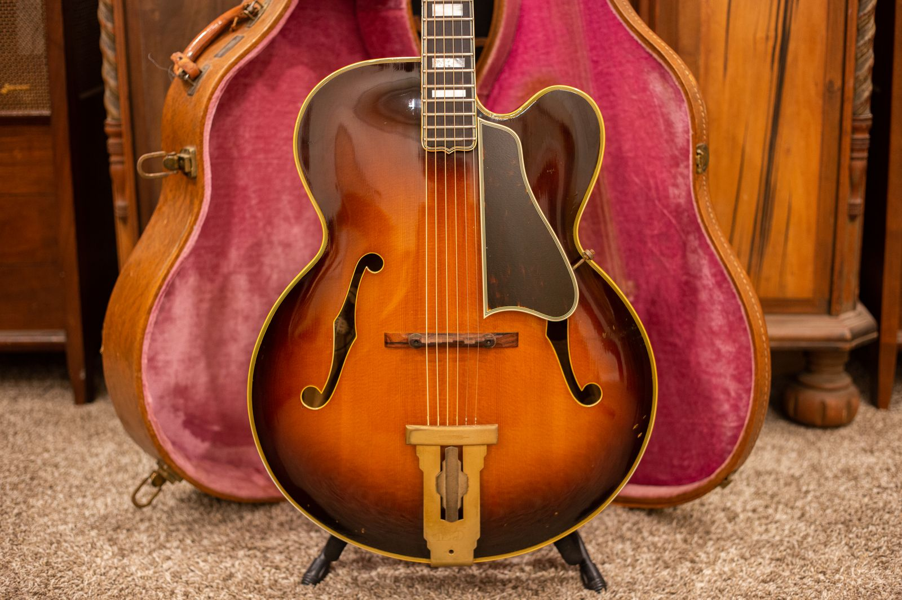
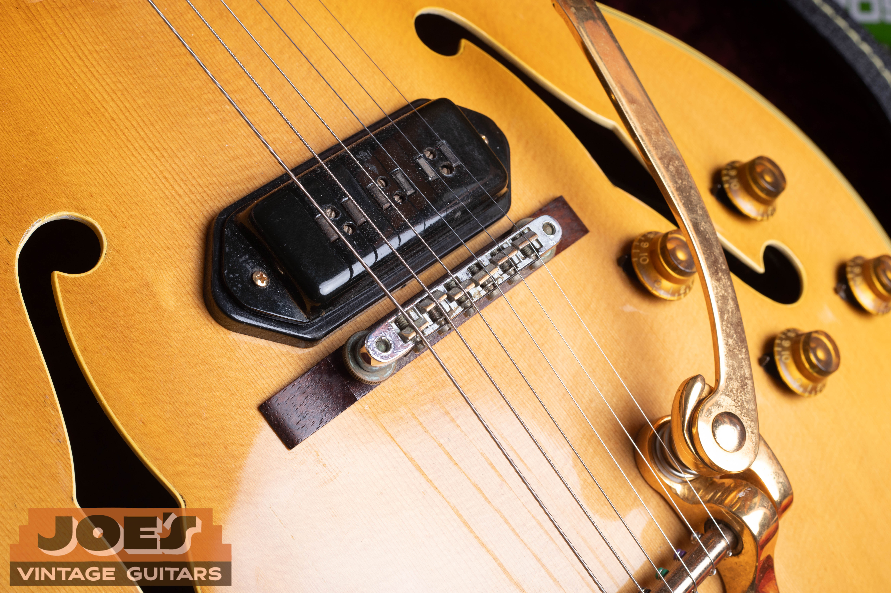
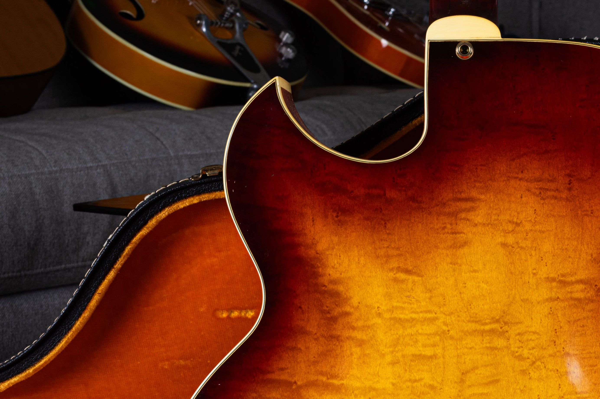
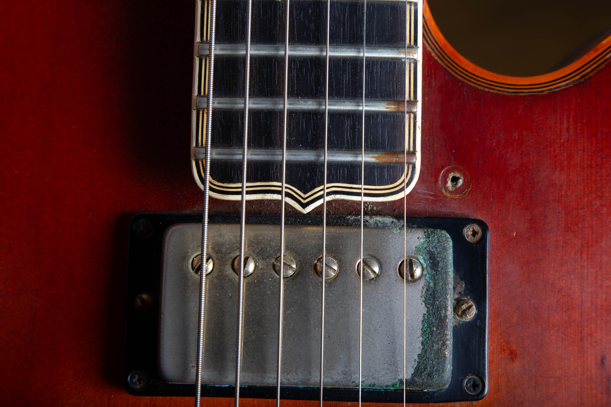
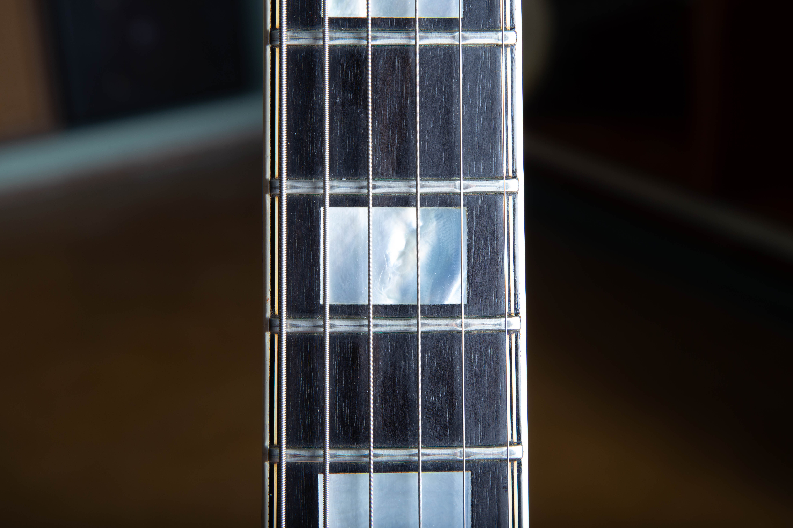
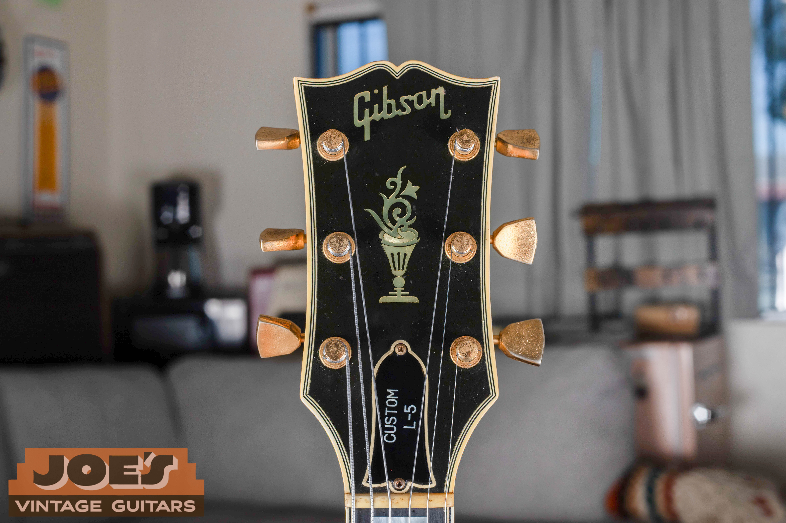

An all-original 1970s Gibson L-5 CES in excellent condition with its original case has a guide range of $7,000 to $9,000. Earlier PAF examples sit at $18,000 to $29,000, with year, finish and pickup configuration determining the appropriate group. I assess the actual instrument and its repairs before narrowing its value.

## Gibson L-5 CES Values By Year

These guide ranges were reviewed in October 2026. They assume an all-original guitar in excellent condition with its original case, standard sunburst or natural finish and no structural repairs. An actual offer depends on the instrument and the terms of the sale.

Each year is listed through 1979, and adjacent years can share an era or configuration range. The exact finish, pickups and condition help narrow an appraisal. An individual guitar's construction and condition determine its place within an era.

| Year | Configuration | Value Range |
| --- | --- | --- |
| 1951 | Single-Coil Reference | $18,000 to $25,000 |
| 1952 | Single-Coil Reference | $18,000 to $25,000 |
| 1953 | Single-Coil Reference | $18,000 to $25,000 |
| 1954 | Single-Coil Reference | $18,000 to $25,000 |
| 1955 | Single-Coil Reference | $18,000 to $25,000 |
| 1956 | Single-Coil Reference | $18,000 to $25,000 |
| 1957 | Single-Coil Reference | $18,000 to $25,000 |
| 1957 | Original PAF Pair | $18,000 to $29,000 |
| 1958 | Original PAF Pair | $18,000 to $29,000 |
| 1959 | Original PAF Pair | $18,000 to $29,000 |
| 1960 | Original PAF Pair | $18,000 to $29,000 |
| 1961 | Original PAF Pair | $18,000 to $29,000 |
| 1962 | Original PAF Pair | $18,000 to $29,000 |
| 1963 | Patent Number Era | $8,500 to $20,000 |
| 1964 | Patent Number Era | $8,500 to $20,000 |
| 1965 | Patent Number Era | $8,500 to $20,000 |
| 1966 | Patent Number Era | $8,500 to $20,000 |
| 1967 | Patent Number Era | $8,500 to $20,000 |
| 1968 | Patent Number Era | $8,500 to $20,000 |
| 1969 | Patent Number Era | $8,500 to $20,000 |
| 1970 | Standard Two-Pickup CES | $7,000 to $9,000 |
| 1971 | Standard Two-Pickup CES | $7,000 to $9,000 |
| 1972 | Standard Two-Pickup CES | $7,000 to $9,000 |
| 1973 | Standard Two-Pickup CES | $7,000 to $9,000 |
| 1974 | Standard Two-Pickup CES | $7,000 to $9,000 |
| 1975 | Standard Two-Pickup CES | $7,000 to $9,000 |
| 1976 | Standard Two-Pickup CES | $7,000 to $9,000 |
| 1977 | Standard Two-Pickup CES | $7,000 to $9,000 |
| 1978 | Standard Two-Pickup CES | $7,000 to $9,000 |
| 1979 | Standard Two-Pickup CES | $7,000 to $9,000 |

### How To Read The Four Reference Groups

The single-coil range covers sunburst and natural P-90 and Alnico V guitars. Late-1957 to late-1962 guitars with their factory PAF pair have a separate range. A 1957 instrument needs its pickup configuration established before either range applies.

The 1963 to 1969 Patent Number envelope covers several different year and finish entries, which explains its width. A late-1960s sunburst guitar shouldn't automatically receive the upper end associated with earlier or natural examples. The 1970s range covers standard CES guitars and excludes altered acoustic L-5C guitars and other L-5 variants.

### Condition And Original Electronics

Finish work, heavy wear or a changed pickup can put an early single-coil or PAF guitar outside the clean-original category. I assess those changes before applying the table.

Changed guards, pickup covers or other parts also affect Patent Number and 1970s guitars. Crack repairs and unresolved service needs require separate consideration. I wouldn't apply an excellent-original value to an instrument that needs structural work.

### Original Parts, Repairs And Case Completeness

A replaced PAF, refinished body or repaired neck moves a guitar outside the original excellent-condition assumption. The extent of those changes and the remaining original parts determine the deduction. A documented repair and an undocumented repair also aren't the same buying decision.

Check whether the original case is actually included and usable. A deteriorating pickguard, loose binding or failing electronics can create work even when the guitar looks clean in a photograph. I want the repair details alongside the year and pickup description before narrowing the range.

## The Evolution: From L-5 To L-5 CES

To understand the L-5 CES (Cutaway Electric Spanish), we must first look at its predecessor.

### The L-5 (1922-1951): The Acoustic Legend

The L-5 was a big step forward. Introduced in 1922 and credited to Lloyd Loar, it was the first guitar to feature f-holes, a violin-style carved top, and a tap-tuned body. It started out as an acoustic rhythm guitar for big bands, and its tone was hard to beat. Over the decades, it grew in size from a 16-inch body to its classic 17-inch width in 1934. In 1939, the single “Premier” Venetian cutaway was introduced.

<figure>

<figcaption>This acoustic L-5C is shown for comparison. It is not a factory-electric L-5 CES and does not use the CES price table.</figcaption>
</figure>

The same 1954 L-5C stayed with its original owner's family. Read the [1954 Gibson L-5C family story](/post/1954-gibson-l5c-california-session-musician/) for his daughter's account of the California session musician who played it.

### The Birth Of The L-5 CES (1951)

The post-war era demanded volume. In 1951, Gibson answered by officially electrifying its premier archtop. The L-5 CES was born. It retained the carved spruce top, maple back and sides, and ornate appointments of the acoustic L-5 but was fitted with two pickups and built-in electronics.

This move made the L-5 CES the top electric archtop, and it has held that spot ever since.

## Key Historical Changes And Specifications

The L-5 CES has seen numerous changes over its long production run. For collectors and players, understanding these variations, especially the pickups and cutaways, is important.

### 1\. The Pickups: The Heart Of The L-5 Sound

The pickups define the era of an L-5 CES more than any other feature.

**1951-1953: The P-90 Era** The very first L-5 CES models were equipped with Gibson’s standard single-coil pickup, the P-90. While the P-90 is known today for its raw, gritty blues and rock tone, it provided the rich, warm, and articulate sound required by jazz guitarists of the 1950s.

**1954-1957: The Alnico V “Staple” Pickup** In late 1953/early 1954, Gibson sought to create a premium pickup for its top-tier models (the L-5 CES, the Super 400 CES, and the newly introduced Les Paul Custom). The result was the Alnico V, often called the “Staple” pickup.

<figure>

<figcaption>The rectangular pole pieces and black pickup cover are visible beside the bridge. The photograph also shows the nearby controls and tailpiece.</figcaption>
</figure>

The Alnico V pickup has individually adjustable rectangular pole pieces. L-5 CES guitars in this period used Alnico V pickups in both the neck and bridge positions; the staple-neck and P-90-bridge combination belongs to the Les Paul Custom.

**1957-Present: The PAF and the Humbucker Era** The introduction of Seth Lover’s patent-applied-for (PAF) humbucker in 1957 was a seismic shift for Gibson and the L-5 CES. The humbucker, with its rich, creamy tone and inherent noise-canceling properties, became the perfect partner for the L-5, defining the warm, sophisticated sound we now associate with modern jazz guitar.

The PAF era runs from late 1957 to late 1962, with Patent Number pickups following and some overlap in gold-plated examples. Later Patent Number and T-Top pickups need to be identified as their own versions. The pickup set and the guitar's construction should agree.

### 2\. The Cutaway: Rounded (Venetian) Vs. Sharp (Florentine)

The shape of the cutaway is another key feature that changed over time, affecting both the playability and the vintage value.

-   **Venetian Cutaway (Rounded): 1939-1960 and 1969-Present.** The classic, graceful, rounded cutaway that most people associate with the L-5. It provides easier access to the upper frets.
    
-   **Florentine Cutaway (Sharp): 1960-1969.** In 1960, Gibson switched the L-5 CES (and other archtops like the [Super 400](/post/gibson-super-400-ces-history-authentication-value/) and Byrdland) to a sharp, pointed Florentine cutaway. This was likely an effort to modernize the look.
    

<figure>

<figcaption>This rear view shows the pointed cutaway, figured back and binding. The cutaway is one part of the configuration I compare before choosing a reference.</figcaption>
</figure>

### 3\. Fretboard, Headstock, And Inlays: The Mark Of Premium Craftsmanship

The L-5 has always featured Gibson’s highest level of ornamentation.

-   **Fretboard:** From its inception, the L-5 has featured an ebony fretboard. This premium wood is prized for its smooth feel and contribution to the guitar’s bright, articulate tone. The fretboard comes to an elegant point at the end of the fingerboard extension. 
    

<figure>

<figcaption>The pointed fingerboard extension sits above the neck pickup. Surface wear and discoloration are visible on the pickup cover.</figcaption>
</figure>

-   **Fretboard Inlays:** The L-5 is defined by its large, **mother-of-pearl block inlays**. In contrast, the Super 400 used split blocks, and lower-tier models like the ES-175 used split parallelograms.
    

<figure>

<figcaption>A close view of the rectangular block inlay and the binding along the fingerboard.</figcaption>
</figure>

-   **Headstock:** The L-5 uses a large, “bound” headstock.
    
-   **Headstock Inlay:** This is one of the guitar’s most famous features: the intricate **mother-of-pearl “Flowerpot” (or torch) inlay**. It is a symbol of Gibson’s highest-grade craftsmanship.
    

<figure>

<figcaption>The headstock photograph shows the flowerpot inlay, tuners and Custom L-5 cover. It does not establish that every part is original.</figcaption>
</figure>

-   **Headstock Logo:**
    
    -   **Block Logo:** “Gibson” block logo (sometimes called the “Gibson Pearl” logo). The style has subtly shifted over decades, but it has remained the standard.
        

### 4\. Finishes: Natural, Sunburst, And Custom Colors

For the first four decades of the L-5 CES, there were really only two options. Custom colors are almost exclusively a feature of the modern era (Gibson Custom Shop).

-   **Sunburst:** The most traditional finish for Gibson archtops, transitioning from a warm amber/yellow in the center to dark brown/black on the edges. **Rarity:** The vast majority of vintage L-5 CES models are Sunburst. It is the most common and “classic” finish.
    
-   **Natural (Blonde):** An option that became very popular in the late 1940s and 1950s. Natural finishes were more difficult to execute, requiring Gibson to use the most flawless pieces of maple and spruce. **Rarity:** While not extremely rare, Natural L-5s are significantly less common than Sunburst and were more expensive new. They generally command a premium in the vintage market.
    
-   **Custom Colors:** Before the 1970s, a custom color on an L-5 was virtually unheard of. Since the 1970s however, Gibson has produced L-5s in high-gloss finishes like:
    
    -   **Black (Ebony)**
        
    -   **White (or Alpine White)**
        
    -   **Wine Red**
        
    -   **Blue (e.g., Trans Blue, Peacock Blue)**
        
-   **Rarity of Custom Colors:** An original, factory-original vintage (1950s-1970s) L-5 in a non-standard color would be extremely rare and worth a large premium, but it is very unlikely you will find one. Modern Custom Shop custom color models are rare but available. A **Black (Ebony)** L-5 (like those used by Pat Martino) is one of the more sought-after modern custom colors.
    

### 5\. The Cases: Protecting A Legend

An original vintage L-5 CES *should* come with its original case. These cases are also highly collectible.

-   **1950s (“Brown”):** The most desirable vintage cases are the Lifton “brown” cases with pink or maroon lining. They feature a unique curved handle and are often stamped “Lifton” and “Made in USA.”
    
-   **1960s (“Black”):** Gibson moved to black cases with a bright orange (or gold) plush lining. These cases generally have “GIBSON” embossed on the plastic handle.
    
-   **1970s and 1980s:** Cases were still generally black but sometimes had blue or red lining. They were often less sturdy than the earlier ones.
    
-   **1990s-Present:** The modern Gibson Custom Shop case is typically black (or brown) with a plush interior (often burgundy or purple) and includes a heavy-duty combination lock and the Custom Shop logo.
    

## The All-Important Question: Value And Authenticity

You may be reading this because you are wondering, “**What is my vintage Gibson L-5 CES worth?**“

Because a vintage L-5 CES is a high-value item, it is a target for fraud, fakes, and unauthorized modifications. The annual table gives a reference condition and a range. An individual appraisal still requires inspection of the actual guitar and its repairs.

To ensure you get an accurate and legitimate value, you need to know how to identify specific factors.

### 1\. How To Date A Gibson L-5

Dating a Gibson is notoriously difficult because Gibson’s serial number systems have changed several times.

-   **1950s:** The L-5 CES will have an **Orange Label** visible through the f-hole. The serial number on this label should be A-prefixed (e.g., A 12345).
    
-   **1961-1969:** A mixed, inconsistent system. Labels may be orange, and serial numbers are usually 4, 5, or 6 digits. It is common to have serial number duplicates from different years, making features (like the cutaway type) essential for dating.
    
-   **1977-Present:** A slightly more standardized 8-digit system (YDDDYRRR), where digits 1 and 5 combine to give the year (not the first two digits), digits 2 through 4 are the day of the year, and the last three are a daily ranking number. However, this is still complex and requires confirmation of other specs.
    

The best way to date your L-5 is with our complete guide: [**How to Date a Gibson Guitar**](/how-to-read-gibson-serial-numbers/)

### 2\. How To Spot Fakes And Non-Original Parts

-   **Headstock Flowerpot Inlay:** A common place for fakes to fail. The true Gibson inlay is precise and intricate. Sloppy, misshapen, or overly glossy inlays are a major red flag.
    
- **Pickups:** Late-1957 to late-1962 PAF guitars need their factory pickup configuration verified. Earlier 1957 examples can have Alnico V pickups. Original solder, bases and the guitar's construction help identify the correct set.
    
-   **Body Wood:** Real L-5s have a carved spruce top. Cheap fakes use laminated (plywood) tops, which show layers if inspected at the edge of the f-hole.
    
-   **Binding:** Vintage binding will yellow and shrink slightly. If the binding looks too white, too new, or too thick, be wary.
    

## 3\. How To Identify A Refinished L-5

A refinished L-5 CES falls outside the original-finish condition assumed in the table. I assess the extent of the work, the remaining original parts and the quality of any repairs separately.

-   **Black Light Test:** We use a black light on all vintage instruments. An original lacquer finish will fluoresce with a unique green glow. A non-factory refinish will not (it will look dark or inconsistent).
    
-   **Overspray:** Look for a build-up of lacquer in the crevices (where the neck joins the body, around the binding, inside the f-holes).
    
-   **Color Tone:** An experienced professional can spot a non-factory “incorrect” color (e.g., a Sunburst with too much red or a Natural that is too clear).
    

## 4\. The Gibson L-5 Value And Appraisal

The reference table gives a starting range, while an individual appraisal accounts for the guitar’s condition, originality and repairs.

**What We *Can* Do:** Our appraisal service is designed specifically for this scenario. I review the available market comparisons together with photographs or a physical inspection of the instrument.

**The value of an L-5 comes down to its history, its condition, and how original it is.**

## Gibson L5-CES Specifications & Changes Through The Years

on mobile, scroll to see more →

| Feature | 1951-1953 (Early P-90) | 1954 To 1957 (Two Alnico V) | Late 1957 To Late 1962 (PAF Era) | 1960-1969 (Florentine) | 1969-Present (Modern Venetian) |
| --- | --- | --- | --- | --- | --- |
| Model Name | L-5 CES | L-5 CES | L-5 CES | L-5 CES | L-5 CES |
| Body Size | 17" | 17" | 17" | 17" | 17" |
| Cutaway Style | Venetian (Rounded) | Venetian (Rounded) | Venetian Before 1960; Florentine From 1960 | Florentine (Sharp) | Venetian (Rounded) |
| Top Wood | Carved Spruce | Carved Spruce | Carved Spruce | Carved Spruce | Carved Spruce |
| Back/Side Wood | Figured Maple | Figured Maple | Figured Maple | Figured Maple | Figured Maple |
| Neck Pickups | P-90 (Single Coil) | Alnico V (Staple) | Humbucker (PAF) | PAF, Then Patent Number/T-Top | Humbucker ('57 Classic, etc.) |
| Bridge Pickups | P-90 (Single Coil) | Alnico V (Staple) | Humbucker (PAF) | PAF, Then Patent Number/T-Top | Humbucker ('57 Classic, etc.) |
| Fretboard | Ebony | Ebony | Ebony | Ebony | Ebony |
| Inlays | Block | Block | Block | Block | Block |
| Headstock Inlay | Flowerpot | Flowerpot | Flowerpot | Flowerpot | Flowerpot |
| Finish Options | Natural, Sunburst | Natural, Sunburst | Natural, Sunburst | Natural, Sunburst | Natural, Sunburst, Custom |
| Tuners | Kluson Sealfast (usually) | Kluson Sealfast (usually) | Kluson Sealfast (usually) | Grovers (sometimes) | Gibson branded (often Schaller) |
| Pickguard | Tortoise-bound (usually) | Tortoise-bound | Tortoise-bound | Tortoise-bound | Tortoise-bound |

## A Legacy Worth Preserving

If you are adding a top piece to a collection or trying to find the real market value of a family heirloom, the Gibson L-5 CES is still one of the better guitars to own. A lot of its value comes down to how rare it is, and if you want to dig into the numbers, the [**Gibson shipment totals**](/post/gibson-shipping-totals-1948-1979/) show just how few of certain models actually left the factory. If it is time to part with a high-value archtop, the [**sell my Gibson**](/sell-my-gibson-guitar/) page lays out a direct, expert-led process to help the instrument find its next home. At Joe’s Vintage Guitars, the work is built on decades of experience and a love of preserving musical history. Learn more about our commitment to transparency and honest service on our [**about us**](/about-me/) page.

## Frequently Asked Questions

### What Is A Vintage Gibson L-5 CES Worth?

As of October 2026, the guide ranges span $7,000 to $29,000 across the covered configurations. They assume an all-original guitar in excellent condition with its original case. I use the pickups, year, finish and repairs to choose the appropriate range.

### Why Do Several Years Have The Same Range?

Adjacent years can share an era or configuration range. The annual rows help you locate the year, while the exact features and condition determine an individual appraisal.

### Are These Guaranteed Selling Prices?

No. These are guide ranges for guitars under the stated condition assumptions. An actual selling price depends on the instrument and sale terms, and the owner's proceeds may differ after selling costs.

### Does A Replacement Pickup Change The Value?

Yes. A guitar with a replacement pickup doesn't meet the original-pickup condition assumed in the table. A period replacement can sound good and still change its collector position, so I assess it separately rather than applying the original PAF-pair range.

### Does Every 1957 L-5 CES Use The Same Range?

No. It's a transition year with separate single-coil and PAF configurations. I identify the actual pickups and original construction before selecting a range. A later pickup conversion doesn't make a guitar a factory PAF example.

### Where Can I Get An Appraisal Of My L-5 CES?

I can review clear photographs of the whole guitar, its label and serial number, pickups, finish, repairs and case. Include any repair receipts or family history you already have. Don't remove hardware just to photograph it if you're unsure how to do that safely.

For the wider family, my [vintage Gibson value guide](/vintage-gibson-value-guide/) links the solidbody, ES, archtop and acoustic model comparisons.
