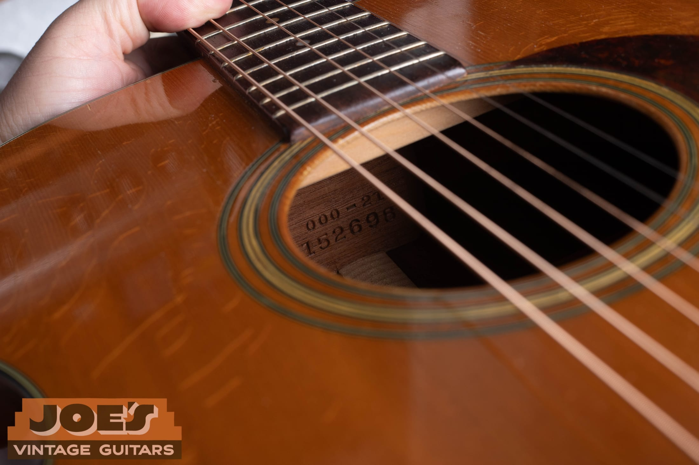

<h2 id="what-is-the-real-value-of-your-martin-guitar">What Is Your Old Martin Guitar Worth?</h2>

**An old Martin’s value depends on its exact model and year, original features, condition, repair history and recent sales of comparable guitars.** The name on the headstock is the beginning of the appraisal. Two Martins made in the same year can have very different values.

If you inherited a guitar or have owned one for decades, you do not need to become a collector to get started. Find the model and serial number, photograph the guitar as it is, and write down what you know about its history. Those details are much more useful than choosing the highest price you find online.

I’ll walk you through what to look for below. If you would like help with your particular guitar, [send me photos for a free Martin appraisal](/free-appraisal/martin/).

> **Before You Change Anything:** Leave the finish, bridge, tuners and other parts in place until the guitar has been evaluated. Keep the case, receipts and any loose original parts with it.

<h2 id="what-to-consider-first">1. Find The Model And Year</h2>

Look through the soundhole toward the neck. On many Martins, the wooden neck block carries the model designation above the serial number. Use a light and photograph the whole stamp. You do not need to remove the neck or take the guitar apart.

The two lines answer different questions:

- **The model identifies the guitar.** In a designation such as D-28 or 000-18, the first part describes the body size or format. The number after the hyphen identifies the style, which includes materials and appointments.
- **The serial helps establish the year.** Match the full number to the correct Martin serial chart. Counting its digits is not a reliable dating method.

*On this guitar, 000-21 is the model and 152698 is the serial. Martin’s year-end chart places 152698 after the final 1955 serial, 147328, and within 1956, which ends at 153225.*

Use my [Martin serial number lookup](/martin-serial-and-model-numbers/) to find the year, or check [Martin’s official serial chart](https://www.martinguitar.com/support-serial-number-lookup.html). The chart lists the **last** serial for each year, so your number does not need to match an entry exactly.

Some early guitars have a serial without a model stamp. A missing model line does not automatically mean something is wrong. My [Martin neck-block stamp guide](/martin-neck-block-stamps/) shows examples. Little Martin and Backpacker instruments also use separate numbering systems, so select the chart for the instrument you have.

<h2 id="how-much-is-a-martin-guitar-worth">2. Match The Model And Era Before Comparing Values</h2>

A useful price comparison starts with the same kind of Martin. A 1930s D-18, a 1960s D-28 and a 1970s D-35 each have their own construction details and buyer demand. An older date does not automatically put one above the others.

| What You Have | What To Establish First | Where To Compare It |
| --- | --- | --- |
| D-18, D-28 or D-45 | Exact year, woods, bracing, finish and repairs | [Martin dreadnought value guide](/martin-d-28-d-18-d-45-dreadnought-value-guide/) |
| 0, 00 or 000 model | Full size and style designation, neck joint and construction period | [Martin small-body guide](/post/martin-0-00-000-history-authentication-value-guide/) |
| A guitar believed to be prewar | Serial date, model and original construction features | [Prewar Martin guide](/prewar-martin-guitar-guide/) |
| A later standard model, reissue or custom guitar | Complete model name, production year and any special specifications | Recent sales of that exact version |

### Woods And Construction Can Change The Comparison

Traditional vintage D-18s have mahogany backs and sides; vintage D-28s and D-45s use rosewood. The difference between those styles goes beyond decoration. Martin’s [model-name explanation](https://www.martinguitar.com/blog-categories/tips-tutorials/blog-062321-What-Does-D-28-Really-Mean.html) is a useful starting point for understanding those designations.

On rosewood models, establish which rosewood is present. The change from Brazilian to East Indian rosewood in standard production during 1969 makes that year especially important to inspect carefully. A serial date is a clue; the wood and the guitar’s repair history still need to agree with it. My [D-28 history guide](/post/martin-d-28-authentication-guide/) explains the changes by period.

<h3 id="how-to-recognize-pre-war-martin-guitars">Check A Prewar Martin’s Actual Features</h3>

The word “prewar” is too broad to price a guitar by itself. Body size, 12-fret or 14-fret construction, bracing, woods and originality all affect the comparison. Herringbone trim alone does not prove an early production date; later Martins also use it.

<h3 id="why-are-pre-war-martin-guitars-so-exorbitantly-priced">Why Some Prewar Martins Bring Much More</h3>

Demand and rarity can separate two models by a large amount. Martin records just 91 D-45s in the original production run ending in 1942. That exceptional scarcity is one reason an original D-45 belongs in a different comparison group from a more common model. [Martin’s museum account](https://www.martinguitar.com/museum-behind-the-glass.html) describes that history.

Use sales of the same model and period wherever possible. A record-setting celebrity guitar or an unusually rare D-45 is poor evidence for the value of an ordinary family-owned Martin.

<h2 id="condition-and-originality">3. Look Beyond Scratches To Condition And Originality</h2>

A guitar can look worn and retain many valuable original features. It can also look clean because it was refinished or had major parts replaced. Cosmetic appearance and originality need separate attention.

### Finish Wear, Overspray And Refinishing

Playing wear, small dents and fine finish checking are common on older instruments. They should be described, but they do not tell the whole story.

Refinishing removes or replaces an earlier finish. Overspray adds finish over an existing surface. Both can affect collector value, and their extent matters. A little localized touch-up and a complete body refinish need different treatment. A glossy photograph is not enough to determine which finish is original.

### Neck Angle And Playability

High strings can point to setup issues or a neck-angle problem. A low saddle combined with high action deserves a closer look. Do not assume that lowering the saddle again will solve it.

A properly performed neck reset is a common repair on older acoustics. It can restore useful playing geometry while retaining the original neck and body. Evaluate the workmanship and remaining repair needs instead of treating every neck reset as the same kind of damage. See my [guide to acoustic guitar neck resets](/post/how-to-tell-if-your-acoustic-guitar-needs-a-neck-reset/) for a closer explanation.

### Cracks, The Bridge And Internal Repairs

These details deserve clear photographs and, when necessary, an in-person inspection:

- **Cracks:** Where are they, how extensive are they, and are they open or repaired? A stable repaired side crack is a different problem from extensive damage around the bridge.
- **Bridge:** Is it original, replaced, shaved down or lifting? An oversized replacement can hide earlier damage or work.
- **Bridge plate:** This is the reinforcing piece inside the top beneath the bridge. Its condition, size and any replacement or patching matter.
- **Bracing:** Loose braces, repairs or later reshaping can affect structure, sound and originality.
- **Other changes:** Replacement tuners, enlarged holes for pickups, neck repairs and a replaced top should all be disclosed.

There is no dependable flat percentage to subtract for “a crack” or “a repair.” The model, the location of the work and the quality of the result change the effect. Repairs can also overlap: a shaved bridge and low saddle may be symptoms of the same neck-angle problem.

### Keep The Guitar’s History With It

Original receipts, repair invoices, family photographs and the case can help explain what happened to the instrument. Keep any replaced parts too.

The 1956 000-21 pictured here came to me from the original owner’s daughter. That family connection helps document its history. It does not replace a condition inspection, and a one-owner story by itself does not guarantee a particular premium.

<h2 id="compare-martin-prices">4. Compare Prices That Answer The Same Question</h2>

When someone says a Martin is “worth” a certain amount, find out what kind of value they mean.

| Price Or Value | What It Tells You |
| --- | --- |
| Dealer asking price | What a shop is seeking. It may reflect repairs, preparation, overhead and the terms of the sale. |
| Completed sale price | What a buyer paid in a particular transaction. Check the date, condition and what the reported amount includes. |
| Dealer purchase offer | What a dealer will pay you now, allowing for repair costs, resale expenses, risk and margin. |
| Consignment proceeds | What you receive after the commission and any agreed expenses when the guitar sells. |
| Insurance replacement value | An estimate for replacing the instrument under the appraisal’s stated assumptions. It is a different purpose from an immediate sale. |

**For a selling decision, compare the amount you expect to receive and the work involved in getting it.** A higher advertised price does not necessarily leave you with a higher net payment after fees, shipping, repairs and other costs.

### How To Build A Useful Comparison

1. **Find several recent completed sales** of the same model and a comparable production period. Active listings show competition, but an asking price is not proof of a sale at that amount.
2. **Read the condition descriptions.** Note finish work, cracks, neck resets, replacement bridges and other alterations. Exclude examples that differ too much from yours.
3. **Check the transaction details.** At auction, establish whether a result includes the buyer’s premium. For marketplace sales, distinguish the actual sale amount from an old listing price.
4. **Allow for remaining repairs and selling expenses.** Get specific estimates where needed. Avoid stacking arbitrary deductions for several symptoms of the same problem.
5. **Use a range when the evidence supports one.** If close comparisons are scarce or hidden repairs remain uncertain, an individual appraisal is more useful than a precise-looking number.

For example, a clean, largely original 1960s D-28 with good playing geometry is a weak comparison for one from the same year with a refinished top, replacement bridge and unresolved high action. The model and date match, but the condition does not.

<h2 id="always-ask-the-experts">5. Get An Appraisal Of Your Martin</h2>

Send the guitar as it is. You do not need to polish it, restring it or have it repaired before contacting me. If a bridge is lifting or the guitar appears structurally unstable, leave it unplayed until it has been checked.

For a useful first look, send:

- The full front and back, plus both sides if possible.
- The front and back of the headstock, including the tuners.
- A readable photograph of the model and serial stamp.
- The bridge and saddle, with one view taken from the side.
- Close views of cracks, wear, repairs or replaced parts.
- The case, receipts and any repair records you have.

Include how you acquired it, any work you know about, and whether you want to sell it or learn more about it. Photos can support identification and a preliminary estimate. Some finish work, internal alterations and structural problems need closer inspection before a final offer.

**[Send Me Photos For A Free Martin Appraisal](/free-appraisal/martin/)** or call [602-900-6635](tel:+16029006635). If you are ready to sell, my [Martin guitar buying page](/sell-my-martin-guitar/) explains the next steps.
