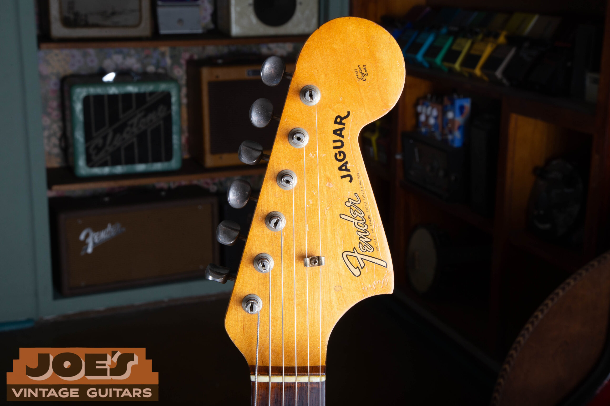
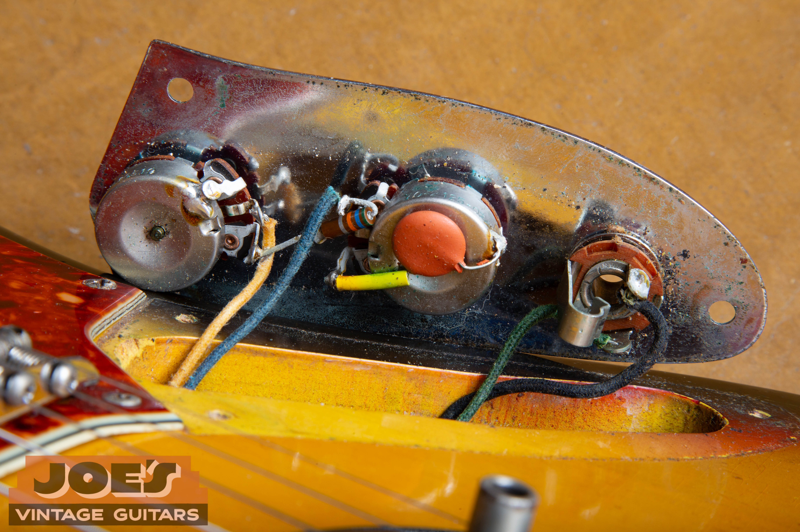
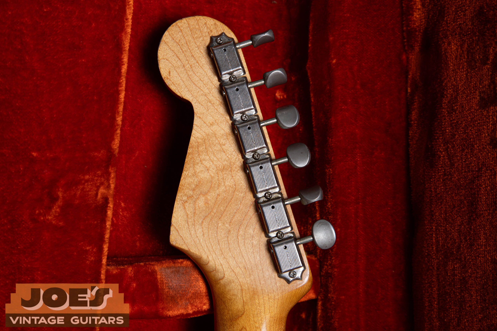
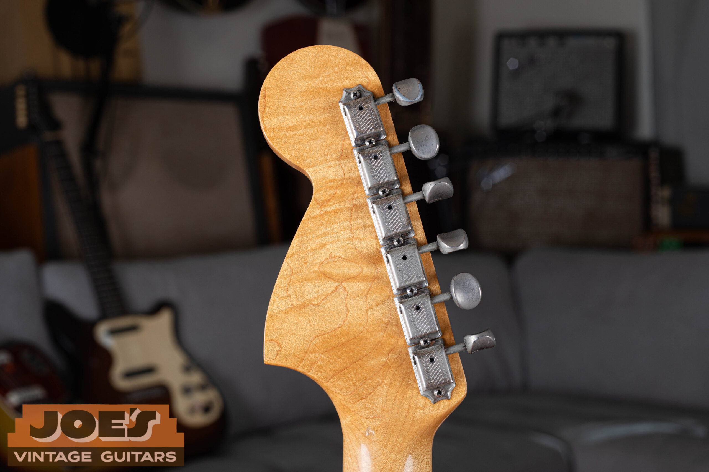
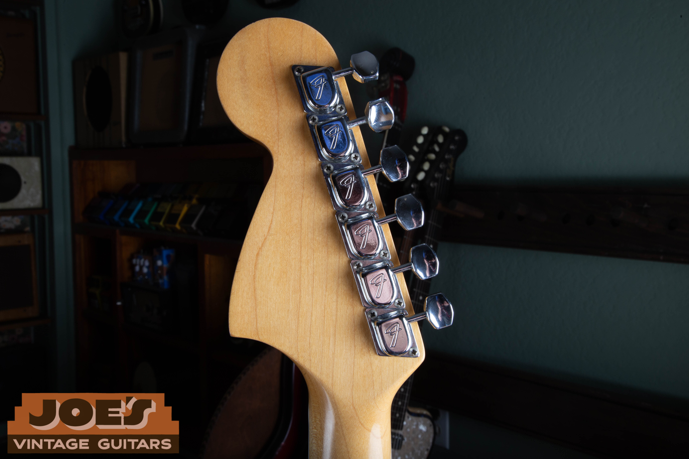
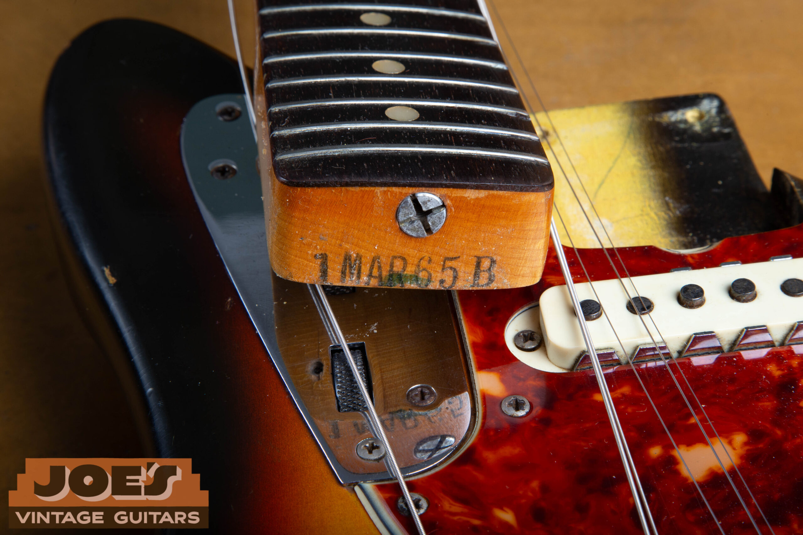
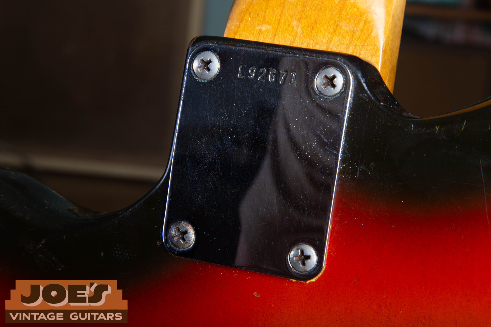
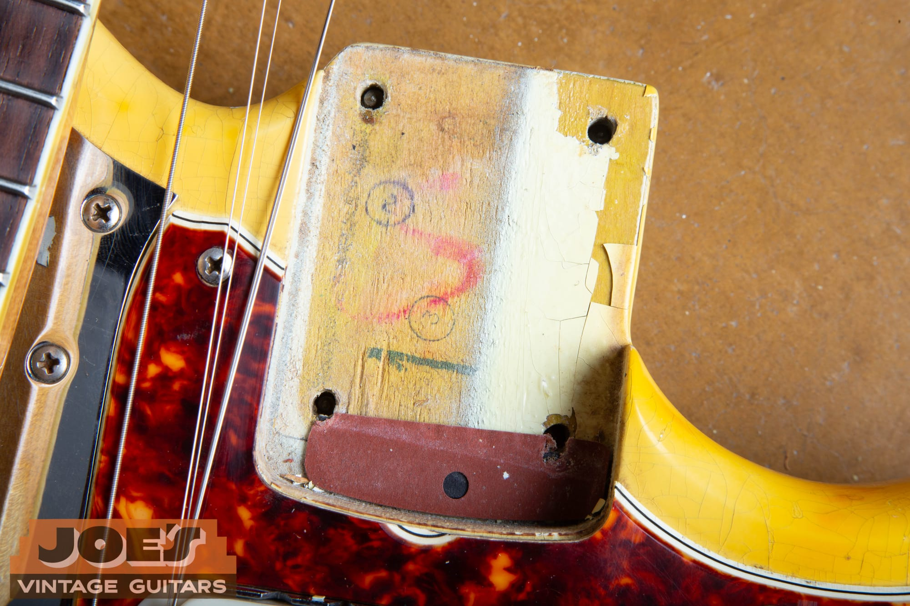

Vintage Fender Authentication · 1962 to 1975

To authenticate a vintage Fender Jaguar, cross-check the neck, pickguard, pickups, finish, hardware, and dated parts. No single feature proves originality. The strongest identification comes from several details that all point to the same production window.

For the 1962, 1964, 1965 and 1966 Fender Jaguar value comparisons and the later years, see my [vintage Fender Jaguar value guide](/vintage-fender-jaguar-value-guide/). This page covers the evidence for the year, parts and finish.

<nav class="post-toc-inline" aria-label="Table of contents">

-   [How to Authenticate a Jaguar](#intro)
-   [Five Fastest Authentication Checks](#fastest-checks)
-   [Year-by-Year Timeline](#year-by-year-quick-reference)
-   [Era Evolution: 1962 to 1975](#pre-cbs-years)
-   [Logo, Neck & Pickguard](#headstock-logo-decoder)
-   [Pickups & Electronics](#pickups-electronics)
-   [Bridge, Tremolo & Mute](#bridge-tremolo-mute)
-   [Tuners & Hardware](#tuners-hardware)
-   [Inside Dates & Serial Numbers](#pot-codes-dating)
-   [Finish, Originality & Red Flags](#custom-color-authentication)
-   [Final Authentication Checklist](#authentication-checklist)
-   [Cases, Value & FAQ](#value-drivers)

</nav>

<h2 id="intro">How To Authenticate A Vintage Fender Jaguar</h2>

Begin with the features you can inspect while the guitar is assembled: fingerboard construction, inlays, binding, pickguard, tuners, logo, and hardware. Then compare the dates and construction details inside the guitar. A neck stamp, potentiometer code, pickup bottom, or serial number can narrow the window, but each can also be replaced or reused. Authentication depends on agreement across the whole instrument.

The Jaguar appeared in 1962 as Fender's most ambitious offset. It sat above the Jazzmaster on the price sheet and was pitched at jazz and surf players who wanted a shorter scale, brighter pickups, and a more complex switching system. CBS discontinued it in 1975. That short original run and its dense series of specification changes make the Jaguar especially useful for parts-based authentication.

This page is the deep authentication reference: originality, finish, electronics, hardware and common modifications. If your main question is simply *what year is it?*, use the faster [Fender Jaguar dating guide](/fender-jaguar-dating-guide/), then return here to evaluate whether the parts and finish are original. If you are trying to [sell a vintage Fender Jaguar](/sell-my-fender-guitar/) or need a *vintage guitar appraisal* on an inherited instrument, these are the details a serious buyer will use.

<h2 id="fastest-checks">The Five Fastest Authentication Checks</h2>

Start with the features you can read while the guitar is assembled. Each gives you a date window; the overlap is what makes the identification defensible.

  <article>
    1
    <h3>Fingerboard & Inlays</h3>
    
Slab versus veneer, clay versus pearl, then bound dots or blocks. This is the fastest way to divide the run into meaningful eras.

    <a href="#fingerboard-inlay-authentication">Read the neck →</a>
  </article>
  <article>
    2
    <h3>Pickguard</h3>
    
Four-ply nitrate belongs to the early run; later three-ply guards should agree with the neck, finish, and screw pattern.

    <a href="#pickguard-identification">Read the guard →</a>
  </article>
  <article>
    3
    <h3>Tuners</h3>
    
Single-line Klusons, double-line Klusons, then F tuners create three quick hardware windows visible from the back.

    <a href="#tuners-hardware">Read the tuners →</a>
  </article>
  <article>
    4
    <h3>Pickup Bottoms</h3>
    
Black and gray fiber bottoms help place the electronics and expose pickup swaps when they conflict with the rest of the guitar.

    <a href="#pickups-electronics">Read the pickups →</a>
  </article>
  <article>
    5
    <h3>Dates Inside</h3>
    
The neck heel and body dates anchor the build; pot codes provide an earliest-possible component date and a useful cross-check.

    <a href="#pot-codes-dating">Read the dates →</a>
  </article>

<aside class="jg-safety-note">
  <strong>Inspect in three passes.</strong> Start across the room, continue with the guitar in your hands, and open it only when the exterior evidence leaves a real question. Old nitrate guards crack easily, and clear exterior photographs are often enough to narrow the era before a screwdriver comes out.
</aside>

<h2 id="why-the-year-matters">Why The Year Matters</h2>

The Jaguar's value curve is steep and easy to read once you know what to look for. A clean, all original 1962 in a factory custom color lives in a completely different price world than a 1973 sunburst that has been through three owners. The vintage market sorts these instruments first by era (pre-CBS versus CBS), then by spec (clay dots versus pearl, bound or unbound, slab versus veneer board), then by condition and originality. A single small spec detail can move the valuation by thousands of dollars. That is exactly why so many "1963" Jaguars on the open market turn out to be parts assembled instruments or transition guitars sold as the better year.

CBS purchased Fender on January 5, 1965, but the changeover on the production floor was gradual. Instruments built in early to mid 1965 still wore most pre-CBS specs. Collectors split hairs over individual months because a "1965 pre-CBS spec" guitar can be worth nearly double a "1965 transitional" guitar even though both rolled off the same line in the same calendar year. Those details can change the appraisal by identifying an earlier configuration or a replaced part. Standard online price guides do not capture this, which is why a professional vintage guitar appraisal on a Jaguar is almost always worth getting. We will come back to this distinction repeatedly.

<h2 id="year-by-year-quick-reference">Year By Year Quick Reference</h2>

This is the high level orientation table. Every cell here is unpacked in detail further down the page. If you want the compact version of this timeline with the fastest visual check for each change, our [guide to dating a Fender Jaguar](/fender-jaguar-dating-guide/) covers the year-by-year in one table.

| Year | Fingerboard | Inlays | Logo | Pickguard | Finish |
| --- | --- | --- | --- | --- | --- |
| **1962** | Slab Brazilian rosewood (to mid year), then veneer | Clay dots | Transition | 4 ply nitrate tortoise | Nitrocellulose |
| **1963** | Veneer Brazilian rosewood | Clay dots | Transition | 4 ply nitrate tortoise | Nitrocellulose |
| **1964** | Veneer Brazilian rosewood | Clay dots (early), pearloid dots (late) | Transition | 4 ply nitrate tortoise | Nitrocellulose |
| **1965** | Veneer rosewood, binding appears late year | Pearloid dots | Transition | 4 ply early, 3 ply mid year | Nitrocellulose |
| **1966** | Bound Indian rosewood | Pearloid dots (early), pearloid blocks (mid year on) | Transition | 3 ply tortoise | Nitrocellulose |
| **1967** | Bound rosewood, optional maple cap | Pearloid blocks | Transition | 3 ply tortoise or pearl | Nitro into thin poly transition |
| **1968** | Bound rosewood, optional maple cap | Pearloid blocks | Transition to CBS black | 3 ply pearl or tortoise | Polyester thick skin begins |
| **1969** | Bound rosewood or maple cap | Pearloid blocks | CBS black | 3 ply pearl common | Polyester |
| **1970 to 1972** | Bound rosewood or maple cap | Pearloid blocks (rosewood); pearloid or black blocks (maple) | CBS black | 3 ply pearl or tortoise | Polyester |
| **1973 to 1975** | Bound rosewood or maple cap (white or black binding) | Pearloid blocks (rosewood); black blocks common on maple | CBS black | 3 ply, parts mix common | Polyester, thinner gloss late |

Scroll to see more →

<h2 id="pre-cbs-years">The Pre-CBS Years: 1962 To 1964</h2>

Everything that drives the high water Jaguar valuations comes out of this era. The Jaguar launched above the Jazzmaster in Fender's solidbody lineup. Tight pocket fits. Hand cut nut slots. Neck dates rubber-stamped on the heel, which is what Fender had moved to by the time the Jaguar launched. Do not expect the penciled dates and shaper's initials you find on 1950s Fenders; those belong to an earlier era, and a penciled name on a Jaguar heel is a reason to look harder, not a mark of authenticity. Finishes shot in nitrocellulose lacquer that has aged into the cracked, ambered surface collectors look for.

### 1962: The Inaugural Year

Production began in late spring of 1962. The earliest examples wear serial numbers in the 80000 and 90000 ranges (shared with Stratocasters and other models of the era), with a switch to the L prefix series late in the year. A first year Jaguar should carry a slab rosewood fingerboard, which is to say the rosewood is flat across its underside where it meets the maple neck. Fender phased that out around July 1962 in favor of the curved or "veneer" board, which has a radius on the back side to match the maple. The slab to veneer transition is the pre-CBS detail collectors argue about most, and a slab board on a Jaguar built in the first half of 1962 carries real value.

The string mute sits behind the bridge, controlled by a lever that drops a foam pad onto the strings. Finding a fully intact mute with the original foam (which crumbles to dust on its own timeline) is a real find. Mute hardware present adds value. Original foam present adds more. Check that the mute screw holes are present and unaltered.

### 1963: The Refinement Year

By 1963 the Jaguar was in full production and the spec set settled into its pre-CBS sweet spot. Veneer rosewood fingerboard, clay dots, gold transition logo, 4 ply nitrate tortoise pickguard, single line Kluson tuners. Serial numbers were entirely in the L series by this point, starting around L00001 and running through the year. Custom colors were available at extra cost, sprayed in DuPont Duco lacquer over the Fullerplast sealer layer, and an authentic original custom color on a 1963 Jaguar is a real prize.

### 1964: The Last Pre CBS Year

The transition began before the actual ownership change. Pearloid dot inlays started appearing late in 1964, with clay dots running on most production through the first three quarters. The 4 ply nitrate pickguards continued through the year and into mid 1965. The gold transition logo remained the standard headstock decal as it had been since the model's introduction. If you can verify a late 1964 build date through neck stamp and pot codes and the guitar still shows clay dots, 4 ply nitrate pickguard, and unbound veneer rosewood, you have a desirable late pre-CBS example.

### The Fullerplast Layer (1963 Onward)

Most generic guides skip this entirely, but it's one of the cleanest ways to call out a refinish on a pre-CBS Jaguar. Starting around 1963, Fender began using **Fullerplast**, a clear chemically cured sealer sprayed onto the bare alder body before any color went on. The Fullerplast layer sits between the wood and the color and acts as a smooth, non-absorbent base for the lacquer or paint above it. It cures hard and stays put for the life of the finish.

Fullerplast is transparent and colorless. The yellow-amber visible in pockets and cavities comes from aniline dye stain applied before the clear sealer. I compare the finish layers with the rest of the instrument rather than calling a finish original or refinished from yellow color alone.

Inspect exposed finish layers at existing chips and accessible cavity edges without scraping or removing material. Separate the stain, clear sealer and color coat in your notes. The other dated parts and finish evidence still need to agree.

<h2 id="1965-transition">The 1965 Transition</h2>

1965 is the year Jaguar collectors argue about most. CBS took ownership on January 5, 1965, but the factory kept building from existing parts inventory and existing processes for months. The mid-year cutoffs collectors care about are not crisp.

A guitar built in February 1965 with a gold transition logo, clay dots, veneer rosewood board, and 4 ply nitrate pickguard is for all practical purposes a pre-CBS guitar even though CBS owned the company when it shipped. A guitar built in November 1965 with pearloid dots, bound fingerboard, and 3 ply pickguard is fully a CBS-era guitar. Both are sold as "1965 Jaguars" online. The difference in market value can run several thousand dollars. Look at the parts, not the calendar. Our guide to [dating a Fender by its parts](/fender-physical-features/) covers exactly these visual tells.

Most of the visible CBS changes appeared in mid to late 1965. The bound rosewood fingerboard came in around September 1965, with block inlays not arriving until around mid 1966. That gap between binding and blocks created the window of "Bound-Dot" Jaguars covered in detail below. The 3 ply pickguard replaced the 4 ply nitrate stock as the older sheets were used up. The gold transition logo remained in place across the year and stayed on the Jaguar headstock through about mid 1968.

### The Bound-Dot Jaguar

Between the introduction of the bound fingerboard (around September 1965) and the introduction of block inlays (around mid 1966), Fender produced Jaguars with **bound rosewood fingerboards but pearloid dot inlays**. Bound-Dot necks are almost exclusively 1966 production with a small tail running into very late 1965. The dot-to-block changeover itself was messy: when blocks arrived in mid 1966, the factory did not flip overnight. There was a few-week window where dot-inlay necks and block-inlay necks were both leaving the line, with dot stock being depleted as block production ramped up. A Bound-Dot Jaguar with a neck date a week or two after the "official" block introduction is still factory original. So Bound-Dot Jaguars are not particularly rare, but they are a little less common than the longer-running standard configurations on either side of the window and they are a distinctive transitional look that some collectors prefer.

The Bound-Dot configuration was simply the standard factory build during the binding-but-not-yet-blocks window. The factory had implemented the new bound neck process but was still installing dot inlays in the new bound necks. The result is a clean looking combination of bound neck and pre-block dot inlays that some buyers specifically seek out.

An authentic Bound-Dot Jaguar will typically show: neck date from late 1965 through mid 1966, gold transition logo, 3 ply pickguard, F-stamped plate (since these were built after the L to F transition), Indian rosewood fingerboard with white binding, pearloid dot inlays, and pot codes from the same window. A faked Bound-Dot can be created by taking a bound 1967 to 1968 block-inlay neck and swapping in dot inlays, which is detectable but requires close inspection of the inlay seating and the binding pattern around the inlay cuts.

Pricing on Bound-Dot Jaguars is typically modestly above standard 1966 to 1968 block-inlay examples, depending on condition and the rest of the build.

<h2 id="cbs-block-inlay-era">The CBS Block Inlay Era: 1966 To 1968</h2>

The full CBS-era spec set was not in place until mid 1966, when pearloid block inlays replaced the dot inlays on bound rosewood necks. Early 1966 Jaguars are typically **Bound-Dots** (legitimate factory configuration, covered above) rather than block-inlay guitars, and the mid 1966 changeover itself produced a few weeks of overlap where both inlay styles appeared on the line. From mid 1966 onward the standard build settled into bound rosewood fingerboard, pearloid block inlays, gold transition logo, and 3 ply pickguard. Build quality remained high through the rest of 1966 and into 1967. Where the early CBS criticism actually starts is around 1968, when polyester finishes began replacing nitrocellulose lacquer on most CBS Fender production.

### The Polyester Transition

Polyester is the most reliable single tell for a CBS late 60s and 70s Fender. The finish sits noticeably thicker on the body, almost glassy on top, and where nitro will check, chip, and amber with age, polyester remains glossy and intact for decades. Strip a poly finish (which collectors rarely do) and you find a near plastic layer beneath. The transition was not a single calendar date but a rolling change across 1968. Many 1968 Jaguars wear a hybrid: nitro sealer with poly topcoat. Late 1968 and onward is full polyester.

The two big 1968 changes (polyester finish replacing nitro, and the black TV logo replacing the gold transition decal) did not happen on the same day. Polyester rolled in during the first half of 1968, the TV logo arrived around mid 1968, and the factory used up the remaining gold transition decal stock for months after the new logo was officially introduced. The result is a small population of late 1968 Jaguars with the **new polyester finish but still wearing the old gold transition decal**. Collectors call these "crossover necks" and they are legitimate factory configurations, not parts mixes or refinishes. Triangulating neck date, pot codes, and finish chemistry against the decal tells you whether you are looking at a real crossover or a swapped headstock.

### Maple Cap Fingerboards

Fender began offering maple cap (sometimes called "maple fingerboard") as an option on the Jaguar around 1967. These are visually distinct from the one-piece maple Telecaster neck of the 50s: the maple board is a separate piece glued onto the maple neck with a visible seam at the headstock. Original maple cap Jaguars are uncommon and add value over a standard rosewood board guitar of the same year, particularly in the late 60s.

**The 1970s maple board with black blocks and black binding:** While late 60s maple cap Jaguars typically wore pearloid block inlays with white binding, 1970s maple-board Jaguars frequently used **black block inlays with black binding** instead. This was a distinctive 70s aesthetic that mirrored the same treatment Fender used on Strat and Tele maple boards of the era. A 1970s Jaguar with a maple fingerboard and black blocks/black binding is factory original and one of the more visually striking late production configurations. A 1970s maple cap Jaguar with pearloid blocks and white binding can be original but is less common. Verify against the neck date and the rest of the build.

<h2 id="late-cbs-years">The Late CBS Years: 1969 To 1975</h2>

The Jaguar's commercial trajectory dropped through the late 60s. By 1969 the surf wave had broken, jazz players had largely moved on to other instruments, and the Jaguar was being outsold by every other major Fender model. The factory responded with cost cutting that shows in the instruments.

-   Thick polyester finishes throughout
-   The "CBS" black logo replacing the transition style around 1968
-   Pickguard material standardized on cheaper 3 ply stock, often with pearl plastic in place of tortoise on some builds
-   Less consistent fretwork and nut work compared to earlier production
-   Cost-driven parts sourcing leading to occasional swaps in pot manufacturers, tuner suppliers, and bridge hardware

This does not mean these guitars are bad. Plenty of 1970s Jaguars play and sound great, and as the last of the original-run instruments they have their own following. But the build is materially different from a 1962 or 1963 example and the market reflects that. The Jaguar was officially discontinued in 1975. Production tapered through 1974 and the last units shipped in 1975, with serial numbers running into the seven digit range and prefixes that overlap with other models of the period.

<h2 id="scale-length">The 24 Inch Scale Length And What It Means</h2>

Most authentication guides skip this, which is odd because it drives the largest share of "Jaguar vs Jazzmaster" search traffic. The Jaguar's **24 inch scale length** is a defining spec and the main reason it feels different in your hands than any other classic Fender. The Stratocaster, Telecaster, and Jazzmaster all run a **25.5 inch scale**. The [Mustang](/post/fender-mustang-history-value/) and Duo-Sonic share the Jaguar's 24 inch scale (or the even shorter 22.5 inch on the original Mustang and Duo-Sonic). Anyone who switches between a Jaguar and a Jazzmaster feels that inch and a half difference right away.

### Jaguar Vs Jazzmaster Scale Length: The Practical Differences

The shorter scale is what gives the Jaguar its distinctive feel. Easier bends. Slightly looser strings under the fingers. A more compact reach down the fretboard. To a player coming off a Stratocaster, the Jaguar feels noticeably more relaxed at the same string gauge. Surf players gravitated to this spec in 1962, and the same spec helped drive the 90s Jaguar revival when players wanted something that felt different than the standard Fender platform. For a deep look at the Jaguar's sibling, see our [Fender Jazzmaster evolution guide covering 1958 to 1971](/post/fender-jazzmaster-evolution-guide-1958-1971/).

### The String Tension Problem

Vintage Jaguar owners learn the 24 inch scale's practical drawback fast: **at standard concert pitch with light gauge strings, the strings are too loose**. The Jaguar bridge has a relatively shallow break angle behind the saddles, the trem is a long floating design, and that combination of low tension and shallow break angle is exactly why so many original Jaguars buzz, rattle, or pop strings out of the saddle slots. Fender shipped these guitars expecting players to use heavier flatwound strings, which were standard in the early 60s. A modern player putting 10s or 9s on an unmodified vintage Jaguar will hit setup issues that usually take a heavier string set, a Buzz Stop, a Mastery bridge, or some combination of those to solve.

All of this matters for authentication because **many working vintage Jaguars have been modified to improve the setup**. Buzz Stops and correctly fitted Mastery or Staytrem bridges are often reversible; heavier strings leave no modification at all. Confirm how the part was installed, whether the factory thimbles and screw holes remain untouched, and whether the original bridge stayed with the guitar.

<h2 id="headstock-logo-decoder">Headstock And Logo Decoder</h2>

The Jaguar arrived in 1962 after the spaghetti logo era had already ended on most Fender production. As a result, **the Jaguar never wore a spaghetti logo from the factory**. Any vintage Jaguar listing that claims a spaghetti logo is either describing the headstock incorrectly (a common mistake even among experienced sellers) or showing a guitar with a non-original decal. Across the 1962 to 1975 production run, only two factory logo styles appeared on the Jaguar.

### Gold Transition Logo (1962 To Mid 1968)

This is the logo the Jaguar launched with and wore for the first six years of production. Heavier rounded script "Fender" in gold with a thin black outline, larger and more prominent on the headstock than the spaghetti logo that preceded it on Stratocasters and Telecasters. The word "Jaguar" appears below in matching gold script, with "Offset Contour Body" and patent text beneath. The earliest 1962 examples carry "PAT. PEND." while 1963 onward shows the actual patent numbers (covered in the section below).

<figure>

<figcaption>Gold transition logo on a 1965 Jaguar headstock. This was the only factory logo style on the Jaguar from launch in 1962 through about mid 1968, when the black TV logo took over.</figcaption>

</figure>

Because this same logo style ran on the Jaguar from launch through both the pre-CBS and early-CBS years, the headstock decal by itself does not tell you whether a guitar is pre-CBS or CBS. A 1963 and a 1967 Jaguar both wear the gold transition logo. The decal needs to be cross-referenced with neck date, body date, pot codes, fingerboard binding, inlay style, and pickguard material to place the guitar correctly.

### CBS Black Logo (Mid 1968 To 1975)

Around mid 1968 the gold transition logo was replaced by the CBS-era black logo, often called the **"TV logo"** by collectors because the bold black "Fender" sits in a heavier blocky font that gives the headstock the look of an old television set's branding. Bold black "Fender" with a thin gold outline, simplified overall design, and the supporting text dramatically reduced. By the early 70s, "Made in USA" appears as a separate small decal on most production. A Jaguar wearing a black TV logo is from 1968 or later, full stop. Note that the patent count actually *drops* on the TV logo decal (from 5 or 6 patents back down to 2), which is covered in detail in the patent block section below.

### Patent Number Evolution

The fine print under the model name changes by year and gives you a fast cross check on logo authenticity. A counterfeit decal usually nails the big "Fender" script but botches the patent number block. The actual Jaguar patent numbers to look for, and the count by era:

| Era | Patent Count | Key Numbers to Look For | Authentication Note |
| --- | --- | --- | --- |
| **1962** | 3 patents | 2,960,900 (offset body) 2,972,923 (vibrato) 2,741,146 | The Jaguar debuted with the gold transition logo and a 3 patent block. The model never used the thin spaghetti logo. "PAT. PEND." text may appear alongside the numbers on earliest examples. |
| **1963 to 1964** | 4 patents | 2,960,900 2,972,923 2,741,146 3,143,028 (added) | The patent block is already larger than a same-year Stratocaster decal. "PAT. PEND." is often still present alongside the numbers on early 1963 production as the older decal stock was used up. |
| **1965 to 1967** | 5 to 6 patents | Earlier patents plus DES 186,826 (design patent) and additional numbers | The "Transition Era" patent block. The block becomes a thick, multi-line paragraph of text on the headstock. This is the largest patent text the Jaguar headstock ever carried. |
| **1968 to 1975** | 2 patents | 2,972,923 3,143,028 | The logo switches to the large black "TV" CBS logo around mid 1968. Counter-intuitively, the patent count **drops significantly** on these decals: from 5 or 6 down to just 2. A CBS-era black-logo Jaguar with 5+ patents is wrong. |

Scroll to see more →

Counterfeiters reproduce the big script easily but routinely miss on the patent block, and the Jaguar's patent count progression gives you a useful pattern to test against because of the counter-intuitive drop in 1968. Common red flags:

-   "PAT. PEND." text by itself with no numbers on anything built after early 1963
-   A 4-patent block on a 1962 build (the fourth patent 3,143,028 was not added until 1963)
-   A 5 or 6-patent block on a black-logo CBS-era Jaguar (the CBS decal dropped to 2 patents)
-   A 2-patent block on a pre-CBS gold transition logo guitar (pre-1968 should be 3 to 6)
-   Patent numbers that do not include 2,972,923 (the vibrato patent appears across the entire 1962 to 1975 run)

Read the actual numbers under magnification or in a high-resolution photo. The big "Fender" script is easy to reproduce, but counterfeit decals routinely show wrong patent counts, wrong specific numbers, or patents listed in non-period sequence.

The water-slide decal goes on top of the clear coat, last. The order is maple, sealer, opaque color where present, clear nitro and then the decal. A decal buried under lacquer indicates a respray in the wrong order; dealer and shop decals also sit on top of the finish.

<h2 id="fingerboard-inlay-authentication">Fingerboard And Inlay Authentication</h2>

### Slab Versus Veneer Rosewood

Look at the underside of the fingerboard where it meets the maple neck. Easiest sightline is along the side of the neck at fret level. A slab board has a flat seam: rosewood uniform in thickness across its width, glued flat to a flat-topped neck. A veneer board has a curved seam: thinner rosewood that follows the radius of the curved-top maple beneath. Slab boards on Jaguars ran from the introduction in 1962 to roughly July 1962. After that, the guitar should have a veneer board. A slab board on a guitar with a 1963 or later neck date is a red flag for either a parts guitar or a recreated identity.

### Clay, Pearloid, And Blocks

Clay dots ran from 1962 to late 1964. They are not actually clay but a plastic compound that ages to a tan or cream color, with a slightly matte appearance and visible age cracking under magnification in many examples. Pearloid dots replaced them in late 1964 and continued through 1965 and into early 1966, with a brighter, more reflective surface that catches light differently. **Pearloid block inlays began in mid 1966** (not late 1965) and ran on rosewood fingerboards through the end of production in 1975. The blocks are larger pearloid rectangles set into the bound fingerboard. On 1970s maple cap fingerboards, the blocks are often black rather than pearloid, paired with black binding instead of white.

<figure>

<figcaption>Clay dot inlays on a 1960s Jaguar fingerboard. Note the slightly matte, off-white surface that ages to tan or cream. Clay dots are one of the fastest visual tells for a 1962 to late 1964 build.</figcaption>

</figure>

<figure>

<figcaption>Pearloid block inlays on a 1966 Jaguar in Olympic White. Blocks took over from dots around mid 1966 and ran on rosewood fingerboards through the end of production in 1975.</figcaption>

</figure>

### Brazilian Versus Indian Rosewood

Brazilian rosewood ran from 1962 to roughly 1965, sometimes into early 1966 as old stock was used up. Indian rosewood took over from 1966 onwards. The visual difference is real but not as definitive as in some other applications: Brazilian tends toward darker chocolate brown with red undertones and prominent figure, while Indian tends toward lighter brown with straighter, more uniform grain. Both age, and a heavily played Brazilian board can look similar to a clean Indian board under fingerboard oil. CITES restrictions on Brazilian rosewood since 1992 affect international sales of these older guitars and you should confirm the rosewood species if you intend to cross borders with the instrument.

<h2 id="pickguard-identification">Pickguard Identification</h2>

The pickguard tells you the era as fast as any single component on the guitar. Hold it up to a strong backlight and look at the edge to read the layer count and material.

Original 4 ply nitrate pickguards outgas an acidic vapor as they age. The smell hits you the moment you sniff the underside of the guard or open a case that's been closed for a while. An authentic pre-CBS nitrate guard *smells* different than any later material, and that vinegar tang is a real physical authentication tool, not folklore. Modern reproductions do not reproduce the smell.

A useful 1965 nuance: if a 1965-dated Jaguar has a heavily shrunken, vinegar-smelling, mint-green-bottomed pickguard, you are likely looking at **leftover 1964 nitrate stock** installed on an early 1965 build. This is factory original and a desirable detail on a transitional 1965 instrument, not a red flag. The PVC/ABS pickguards that replaced nitrate do not shrink, do not smell of vinegar, and do not have the mint green underlayer.

### Screw Count And Hole Match

Every era has its expected screw count and pattern. Pulling the pickguard shows you the wood color underneath and also any extra or missing screw holes left from a previous, different-shape pickguard. A 1962 Jaguar should have the original pickguard outline matched cleanly to the body routing with no extra screw holes. Any pickguard hole that does not line up with the original factory drill points means the guard has been replaced, the body has been routed for a different shape, or both. Pulling the pickguard is one of the highest yield single inspections on the instrument.

<h2 id="pickups-electronics">Pickups And Electronics</h2>

The Jaguar pickup is what makes the guitar sound the way it does. They are single coils, similar in dimensions to a Stratocaster pickup but housed in a distinctive notched metal claw shielding plate that wraps around three sides of each pickup. The claw plates were part of Leo Fender's effort to reduce single coil noise on the Jaguar without sacrificing brightness, and they are a reliable visual identifier.

<figure>

<figcaption>Pickups on a 1964 Jaguar showing the distinctive notched metal claw shielding that wraps around three sides of each pickup. This shielding pattern is one of the most reliable visual identifiers of a Jaguar pickup.</figcaption>

</figure>

### Pickup Specifications

-   DC resistance typically 6.2k to 7.4k ohms per pickup
-   Alnico V magnets
-   Forbon (fish paper) bobbin construction throughout the run
-   Pole piece profile: **flat (level) pole pieces on 1962 production**, transitioning to staggered pole pieces across 1963 and 1964 with mixed examples throughout the transition window, and fully staggered from 1965. **Flush poles then return as the factory specification in mid-1974** and run to the end of production. So flat poles are correct at both ends of the Jaguar's life, and they only raise a question on a guitar built between 1965 and mid-1974
-   Cloth-covered push-back wire on lead connections from 1962 through 1968 to 1969, typically yellow and black insulation, with plastic insulated wire taking over by the end of the 1960s
-   Date codes pencilled or stamped on the bottom flatwork in many pre-1965 pickups

### Black Bottoms Versus Gray Bottoms

Pickup bottom color carries real authentication weight on a Jaguar, and serious buyers check it first. From 1962 through roughly mid-1964, Fender used **black bottom Forbon flatwork** on Jaguar pickups. Pull a pickup and the bottom plate is matte black. From late 1964 on, Fender switched to **gray bottom Forbon**, the lighter colored flatwork that ran for the rest of the production cycle.

Original black bottom pickups in a 1962 to mid-1964 Jaguar are a collector premium. A clean pair of original black bottoms can command serious dollars on their own. If a seller is showing you a "1963" Jaguar with gray bottom pickups, you are looking at one of three possibilities: a replacement pair, a parts mix guitar, or a misdated instrument. None of those should be priced at full pre-CBS valuation. Pull a pickup before you commit to a price on any 1962 to early 1964 Jaguar.

### The Dual Circuit System

The Jaguar's switching is the most complex Fender designed in the 1960s. Two completely separate circuits run side by side, selected by a slide switch on the upper bout.

**Lead Circuit** (lower bout controls): three slider switches near the bridge, plus volume and tone rollers on the lower bout chrome control plate. The first two sliders select neck and bridge pickups individually. The third slider activates the "strangle" capacitor, a 0.003 microfarad cap in series with the signal that aggressively rolls off the bass and pushes the tone into thin treble territory. Volume and tone in this circuit use 1 megohm potentiometers, a linear taper on the volume and an audio taper on the tone.

**Rhythm Circuit** (upper bout controls): activated by sliding the upper bout circuit selector forward. This routes only the neck pickup through its own dedicated volume and tone roller, with a fixed high-cut tone shaping designed for jazz comping. The pots in this circuit are linear taper mini pots: a 1 megohm volume and a 50k tone in the original Fender wiring. The bass-heavy preset comes from the combination of the smaller tone pot and a fixed capacitor in the signal path.

<figure>

<figcaption>The upper bout rhythm circuit on a 1965 Jaguar: the slider switch toggles between the lead and rhythm circuits, and the two roller knobs are the dedicated volume and tone for the neck-pickup-only jazz preset.</figcaption>

</figure>

Pull the lead circuit control plate (four screws) and inspect the pot codes, the cap, and the solder joints. Original Fender solder joints from the 60s have a duller, almost frosted appearance compared to modern leaded solder, and the joints themselves should look unmolested. A rewire or pot replacement is not necessarily a value killer on a player grade guitar but on a collector grade Jaguar, originality of the harness matters. Look for the cloth-covered push-back wire on 1962 through 1968 to 1969 examples (typically yellow and black insulation), with plastic insulated wire appearing on builds from the end of the 1960s onward.

<figure>

<figcaption>A 1965 Jaguar lead-circuit harness. Photograph the pot stamps, capacitor, cloth-covered wire, solder joints, and the back of the control plate before disturbing anything; the value is in how these clues agree with one another.</figcaption>

</figure>

### Brass Shielding Tubs And Grounding

Most authentication guides skip the shielding, but it's a reliable tell for a parts assembled instrument. Original Jaguar bodies came from the factory with **brass shielding tubs** installed in the control cavities. These are thin folded brass sheets that line the routs beneath the lead circuit plate, the rhythm circuit plate, and the pickup cavities. The pickguard's aluminum shielding plate makes contact across the top. Ground wires were soldered to the brass at specific points, creating a continuous shielding cage around the electronics tied to the overall ground bus.

Pull the control plates and the pickguard on any Jaguar claimed to be all original and you should see:

-   Brass shielding visible in the control cavities, oxidized to a dull amber or olive color from age
-   A ground wire physically soldered to the brass (usually one in each cavity)
-   The pickguard's aluminum shielding plate making clean mechanical contact with the brass when the guard is in place
-   No fresh solder spots, no copper foil tape patches, no missing brass with bare wood routs

When a body gets stripped and refinished, the brass shielding has to come out. Skilled vintage restorers reinstall it carefully and re-solder the original ground points. Amateur refinishers and parts builders almost never do this work, and you will find a "1963 Jaguar" with bare wood control cavities or with copper foil tape substituted for the brass. Bare wood under the pickguard on a guitar claimed to be all original is one of the loudest red flags on the entire instrument. Modern reissue Jaguars also handle shielding differently, so a guitar with reissue-style shielding inside a "vintage" body is telling you what it is.

<h2 id="bridge-tremolo-mute">Bridge, Tremolo, And Mute System</h2>

### The Floating Tremolo

The Jaguar shares its trem with the Jazzmaster: a long floating tremolo plate with a locking button, mounted on the lower bout below the bridge. The "lock" lets you continue playing in tune if a string breaks, which mattered more in 1962 when string breakage was a regular gig event. The trem plate is chrome, sometimes shows a "Pat Pend" or patent number stamp, and the original tremolo arm is a removable push-in steel rod with a plastic tip.

### The Bridge

The Jaguar bridge is its most criticized component. Two thimble-mounted posts hold a chrome bridge with six individual saddles, each adjustable for height with two grub screws and for length with a single rear screw. The factory saddle grooves are notoriously narrow and shallow, which is why so many original Jaguars have had Mastery or Staytrem replacement bridges installed by working players. An original bridge has value, and many sellers keep the bridge with the case and run a modern replacement on the playing instrument. If you are buying a "stock" Jaguar, verify the bridge is the period correct piece, not a modern reissue or aftermarket part.

<figure>

<figcaption>The factory-style floating bridge on a 1966 Jaguar: two thimble-mounted posts and six individually adjustable threaded saddles. Compare this simple assembly with the precision-machined shapes and maker marks found on modern replacements.</figcaption>

</figure>

### The Mute

The hinged mute is a foam pad mounted to a metal plate behind the bridge, dropped onto the strings via a thumb lever to dampen sustain for a more upright-bass-like sound. The Jazzmaster never had one, so it is also a quick visual separator between the two offsets. A factory original example with the mute intact and the foam not crumbled adds collector value.

### Buzz Stop And Replacement Bridges: Common Reversible Modifications

The Jaguar's 24 inch scale, shallow bridge break angle, and floating tremolo can create setup problems with light strings. Buzz Stops and modern replacement bridges therefore became common on player-grade examples. On a vintage-spec guitar, both changes can usually be reversed without altering the body or original hardware, so the important questions are whether the installation used existing mounting points and whether the original parts stayed with the guitar.

The **Buzz Stop** is a small roller bar that sits between the bridge and the tremolo and increases the break angle over the saddles. Standard versions fasten under the two existing front tremolo screws; they do **not** require new holes in the plate or body. A Buzz Stop by itself is therefore a reversible setup choice, not evidence that the guitar was drilled. If you do find extra holes, altered screws, or a nonstandard mounting method, evaluate that work separately rather than attributing it to every Buzz Stop installation.

The **Mastery Bridge** and alternatives such as the Staytrem are modern replacement bridges designed to improve stability and keep strings in their saddle grooves. Many versions drop into the original Jaguar thimbles, though the exact installation depends on the guitar and bridge model. On an original vintage Jaguar, confirm that the factory thimbles were not replaced or enlarged and that the original bridge is still in the case.

Verify with any "all original" vintage Jaguar that the bridge currently installed is actually the factory bridge and not a modern reissue or aftermarket. Mastery bridges are easily identified by the engraved "Mastery" name on the saddle block and the precision machining. Staytrem bridges have their own makers marks. A factory original Jaguar bridge will have the period correct chrome plating with appropriate aging and the simpler saddle design described above. The original bridge being present somewhere (even if not currently installed on the guitar) is what matters for collector value. If the original bridge is missing entirely, that is a meaningful value reduction.

<h2 id="tuners-hardware">Tuners And Hardware Authentication</h2>

| Era | Tuner Type | Stamp | Button |
| --- | --- | --- | --- |
| 1962 to late 1964 | Kluson Deluxe single line | Single "Kluson Deluxe" stamp running down the center of the back plate | Oval metal |
| Late 1964 through the mid-1960s transition | Kluson Deluxe double line | "Kluson Deluxe / Kluson Deluxe" stacked on two lines | Oval metal |
| Mid-1960s transition to 1975 | Fender "F" stamped tuners | Large stylized "F" on back plate | Octagonal metal |

Scroll to see more →

Tuner replacement is one of the most common modifications on vintage Fenders, usually because the original Klusons developed slop in the gears after fifty years of use. Replacement is reversible and not always a dealbreaker, but you want to see the original tuner peg holes intact with no enlargement or filled secondary holes from a different gear ratio replacement set. Sperzels or Gotohs installed in original Kluson holes leave a tight, period correct looking exterior but you can spot them by the modern stamping and the post diameter.

The single line to double line Kluson transition happened in **late 1964**, not 1962. A 1962, 1963, or early 1964 Jaguar should wear **single line** Klusons with a single "Kluson Deluxe" stamp running down the center of the back plate. **Double line tuners on a 1962, 1963, or early 1964 build are a red flag for later replacement**, usually a service swap done in the late 60s or early 70s when the originals wore out. The reverse is also true: single line tuners on a 1966 or later guitar are wrong for the era. The double-line-to-F-tuner change was a parts-bin transition rather than a clean calendar cutoff, so use the neck date, tuner footprint, and the rest of the hardware together.

<figure class="jg-tuner-comparison">

<figcaption><strong>Single-line versus double-line Klusons.</strong> These period Fender examples share the same identifying back-stamp patterns used on Jaguars: one centered “Kluson Deluxe” line on the earlier housing, two edge lines on the later housing.</figcaption>

</figure>

<figure>

<figcaption>F-stamped tuners on Bill's documented one-owner 1966 Jaguar. This real transition-year example is why the tuner change should be treated as an overlap window, not a rigid late-1967 cutoff.</figcaption>

</figure>

<h2 id="pot-codes-dating">Pot Codes And Dating</h2>

Pot codes date the potentiometer, not the finished guitar. Treat the stamped week and year as an **earliest-possible component date** and a cross-check against the neck, body, pickups, and visible specifications. A factory pot may predate assembly by weeks or months, while a later code than the neck or body usually points to service work or a replacement.

Two pots from two different years on the same guitar means one of the following: a factory parts bin draw from old stock (uncommon but happens), a replacement pot installed during a repair (more common), or a parts assembled guitar (a real concern). Two pots with codes more than six months apart from each other deserve a second look, and pots dated significantly later than the neck date are red flags for service work or rewiring.

<h2 id="neck-date-stamps">Neck Date Stamps</h2>

Remove the neck (four bolts on the neck plate) and you will find the neck date on the heel. On a Jaguar that date is a **rubber stamp**: the model launched in 1962, by which point Fender had moved to an inked stamp format that encodes more information in a compact string. A typical Jaguar neck stamp looks like **1FEB63B**, which decodes to:

The neck date is the most defensible "manufactured date" for the guitar because it represents the actual carving and finishing of the neck. The body date (stamped on the body in the tremolo cavity, or under the pickguard) can be earlier or later because bodies sat in the warehouse before being matched to necks for assembly. The pot dates are downstream of both, since the potentiometer was made before the guitar was wired.

<figure>

<figcaption>Inked neck heel stamp on a 1965 Jaguar. Reading left to right: model code (1 for Jaguar), month and year of neck shaping, and the nut width letter at the end.</figcaption>

</figure>

### Triangulating The Date

A consistent vintage Jaguar will show neck date, body date, pot codes, and feature set all clustering in a reasonable window. A January 1963 build will typically show:

-   Neck date: late 1962 to early 1963
-   Body date: late 1962 to early 1963
-   Pot codes: 1962, week 35 to 1963 week 5 range
-   Pickup dates if present: late 1962
-   Features: gold transition logo, clay dots, veneer rosewood, 4 ply nitrate pickguard

If any of those data points sits dramatically outside the cluster (a 1965 pot code on an otherwise 1963 spec guitar, for example), you are looking at either a service replacement or a parts mix and you should price accordingly.

<h2 id="neck-plate-serial">What The Neck Plate Serial Will Not Tell You</h2>

Almost every first-time vintage Jaguar buyer gets caught by this. The serial number stamped into the neck plate is **not** a reliable indicator of the build year on its own, and any seller (or guide) telling you "this is a 1963 because of the L-series number" is either uninformed or steering you wrong.

### How Fender Actually Used Serial Numbers

Fender stamped neck plates in batches and pulled them from bins as guitars came together on the assembly line. The plates were not used in strict sequential order. A box of L-series plates might sit on a shelf for months. A higher numbered plate could go on a guitar assembled before a lower numbered plate. The serial number tells you roughly which production year the guitar belongs to (within a wide window), but it does not tell you the month, the week, or even reliably the half of the year.

A 1963 neck plate can absolutely show up on a guitar that was actually assembled in early 1964, and a 1964 plate can show up on something assembled in 1963. Worse, plates are detachable. A perfectly real L-series plate from a wrecked or stripped pre-CBS guitar can be installed on a later body or a parts assembly to spoof an early build. A serial number alone doesn't establish the guitar's configuration or originality. The plate is one input. The neck date, body date, pot codes, pickup bottoms, brass shielding, Fullerplast layer, pickguard material, and decal patents are the other inputs. All of them have to agree.

This is why we recommend a professional appraisal before any vintage Jaguar purchase or sale. A serial number lookup and a phone photo will not catch a well done parts assembly. Hands on inspection will.

### The L To F Plate Transition

One specific transition inside the serial number story matters more than most. In **late 1965**, Fender switched from the small "L-prefix" stamped neck plate to the larger "F-stamped" plate that became the standard for the rest of the CBS era. The L plate is a smaller piece of metal with the L-series number stamped in a smaller typeface, while the F plate is physically larger, with a bold stylized "F" stamped above the number.

<figure>

<figcaption>L-series neck plate on a 1965 Jaguar. The L plate was the standard from 1963 through late 1965, when the larger F-stamped plate took over for the rest of the CBS era.</figcaption>

</figure>

The transition happened mid-to-late 1965, with the actual changeover floating across the production line over weeks. The result is a small window where you can find documented factory anomalies that are real collector finds:

-   **Late 1965 F-plate with pre-CBS spec features** (clay or pearloid dot inlays, unbound rosewood board, 4 ply nitrate pickguard): a documented factory transition guitar that is one of the more sought after Jaguars on the market
-   **Mid 1965 L-plate with later CBS spec features** (bound rosewood, block inlays, 3 ply pickguard): also a transition piece, less rare but still distinctive
-   **F-plate on a 1965 build with all CBS features**: a standard late 1965 production guitar, normal valuation for the era

An L-prefix plate on a 1967, 1968, or later Jaguar is a major red flag. The L-series ran out by mid-to-late 1965 and the F plates were the standard thereafter. If you see an L plate on a guitar with bound block-inlay neck, transition or CBS logo, polyester finish, and 1968 pot codes, you are looking at a plate swap. The most likely explanation is someone took a salvageable L plate from a wrecked pre-CBS guitar and installed it on a later body to elevate the apparent value. The triangulation of date stamps and features will catch this every time, but the L plate by itself can fool a hurried buyer.

<h2 id="custom-color-authentication">Custom Color Authentication</h2>

The Jaguar was offered in Fender's full custom color palette through the 60s, and original custom color Jaguars are among the most valuable instruments in the lineup. Pre-CBS custom colors were sprayed in DuPont Duco lacquer, applied over a sealer layer; yellow visible beneath clear Fullerplast is the aniline stain. The most desirable colors include Fiesta Red, Sonic Blue, Lake Placid Blue, Olympic White, Daphne Blue, Burgundy Mist, Surf Green, Foam Green, and Shoreline Gold (later replaced by Firemist Gold in 1965 for the CBS-era catalog).

<figure>

<figcaption>1966 Jaguar in Lake Placid Blue custom color with matching painted headstock. The matching headstock option was available on many factory custom colors and adds collector value when authenticated as original.</figcaption>

</figure>

### Undercoats And The Fullerplast Misconception

A common authentication mistake is confusing the Fullerplast sealer with an "undercoat." They're different things, and a serious buyer needs to know the difference.

The **Fullerplast layer** is a colorless, chemically cured sealer. Yellow in pockets and cavities is the aniline dye stain beneath it, not dye produced by the sealer. Fender used Sherwin-Williams Homoclad from 1955 to about mid-1962.

The **undercoat**, when one was used, is a colored primer or base coat sprayed over the Fullerplast and beneath the final custom color. Fender's undercoats varied:

-   **White undercoat**: common under lighter custom colors and metallic colors that needed a bright base to read correctly
-   **Desert sand undercoat**: used under various colors, gives a slightly warmer tone-through on aged finishes
-   **Other colors**: Fender used additional undercoat colors as needed for specific custom color applications
-   **No undercoat at all**: some custom colors were sprayed directly over the Fullerplast sealer with no separate primer layer, depending on the color and the year

There isn't a universal yellow primer beneath every Fender custom color. The yellow stain lies below the clear sealer; a colored primer or base coat, when used, is a different layer above it.

### Verifying An Original Custom Color

The high-value tells for an authentic factory custom color on a vintage Jaguar are physical evidence baked into the body that a refinish cannot reproduce:

**1\. Fender nail holes.** On a 1962 to 1964 custom color body, pull the pickguard and the bridge. The Fender nail holes should be present and unpainted, with the bare alder visible inside the holes. A custom color refinish strips and resprays the body, and the new finish fills, sands over, or completely eliminates the original nail holes. Painted nail holes on a pre-1965 custom color guitar is a refinish, full stop.

**2\. Paint stick shadow in the neck pocket.** Starting in late 1962, Fender's finishers used a wooden paint stick (a dowel or handle, really) inserted into the neck pocket so they could hold the body while spraying. The stick blocked paint from reaching a specific area inside the pocket, leaving a distinctive shadow where the bare wood or Fullerplast shows through against the surrounding color. **An original finish 1963 to 1965 custom color Jaguar will show this paint stick shadow inside the neck pocket.** A refinish almost never reproduces it correctly because the refinisher doesn't know to leave that area open in the same way.

**3\. Stain, Sealer And Color Layers.** Fullerplast is colorless, and the yellow beneath it is aniline stain. Examine the layers alongside the nail holes, paint-stick shadow, wear and dated parts; yellow alone doesn't establish originality.

**4\. Color matches the documented Fender catalog.** Compare to known Fender custom color samples for the claimed year. Hues that drift, that include shades not in the Fender catalog, or that fluoresce wrong under UV are immediate refinish flags.

<figure>

<figcaption>An original 1966 Olympic White Jaguar neck pocket. The unpainted paint-stick shadow, factory markings, finish edge, and sealer evidence are much harder to reproduce convincingly than the color seen from the front.</figcaption>

</figure>

### The Neck Pocket Tells You The Story

If you take one thing from this section, take this: **pull the neck on any custom color Jaguar before purchase**. The neck pocket gives you four reads in a single inspection:

-   Read the body date in the tremolo cavity or under the pickguard; the neck-pocket view shows the neck heel stamp
-   The paint stick shadow should be visible (late 1962 onwards)
-   The color should continue cleanly into the pocket walls (matching the body color)
-   The Fullerplast layer should be visible at the edges and floor of the pocket

Headstock color matching to the body was an option on many factory custom colors, and a matching headstock on a 1962 to 1965 Jaguar adds further value. Verify that the headstock color sits under the lacquer layer rather than over it, and that the decal sits on top of the clear coat.

<h2 id="red-flags-problems">Red Flags And Common Problems</h2>

### Refinish Detection

-   Overspray in pickup routes, body cavities, or the neck pocket
-   Finish layers inconsistent with the period and with the other evidence; Fullerplast itself is colorless
-   On 1962 to 1964 guitars, nail holes filled with paint or sanded smooth and refilled rather than left as clean unpainted holes
-   Finish that fluoresces uniformly under black light rather than showing the mottled aging pattern of original nitrocellulose
-   Sharp, unbroken edges around all routing, indicating no original aging
-   Pickguard outline that does not sit cleanly against the body finish
-   Headstock decal buried under lacquer rather than sitting on top of the clear coat
-   Color or hue that does not match any Fender catalog spec for the claimed year
-   Bare wood control cavities with no brass shielding present

### Parts Mix Indicators

-   Neck date and body date more than a year apart
-   Pot codes inconsistent with the claimed build year
-   Pickguard era mismatched to the rest of the guitar
-   Pickups with date codes pointing to a different year than the rest of the build
-   Tuners era inconsistent with the headstock decal
-   Bridge or tremolo plate stamps from a different production window
-   Filled screw holes under the pickguard, neck plate, or hardware mounting points

### Common Damage To Inspect

-   Headstock breaks: uncommon on Jaguars because the bolt-on neck uses Fender's flat headstock design, but splits and repairs are still possible. Inspect the tuner holes, string tree, nut area, and headstock edges for cracks, touch-up, or plugged holes
-   Neck pocket cracks: usually shrinkage related, often around the truss rod adjustment area
-   Fingerboard cracking on Brazilian rosewood examples, particularly along the bass side near the nut
-   Body finish checking on nitrocellulose finishes: normal and adds value when authentic, suspicious when uniform or absent on a claimed-original 60 year old finish
-   Mounting hole wear on the floating tremolo posts and bridge thimbles
-   Pickguard shrinkage and screw hole stress cracks on 4 ply nitrate guards

<h2 id="reissues-counterfeits">Reissues, Counterfeits, And What To Watch For</h2>

Fender started reissuing the Jaguar in 1986 with the Japanese MIJ Jaguar series. US reissues followed under the American Vintage Reissue program in 1999, and various models have come and gone since. These reissues are not counterfeits. They are clearly marked Japanese or American instruments with modern serials and proper branding. They become a problem only when someone tries to pass a reissue as an original by removing or modifying the country of origin decals or by swapping components.

### Reissue Identification

-   "Made in Japan" or "Crafted in Japan" decals indicate MIJ reissue, not USA original
-   Serial number formats differ: MIJ Jaguars use letter prefixes like JV, A, E, F, V, with shorter numerics
-   Polyurethane finishes throughout, including under hardware
-   Pickup base plates lack pencil dates and use modern, uniform construction
-   Pot codes use modern manufacturers and date formats inconsistent with the 1960s system
-   Neck dates use modern stamp formats rather than the inked stamps of vintage production

### Outright Counterfeits

Pure counterfeit vintage Fender Jaguars are uncommon because the labor of faking a convincing one outweighs the return. Parts assembled "Frankensteins," though, are extremely common. A builder can take a real but low value 1970s Jaguar body, refinish it, add a reproduction gold transition decal, swap in a repro pickguard, install reproduction clay dots, and offer the whole thing as a 1963. The defense is the triangulation this guide has been pushing all along: neck date, body date, pot codes, pickup construction, hardware stamps, and feature consistency all have to point to the same window.

<h2 id="authentication-checklist">Final Authentication Checklist</h2>

Run this list every time before you make an offer on a vintage Jaguar.

-   Confirm the neck date stamp matches the claimed build year and starts with the model code "1" for Jaguar
-   Read the nut width code at the end of the neck stamp (B for 1 5/8" standard, A for narrow, C for wider, D for widest)
-   Confirm the body date stamp (in the tremolo cavity or under the pickguard) is consistent with the neck date
-   Read at least two pot codes and confirm neither postdates the guitar's assembly; unused older stock can predate the final build by months
-   Verify the headstock logo style matches the era (gold transition for 1962 to mid 1968, CBS black for mid 1968 to 1975)
-   Read the patent number block under magnification and confirm it matches the year
-   Verify the fingerboard construction (slab versus veneer) matches the era
-   Verify inlay material (clay 1962 to late 1964, pearloid dot late 1964 through early 1966, pearloid block mid 1966 onward on rosewood, black block common on 1970s maple cap) matches the era
-   Confirm the pickguard layer count and material match the era
-   Inspect pickguard screw holes for matches to factory drill points
-   Pull a pickup and verify the bottom color (black on 1962 to mid-1964, gray after)
-   Check pole piece profile: flat poles on 1962, transitional through 1963 to 1964, fully staggered from 1965, and flush again from mid-1974
-   Verify pickup base plate construction and date codes if present
-   Pull the control plates and inspect for brass shielding tubs with original ground wires soldered in place
-   Check exposed stain, clear sealer and color layers at existing finish chips and cavity edges
-   On any 1962 to 1964 guitar, pull the pickguard and bridge and verify the Fender nail holes are present and unpainted
-   Verify the neck plate type matches the era (L plate to late 1965, F plate from late 1965 onward) and watch for L plates on later-era guitars
-   Inspect the tremolo plate and body for nonstandard extra holes or altered screws; a standard Buzz Stop uses the two existing front tremolo screws and is reversible
-   Verify the bridge currently installed is the period correct Fender piece, not a Mastery, Staytrem, or reissue replacement
-   Confirm the tuner stamps and button shape match the era
-   Check the original case if present: brown Tolex (1962 to 1963), black Tolex no logo (1964 to early 1965), or chrome logo black Tolex (late 1965 onward)
-   Pull the neck and inspect the heel for date, finish under the heel, and any signs of removal or refit
-   Inspect under blacklight for finish overspray and decal placement
-   Cross check the serial number against published Fender date ranges (knowing they overlap significantly and the plate alone is not a reliable date indicator)
-   If a custom color is claimed, verify the paint stick shadow in the neck pocket (late 1962 onward), Fullerplast under the color coat, unpainted nail holes (pre-late 1964), and color matching a documented Fender catalog spec
-   Confirm the case candy if present (warranty card, polish cloth, strap, trem arm, mute foam): all era appropriate

If anything on this list does not line up, the right answer is usually to ask the seller specifically about that detail. A legitimate seller of a real vintage Jaguar will have stories or service records that explain inconsistencies, or will adjust price to reflect the parts mix. A seller who gets defensive about a single mismatched pot code, an out of era pickguard, or a refinished body is telling you something about the rest of the inventory too.

<h2 id="original-cases">Original Cases By Era</h2>

If you have inherited a vintage Jaguar that came out of a closet, attic, or under-the-bed storage, the case it lives in is one of the first things you can check before even opening it up. Fender shipped specific case styles by year, and an original-to-the-guitar case adds real value to the package.

| Era | Exterior | Interior | Logo |
| --- | --- | --- | --- |
| **1962 to 1963** | Brown Tolex covered, leather end tip, brass latches | Orange or pink plush lining, with a small interior accessory pocket | No exterior Fender logo on the lid |
| **1964 to early 1965** | Black Tolex covered, similar hardware to the brown case | Orange plush, sometimes with white accent piping | No exterior logo (commonly called the "no logo" black case) |
| **Late 1965 onward** | Black Tolex with chrome Fender logo on the lid | Orange plush early, transitioning to other colors | Chrome Fender logo plate, with the small "tail" decoration on earliest examples then without |
| **Late 60s into 70s** | Black Tolex continues, hard shell construction | Orange then black plush by the early 70s | Chrome "tailless" Fender logo, then plain black molded cases on late 70s |

Scroll to see more →

The brown Tolex case from 1962 to 1963 is the one buyers want most and adds noticeable value when present with a pre-CBS Jaguar. The "no logo" black case from 1964 to early 1965 is a strong second tier and often gets dismissed by people who do not know what they are looking at. If you found a Jaguar in a brown Tolex case in a closet, you are likely looking at an early 60s instrument before you even open the lid.

### Case Candy And Why It Matters

The original contents of the case (collectively called "case candy" by collectors) add measurable value to an original instrument. A complete original package can improve collector appeal, but its contents and condition need to be documented.

-   Original warranty card or hangtag, often dated
-   Original polish cloth with Fender branding
-   Original push-in tremolo arm with its plastic tip
-   Original mute foam on 1962 and early 1963 examples (rare to find intact)
-   Original ash tray bridge cover: **unmarked plain chrome**. Original 1960s Fender bridge covers were always smooth chrome with no stamped logo or model name. A bridge cover with "Jaguar" stamped into it is a modern reproduction (commonly found on Squier Classic Vibe models and recent Fender reissues), not a vintage part
-   Original Fender strap, often leather with embossed branding
-   Original allen wrenches for saddle height adjustment
-   Original owner's manual or "Fender Fine Electric Instruments" booklet

<h2 id="value-drivers">Originality And Value</h2>

Original finish, original pickups and a complete case package can improve collector appeal. Refinishing, structural repairs and missing original parts change the comparison. Establish the guitar's year and originality before using the paired value guide's price table.

<h2 id="faq">Jaguar Authentication Questions</h2>

### Can I Date A Vintage Jaguar From The Serial Number Alone?

No. Fender neck plates came from shared bins and their ranges overlap. I compare the neck stamp, body date, potentiometer codes, pickup construction, hardware and feature set before assigning a year.

### Is A 1965 Fender Jaguar Pre-CBS Or CBS?

The calendar alone isn't enough. Earlier features overlap the CBS ownership period, and later guitars show changes such as fingerboard binding and a different pickguard. I compare the actual neck, guard, hardware, dates and electronics rather than relying on the seller's label.

### Does The Headstock Decal Sit Under The Clear Coat?

No. The water-slide decal goes on top of the finished clear coat, last. A decal buried under lacquer indicates a respray in the wrong order. Dealer and shop decals also sit on top of the finish.

### Is Fullerplast The Yellow Material In A Cavity?

Fullerplast is colorless. The yellow visible in pockets and cavities comes from the aniline dye stain applied before the sealer. I don't treat yellow color alone as proof of a factory finish.

### What Should I Expect From The Jaguar Mute?

The Jaguar mute is a hinged plate behind the bridge with a thumb lever and foam pad. The foam deteriorates with age, so intact original foam is a collector find. The Jazzmaster didn't use this fitting.

### Did Vintage Jaguars Use A Three-Bolt Neck?

No. The original Jaguar run kept a four-bolt neck and heel-adjusted truss rod. A three-bolt attachment on a guitar presented as an original vintage Jaguar needs investigation for modification or a parts assembly.

### Where Is The Jaguar Body Date?

The body date is stamped in the tremolo cavity under the tremolo plate, or under the pickguard. It isn't in the neck pocket: the stamp people read there belongs to the neck heel.

### What Do Paint-Stick And Nail Marks Tell Me?

Fender adopted the paint stick around December 1962 while still using face nails for horizontal drying racks until late 1964. A factory 1963 to early-1964 body shows both a stick shadow and open nail holes. A 1963 body with a stick shadow but no nail holes is a refinish warning.

<h2 id="closing-thoughts">Closing Thoughts</h2>

The Jaguar is a rewarding vintage Fender to learn because the spec changes are dense, the era boundaries are real, and a careful inspection actually changes your conclusions about what a guitar is. A 1965 Jaguar can combine transition features, and the comparison depends on the actual instrument rather than the calendar label. The time you put into learning the details pays off on instruments you buy and instruments you inherit.

If you have questions about a specific Jaguar, want to [sell a vintage Fender Jaguar](/sell-my-fender-guitar/), or need a no-pressure **vintage guitar appraisal** on something a relative left behind, get in touch. We have authenticated, appraised, and bought hundreds of vintage Fenders out of Mesa and we are always interested in original examples. Free appraisals, cash offers, no obligation. For more on dating Fender instruments by serial number, see our [Fender serial number guide](/fender-guitars-serial-number-guide/). For authentication walkthroughs on other pre-CBS Fenders, our [1963 Stratocaster authentication guide](/post/1963-fender-stratocaster-authentication-guide/) covers many of the same dating methods applied to the Strat, and our [Jazzmaster evolution guide](/post/fender-jazzmaster-evolution-guide-1958-1971/) traces the Jaguar's sibling model across the same era. Or browse the [full archive](/blog/) for more.
