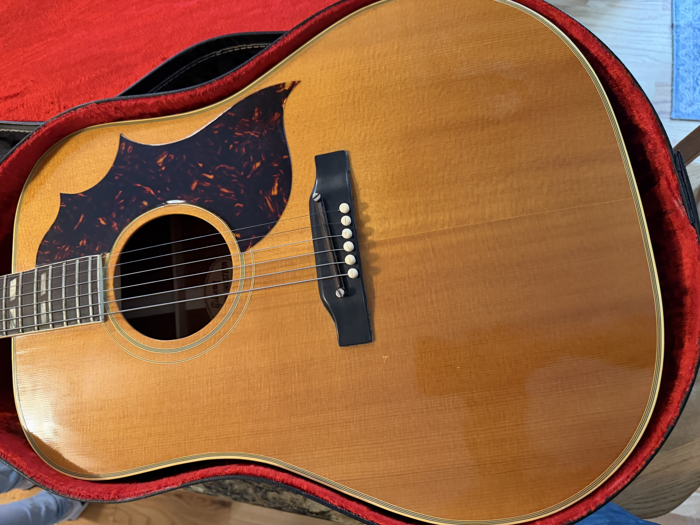
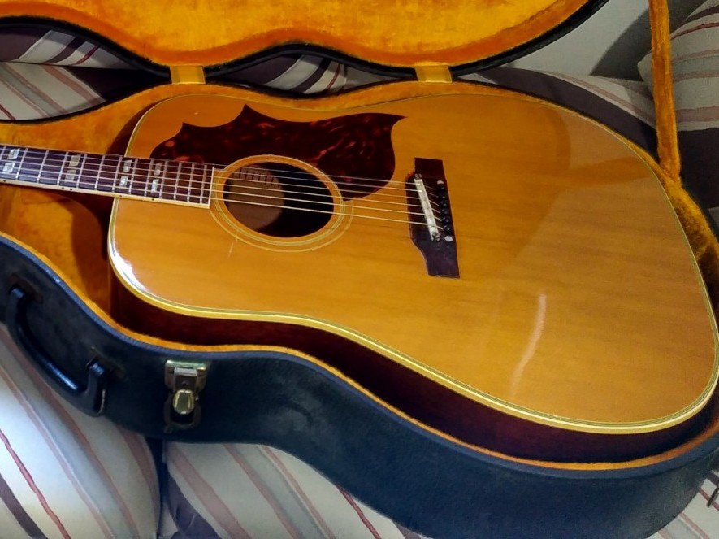
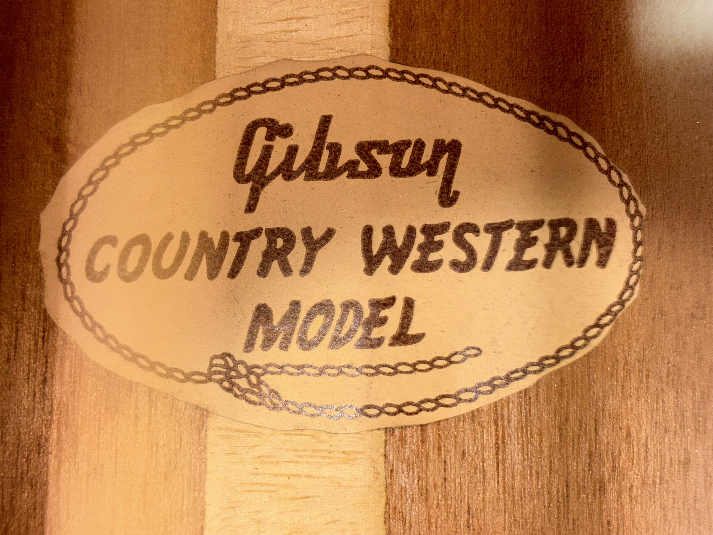

A Gibson Country Western is part of the natural-finish Southern Jumbo family. Authentication requires more than a blonde top: the trim, construction, date and evidence of factory finish must agree. The name also appears as SJN, and later examples use the SJN Deluxe designation.

## Country Western Versus J-50 And Southern Jumbo

Start with the fingerboard. Split parallelogram markers suggest the SJ/Country Western family; the familiar J-50 uses simple dots. Then compare the body shape, binding and finish. A replaced fingerboard or neck can complicate this first check.

A sunburst SJ refinished natural can resemble the right family without being a factory Country Western. The distinction affects both the description and the appropriate price comparison. The [Southern Jumbo authentication guide](/gibson-southern-jumbo-authentication-guide/) shows one such example from my archive.

## The Natural SJ, Country Western And Deluxe Eras

Natural-finish Southern Jumbos were offered before the Country Western name. [Folkway’s examination of a 1954 SJ Natural](https://folkwaymusic.com/museum/gibson-guitars/1954-gibson-sj-nat-0119) documents the early version and the subsequent Country Western naming. The 2026 price guide starts its named Country Western category in 1956.

The [1960 Gibson catalog](https://acousticmusic.org/wp-content/uploads/2016/02/Gibson-1960-Catalog.pdf) uses “SJN Country Western” and shows its relationship to the sunburst SJ. By the mid-1960s, the [Gibson catalog’s SJ/SJN comparison](https://www.vintageguitarandbass.com/gibson/catalogues/1966_29.php) shows the later square-shoulder family.

The change from round to square shoulders is best treated as a 1962 to 1963 transition. The price guide’s categories overlap in 1962; specialist chronologies differ on the exact boundary. Establish the physical configuration before selecting a year category. Later SJN Deluxe guitars have their own changing bridge, binding and fingerboard details.

<figure>

<figcaption>A transitional Country Western with slope shoulders and the pointed Western-style pickguard. Read the body shape, guard and adjustable saddle together; the guard alone does not establish a square-shoulder guitar or an exact year.</figcaption>
</figure>

<figure>

<figcaption>The square-shoulder Country Western has a different upper-body outline from the earlier examples. Compare the shoulders near the neck, not just the pickguard shape.</figcaption>
</figure>

## Check Whether The Natural Finish Is Original

Look for finish differences around the neck heel, binding ledges and bridge perimeter. Uneven sanding, softened edges, residue in protected areas or finish covering later repair work can be reasons to investigate. None is a standalone verdict from a compressed photo.

A natural top that is unusually clean compared with the rest of the guitar deserves a closer look, but clean condition alone is not evidence of a refinish. Ask for repair history and well-lit close-ups before making the claim. Preserve any old labels and paperwork.

<figure>

<figcaption>The interior “Country Western Model” label records the model name. Read it alongside the body, neck, finish and dating evidence; a label alone cannot establish the year or originality of every part.</figcaption>
</figure>

## Bridge, Saddle And Neck Checks

Compare the installed saddle system with the proposed era, then inspect for conversions. A changed bridge can cover the original footprint; an unusually low bridge may have been shaved to compensate for neck angle. A repaired guitar can be authentic while no longer matching its factory configuration.

Check the heel, headstock transition, tuner mounting holes and fingerboard edges. Read a serial number with the [Gibson dating guide](/how-to-read-gibson-serial-numbers/), then confirm it against the instrument. A matching number range alone cannot distinguish a Country Western from another Gibson acoustic.

## Modern Country Western And Sheryl Crow Models

Modern versions can use the same name and many period-style appointments. Model names containing a decade describe an inspiration, not necessarily the manufacture date. Confirm the serial, label and paperwork before using a vintage comparison. A pickup installation alone is not conclusive because older guitars can be modified.

## Photos To Send For Authentication

Include the whole front and back, body shoulders, inlays and binding, both headstock faces, serial and label, bridge and saddle from the side, neck heel and accessible interior. Tell me about known finish work and repairs. If the evidence supports a date range rather than a single year, that is the description to use.

## Value And Next Steps

Once the model, era and condition are established, use the [Gibson Country Western value guide](/vintage-gibson-country-western-value-guide/) for its dated reference ranges. For help identifying a particular guitar, [request a free appraisal](/free-appraisal/) with the photographs above. A photo review may leave an exact year or a concealed repair unresolved; an in-person examination can be necessary.

<nav class="amg-related" aria-label="Related Gibson Country Western guides">
<a href="/vintage-gibson-country-western-value-guide/">Gibson Country Western Values</a>
<a href="/gibson-country-western-authentication-guide/">Gibson Country Western Authentication</a>
<a href="/vintage-gibson-acoustic-value-guide/">All Gibson Acoustic Models</a>
</nav>
