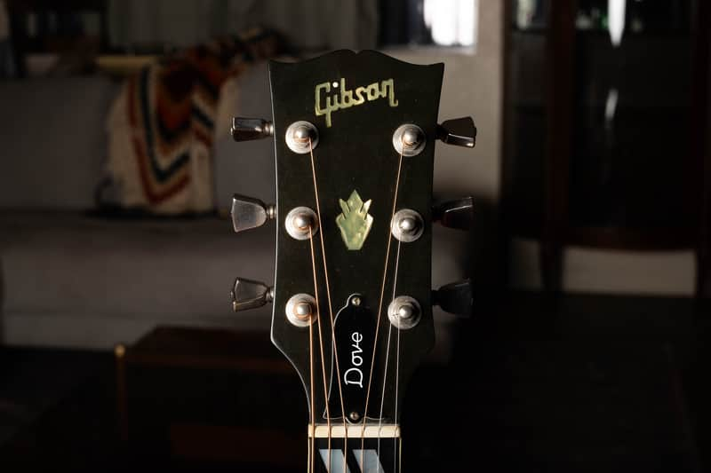

A vintage Gibson Dove is identified by a combination of body construction, scale, trim and period hardware. The bird on the pickguard is an excellent starting point, but replacement guards and reissues make it poor evidence on its own.

## Dove Identification Checklist

The original Dove arrived in 1962 with a square-shoulder body, spruce top, maple back and sides, and a 25½-inch scale. Its split parallelogram fingerboard markers, headstock crown and decorated bridge/guard distinguish the familiar design. These are vintage-model characteristics; later special editions can use other woods. Gibson’s [anniversary model history](https://www.gibson.com/it-eu/blogs/gibson-gazette/gibson-announces-acoustic-anniversary-limited-edition-models) documents the introduction and long-scale maple configuration.

Compare a suspected Hummingbird carefully: both can have square shoulders, split inlays and a bird-themed guard. The standard vintage Hummingbird’s mahogany body and shorter scale make the wood and measurements more useful than a quick glance at the decoration. Measure scale from the nut to the 12th fret and double it; the saddle includes compensation.

## Bridge And Pickguard Timeline

Early Doves used a metal Tune-o-matic-style saddle assembly. By the late 1960s, bridge and saddle arrangements changed; later examples use a fixed saddle. Guard construction also changed, and surviving guitars may have replacement parts. [GuitarHQ’s Gibson flat-top reference](https://www.guitarhq.com/gibson6.html) documents these transitions.

<figure>

<figcaption>A later configuration: my 1976 Ebony Dove, photographed for a <a href="https://reverb.com/item/78866390-gibson-dove-1976-ebony">completed listing</a>. Use this as a 1970s comparison, not a template for an untouched 1962 guitar.</figcaption>
</figure>

Ask whether the bridge footprint, saddle hardware and screw holes agree. A fixed-saddle conversion on an older guitar does not make it a counterfeit Dove, but the modification belongs in its description. Examine guard edges and the surrounding finish for replacement evidence; an attractive reproduction is still a changed part.

## Serial Numbers And The Headstock

<figure>

<figcaption>The headstock of the same 1976 Dove. A branded truss-rod cover is removable and cannot authenticate a guitar by itself.</figcaption>
</figure>

Photograph the entire back of the headstock, its number and any additional stamp. Use the [Gibson serial-number guide](/how-to-read-gibson-serial-numbers/) to establish candidate dates, then compare construction. Some Gibson number sequences repeat; entering a number into a lookup is not a complete authentication.

Check the neck-to-headstock transition under angled light for repaired breaks or overspray. Examine tuner screw patterns and extra holes. The listing for this Ebony example notes an “F” prefix and factory “2” stamp; its suggested explanation for the prefix is not proof that every such stamp establishes a custom color.

## Originality, Repairs And Modern Reissues

Keep three questions separate: Is it a Gibson Dove? When was it built? Which parts and finish remain original? An authentic guitar can have a changed guard, saddle, tuners or repaired headstock. Document each issue rather than collapsing everything into “real” or “fake.”

Modern reissues can deliberately recreate old trim. Their model paperwork, serial system and construction must agree with a modern build date. An aged finish, faded sunburst or old-looking case cannot move a reissue into a vintage price category.

## Photos To Send For Authentication

Send full front and back views, both sides of the headstock, the number or label, neck heel, bridge from above and from the side, guard close-up, and accessible interior views. Add the nut width and scale measurement, plus repair receipts. The more precise the condition record, the more useful an appraisal can be.

## Value And Next Steps

Once the model, era and condition are established, use the [Gibson Dove value guide](/vintage-gibson-dove-value-guide/) for its dated reference ranges. For help identifying a particular guitar, [request a free appraisal](/free-appraisal/) with the photographs above. A photo review may leave an exact year or a concealed repair unresolved; an in-person examination can be necessary.

<nav class="amg-related" aria-label="Related Gibson Dove guides">
<a href="/vintage-gibson-dove-value-guide/">Gibson Dove Values</a>
<a href="/gibson-dove-authentication-guide/">Gibson Dove Authentication</a>
<a href="/vintage-gibson-acoustic-value-guide/">All Gibson Acoustic Models</a>
</nav>
