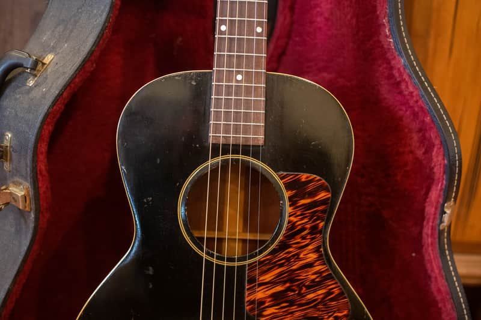
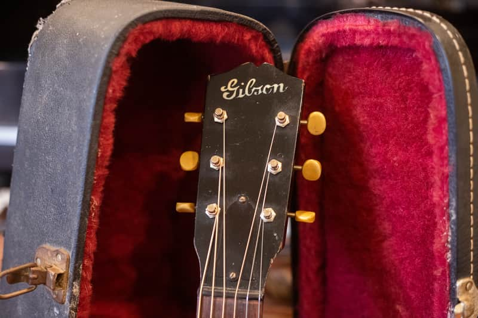

A vintage L-00 belongs to Gibson’s small flat-top L family. Its close relatives overlap in shape and finish, so authentication means reading a group of features together. “L-00” uses two zeroes; an LG-0 is a separate, later model.

## L-00 Identity And Early History

The familiar original L-00 combines a small body, spruce top, mahogany back and sides, dot markers and a simple bridge. Gibson’s [brand history](https://brandbook.gibson.com/overview/gibson) places the L-00 in its early-1930s small-body line.

There is a useful distinction between introduction history and guide coverage. [Vintage Guitar’s examination of a 1933 L-00](https://www.vintageguitar.com/19622/1933-gibson-l-00/amp/) cites the 1931 announcement and describes early 12-fret instruments, followed by 14-fret examples. The 2026 price guide groups its vintage value entry as 1932 to 1946. Neither fact justifies changing an actual guitar’s date to fit a table.

## Neck Joint, Binding And Finish Clues

Count the frets clear of the body, rather than the total number on the fingerboard. Check top and back binding separately. Early L-00s and later examples do not all share the same binding arrangement; back binding became part of the later specification.

Black and sunburst examples both exist, and the L-0 also appears in black. Finish color alone is therefore an unreliable model test. The [GuitarHQ L-family reference](https://www.guitarhq.com/loo.html) explains the overlapping features. Measure the lower bout and photograph the back edge before deciding between the names.

<figure>

<figcaption>This guitar was listed and sold as a 1938 L-00 in my <a href="https://reverb.com/item/67254292-gibson-l-00-1938-black">completed Reverb listing</a>. Its repaired cracks and neck reset are documented there; its front view does not reveal all of that work.</figcaption>
</figure>

## Factory Order Numbers And Headstock Details

<figure>

<figcaption>Headstock detail from the same completed listing. The logo supports the overall examination; it cannot establish an exact year by itself.</figcaption>
</figure>

Look for the factory order number inside the body and capture faint marks in several lighting angles. Do not rub, wet or sand the stamp. Use the [Gibson number guide](/how-to-read-gibson-serial-numbers/) and the complete physical specification together; an absent or unreadable stamp does not automatically make an old L-00 inauthentic.

Compare the logo, tuner footprint, neck shape and joint, but allow for disclosed replacements. New tuners can hide extra screw holes. A replaced logo or repaired headstock needs to be distinguished from the age of the rest of the instrument.

## Bridge, Braces And Repairs

Examine the bridge footprint and pin layout, saddle height, neck angle and top distortion. Interior photographs may reveal crack cleats, bridge-plate work or replaced braces that a front view cannot show. A shaved bridge can make action appear acceptable while leaving the underlying neck-angle issue unresolved.

The 1938 listing shown here records a neck reset, repaired back and side cracks and a non-original case. Those facts do not make it a fake. They belong in the condition report and affect comparison with an excellent original example.

## Separate Vintage Guitars From Modern L-00s

Gibson has used the L-00 name on later production, including reissues and other versions. An old model designation in a sales title does not mean an old manufacture date. Check the actual serial system, label, construction and supporting paperwork. Do not use the original-production value band for a modern guitar merely because its body outline is similar.

## Photos To Send For Authentication

Send full front and back views, both headstock faces, neck-to-body joint, top and back binding, bridge and saddle, interior stamp, and any repair areas. Add the lower-bout width and the number of frets clear of the body. Photographs of the case and old paperwork can support the history without replacing the instrument evidence.

## Value And Next Steps

Once the model, era and condition are established, use the [Gibson L-00 value guide](/vintage-gibson-l-00-value-guide/) for its dated reference ranges. For help identifying a particular guitar, [request a free appraisal](/free-appraisal/) with the photographs above. A photo review may leave an exact year or a concealed repair unresolved; an in-person examination can be necessary.

<nav class="amg-related" aria-label="Related Gibson L-00 guides">
<a href="/vintage-gibson-l-00-value-guide/">Gibson L-00 Values</a>
<a href="/gibson-l-00-authentication-guide/">Gibson L-00 Authentication</a>
<a href="/vintage-gibson-acoustic-value-guide/">All Gibson Acoustic Models</a>
</nav>
