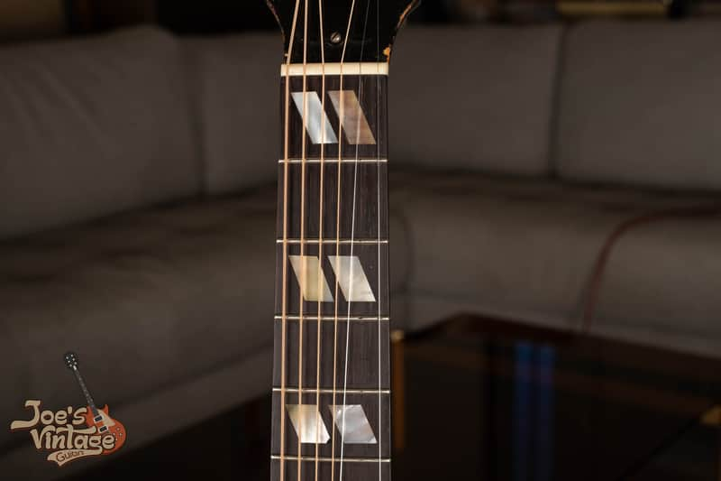
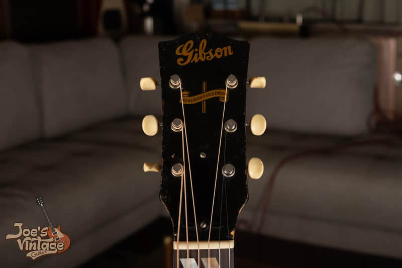
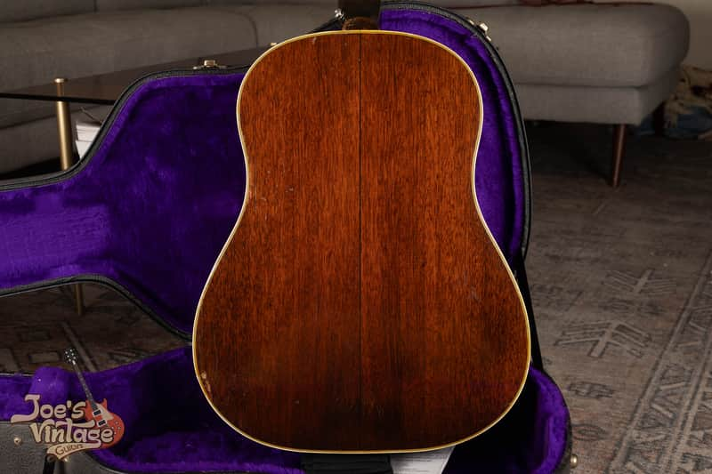
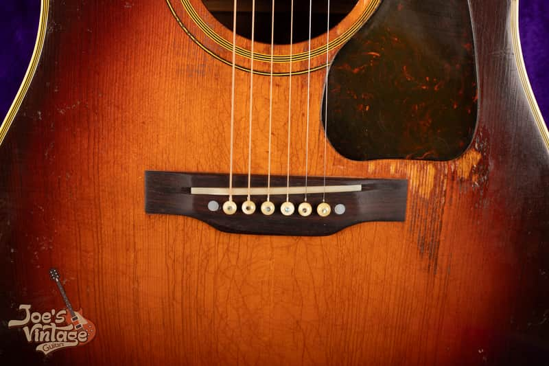
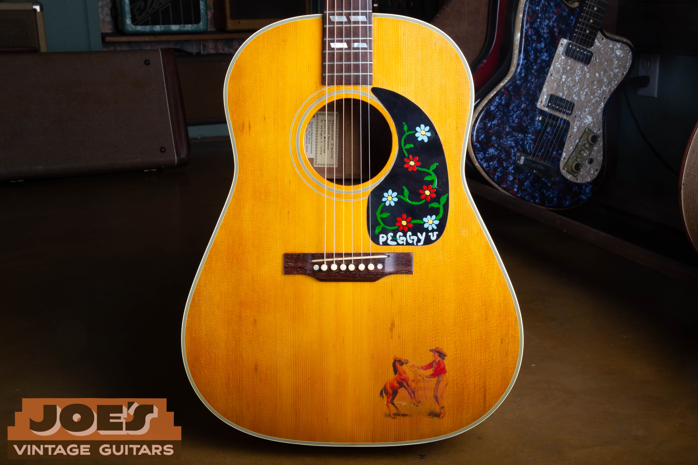
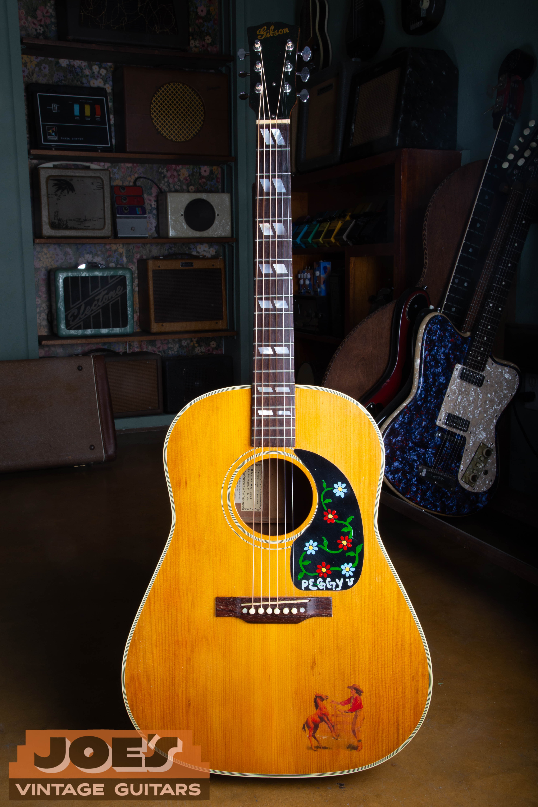

Authenticating a Southern Jumbo means answering three questions: is it an SJ, when was it built, and what has changed? The Banner headstock is a useful starting point on a wartime example, but the body woods, neck, inlays, bridge and finish must tell a consistent story. An authentic old SJ can also have repairs and replacement parts.

## Start With The Southern Jumbo Features

The Southern Jumbo, also called the Southerner Jumbo or SJ, is the more ornamented relative of the J-45. Look for split parallelogram fingerboard markers, multiple lines of body trim and soundhole decoration. Compare those features with the simpler dot markers of a J-45 or J-50. “SJ” here means Southern Jumbo, not the larger SJ-200.

<figure>

<figcaption>The split markers on my 1944 SJ. Its unbound fingerboard is a useful reminder to compare a wartime guitar with its own period, rather than expecting the bound board of a later SJ.</figcaption>
</figure>

Look down both fingerboard edges and photograph the body binding at the front and back. Count frets clear of the body, measure the lower bout and record the nut width. A changed fingerboard or a refinished body can remove identification clues, so none of these features should stand alone.

## The Banner Headstock And Later Logos

<figure>

<figcaption>The Banner headstock on my <a href="https://reverb.com/item/81589697-gibson-southern-jumbo-1944-sunburst-banner">1944 Southern Jumbo listing</a>. Read the small banner together with the Gibson lettering, neck construction and the rest of the instrument.</figcaption>
</figure>

The familiar wartime headstock combines the gold Gibson script with the “Only a Gibson is Good Enough” banner. The usual Banner-era window is 1942 to 1945; very early SJs can have pre-Banner appointments. A typical 1946 has script without the banner, followed by the later block-style logo. [GuitarHQ's photographed SJ chronology](https://guitarhq.com/sj.html) illustrates these changes.

Inspect the edges of the lettering and surrounding lacquer under angled light. Look for a newly applied logo, overspray, a replaced headstock face or a repaired break. Photograph the entire headstock, including its outline, nut, truss-rod-cover area and tuner posts. A convincing emblem cannot establish whether the neck and body belong together.

Modern Gibson [Banner Southern Jumbo reissues](https://www.gibson.com/products/gibson-custom-1942-banner-southern-jumbo-vintage-sunburst-light-aged) reproduce this appearance, including aged finishes. The word “1942” in a modern model name refers to the design, not the guitar's manufacturing year. Check the actual serial system and paperwork.

## Wartime Woods: Mahogany, Rosewood And Maple

Most Southern Jumbos have mahogany backs and sides, but wartime production includes exceptions. Some early examples used rosewood. Rare wartime SJs can also have maple backs, including documented laminated maple back-and-side construction stained dark. [GuitarHQ records these wartime variations](https://guitarhq.com/sj.html).

Identify the back, sides and neck separately. A laminated maple neck does not prove that the back is maple, and a dark stain can obscure the grain. Inspect the inside back with a light and mirror where accessible, compare it with the exterior, and look for evidence of replaced panels. Do not decide wood species from color alone or treat an unusual back as automatic proof of a refinish.

<figure>

<figcaption>The back of the 1944 example. This photograph illustrates the inspection area; it is not presented as a rare maple-back specimen. The listing discloses repaired back cracks.</figcaption>
</figure>

Top wood needs its own examination. Wartime spruce and mahogany tops are different configurations, and the price guide treats them separately. A Banner or a seller's year attribution cannot establish spruce species. Unusual woods need a specific comparison before assigning a premium.

## Neck Construction, Truss Rod And Tuners

Wartime necks vary in wood, lamination and reinforcement. Some have substantial profiles and wooden reinforcement instead of an adjustable metal truss rod; others have adjustable rods. Open-back tuners also vary. Those differences require period comparison, not a single rule that every Banner must have the same neck or hardware.

Photograph the back of the neck and heel in good light. Follow visible seams and inspect for a repaired headstock, neck reshaping or overspray. Compare the finish at the heel with the body. A neck reset can be legitimate repair work, but a poor joint or changed heel shape needs explanation.

Inspect tuner plates, screw locations, shafts and bushings together. Extra holes and imprints can identify an earlier set even when the installed tuners look old. Do not force a stuck truss-rod nut or remove hardware simply to obtain a date. Have a repairer confirm the reinforcement and adjustment condition if it is uncertain.

## Bridge, Saddle And Pickguard Originality

<figure>

<figcaption>The bridge on this 1944 SJ is a replacement. My listing says the removed bridge accompanies the guitar and has an extra drilled hole; the finish, tuners and pickguard are described as original.</figcaption>
</figure>

A period-looking bridge is not necessarily the factory bridge. Check its footprint, height, pin spacing and saddle position. Look for a shadow from a larger bridge, disturbed lacquer, filled holes or a bridge plate altered underneath. A saddle with little height remaining can accompany a neck-angle problem even when the action is currently low.

Inspect the guard outline, thickness and fit against the rosette, then look for a different outline in the finish. The 1944 listing gives us a concrete example: original finish and guard coexist with a replaced bridge, repaired back cracks, filled headstock holes and a replacement case. It should be described accurately rather than called completely untouched.

## Original Sunburst And Refinished Natural Comparison

<figure>

<figcaption>My refinished 1946 SJ provides the comparison with the sunburst 1944 above. The <a href="https://reverb.com/item/98162860-gibson-southern-jumbo-1946-natural">1946 listing</a> documents its refinish, replacement folk-art guard and cracks.</figcaption>
</figure>

<figure>

<figcaption>The script logo and SJ markers remain useful identification clues on the refinished guitar. Its present natural color does not turn it into a factory Country Western.</figcaption>
</figure>

Inspect the heel, binding, soundhole edge and bridge area for sanding, finish buildup and changes in color. A stripped sunburst can lose its most obvious visual feature while retaining its original model identity. Conversely, a natural top can be factory correct on the appropriate later SJ/SJN. [Folkway's examined 1954 SJ Natural](https://folkwaymusic.com/museum/gibson-guitars/1954-gibson-sj-nat-0119) illustrates that later factory option.

## Factory Order Numbers And Interior Evidence

Photograph the neck block through the soundhole and any other factory marks before trying to decode them. Preserve faint letters, spaces and suffixes. A factory order number records production-batch evidence and must be interpreted differently from a later headstock serial. Some wartime guitars have no readable FON; that alone does not make them inauthentic.

Use the [Gibson number guide](/how-to-read-gibson-serial-numbers/) alongside construction. If the proposed date disagrees with the logo, neck or body, investigate the disagreement. Do not force an exact year out of an indistinct mark.

Interior photographs can reveal brace replacements, crack cleats, bridge-plate work or excess glue. Record what is visible and what remains inaccessible. Ask for repair receipts, old photos and retained parts, especially when a neck, bridge or finish has changed.

## Postwar, Square-Shoulder And SJ Deluxe Guitars

The postwar SJ evolved through changes in logos, fingerboard binding, guards and bridges. The 2026 price guide places the round-to-square-shoulder division in 1962; specialist histories commonly place the change in 1963. Treat that boundary as a configuration check rather than a universal January 1 change.

The [1966 Gibson catalog](https://www.vintageguitarandbass.com/gibson/catalogues/1966_29.php) shows the square-shoulder SJ and natural SJN together. Use that factory reference for its own period. Later SJ Deluxe specifications also differ from a wartime Banner, including fingerboard and binding details. Neither a later unbound board nor a square body should be rejected because it differs from the 1944 pictured here.

## Photos To Send And What Happens Next

Send the full front and back, both headstock faces, neck and heel, fingerboard edges, bridge from above and the side, all factory markings and accessible interior views. Include nut width, lower-bout width and known repair work. Those photographs should support separate findings for model, age, woods, finish and replaced parts.

Once those findings agree, use the [Southern Jumbo value guide](/vintage-gibson-southern-jumbo-value-guide/). For help with your guitar, [request a free appraisal](/free-appraisal/). A concealed repair or uncertain wood species may still require an examination in person.

<nav class="amg-related" aria-label="Related Gibson Southern Jumbo guides">
<a href="/vintage-gibson-southern-jumbo-value-guide/">Gibson Southern Jumbo Values</a>
<a href="/gibson-southern-jumbo-authentication-guide/">Gibson Southern Jumbo Authentication</a>
<a href="/vintage-gibson-acoustic-value-guide/">All Gibson Acoustic Models</a>
</nav>
