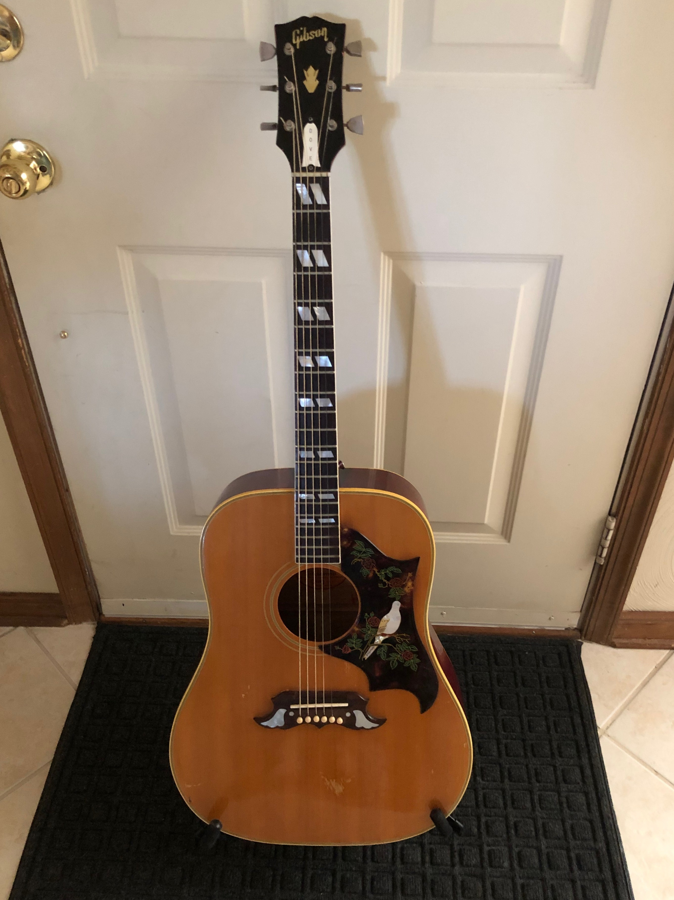
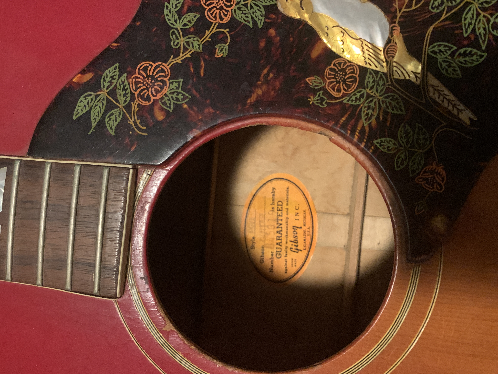
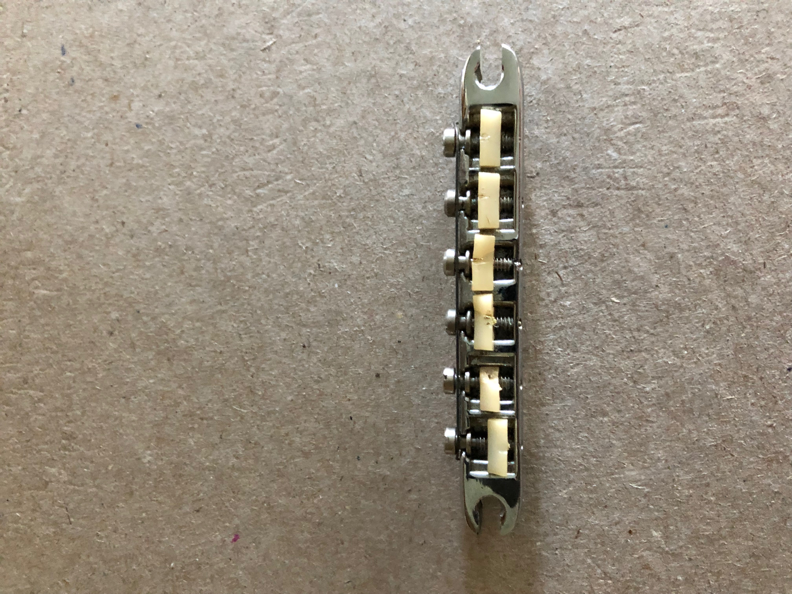
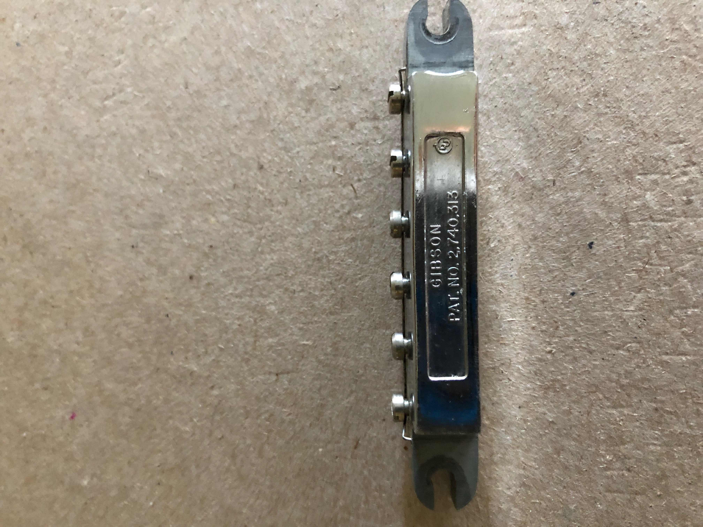
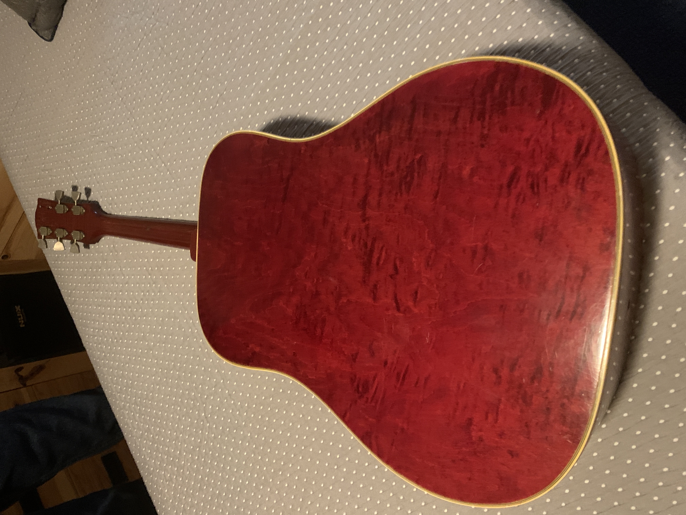
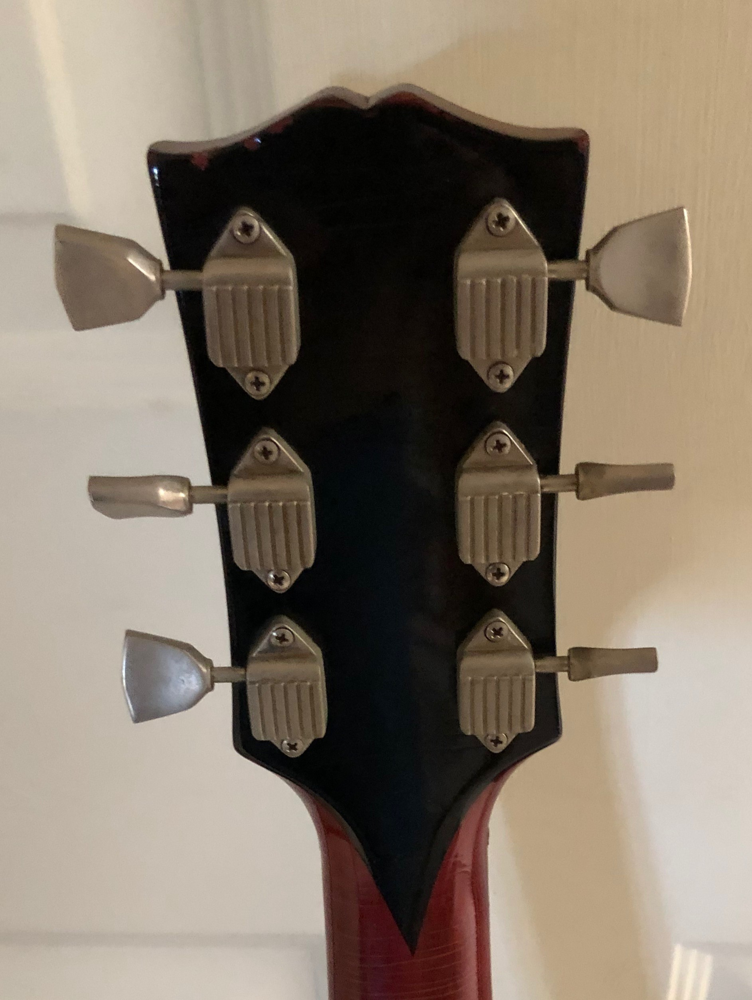

A vintage Dove needs its own comparison: the maple-bodied, long-scale square-shoulder design is a different instrument from a Hummingbird. The early 1960s examples and the later 1970s guitars also occupy different price categories. Identify the construction and condition before choosing a row.

<nav class="amg-related" aria-label="Related Gibson Dove guides">
<a href="/vintage-gibson-dove-value-guide/">Gibson Dove Values</a>
<a href="/gibson-dove-authentication-guide/">Gibson Dove Authentication</a>
<a href="/vintage-gibson-acoustic-value-guide/">All Gibson Acoustic Models</a>
</nav>

## Gibson Dove Value Table: 1962 to 1979

| Era | Configuration | Adjusted Reference (USD) |
| --- | --- | --- |
| 1962 to 1964 | Early Dove | $7,650 to $10,200 |
| 1965, early | Early-1965 configuration | $5,340 to $7,120 |
| 1965, late | Late-1965 configuration | $3,915 to $5,220 |
| 1966 to 1969 | Later 1960s Dove | $3,480 to $4,785 |
| 1970 to 1979 | Various colors | $2,464 to $3,344 |

### How These Ranges Were Prepared

These are adjusted guide references based on [The Official Vintage Guitar Magazine Price Guide 2026](https://store.vintageguitar.com/the-official-vintage-guitar-price-guide-2026.html), page 147. Each source row was reduced by one fixed, randomly assigned percentage from 11% through 15%, applied to both endpoints. They are not reported sale prices or a statistical market average. Reviewed October 2026.

The baseline is an all-original instrument in excellent condition, with its original case where applicable. Repairs, replacement parts, refinishing and missing cases require individual assessment. The adjustment is already included; do not subtract it a second time.

## Choose The Right Dove Price Row

The guide separates early and late 1965. A six-digit number that could fall in more than one year is not enough to choose the higher band. Record the nut width, bridge and saddle system, guard, tuners and any evidence of replacement. Use my [Dove authentication guide](/gibson-dove-authentication-guide/) to assemble those clues.

The table ends at 1979. Later Bozeman Doves, reissues, signature models and Epiphone Doves need separate comparisons. A model name on a truss-rod cover does not establish which version you have.

<figure>

<figcaption>A natural-finish Dove from my photo archive. The full view brings together the body outline, bird guard, bridge decoration and fingerboard markers; original parts still need individual examination.</figcaption>
</figure>

### Check The Model And Dating Evidence

<figure>

<figcaption>The orange label identifies the Dove model and records number 845019. This is a separate archive detail, not the serial number of the natural 1968 guitar in the linked listing. Check the number against the rest of its own instrument.</figcaption>
</figure>

An attractive front view or a legible label cannot resolve a conflicting year attribution by itself. Match the body, scale, hardware and number before choosing the early- or late-1965 category.

## Bridge, Pickguard And Repair Effects

An early metal saddle assembly and a later fixed-saddle bridge are different configurations. A conversion can be useful to a player, but it changes the originality comparison. Look for enlarged bridge footprints, filled holes, an altered bridge plate and insufficient saddle height. A reproduction bird guard should be disclosed even when it looks convincing.

<figure class="amg-hardware-photo">

<figcaption>Front view of a detached Tune-o-matic assembly. The individual saddles and screws show what to inspect when assessing the hardware. A loose part must be matched to its instrument before it is described as original.</figcaption>
</figure>

Keep removed parts with the guitar and document the work. A conversion and an untouched adjustable assembly represent different originality descriptions, even when both guitars are playable.

<figure class="amg-hardware-photo">

<figcaption>Reverse view showing the Gibson and patent markings. A patent number identifies a design; it is not the guitar’s serial number or manufacturing date.</figcaption>
</figure>

### A Modified 1968 Dove Example

The guitar pictured at the top comes from my [1968 natural Dove listing](https://reverb.com/item/97238588-gibson-dove-1968-natural). It has a fixed-saddle conversion, replacement nut and guard, an added passive pickup and a small headstock crack described as stable. This is a condition example, not an all-original benchmark. The listing’s asking price is not a recorded sale or an input to the guide table.

## Maple, Finish And Tuner Condition

<figure>

<figcaption>Figured maple beneath the red finish on this Dove back. Wood, body construction and scale help separate the vintage Dove from a standard mahogany-bodied Hummingbird.</figcaption>
</figure>

Figure and color are only part of the comparison. Establish whether the finish is factory-applied, document any repairs and compare the same version. A healthy neck angle and enough saddle height matter alongside appearance.

<figure>

<figcaption>Waffleback tuners in the supplied archive photo. Inspect screw placement, the surrounding finish and any unused holes before deciding whether the installed set is original to that guitar.</figcaption>
</figure>

Replacement tuners, extra mounting holes and any retained original parts belong in the condition record. The archive photographs above show individual features; they do not certify that every part on a pictured guitar is original.

## From A Reference Range To Your Guitar

A dealer asking price, a completed transaction and a direct purchase offer are different figures. These ranges do not promise your selling proceeds or establish an insurance replacement value. I need the guitar’s model, date, condition and repair record before giving a specific appraisal.

A quality refret preserves the all-original classification of an otherwise original guitar in my grading, while removing museum-quality status. A replacement bridge, neck reshaping or a refinish is a separate issue and must be disclosed.

For a [free appraisal](/free-appraisal/), send full front and back photos, both headstock faces, all numbers or labels, bridge and saddle, neck heel and known repair areas. You can also read about [selling a Gibson](/sell-my-gibson-guitar/).
