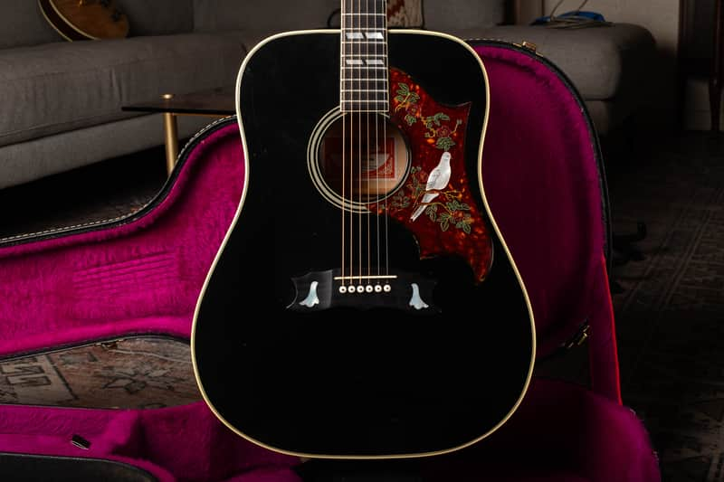

A vintage Dove needs its own comparison: the maple-bodied, long-scale square-shoulder design is a different instrument from a Hummingbird. The early 1960s examples and the later 1970s guitars also occupy different price categories. Identify the construction and condition before choosing a row.

<nav class="amg-related" aria-label="Related Gibson Dove guides">
<a href="/vintage-gibson-dove-value-guide/">Gibson Dove Values</a>
<a href="/gibson-dove-authentication-guide/">Gibson Dove Authentication</a>
<a href="/vintage-gibson-acoustic-value-guide/">All Gibson Acoustic Models</a>
</nav>

## Gibson Dove Value Table: 1962 to 1979

| Era | Configuration | Adjusted Reference (USD) |
| --- | --- | --- |
| 1962 to 1964 | Early Dove | $7,650 to $10,200 |
| 1965, early | Early-1965 configuration | $5,340 to $7,120 |
| 1965, late | Late-1965 configuration | $3,915 to $5,220 |
| 1966 to 1969 | Later 1960s Dove | $3,480 to $4,785 |
| 1970 to 1979 | Various colors | $2,464 to $3,344 |

### How These Ranges Were Prepared

These are adjusted guide references based on [The Official Vintage Guitar Magazine Price Guide 2026](https://store.vintageguitar.com/the-official-vintage-guitar-price-guide-2026.html), page 147. Each source row was reduced by one fixed, randomly assigned percentage from 11% through 15%, applied to both endpoints. They are not reported sale prices or a statistical market average. Reviewed October 2026.

The baseline is an all-original instrument in excellent condition, with its original case where applicable. Repairs, replacement parts, refinishing and missing cases require individual assessment. The adjustment is already included; do not subtract it a second time.

## Choose The Right Dove Price Row

The guide separates early and late 1965. A six-digit number that could fall in more than one year is not enough to choose the higher band. Record the nut width, bridge and saddle system, guard, tuners and any evidence of replacement. Use my [Dove authentication guide](/gibson-dove-authentication-guide/) to assemble those clues.

The table ends at 1979. Later Bozeman Doves, reissues, signature models and Epiphone Doves need separate comparisons. A model name on a truss-rod cover does not establish which version you have.

## Bridge, Pickguard And Repair Effects

An early metal saddle assembly and a later fixed-saddle bridge are different configurations. A conversion can be useful to a player, but it changes the originality comparison. Look for enlarged bridge footprints, filled holes, an altered bridge plate and insufficient saddle height. A reproduction bird guard should be disclosed even when it looks convincing.

<figure>

<figcaption>This 1976 Dove comes from my <a href="https://reverb.com/item/78866390-gibson-dove-1976-ebony">completed Reverb listing</a>. The listing notes a factory “2” stamp and a small bridge-pin crack. It does not establish the realized sale price or a premium for every Ebony Dove.</figcaption>
</figure>

Unusual color alone does not justify adding a fixed premium. Establish whether the finish is factory-applied, document any repairs and compare the same version. A healthy neck angle and enough saddle height matter alongside appearance.

## From A Reference Range To Your Guitar

A dealer asking price, a completed transaction and a direct purchase offer are different figures. These ranges do not promise your selling proceeds or establish an insurance replacement value. I need the guitar’s model, date, condition and repair record before giving a specific appraisal.

A quality refret preserves the all-original classification of an otherwise original guitar in my grading, while removing museum-quality status. A replacement bridge, neck reshaping or a refinish is a separate issue and must be disclosed.

For a [free appraisal](/free-appraisal/), send full front and back photos, both headstock faces, all numbers or labels, bridge and saddle, neck heel and known repair areas. You can also read about [selling a Gibson](/sell-my-gibson-guitar/).
