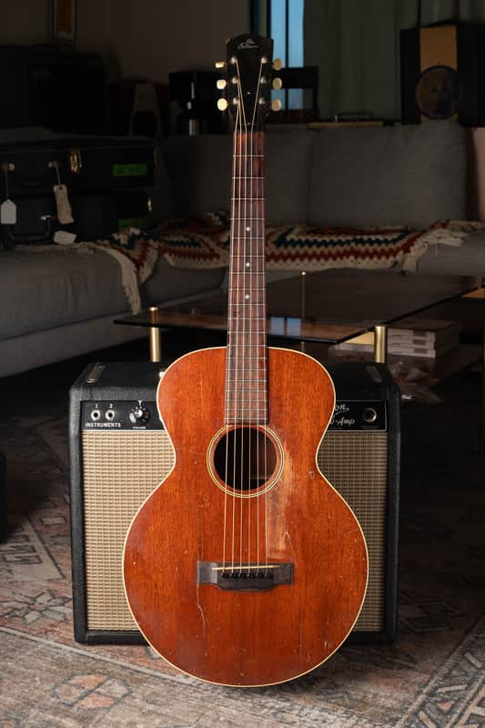
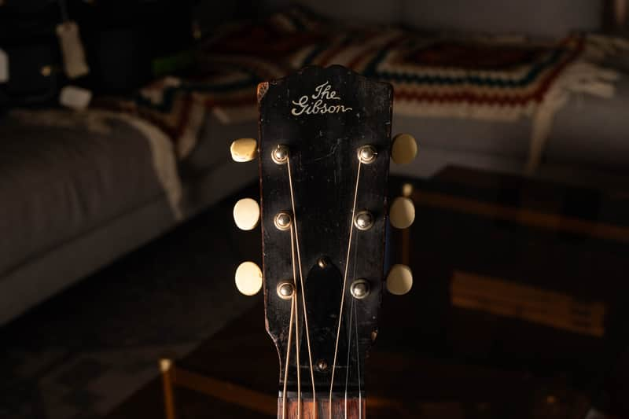
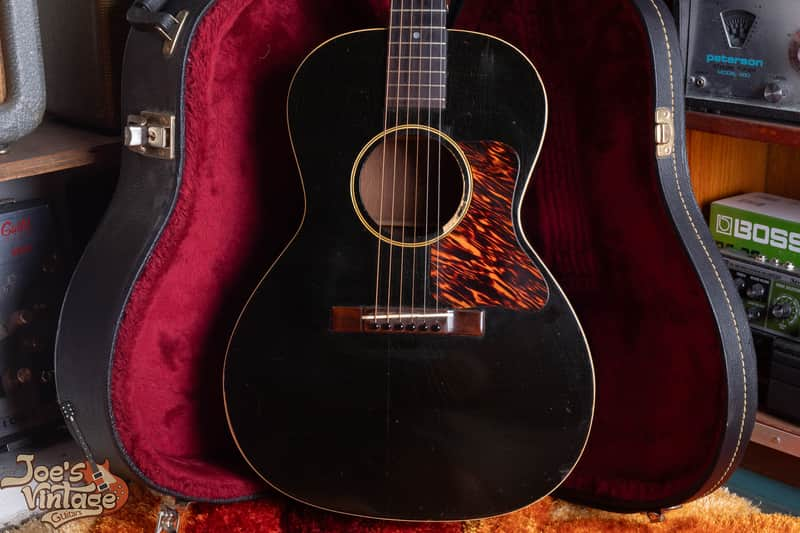
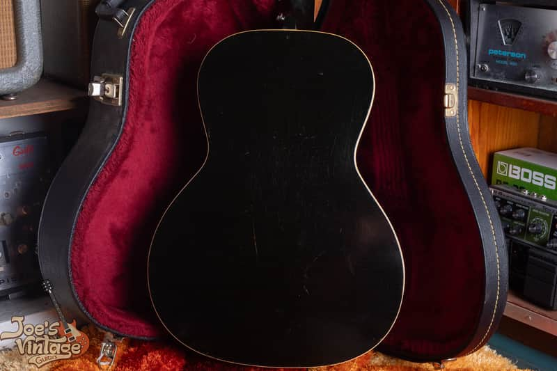
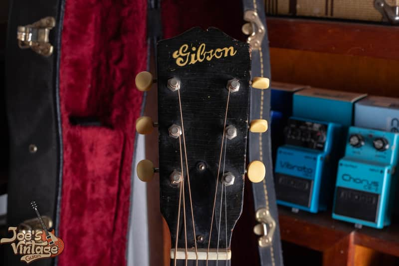
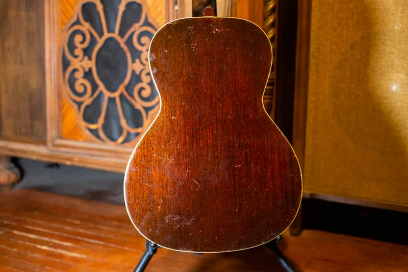
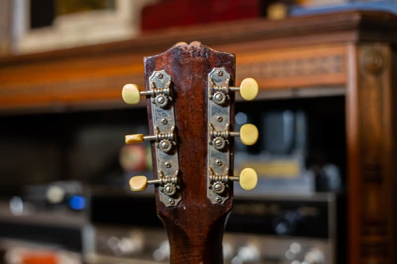

The Gibson L-0 and L-00 names overlap across different periods. The early all-mahogany L-0 is a different starting point from the later black L-0. When Gibson revived the L-0 name, the black guitar and the sunburst L-00 became very close relatives. Identify the version first, then choose its value row.

<nav class="amg-related" aria-label="Gibson L-0 and L-00 guide sections">
<a href="#authentication-checklist">Identify Your L-0 Or L-00</a>
<a href="#gibson-l-0-values">L-0 Values</a>
<a href="#gibson-l-00-values">L-00 Values</a>
<a href="/vintage-gibson-acoustic-value-guide/">All Gibson Acoustic Models</a>
</nav>

## Why The L-0 And L-00 Names Are Confusing

The L-0 name first appeared in 1926. Its original run changed in body size and construction before disappearing in the early 1930s. Gibson reused the name in 1937 for a spruce-top, black-finished model near the bottom of the flat-top line. That later L-0 was closely related to the sunburst L-00, rather than simply continuing the early all-mahogany design.

The price hierarchy changed too. The L-0 had once ranked above the L-00, but the revived black L-0 was advertised at $25 while the sunburst L-00 was $30. Those are period catalog prices, not present-day values. Small changes in trim and finish separated guitars that could otherwise be nearly identical.

For the later pair illustrated here, use black L-0 and sunburst L-00 as the working comparison. It is a useful period distinction, not a rule that every black small-body Gibson is an L-0. Earlier black L-00s also exist. The [examined L-family history at GuitarHQ](https://www.guitarhq.com/loo.html) documents the overlap in construction and finish.

## The Early All-Mahogany L-0

<figure>

<figcaption>My early all-mahogany L-0 from the <a href="https://reverb.com/item/80791235-gibson-l-0-1920s-flattop">1920s listing</a>. This is the earlier use of the model name, not the revived black spruce-top L-0 shown below.</figcaption>
</figure>

Look at the top wood and rounded outline before relying on the name. Measure the lower bout and count frets clear of the body. The price guide separates an approximately 13½-inch early body from a later 14¾-inch form, with different wood categories. The two 1928 entries overlap because they describe different configurations.

<figure>

<figcaption>The headstock from the same early L-0. Lettering helps establish the period when read with the body and construction; it does not supply an exact year by itself.</figcaption>
</figure>

My listing describes substantial repaired cracks, a refret and a replacement case. The guitar illustrates the early model, but its condition requires an individual appraisal. The listing's broad 1920s date is retained rather than replaced with an unsupported exact year.

## The Revived Black L-0

<figure>

<figcaption>The black L-0 from my <a href="https://reverb.com/item/91349493-gibson-l-0-1930s-black">1930s listing</a>. This is the later design associated with the revived L-0 name: spruce top, black finish and simple small-body appointments.</figcaption>
</figure>

The familiar 1937 to 1942 L-0 has an ebony finish, simple white body binding, a small soundhole ring, dot markers and an unbound fingerboard. A firestripe guard and rectangular rosewood bridge complete the familiar appearance. These details need to agree with the proposed period, especially when the finish hides the grain beneath it.

<figure>

<figcaption>The back of the black L-0. Inspect both body edges: a front photograph alone cannot tell you whether the back is bound or whether its finish matches the top.</figcaption>
</figure>

<figure>

<figcaption>The black L-0's script logo and tuner layout. Compare the lettering, headstock shape and hardware with the body's period and construction.</figcaption>
</figure>

The listing describes original finish and parts, with repaired top cracks and a reglued bridge. Those repairs still belong in the condition record even though the overview photographs here concentrate on the model's appearance.

## The Sunburst L-00

The sunburst guitar at the top of this page comes from my [1930s L-00 listing](https://reverb.com/item/47416984-gibson-l-00-1930s-sunburst). Compare its body outline, dot markers, firestripe guard and rectangular bridge with the black L-0. The similarities explain why the names are so often mixed up.

<figure>

<figcaption>The sunburst L-00's back, shown for comparison with the black L-0. Finish and binding are useful clues when assessed together with the neck joint and factory markings.</figcaption>
</figure>

The original L-00 line includes early 12-fret and later 14-fret configurations, with changes in back binding and finish. [Vintage Guitar's examination of a 1933 L-00](https://www.vintageguitar.com/19622/1933-gibson-l-00/amp/) discusses the early instruments. The 2026 price guide starts its broad value band at 1932; that coverage should not be used to erase an earlier documented introduction or change a guitar's actual date.

My sunburst listing records original finish, bridge, tuners and guard, together with repairs, saddle shims and a small added top hole. It is an identification example with a disclosed condition history, not a claim that every pictured part of the guitar is untouched.

## Authentication Checklist

Start with these observations before selecting either price table:

- **Body and top:** measure the lower bout, identify top wood and record the outline. Separate the early mahogany-top L-0 from the later spruce-top family.
- **Neck joint:** count frets clear of the body and inspect the heel for reset work or alteration. Do not count all the frets on the board as the neck-joint measurement.
- **Binding and finish:** photograph top and back edges. Look for sanding, overspray or a changed finish that could erase the original model clues.
- **Guard, bridge and fingerboard:** compare the guard outline, rosette, dot markers, bridge footprint and saddle arrangement. Check removed parts and repair receipts where available.
- **Neck profile and hardware:** record the neck shape, logo, tuner plates and extra mounting holes. A V-shaped neck or old-looking tuners support a comparison but do not establish an exact year.

These models should also be separated from the L-1 and the later LG-0. If the guitar belongs to the LG family, use the [LG-series identification guide](/post/joesvintageguitarsaz-com-identify-gibson-lg-series/). The zero in L-0 does not make it an LG-0.

## Factory Numbers And Headstock Clues

<figure>

<figcaption>The sunburst L-00's headstock back. My listing describes a difficult-to-read number and no located interior FON. This photo is not sufficient to turn that uncertain reading into an exact year.</figcaption>
</figure>

Check both the interior neck block and the back of the headstock. Some late-1930s examples have die-stamped factory numbers on the headstock rather than the more familiar inked neck-block location. Preserve the full mark, its location, letters and spacing before using the [Gibson number guide](/how-to-read-gibson-serial-numbers/).

The neck profile and a bridge without pearl bolt-cover dots can support the comparison, but they are not standalone date codes. Neck shapes evolved within this family, and sanding or replacement parts can change the evidence. Keep an uncertain date as a range until the complete instrument supports more precision.

## Gibson L-0 Values

| Era | Configuration | Adjusted Reference (USD) |
| --- | --- | --- |
| 1926 to 1928 | 13½-inch body; maple category in the guide | $4,840 to $6,160 |
| 1928 to 1930 | 13½-inch body; mahogany category | $4,840 to $6,160 |
| 1931 to 1933 | 14¾-inch body | $5,160 to $6,880 |
| 1937 to 1942 | 14¾-inch body; spruce top | $5,220 to $6,960 |

The source separates early woods and body sizes, then lists the revived spruce-top L-0. Its 1933 to 1937 coverage gap is intentional here; I have not invented values for the intervening years. The early maple category is the price guide's wording, not an identification of my all-mahogany example.

## Gibson L-00 Values

| Era | Configuration | Adjusted Reference (USD) |
| --- | --- | --- |
| 1932 to 1946 | Original-production L-00; shared guide band | $5,280 to $6,600 |

This is the source's single L-00 band. It does not say that every year, finish and neck configuration has the same market value. Later reissues and modern L-00 versions need separate comparisons.

### How These Ranges Were Prepared

Both tables use [The Official Vintage Guitar Magazine Price Guide 2026](https://store.vintageguitar.com/the-official-vintage-guitar-price-guide-2026.html), page 169. Each source row was reduced once by a fixed, randomly assigned percentage from 11% through 15%, applied to both endpoints. They are adjusted references, not recorded sales or a statistical market average. Reviewed October 2026.

The baseline is an all-original instrument in excellent condition, with its original case where applicable. The reduction is already included. Repaired cracks, a refinish, a replacement bridge or a missing case need individual assessment; do not simply apply another universal percentage.

## Condition And Your Guitar's Appraisal

Inspect neck angle, bridge height and saddle room alongside the top's stability. A low action achieved with a shaved bridge is a different situation from a healthy neck angle. Interior photographs may reveal bridge-plate work, altered braces or repairs that a full-front view cannot show.

A quality refret preserves the all-original classification of an otherwise original guitar in my grading, while removing museum-quality status. Replaced parts and refinishing are separate issues and must be disclosed. Neither a listing title nor a pleasant playing setup replaces that condition record.

For a [free appraisal](/free-appraisal/), send full front and back photographs, both headstock faces, body edges, neck heel, bridge and saddle, any factory numbers and known repair details. Include lower-bout width and frets clear of the body. Identify the version first, then compare its condition with the appropriate value row.
