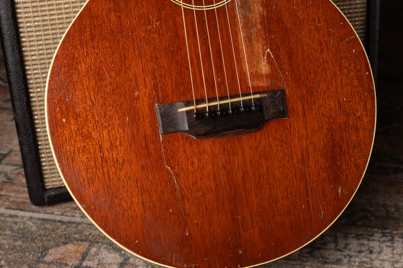

The L-0 name covers more than one body design and wood combination. A small late-1920s guitar should not be priced automatically as a larger 1930s example. Measure the body, identify the top and check the repairs before applying the table.

<nav class="amg-related" aria-label="Related Gibson L-0 guides">
<a href="/vintage-gibson-l-0-value-guide/">Gibson L-0 Values</a>
<a href="/gibson-l-0-authentication-guide/">Gibson L-0 Authentication</a>
<a href="/vintage-gibson-acoustic-value-guide/">All Gibson Acoustic Models</a>
</nav>

## Gibson L-0 Value Table: 1926 to 1942

| Era | Configuration | Adjusted Reference (USD) |
| --- | --- | --- |
| 1926 to 1928 | 13½-inch body; maple category in the guide | $4,840 to $6,160 |
| 1928 to 1930 | 13½-inch body; mahogany category | $4,840 to $6,160 |
| 1931 to 1933 | 14¾-inch body | $5,160 to $6,880 |
| 1937 to 1942 | 14¾-inch body; spruce top | $5,220 to $6,960 |

### How These Ranges Were Prepared

These are adjusted guide references based on [The Official Vintage Guitar Magazine Price Guide 2026](https://store.vintageguitar.com/the-official-vintage-guitar-price-guide-2026.html), page 169. Each source row was reduced by one fixed, randomly assigned percentage from 11% through 15%, applied to both endpoints. They are not reported sale prices or a statistical market average. Reviewed October 2026.

The baseline is an all-original instrument in excellent condition, with its original case where applicable. Repairs, replacement parts, refinishing and missing cases require individual assessment. The adjustment is already included; do not subtract it a second time.

## Identify The Body Before Selecting A Range

The guide separates the roughly 13½-inch early body from the 14¾-inch later design, with another category for the returning spruce-top model. The 1928 rows overlap because the wood/configuration categories differ. Measure and inspect rather than selecting a row from the date alone.

Early construction descriptions differ among reference sources, especially wood identification and transition dates. The table retains the price guide’s categories; a photograph or an uncertain seller description cannot establish that an early back is maple. Use my [L-0 authentication guide](/gibson-l-0-authentication-guide/) and an examination of the actual instrument.

The gap between 1933 and 1937 is intentional in the source coverage. I have not added annual values for the intervening years. An instrument attributed to that period needs its identity checked before pricing.

## A Player’s L-0 And An Excellent Original Example

<figure>

<figcaption>My <a href="https://reverb.com/item/80791235-gibson-l-0-1920s-flattop">completed L-0 listing</a> documents substantial repaired cracks, a refret and a non-original chipboard case. It is a useful repair example, not a specimen meeting every table assumption.</figcaption>
</figure>

Check repaired cracks from both sides where accessible, along with the bridge footprint, top stability and neck angle. A professional repair may make an old L-0 a dependable instrument, but it does not erase the repair history.

Do not confuse the L-0 with the later LG-0, or apply this table to an L-1 simply because the body is similar. A replacement pickguard, refinished top or altered bridge can remove the easiest visual clues.

## From A Reference Range To Your Guitar

A dealer asking price, a completed transaction and a direct purchase offer are different figures. These ranges do not promise your selling proceeds or establish an insurance replacement value. I need the guitar’s model, date, condition and repair record before giving a specific appraisal.

A quality refret preserves the all-original classification of an otherwise original guitar in my grading, while removing museum-quality status. A replacement bridge, neck reshaping or a refinish is a separate issue and must be disclosed.

For a [free appraisal](/free-appraisal/), send full front and back photos, both headstock faces, all numbers or labels, bridge and saddle, neck heel and known repair areas. You can also read about [selling a Gibson](/sell-my-gibson-guitar/).
