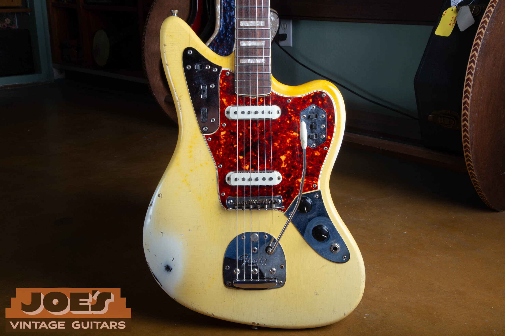
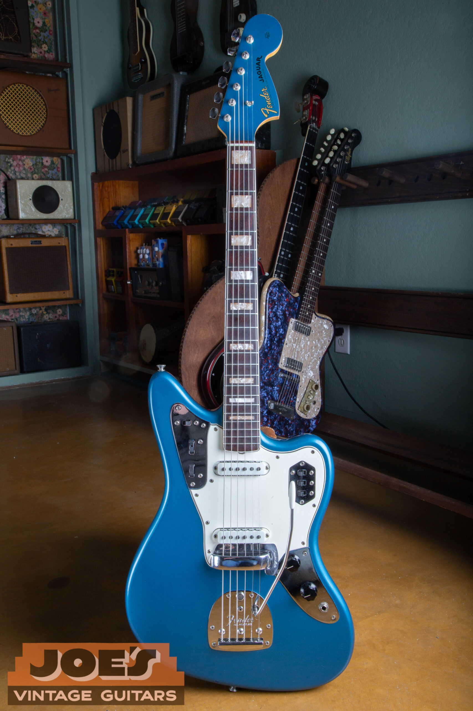
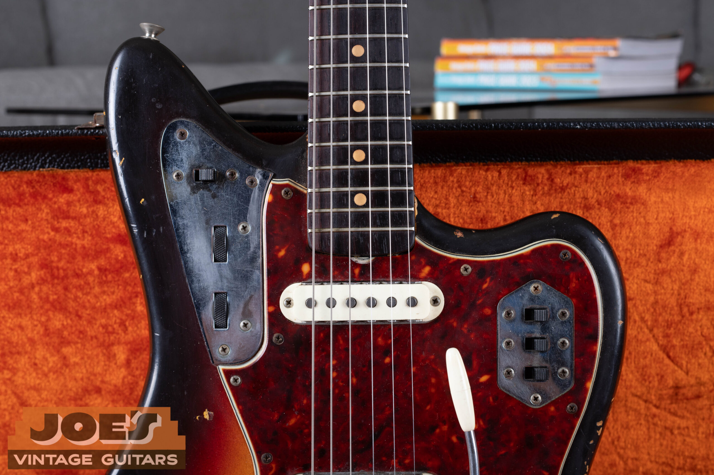
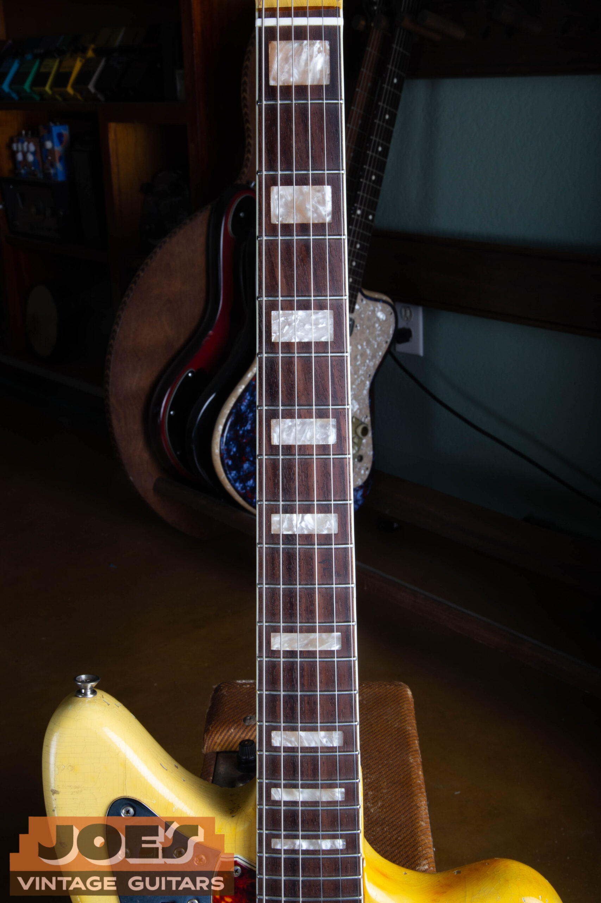
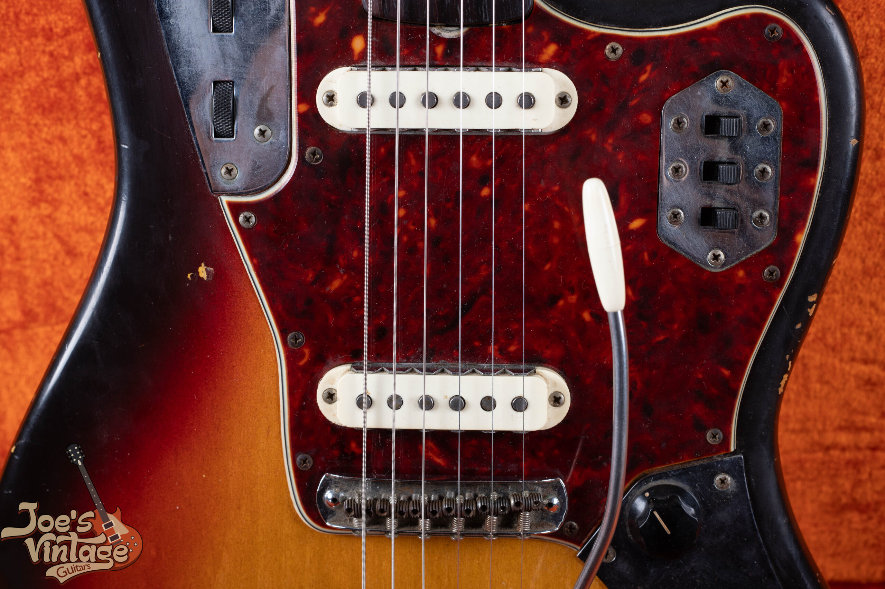
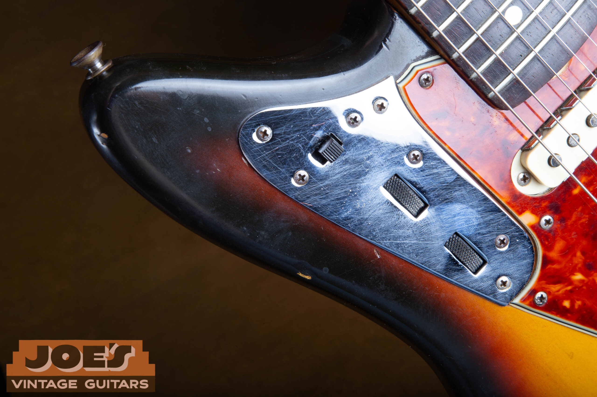

Vintage Fender Jaguar sunburst values run from $3,500 to $9,000 across the original 1962 to 1975 production years, with condition and case differences set out below. First-year examples sit at $6,000 to $9,000; the 1970s range is $3,500 to $4,500. I use those as starting ranges, then assess the actual guitar.

I start with the guitar's year and configuration, then compare the finish, parts, repairs and case with the instruments behind the range. If you need to establish the year or originality first, my [vintage Fender Jaguar authentication guide](/post/vintage-fender-jaguar-guide/) explains the evidence to check.

If you're comparing a Jaguar with another model, use my [Fender guitar and bass value guide](/vintage-fender-value-guide/) to find the matching price table.

## Vintage Fender Jaguar Values By Year

These ranges are reviewed as of October 2026 and stated in U.S. dollars, excluding separately charged shipping and taxes. Condition, originality and the case affect where a guitar falls within its range. Adjacent years can share the same range.

| Year | Sunburst Comparison | Condition |
| --- | --- | --- |
| 1962 | $6,000 to $9,000 | Very Good to Excellent; case and originality documentation vary |
| 1963 | $5,500 to $6,500 | Very Good; see parts and case allowances |
| 1964 | $5,500 to $6,500 | Very Good; see parts and case allowances |
| 1965 | $4,000 to $5,500 | Varying condition; see fretwork and case allowances |
| 1966 | $4,000 to $4,500 | Very Good originals with original cases |
| 1967 | $4,000 to $4,500 | Very Good originals with original cases |
| 1968 | $4,000 to $4,500 | Very Good originals with original cases |
| 1969 | $4,000 to $4,500 | Very Good originals with original cases |
| 1970 | $3,500 to $4,500 | Excellent; see case and service allowances |
| 1971 | $3,500 to $4,500 | Excellent; see case and service allowances |
| 1972 | $3,500 to $4,500 | Excellent; see case and service allowances |
| 1973 | $3,500 to $4,500 | Excellent; see case and service allowances |
| 1974 | $3,500 to $4,500 | Excellent; see case and service allowances |
| 1975 | $3,500 to $4,500 | Excellent; see case and service allowances |

The first-year range mixes examples with different levels of documentation and includes a replacement case and replacement mute foam. It isn't a separate slab-board premium or a promise of museum condition. The 1963 to 1964 comparison allows missing accessories, a replacement case and fretwork; the three documented instruments are from 1963.

The 1965 range allows transition features, fretwork needs and differences in case completeness. The late-1960s range assumes original sunburst finish, an original case, visible wear and no disclosed structural repair. I assess those differences before applying either range.

The 1970s range covers rosewood-board instruments with original pickups. Case originality, minor service needs and the completeness of the original parts can vary. An unusually clean, fully documented guitar needs a closer appraisal.

These ranges don't cover custom colors, maple boards, refinishes or heavily modified guitars. I assess those configurations individually instead of applying a fixed premium or discount.

The original Jaguar run ends in 1975. A guitar described as a 1976, 1977, 1978 or 1979 Jaguar needs its identity checked before you apply an original-run price. A date on a receipt, a replacement part or a later reissue name doesn't establish its manufacturing year.

<figure>

<figcaption>An Olympic White Jaguar body from my site archive, with its tortoiseshell pickguard, two pickups and chrome control plates.</figcaption>

</figure>

## Choosing The Right Comparison

A price range is useful only when the guitar behind it resembles yours. A sunburst Jaguar with its original pickups, original finish and a serviceable case belongs in a different comparison from a refinished guitar with changed electronics. They can both be good instruments, but a buyer is purchasing a different package.

The annual rows help you find a guitar by year. They don't imply that its value changed by a fixed amount when the calendar turned. I consider condition and configuration before narrowing a range.

I also distinguish the condition grade printed on a listing from a description of the actual parts. “Excellent” can describe a clean refinished guitar, while “Very Good” can describe an original guitar with visible playing wear. Neither label, by itself, establishes an original finish, an untouched wiring harness or the right case.

The same distinction applies to maintenance. A quality refret is accepted maintenance and preserves the all-original classification of an otherwise all-original guitar. It removes the instrument from the museum-quality category. Neck reshaping, a replacement fingerboard and enlarged tuner holes are different alterations and need their own assessment.

### The First-Year Question

The Jaguar arrived in 1962, and first-year instruments deserve a closer comparison than a generic “pre-CBS Fender” description. Early slab-board and later veneer-board guitars belong to that same calendar year. Slab and veneer describe two different rosewood fingerboard constructions; they aren't condition grades.

An exceptional early slab-board example needs an individual appraisal. I wouldn't place it in the same category as a later, more worn guitar without checking those differences. An owner's memory of buying it soon after launch doesn't establish the production date by itself.

A first-year guitar also needs its finish separated from its year. A standard sunburst comparison can't price an authenticated rare custom color. That doesn't make every unusual-looking color valuable: the premium depends on the finish actually being original and on finding comparable demand for that configuration.

### Why 1965 Needs Its Own Context

The CBS purchase happened in 1965, but the instruments didn't change all at once. A 1965 Jaguar can retain earlier features or show later changes. I assess its actual features before applying the range; guitars from the same year aren't interchangeable.

For an appraisal, I want the actual configuration described alongside the year. A seller's “pre-CBS” label isn't a substitute for that description. Once the guitar is identified, the comparison can account for its features without assigning a premium to a slogan.

### Later Jaguars And The Player Market

Late-1960s and 1970s Jaguars have their own buyers. Some want a vintage instrument they can use regularly; others collect a particular finish, fingerboard or period. A later guitar doesn't need to imitate a first-year example to have a market.

For these instruments, comfortable setup, working electronics and disclosed modifications help a buyer understand the package. A guitar with missing parts or unresolved playing problems may need a different comparison even when the finish looks clean. A repair estimate should come from inspecting the problem, not from subtracting a generic percentage.

<figure>

<figcaption>This Lake Placid Blue Jaguar in my archive shows the matching headstock, white guard and block inlays. A custom-color comparison needs its own finish evidence.</figcaption>

</figure>

## Original Finish And Custom Color Value

An original finish is part of the collectible instrument. Repainting changes that category even when the new work looks attractive and the guitar plays well. I compare a refinished Jaguar with other refinished examples instead of assuming that a new coat of a rare color recreates the rare original.

Custom colors need individual appraisals. The premium for one color doesn't automatically transfer to another. I consider the finish's originality, condition and the rest of the guitar together.

If the finish is the unresolved part of your guitar's story, the [Fender custom color authentication guide](/post/fender-custom-color-authentication-guide/) covers the finish evidence. Here, the value question starts after that identification is settled. The buyer needs to know which finish they're paying for.

Normal aging can change how a finish looks without making it a refinish. I describe the visible color and wear separately from the conclusion about originality. A photograph with warm lighting isn't enough to establish the factory color, and a polished surface isn't evidence that a guitar has escaped repair.

Wear also needs context. The edges, back and areas touched while playing may show use on an otherwise original guitar. A large repair, added routing or changed finish is a different issue from worn lacquer. I don't combine all of them under a vague “player grade” label and leave a buyer to guess.

<figure>

<figcaption>A close view of a Jaguar from my archive shows the dot markers, upper controls and tortoiseshell guard. The photograph illustrates features, not a separate price band.</figcaption>

</figure>

## Condition, Repairs And Replacement Parts

The price table is a starting comparison, not a list of automatic deductions. Two Jaguars can have the same replacement part and different values because the work affected them differently. A bridge that can be exchanged without changing the body is a different proposition from an enlarged pickup cavity.

Original pickups and electronics help define the guitar. If a pickup has been replaced, I want to know whether the original survives and whether it works. A box containing an original component can improve the completeness of the package, but it doesn't make an undocumented alteration disappear.

A changed switch or potentiometer also needs a plain description. A potentiometer is the electrical control behind a volume or tone knob. Replacing one may have been necessary maintenance; the buyer still needs to know what changed and whether the older part comes with the instrument.

Structural repairs require more detail than “professionally repaired.” The location, extent and present stability of the repair affect the comparison. Photographs and any repair paperwork help, but the final assessment may need an in-person inspection. I don't assign the same discount to every repaired neck or every filled screw hole.

The playing condition belongs in the appraisal too. A neck that won't adjust as expected, worn frets, intermittent switches or a bridge that needs attention can change what a buyer is willing to take on. Tell me about those issues before commissioning work purely to prepare the guitar for sale.

### Refretting And Originality

A quality refret can make a vintage Jaguar easier to use while preserving the all-original classification of an otherwise original instrument. That classification is separate from museum-quality condition. An instrument can be collectible and useful without retaining unusable frets.

The appraisal still considers the quality and extent of the work. Refretting doesn't authorize reshaping the neck or altering the fingerboard. If those changes accompanied the fret work, they should be disclosed separately rather than hidden inside the word “refret.”

<figure>

<figcaption>The bound rosewood board and block inlays are visible in this photograph from my Jaguar guide.</figcaption>

</figure>

## Hardware, Mute And Case Completeness

The Jaguar's hardware is part of the package being compared. Record the bridge, tremolo arm, covers and other included pieces before you move anything. If a replacement is fitted and an older part survives in the case, photograph both and explain which is which.

The Jaguar mute is the hinged plate behind the bridge with a thumb lever and a foam pad. Its foam deteriorates over time, so intact original foam is a collector find. A fresh foam pad should be described as replacement material, and the mute assembly should be described on its own merits.

The case needs the same specificity. “Comes with a case” doesn't tell a buyer whether it's the original case, a period replacement or a modern hard case. A modern case can be useful for transport while remaining a different collectible package from an original case with its accessories.

Save the small items. A tremolo arm, original bridge, instruction sheet, hang tag or dated receipt can help document what accompanies the guitar. I don't add a fixed dollar premium for a bundle whose contents and condition haven't been checked. Instead, I describe the package and compare it with similarly complete instruments.

<figure>

<figcaption>A sunburst Jaguar body from my archive, showing the pickups, bridge, tremolo arm and chrome control plates.</figcaption>

</figure>

## Asking Price, Sale Price And Your Proceeds

A dealer's asking price is an invitation to buy. A completed price records a transaction. Your proceeds are what remains after the costs and terms of your chosen sale. Those figures can differ without any of them being dishonest.

A refinished, repaired or incomplete guitar belongs in a different condition group from a clean original. I check the pickups, finish, repairs and included parts before discussing an offer.

Values can change, and an unusually clean or heavily modified Jaguar may sit outside a broad range. I assess the actual instrument before treating the table as an expected selling price.

For a private sale, you also need to weigh the time spent answering questions, arranging payment, packing and resolving a buyer's concerns. A dealer offer is a separate proposal with its own terms. Neither should be confused with an upper-end retail asking price pulled from an unrelated guitar.

An appraisal can narrow the comparison once the guitar is documented. It isn't a promise that a particular buyer will pay the top of a range on a particular day. Unusual finishes, substantial repairs and mixed original parts are the cases where a broad online table needs the most individual work.

<figure>

<figcaption>The rhythm control plate, slide switch and rollers on a Jaguar from my site archive.</figcaption>

</figure>

## Getting A Value For Your Jaguar

Start with photographs of the full front and back, the headstock, the case and any known repairs or replacement parts. Include the year you believe it is and the history you actually know. If you aren't sure about a finish or component, say so; uncertainty is useful information.

You don't need to take the guitar apart for an initial conversation. Existing photographs of hidden dates or components are helpful if you already have them. I can explain what additional evidence is needed after looking at the complete instrument.

Keep the original parts, paperwork and case together. Don't repaint the guitar, enlarge a cavity or discard old hardware to make the package look newer before asking about value. If it already has modifications, describe them plainly and we can use the appropriate comparison.

I buy vintage guitars nationwide from my shop in Mesa. You can request a [free Jaguar appraisal](/free-appraisal/) with photographs, or read about [selling a vintage Fender guitar](/sell-my-fender-guitar/) if you're ready to discuss a sale. I'll assess the instrument and its condition before explaining the range that fits.