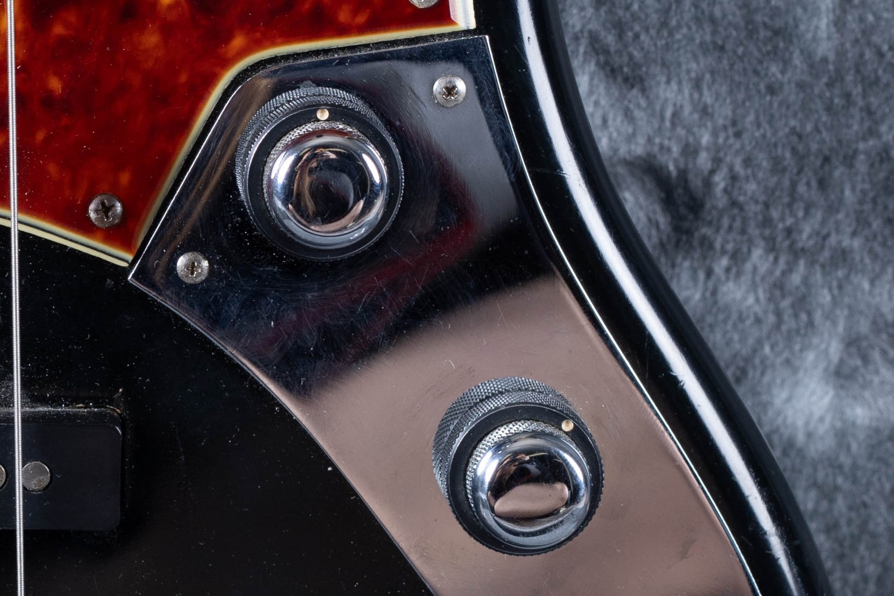
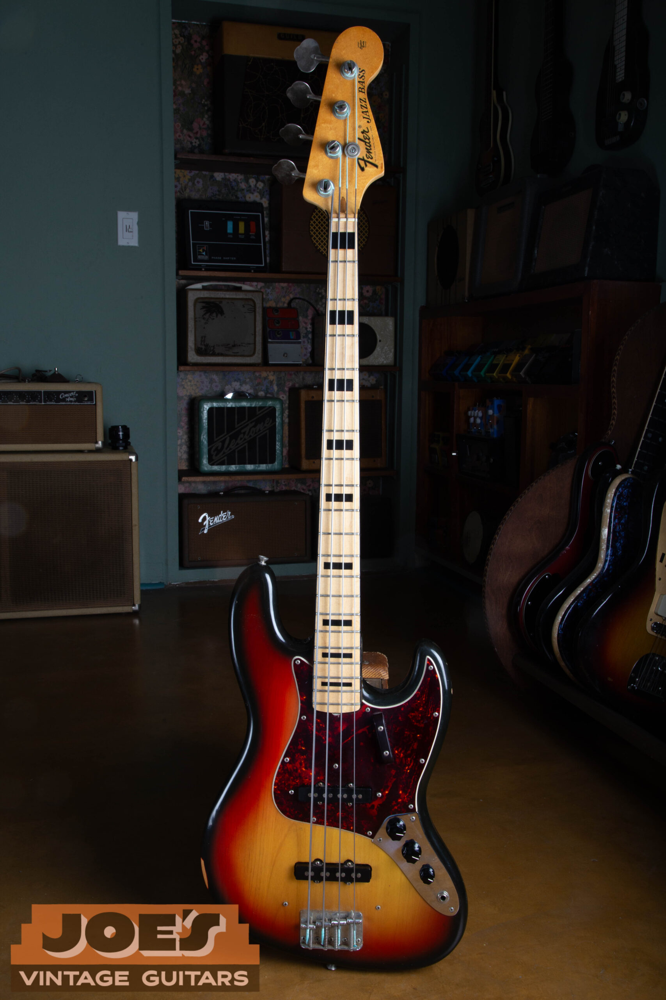
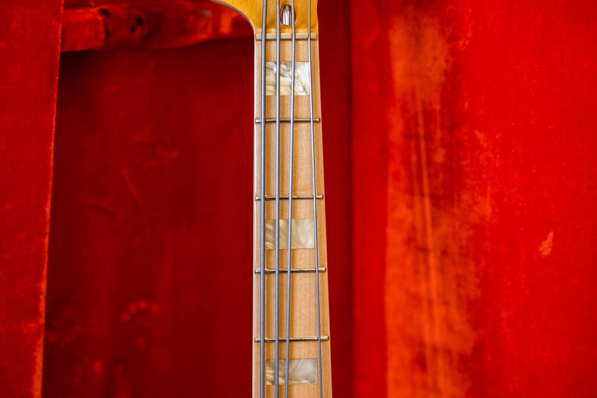
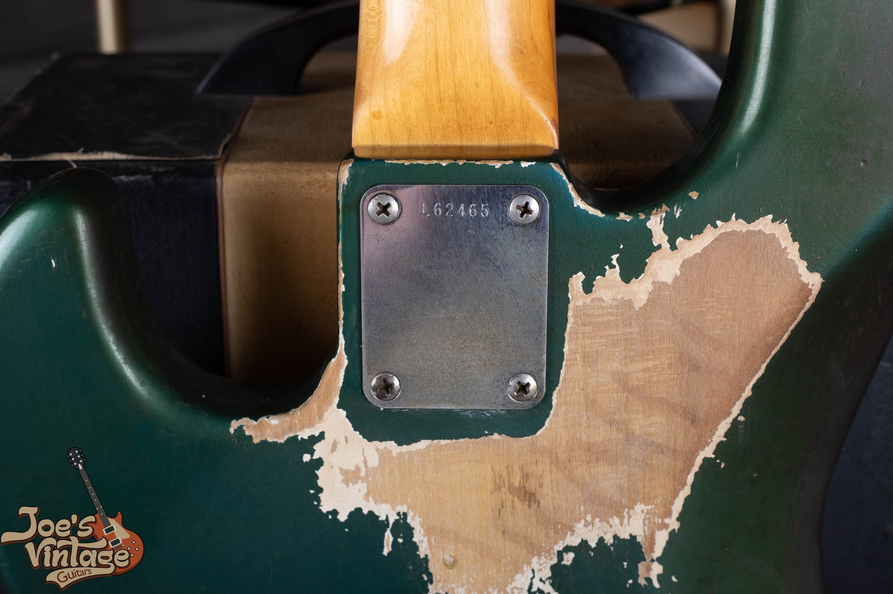
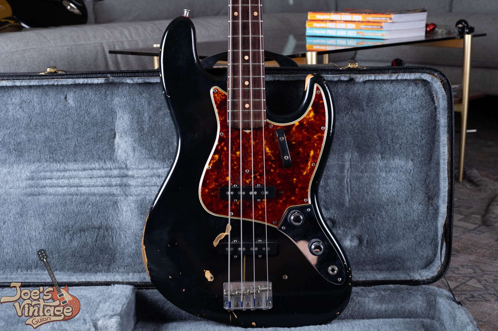

Vintage Fender Jazz Bass comparisons run from $2,000 to $29,000 across 1960 to 1979, depending on the control layout, year, finish and condition. Original sunburst stack-knob examples sit in a $21,000 to $29,000 band; the late-1970s comparison is $2,000 to $4,000. I start with the right group, then narrow it to the bass in front of me.

If the year or originality is uncertain, use my [Fender Jazz Bass dating and authentication guide](/post/vintage-fender-jazz-bass-guide/) before applying a price. I cover market comparisons, condition and selling decisions. The photographs are from my own archive, including a refinished example that's labeled as such.

My [vintage Fender model value guide](/vintage-fender-value-guide/) also links the Precision Bass and guitar price tables if you're comparing more than one instrument.

## Fender Jazz Bass Values By Year

These U.S. dollar ranges are reviewed as of October 2026. They cover original instruments across the condition levels described below. I check wear, repairs and case completeness before placing a bass within its range.

Each production year has a row, and adjacent years can share a range. The two control arrangements overlap in 1961 and early 1962, so those years have separate configuration rows.

| Year | Value Range | Shared Comparison And Condition |
| --- | --- | --- |
| 1960 | $21,000 to $29,000 | 1960 to early 1962 stack-knob era; Excellent original sunburst and case, replacement nut disclosed |
| 1961 | $21,000 to $29,000 | 1960 to early 1962 stack-knob era; Excellent original sunburst and case, replacement nut disclosed |
| 1961 | $21,750 to $30,450 | 1961 to 1964 three-control era; Good to Excellent sunburst, case documentation varies |
| 1962 | $21,000 to $29,000 | 1960 to early 1962 stack-knob era; Excellent original sunburst and case, replacement nut disclosed |
| 1962 | $18,900 to $24,750 | 1961 to 1964 three-control era; Good to Excellent sunburst, case documentation varies |
| 1963 | $10,000 to $21,000 | 1961 to 1964 three-control era; Good to Excellent sunburst, case documentation varies |
| 1964 | $12,900 to $16,700 | 1961 to 1964 three-control era; Good to Excellent sunburst, case documentation varies |
| 1965 | $8,900 to $13,350 | 1965 to 1969 era; Good to Excellent original sunburst, minor hardware changes disclosed |
| 1966 | $4,500 to $12,000 | 1965 to 1969 era; Good to Excellent original sunburst, minor hardware changes disclosed |
| 1967 | $5,250 to $7,400 | 1965 to 1969 era; Good to Excellent original sunburst, minor hardware changes disclosed |
| 1968 | $5,300 to $7,500 | 1965 to 1969 era; Good to Excellent original sunburst, minor hardware changes disclosed |
| 1969 | $5,350 to $7,600 | 1965 to 1969 era; Good to Excellent original sunburst, minor hardware changes disclosed |
| 1970 | $3,500 to $6,000 | 1970 to 1974 era; Excellent to Mint sunburst, original case, refret disclosed |
| 1971 | $3,900 to $4,800 | 1970 to 1974 era; Excellent to Mint sunburst, original case, refret disclosed |
| 1972 | $3,550 to $4,750 | 1970 to 1974 era; Excellent to Mint sunburst, original case, refret disclosed |
| 1973 | $3,350 to $4,050 | 1970 to 1974 era; Excellent to Mint sunburst, original case, refret disclosed |
| 1974 | $2,500 to $3,850 | 1970 to 1974 era; Excellent to Mint sunburst, original case, refret disclosed |
| 1975 | $2,000 to $4,000 | 1975 to 1979 era; Good to Excellent standard finishes, case varies |
| 1976 | $2,000 to $4,000 | 1975 to 1979 era; Good to Excellent standard finishes, case varies |
| 1977 | $2,000 to $4,000 | 1975 to 1979 era; Good to Excellent standard finishes, case varies |
| 1978 | $2,000 to $3,550 | 1975 to 1979 era; Good to Excellent standard finishes, case varies |
| 1979 | $2,000 to $3,500 | 1975 to 1979 era; Good to Excellent standard finishes, case varies |

### What The Ranges Include

The stack-knob range assumes excellent original sunburst finish, original pickups and the original case. A replacement nut can fit within that category. Repairs or substantial parts changes require a separate appraisal.

The early three-control range covers worn later examples through excellent earlier slab-board basses. A slab board is the thicker rosewood fingerboard used before the curved veneer style. Case completeness and originality affect the result; a worn 1964 and a clean 1962 won't necessarily receive the same appraisal.

The 1965 to 1969 group allows minor replacement hardware and visible wear, with original finish, pickups and an original case. Excellent, original examples sit toward the upper end. I confirm the year and condition before choosing where an individual bass belongs within that range.

The early-1970s range allows a professional refret and replacement nut, with the original case. More wear and a replacement case can place a late-1970s bass lower in its range. Refinishes, replacement pickups, extra routing and rare custom colors need individual appraisals.

The ranges exclude separately charged shipping and taxes. They aren't guaranteed purchase offers or the amount an owner will receive after selling costs.

## Why The Control Layout Changes The Comparison

For condition comparisons beyond this model, I explain [how repairs and replaced parts affect vintage guitar value](/what-lowers-vintage-guitar-value/).

The earliest Jazz Bass uses two stacked controls, with a volume and tone adjustment for each pickup. The later arrangement has three separate knobs: two volumes and a shared tone. That difference separates the first collector group from the much longer production run that followed it.

I check the complete instrument before assigning a range. A replacement plate can give a later or modified instrument the appearance of an earlier one. For the stack-knob band, the bass needs to belong to that original configuration, with its finish, pickups and supporting evidence accounted for.

The $21,000 to $29,000 comparison applies to original sunburst stack-knob instruments under the stated conditions. It doesn't apply unchanged to a refinished body, an assembled bass or a later instrument converted to stacked controls. Those can still be good instruments, but the available comparison has changed.

<figure>

<figcaption>The stacked controls on a Jazz Bass from my archive. This control arrangement belongs in the comparison before a price is chosen.</figcaption>

</figure>

Early 1962 stack-knob examples belong with the original stack-knob configuration when the evidence supports it. A 1962 with three controls belongs in the next group. The calendar year doesn't settle that choice by itself, which is why the table carries both rows.

### The Early Three-Control Years

The 1961 to 1964 three-control range is $10,000 to $30,450. It covers different fingerboards and condition levels. Worn examples with incomplete accessories belong lower than excellent earlier configurations.

Once the bass is identified, I narrow that interval. Original finish and pickups, the correct neck, repair history, usable frets and the case all belong in the same appraisal. A clean description without photographs of the wear and changed parts doesn't give me enough to place a bass at the upper end.

An original owner history can help establish what was changed and when. It doesn't turn an undocumented pickup or a replacement case into an original one. I keep the owner's account with the physical evidence so a later buyer can understand both.

## How I Compare The CBS And Seventies Basses

For 1965 to 1969, the $4,500 to $13,350 range spans Good, worn later examples through excellent originals from 1965. The lower floor than the Precision Bass comparison reflects the Good-condition players included here; that Precision band starts at Very Good. Compare equally complete basses in the same condition before treating the difference as a model premium.

A 1966 bound-dot bass deserves its own inspection because it sits within a transition. Its condition and complete configuration can appeal to a different buyer from a later block-inlay player. Its originality and condition determine where it falls within the range.

The 1970 to 1974 comparison is $2,500 to $6,000. The reference includes original-finish sunburst basses with original pickups and cases, from serviced players to unusually complete examples. Fretwork and a replacement nut are disclosed changes, rather than reasons to describe every bass in that interval as untouched.

<figure>

<figcaption>A 1973 Jazz Bass from my archive, showing the sunburst body, maple fingerboard and black block inlays.</figcaption>

</figure>

For 1975 to 1979, the standard-finish range is $2,000 to $4,000. Condition, neck function, weight and retained parts help narrow an individual appraisal. Unusual finishes need a separate assessment.

A Precision Bass, modern reissue or bass assembled from parts needs its own comparison. The instrument's actual model and construction determine which range applies.

### Maple Boards And Playing Condition

A maple fingerboard with block inlays gives a 1970s Jazz Bass a different appearance from the earlier rosewood instruments. I assess the neck's originality and condition with the rest of the bass.

<figure>

<figcaption>A close view of the bound maple board and pearloid blocks on a Jazz Bass from my archive.</figcaption>

</figure>

A bass that needs routine setup work is different from one with an unresolved neck problem. Before I make a firm offer, I want to understand the neck's condition, the remaining fret life and any repair history. If the owner doesn't know, I record that uncertainty instead of treating silence as proof that everything works.

A quality refret is accepted maintenance and preserves the all-original classification of an otherwise all-original instrument. It takes that bass out of the museum-quality category. Neck reshaping, fingerboard replacement and other alterations require a separate assessment because they change more than the worn frets.

## Original Finish, Custom Color And Refinish

The main ranges cover original sunburst or standard finishes. A verified factory custom color can appeal to a different group of buyers, especially when the rest of the bass is complete. I appraise those finishes individually.

Lake Placid Blue, Candy Apple Red and other colors aren't interchangeable price categories. A matching headstock also needs to belong to the original finish package. The [Fender custom color authentication guide](/post/fender-custom-color-authentication-guide/) covers the finish evidence without turning this value page into a paint inspection walkthrough.

<figure>

<figcaption>The back of this Jazz Bass shows finish wear and a white layer beneath the blue. A photograph of the wear belongs with the condition description.</figcaption>

</figure>

The color visible today may have changed with age and wear. That doesn't by itself prove a refinish, just as attractive checking doesn't prove an original finish. I use the established finish assessment when choosing the price group, rather than assigning a premium from the color in one photograph.

A refinished instrument belongs in a refinished comparison. The workmanship can be excellent and the bass can play beautifully, but the collector isn't buying an untouched factory finish. The extent of the refinish and the other retained parts determine the size of the deduction.

<figure>

<figcaption>This black stack-knob Jazz Bass in my archive is refinished. It illustrates a different collector category from the original-finish table.</figcaption>

</figure>

The black stack-knob bass in my archive is a refinished example. Its early control arrangement doesn't make the black finish factory original. That distinction keeps an attractive player's instrument from being priced as an original custom-color collector example.

If a finish has only localized touchup or overspray, I describe the location and extent rather than calling the entire bass either perfect or ruined. Overspray means an added coat over an existing finish. The repair record and photographs help determine the appropriate comparison.

## Pickups, Hardware And The Case Package

The pickups are the components that turn the strings' vibration into an electrical signal. For valuation, I want to know whether the original pair remains, whether either pickup has been rewound and whether any removed parts are included. A working replacement can serve a player well while changing the collector comparison.

I separate a replaced potentiometer, the electrical control beneath a knob, from a body routed for an added pickup. One is a component change; the other removes wood. Treating both as the same generic modification hides information a buyer needs.

Hardware changes also vary. A missing cover screw, a replaced tuner and extra holes from a different bridge aren't equivalent. Listing each change makes the comparison useful and avoids applying the lowest modified-bass price to an instrument with only a minor service part.

Keep removed original parts with the bass. Don't discard an old pickup because it doesn't work or assume a worn bridge has no value to a future owner. I can evaluate what remains before recommending any repair or replacement.

An original case supports the completeness of the package, but it still has its own condition. Broken latches, a missing handle or a damaged lining should be described. A newer protective case may be better for transport while remaining a replacement in the appraisal.

Receipts, tags and photographs can help establish a bass's history. I describe what they actually show. An old photograph of a similar instrument doesn't prove it's the same bass, and a claimed celebrity connection needs documentation.

## What A Market Range Means For A Sale

The table is a comparison of instruments with stated conditions. It isn't a cash offer, an insurance replacement figure or a guarantee of the amount a private seller will receive. Each of those questions has different terms attached to it.

For a direct purchase, I explain the bass's condition and the proposed offer together. For a private sale, the seller still has to consider fees, shipping, any agreed repairs and the final negotiated price. An advertised dealer figure and a seller's net proceeds answer different questions.

If you're comparing offers, keep the included items and responsibilities consistent. A number that includes an original case, loose parts and shipping can't be compared fairly with one that leaves them out. Put the known condition and included accessories in writing so everyone is discussing the same package.

An advertised amount and the price a buyer ultimately pays can differ. A direct buying offer also reflects the instrument's condition and the terms of the transaction.

### Is A Vintage Jazz Bass An Investment?

A collectible bass can retain an audience, while its resale price and time on the market remain uncertain. The acquisition price, condition, originality and eventual selling costs all affect the outcome. Buy an instrument you understand rather than relying on a prediction that every vintage bass will rise together.

For an inherited instrument, there is no need to rush cosmetic work in order to request a value. A clear record of its present condition is a better starting point. Polishing, refinishing or replacing parts before an appraisal can remove evidence that would have helped explain it.

## Getting A Specific Value For Your Jazz Bass

Start with clear photographs of the front, back, headstock, controls, case and any known damage. Include a picture of the serial number and tell me about work you know was done. Don't remove a neck, unsolder a pickup or dismantle unfamiliar hardware for the initial inquiry.

Tell me what comes with it, including loose parts, receipts and the case. If it has been stored for years, say so; you don't need to claim that it plays perfectly before someone has checked it. I can explain which uncertainties affect the appraisal and which photographs would help resolve them.

You can request a [free appraisal of your vintage Jazz Bass](/free-appraisal/) from anywhere in the country. If you're ready to sell, my [Fender buying process](/sell-my-fender-guitar/) explains the next steps. I buy vintage guitars and basses nationwide from Mesa, Arizona.

These ranges were reviewed in October 2026. For an appraisal of your bass, send photographs and any known repair history. I can then explain which condition group fits.