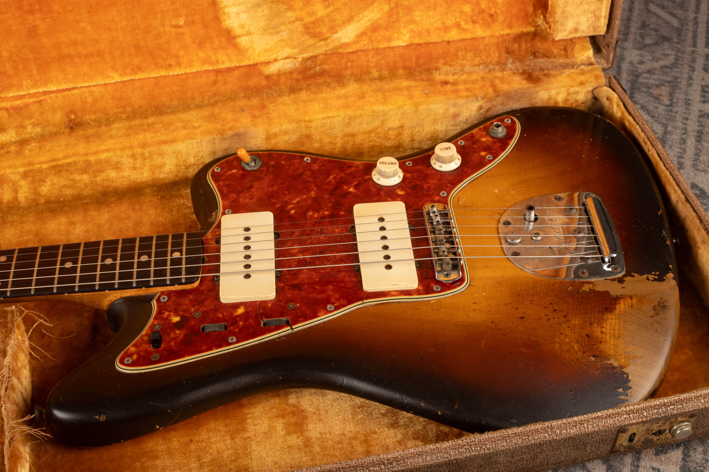
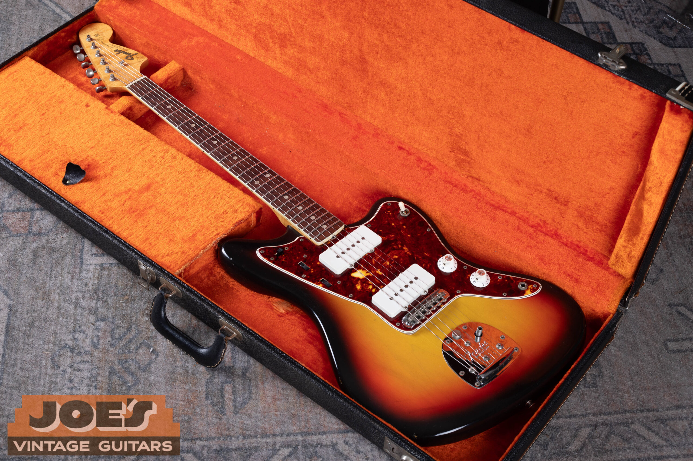
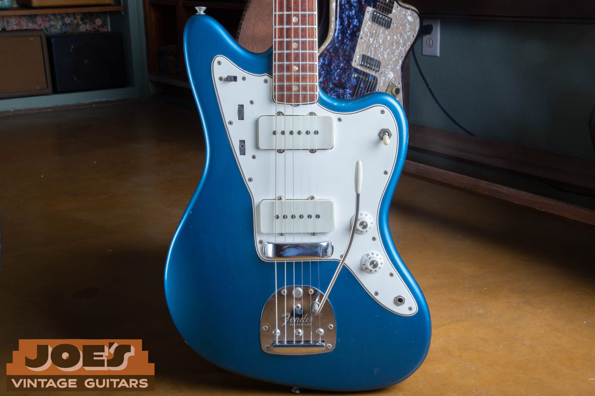
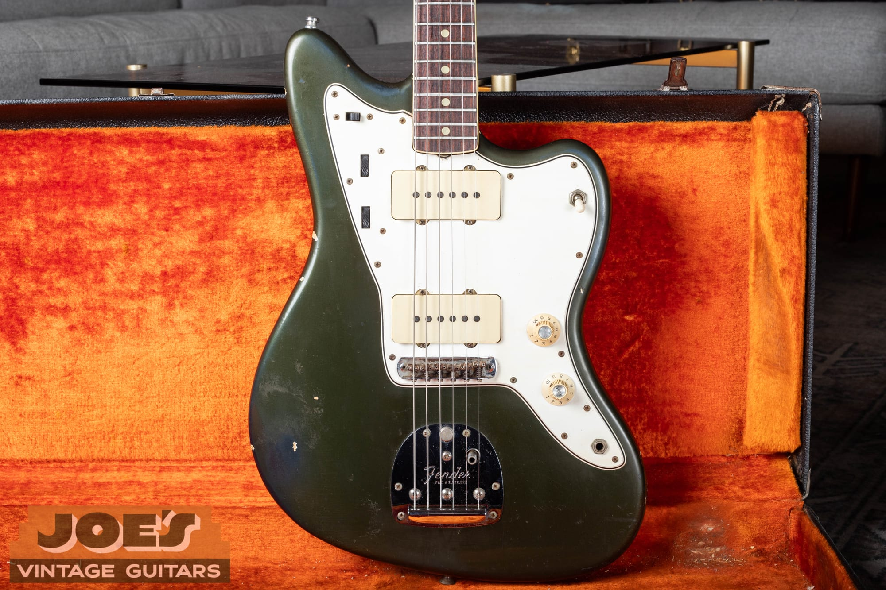
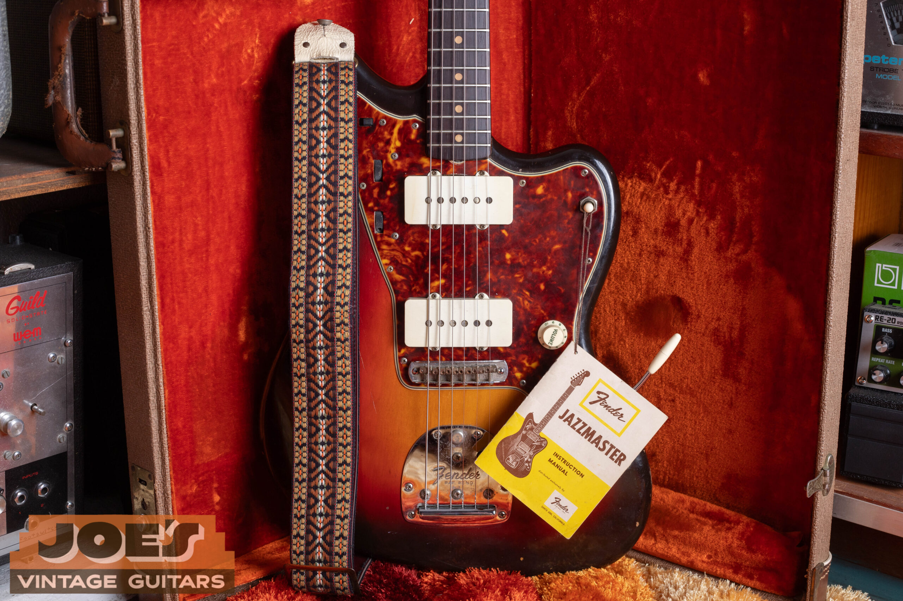
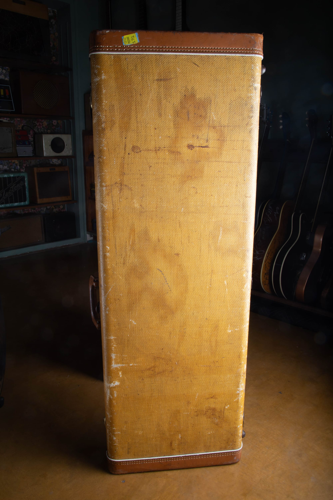

Vintage Fender Jazzmaster guide values run from $3,400 to $5,500 for typical 1970s sunburst guitars to $9,150 to $18,350 for early sunburst guitars, as of October 2026. Gold guards, slab rosewood boards and original custom colors attract additional collector interest, which a year alone won't capture.

For the year and original specification, use my [Fender Jazzmaster dating and identification guide](/fender-jazzmaster-dating-guide/). This guide covers market value and the features that move it.

For comparisons with other Fender models, my [vintage Fender value guide](/vintage-fender-value-guide/) brings the guitar and bass price guides together.

## Fender Jazzmaster Values By Year

**Reviewed October 2026. US dollars.** Adjacent years can share a range. Read the condition notes with the table.

| Year | Value Range | Configuration And Year Notes |
| --- | --- | --- |
| 1958 | $14,350 to $18,350 | Gold anodized guard and slab rosewood board. |
| 1959, Gold Guard | $12,000 to $15,600 | Gold-guard premium exists; shared early-era envelope. |
| 1959, Tortoise Guard | $11,500 to $14,900 | Slab board and original tortoise guard. |
| 1960 | $9,450 to $12,600 | Slab board and tortoise guard on sunburst. |
| 1961 | $9,350 to $12,500 | Slab board; original finish and pickups drive placement. |
| 1962, Early Slab Board | $9,150 to $11,750 | Shared slab-era reference; slab premium over veneer. |
| 1962, Veneer Board | $9,050 to $11,600 | Slab to veneer transition during spring. |
| 1963 | $9,350 to $12,000 | Veneer board and unbound neck. |
| 1964 | $9,350 to $12,000 | Logo and dot-material transitions; still pre-CBS. |
| 1965 | $6,100 to $7,850 | CBS purchase in January; binding arrives late in year. |
| 1966 | $5,550 to $7,250 | Bound dots give way to blocks around midyear. |
| 1967 | $5,800 to $7,550 | Bound blocks; later logo and headstock changes. |
| 1968 | $5,600 to $7,300 | CBS bound-block version; original sunburst. |
| 1969 | $5,550 to $7,250 | Late 1960s bound-block configuration. |
| 1970 | $3,500 to $4,850 | 1970s sunburst reference; custom colors excluded. |
| 1971 | $3,500 to $4,850 | Original pickups and dual circuit retained. |
| 1972 | $3,550 to $4,900 | Sunburst and rosewood-board reference. |
| 1973 | $3,400 to $4,700 | Weight, wear and original parts affect placement. |
| 1974 | $3,450 to $4,750 | Working electronics and original finish assumed. |
| 1975 | $4,000 to $5,500 | Unmodified body and original pickups assumed. |
| 1976 | $3,550 to $4,900 | Case and refret quality affect the individual guitar. |
| 1977 | $3,500 to $4,850 | Later vintage production; reissues excluded. |
| 1978 | $3,400 to $4,700 | Sunburst reference; unusual options need individual evidence. |
| 1979 | $3,500 to $4,850 | Final year covered here, not the end of all Jazzmaster production. |

Gold guards and slab rosewood boards attract collector interest. Both 1959 configurations share the broad early range; condition and originality determine the individual premium. The two 1962 rows distinguish slab and veneer boards. The 1965 range covers played sunburst guitars, while a clean bound-dot example needs an individual appraisal.

### Condition Behind The Ranges

**1958 To 1961 Sunburst Jazzmaster:** Original sunburst finish and pickups, no disclosed structural repair. Played to very clean; minor knob or switch changes accepted. Gold or tortoise guard as appropriate. Original or period case, with some worn or stiff controls at the lower end.

**1962 To 1964 Sunburst Jazzmaster:** Original sunburst finish and pickups, no disclosed structural repairs. Played to clean; refret, one replaced tuner, saddle screws or old owner markings accepted. Original case.

**1965 Jazzmaster, Sunburst, Played Originals:** Original finish, pickups, electronics and principal hardware, with original case and ordinary playing wear. Quality refret accepted; removable strap locks with original buttons retained included. Not a museum-quality band.

**1966 To 1969 Sunburst Jazzmaster:** Original sunburst finish and pickups, no disclosed structural repair, original case. Played to very clean, with a quality refret allowed. Finish wear and case completeness vary.

**1970 To 1979 Sunburst Jazzmaster:** Original sunburst finish and pickups, no disclosed structural repair. Played to very clean; refret, replacement nut or strap buttons and additional shielding accepted. Case originality varies.

## Gold Guards And Slab Rosewood Boards

The Jazzmaster arrived in 1958 with a gold anodized aluminum guard and a slab rosewood fingerboard. Slab describes the thick, flat-bottomed piece of rosewood on the maple neck. The gold guard gives way to tortoiseshell during 1959, so that year's guitars need more than a serial number beside the price.

The gold-guard version carries collector appeal beyond an ordinary later sunburst. Its condition, originality and complete hardware determine how much of a premium it brings. I identify both 1959 versions separately in the table.

Slab boards generally bring more than later veneer boards. Veneer is the thinner curved-bottom rosewood board that follows during spring 1962. The two 1962 rows separate those configurations.

<figure>

<figcaption>A worn sunburst 1962 Jazzmaster in its yellow-lined case. From my archive.</figcaption>

</figure>

An original finish with honest playing wear is a different purchase from a freshly refinished guitar. The 1962 photo shows a worn sunburst instrument, and that wear belongs in its condition assessment. The slab board doesn't cancel the effect of repairs, changed pickups or a replaced neck.

## Pre-CBS And The 1965 Transition

Pre-CBS refers to manufacture before CBS bought Fender in January 1965. The ownership date doesn't create a single overnight specification change. Jazzmasters built during 1965 move through changes to knobs, plates and tuners, with fingerboard binding appearing late in the year.

Bound dot-marker necks precede the block-inlay version that arrives around mid-1966. A clean bound-dot guitar can interest a different buyer from a worn earlier-style 1965. The $6,100 to $7,850 row covers played sunburst guitars; it isn't an upper limit for every transitional example.

The later 1960s range reaches $9,000 for cleaner guitars and desirable configurations. That doesn't make every 1967 worth more than every 1965. Condition and configuration can outweigh the calendar year.

<figure>

<figcaption>A sunburst 1966 Jazzmaster in an orange-lined case. From my archive.</figcaption>

</figure>

The bound neck, block inlays and later fittings define much of the CBS-era appearance. Original pickups and the complete lead and rhythm circuits remain part of the guitar's identity. The Jazzmaster never had the Jaguar's string mute, so a missing mute isn't a value deduction on this model.

## Custom Colors And Matching Headstocks

<figure>

<figcaption>A Lake Placid Blue Jazzmaster with a white guard and white pickup covers. From my archive.</figcaption>

</figure>

Lake Placid Blue, Charcoal Frost and other factory colors need an individual appraisal. An original matching headstock can add collector interest. The exact color, originality and condition determine the premium.

After the gold-guard period, factory custom colors use white guards, with Olympic White the exception that can be paired with tortoiseshell. Tortoise on Fiesta Red or Lake Placid Blue isn't an ordinary factory pairing. That finish-and-guard question belongs in an originality assessment before a color premium is considered.

The white guards are nitrate through mid-1965, then non-nitrate white vinyl. Their material belongs with the guitar's production period. The [Fender custom-color authentication guide](/post/fender-custom-color-authentication-guide/) explains the finish evidence behind a factory-color appraisal.

<figure>

<figcaption>Finish wear on a Charcoal Frost Jazzmaster with a white guard. From my archive.</figcaption>

</figure>

The Charcoal Frost photograph shows visible wear on a custom-color guitar. Original wear doesn't establish a single discount, just as a desirable color doesn't guarantee the top price. Finish, originality and the guitar's condition need to describe the same instrument.

## Original Pickups, Routing And Refinished Bodies

For condition comparisons beyond this model, I explain [how a refinish affects vintage guitar value](/how-much-does-a-refinish-hurt-guitar-value/).

The broad Jazzmaster pickups are part of the model's appeal. A guitar cut for other pickups has changed wood as well as changed electronics. Restoring the appearance with original-style covers doesn't restore the removed material.

A professional refinish reduces collector value, while normal wear on an original finish belongs in a different category. I assess the finish, repair quality and retained parts together before adjusting a Jazzmaster's value.

A quality refret preserves the all-original classification of an otherwise original guitar while taking it out of the museum-quality category. It differs from a replacement neck, enlarged pickup routes or a full refinish. The price-table conditions already allow some maintenance, so another automatic deduction would count it twice.

## Cases And The 1970s Market

<figure>

<figcaption>A sunburst Jazzmaster with a woven strap and Fender instruction manual. From my archive.</figcaption>

</figure>

The original case and accessories can complete an unusually intact guitar. Early tweed, later brown and black cases belong to different periods, so the case should match the instrument's actual era. The [Jazzmaster evolution guide](/post/fender-jazzmaster-evolution-guide-1958-1971/) covers that wider history.

<figure>

<figcaption>A tweed case with brown leather ends and visible wear. From my archive.</figcaption>

</figure>

The $3,400 to $5,500 1970s range covers sunburst guitars with original pickups and finish. A quality refret, replacement nut or strap buttons, or added shielding can fit within that range. Factory custom colors and unusual options need a separate appraisal.

These later guitars can provide the familiar Jazzmaster layout without the early gold-guard or slab-board collector price. A working vibrato, intact controls and a comfortable neck affect their usefulness as instruments. Original parts and a clear repair history help explain a particular asking or selling figure.

For an individual appraisal, send front and back photographs, the headstock, bridge, case and any known changes through the [free guitar appraisal](/free-appraisal/) page. Keep removed original parts with it. A dealer offer includes preparation, selling costs and margin, so it won't simply repeat the top retail reference.
