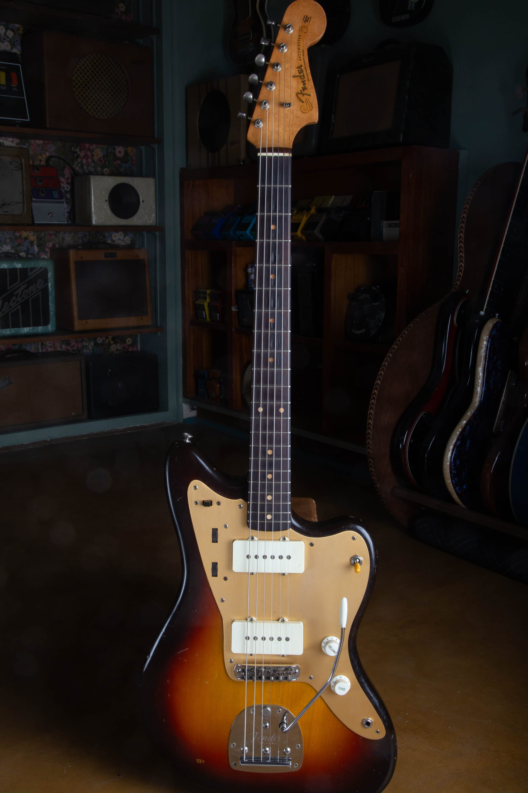

Vintage Fender Jazzmaster reference values run from $4,200 to $6,000 for typical 1970s sunburst guitars to $12,000 to $20,000 for early sunburst examples, as of October 2026. I list every year from 1958 through 1979 below and keep factory custom colors outside these sunburst ranges.

My [Fender Jazzmaster dating and authentication guide](/fender-jazzmaster-dating-guide/) covers the year and originality work. This value guide explains which comparisons make sense once those details are established.

## Fender Jazzmaster Values By Year

**As of October 2026. All ranges are in US dollars.** Each year is listed separately. **Repeated ranges are shared era references**, supported by at least three independent completed sales per comparison group, not three sales for every individual year. Match the condition notes below before applying a range.

| Year | Value Range | Comparison Group |
| --- | --- | --- |
| 1958 | $12,000 to $20,000 | Early Sunburst |
| 1959 | $12,000 to $20,000 | Early Sunburst |
| 1960 | $12,000 to $20,000 | Early Sunburst |
| 1961 | $12,000 to $20,000 | Early Sunburst |
| 1962 | $8,500 to $11,000 | Early 1960s Sunburst |
| 1963 | $8,500 to $11,000 | Early 1960s Sunburst |
| 1964 | $8,500 to $11,000 | Early 1960s Sunburst |
| 1965 | $6,000 to $7,000 | Played Original Sunburst |
| 1966 | $5,500 to $9,500 | Bound Neck, Sunburst |
| 1967 | $5,500 to $9,500 | Bound Neck, Sunburst |
| 1968 | $5,500 to $9,500 | Bound Neck, Sunburst |
| 1969 | $5,500 to $9,500 | Bound Neck, Sunburst |
| 1970 | $4,200 to $6,000 | 1970s Sunburst |
| 1971 | $4,200 to $6,000 | 1970s Sunburst |
| 1972 | $4,200 to $6,000 | 1970s Sunburst |
| 1973 | $4,200 to $6,000 | 1970s Sunburst |
| 1974 | $4,200 to $6,000 | 1970s Sunburst |
| 1975 | $4,200 to $6,000 | 1970s Sunburst |
| 1976 | $4,200 to $6,000 | 1970s Sunburst |
| 1977 | $4,200 to $6,000 | 1970s Sunburst |
| 1978 | $4,200 to $6,000 | 1970s Sunburst |
| 1979 | $4,200 to $6,000 | 1970s Sunburst |

These are sunburst comparisons. Early gold-guard and tortoise-guard examples share the first reference band; bound-neck dot and block versions share the later 1960s band. Those groupings don't claim that every specification commands the same individual price.

The 1965 band uses a closer set of played originals with original cases, while adjacent era bands include a wider spread of wear and completeness. The 1970s reference doesn't separately price a factory custom color, a maple fingerboard or an unusually untouched example. I won't manufacture a year premium by adding a fixed amount to the previous year's row.

### Condition Behind The Ranges

**1958 To 1961 Sunburst Jazzmaster:** Original sunburst finish and pickups, no disclosed structural repair. Played to very clean; minor knob or switch changes accepted. Gold or tortoise guard as appropriate. Original or period case, with some worn or stiff controls at the lower end.

**1962 To 1964 Sunburst Jazzmaster:** Original sunburst finish and pickups, no disclosed structural repairs. Played to clean; refret, one replaced tuner, saddle screws or old owner markings accepted. Original case.

**1965 Jazzmaster, Sunburst, Played Originals:** Original finish, pickups, electronics and principal hardware, with original case and ordinary playing wear. Quality refret accepted; removable strap locks with original buttons retained included. Not a museum-quality band.

**1966 To 1969 Sunburst Jazzmaster:** Original sunburst finish and pickups, no disclosed structural repair, original case. Played to very clean, with a quality refret allowed. Finish wear and case completeness vary.

**1970 To 1979 Sunburst Jazzmaster:** Original sunburst finish and pickups, no disclosed structural repair. Played to very clean; refret, replacement nut or strap buttons and additional shielding accepted. Case originality varies.

I use rounded Reverb Price Guide final transaction prices and Heritage auction results, checked against the instrument descriptions. The records span 2020 to 2026, depending on the group; the review date doesn't turn an older sale into a current transaction. Auction totals include the buyer's premium. Shipping and tax are excluded, and these aren't dealer buying offers or guaranteed selling prices.

Seller descriptions supply the condition evidence behind these comparisons. I still need to examine the actual guitar before treating its finish, pickups or repair history as established. A repeated era range is a starting point for that appraisal, not a separate sale record for each year.

<figure>

<figcaption>This Jazzmaster has a gold pickguard and white pickup covers against a sunburst finish. Photo by Joe Dampt.</figcaption>

</figure>

## Early Jazzmasters And The Gold Guard

Fender introduced the Jazzmaster in 1958. Its early gold-colored anodized metal pickguard distinguishes the first production period visually. That guard is part of the configuration being compared, rather than a complete statement about a guitar's originality.

I want the finish, pickups, electronics and condition considered alongside it. A replacement guard doesn't change the date of the guitar, and a correct early guard doesn't establish that the body finish is original. The appraisal needs the complete instrument's history.

The case and accessories also need precise descriptions. An original case, a period replacement and a modern case are different inclusions. I record what comes with the guitar instead of assuming that a case pictured beside it has always belonged to it.

## Slab Boards, Veneer Boards And Bound Necks

Slab board and veneer board describe two different constructions of the rosewood fingerboard. Bound neck refers to the edging around the fingerboard. These terms help place a Jazzmaster into a period, but they aren't condition grades or automatic premiums.

I use the established period to choose relevant completed sales. Then I account for the guitar's finish and parts rather than assuming all examples with the same fingerboard construction should share one value.

The [Jazzmaster evolution reference](/post/fender-jazzmaster-evolution-guide-1958-1971/) covers the changes in detail. This page doesn't repeat the serial, neck-date or component inspection process; that work needs to be resolved before its result is used in a price comparison.

A later bound-neck Jazzmaster and an earlier dot-neck guitar can appeal to different buyers. A useful appraisal explains which period is being offered and what condition it is in. A generic vintage Jazzmaster average conceals both facts.

<figure>

<figcaption>Wear through the sunburst is visible on this 1962 Jazzmaster. A worn original finish and a refinish belong in different comparisons. Photo by Joe Dampt.</figcaption>

</figure>

## Factory Custom Colors

An original custom color needs a separate comparison from sunburst, with the exact finish and period established. I don't apply one multiplier to every color. Different colors and configurations require their own evidence, especially when completed sales are scarce.

A matching headstock can also be part of the package being evaluated. Its presence alone doesn't prove that the finish was applied at the factory. A color premium has to follow the originality finding rather than lead it.

My [Fender custom color authentication reference](/post/fender-custom-color-authentication-guide/) covers that examination. If the finish history is unresolved, I keep the valuation conditional instead of treating the most valuable possibility as established.

Lighting can change how an old finish looks in a photograph. Start with clear pictures in ordinary indirect light and include any older photographs or documentation you have. A color name supplied by a previous owner is useful background, but it isn't a substitute for examining the instrument.

<figure>

<figcaption>This 1966 Jazzmaster and its case show the complete package. I account for the case and loose accessories along with the guitar. Photo by Joe Dampt.</figcaption>

</figure>

## Refinished And Oversprayed Examples

A refinish replaces the guitar's original coating. Overspray adds finish over an existing surface, while touch-up is localized work. I keep those terms distinct because they describe different amounts and kinds of alteration.

An attractive refinish can make a guitar appealing to a player without putting it into the original-finish collector group. I compare it with guitars whose finish history is similarly documented. I don't quietly put an unusually low refinished sale into a clean-original range.

The same distinction applies when the body and neck have different histories. A body refinish with an original neck finish isn't the same description as a completely refinished instrument. The appraisal should make clear which surfaces were worked on and which questions remain open.

I don't assign a fixed refinish percentage without supporting comparisons. The era, original parts, structural condition and quality of the work all belong in the assessment. Several guessed deductions applied to an uncertain starting value don't make the result reliable.

<figure>

<figcaption>This 1966 Lake Placid Blue example has a white guard and matching pickup covers. Custom finishes need their own price comparisons. Photo by Joe Dampt.</figcaption>

</figure>

## Pickups And The Dual-Circuit Electronics

The Jazzmaster has its own pickup design and a separate rhythm circuit. A pickup is the magnetic assembly that converts string movement into an electrical signal. The rhythm circuit provides a separate set of controls from the main lead controls.

For valuation, I want to know whether those parts remain original and whether they work. A disabled rhythm circuit, replacement pickups or rewired controls change the description. They should be named directly rather than hidden behind the statement that the guitar sounds good.

A rewound pickup has had its coil wire replaced. That can restore a usable instrument, but it is different from an untouched original pickup. If the removed original parts are included, keep them with the guitar and mention them in the appraisal notes.

I don't total up the asking prices of loose pickups, knobs and guards to estimate a complete Jazzmaster. Those parts advertisements are a different market from completed instrument sales. The neck, body, finish and repair history still have to be valued together.

<figure>

<figcaption>This 1965 Charcoal Frost example shows finish wear around the body. Color and condition are separate parts of the appraisal. Photo by Joe Dampt.</figcaption>

</figure>

## Bridges, Vibratos And Player Changes

A bridge replacement can be a practical choice for a player. Its effect on an appraisal depends on what was changed, whether wood was removed and whether the original bridge remains. A reversible substitution and a permanent modification need separate descriptions.

The vibrato assembly and arm also belong in the inventory. If a piece is missing or a part has been replaced, say so. I don't need an owner to buy replacements before sending photographs.

The Jazzmaster never had the Jaguar's string mute. A missing mute isn't a defect to deduct from a Jazzmaster's value. I keep the related models' features separate so a comparison doesn't introduce a repair or missing-part claim that doesn't apply.

Any additional routing, holes or altered switching should be disclosed. An older modification remains a modification even when all the installed parts have aged together. A complete condition description helps put the guitar into the right comparison group.

## Necks, Frets And Playing Condition

A comfortable playing setup and collector condition are related but different questions. Tell me about buzzing, a stiff control, intermittent sound or a neck issue you already know about. The owner doesn't need to diagnose the problem before describing it.

A quality refret is accepted maintenance that preserves the all-original classification of an otherwise all-original guitar. It takes the instrument out of the museum-quality category. A reshaped neck or sanded fingerboard needs its own description and shouldn't be grouped with routine fret replacement.

A replacement neck is another distinct alteration. An old Fender neck and an old Fender body don't automatically establish that they left the factory together. I keep that history visible in the appraisal and use comparisons appropriate to the assembled instrument.

I prefer to see the guitar before cosmetic work is authorized solely to prepare it for sale. A repair expense isn't automatically recovered in the price. Documenting the present condition lets the owner make that decision with a clearer understanding of what is being changed.

## Cases, Accessories And Documentation

Include the case in the photographs, both open and closed. Original cases and later replacements are different parts of the offered package. Wear, damaged latches or repairs should be described plainly.

Keep old photographs, purchase receipts, repair invoices and loose original parts together. They can help explain the ownership or work history. They don't make an unrelated part original simply because it has been stored in the same case.

If you inherited the guitar, it's fine to have gaps in the history. Tell me what you know and what you were told, keeping those two things separate. An uncertain detail can be examined; a guessed detail can send the whole comparison in the wrong direction.

<figure>

<figcaption>The manual and strap remain with this Jazzmaster. Photograph accessories together instead of leaving them out of the appraisal. Photo by Joe Dampt.</figcaption>

</figure>

## Completed Sales And The Amount You Receive

A current listing is an asking price. A completed transaction is a realized price, and it still needs the instrument's condition and sale terms recorded. A listing marked sold may continue showing an advertised amount even if the buyer paid less after negotiation.

Auction totals and marketplace records can also include different costs. I keep the buyer's premium, shipping and taxes separate where the source distinguishes them. Otherwise, the comparison can mix unlike totals.

If you're evaluating a selling option, compare expected net proceeds and timing rather than the headline price alone. Selling fees, repairs and the work of handling a transaction can change the amount an owner keeps. A higher advertised amount doesn't guarantee a higher completed return.

I don't promise that a Jazzmaster will appreciate. Buying or keeping a guitar should be a decision you can support without assuming a future price increase. A dated appraisal describes the present instrument and available evidence, not a guaranteed investment result.

<figure>

<figcaption>An exterior case photograph records wear that the open-case view does not show. Photo by Joe Dampt.</figcaption>

</figure>

## Get A Jazzmaster Appraisal From Joe

Begin with clear front, back and headstock photographs, plus the case and any loose parts. Add close views of known damage or repairs. Leave disassembly to someone qualified if it is needed later; the first conversation doesn't require an owner to take the guitar apart.

I buy vintage Fenders nationwide from Mesa, Arizona. You can request a [free Fender Jazzmaster appraisal](/free-appraisal/) or read about [selling a Fender to Joe](/sell-my-fender-guitar/). I'll start with the actual guitar and the history you can document.
