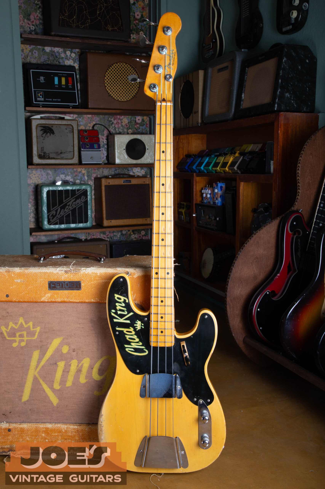
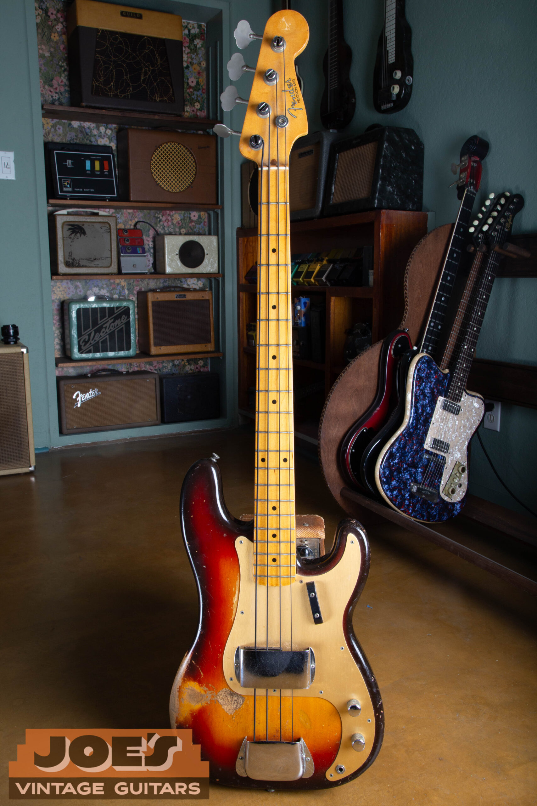
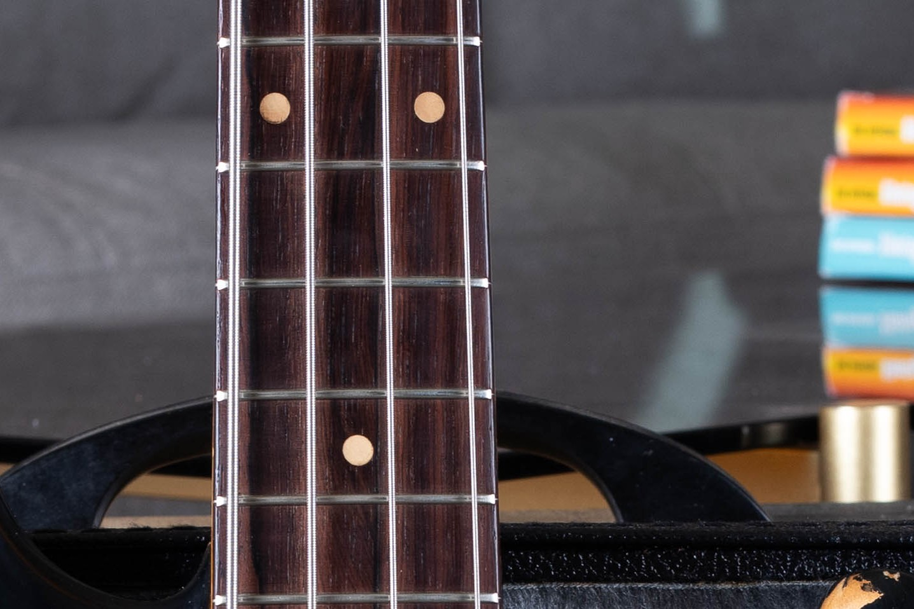
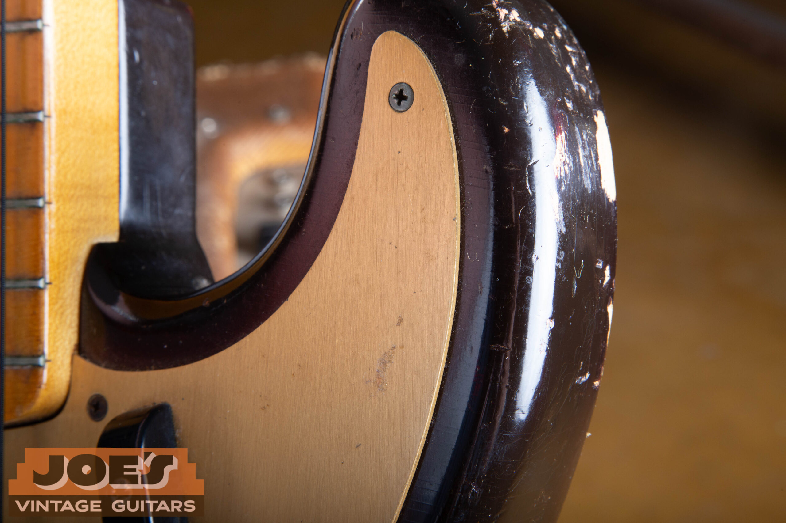
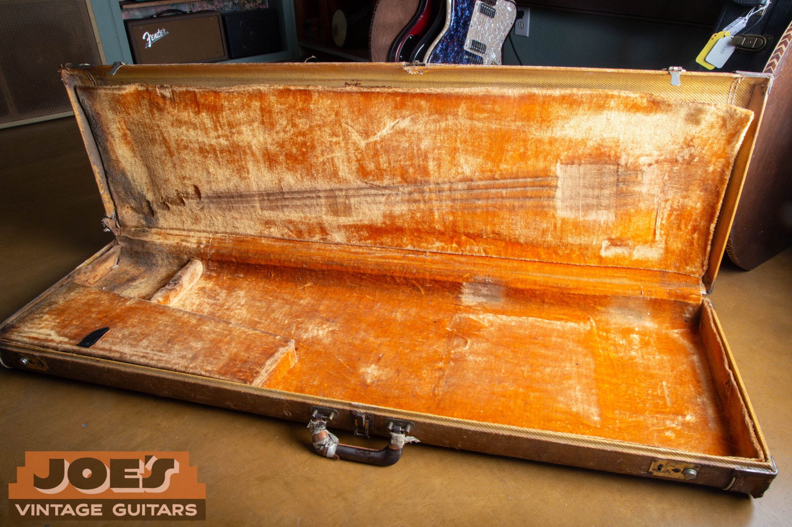

Vintage Fender Precision Bass comparisons span $2,000 to $36,000 across 1951 to 1979, with exceptional early examples potentially exceeding that range. The guide range for original 1951 to 1953 slab-body basses is $18,000 to $36,000 or more; the late-1970s comparison is $2,000 to $4,000. I first identify which version of the Precision is present, then account for its finish, pickup, repairs and case.

For the earliest design, my [1951, 1952 and 1953 Precision Bass authentication guide](/post/1952-fender-precision-bass-guide/) explains the original construction and dating evidence. It covers a bass with one continuous model name but several different designs.

For a Jazz Bass or another Fender model, start with my [Fender values by model guide](/vintage-fender-value-guide/) and choose the matching instrument.

## Fender Precision Bass Values By Year

These guide ranges are reviewed as of October 2026. Choose the correct body and pickup configuration, then read its condition assumptions below. The table isn't a guaranteed purchase offer.

Amounts are in U.S. dollars, and adjacent years can share a range. The 1957 transition has two rows because the single-coil and redesigned split-pickup instruments require different appraisals.

| Year | Value Range | Shared Comparison And Condition |
| --- | --- | --- |
| 1951 | $18,000 to $36,000 or more | Original 1951 to 1953 slab-body configuration; Very Good to Excellent |
| 1952 | $18,000 to $36,000 or more | Original 1951 to 1953 slab-body configuration; Very Good to Excellent |
| 1953 | $18,000 to $36,000 or more | Original 1951 to 1953 slab-body configuration; Very Good to Excellent |
| 1954 | $11,000 to $17,000 | Mid-1954 to 1957 contoured single-coil era; excellent original condition |
| 1955 | $11,000 to $17,000 | Mid-1954 to 1957 contoured single-coil era; excellent original condition |
| 1956 | $11,000 to $17,000 | Mid-1954 to 1957 contoured single-coil era; excellent original condition |
| 1957 | $11,000 to $17,000 | Mid-1954 to 1957 contoured single-coil era; excellent original condition |
| 1957 | $13,000 to $23,000 | 1957 to 1959 gold-guard sunburst era; Very Good to Excellent, serviced parts and case condition |
| 1958 | $13,000 to $23,000 | 1957 to 1959 gold-guard sunburst era; Very Good to Excellent, serviced parts and case condition |
| 1959 | $13,000 to $23,000 | 1957 to 1959 gold-guard sunburst era; Very Good to Excellent, serviced parts and case condition |
| 1960 | $9,000 to $16,000 | 1960 to 1964 era; Very Good to Excellent sunburst, guard and hardware changes disclosed |
| 1961 | $9,000 to $16,000 | 1960 to 1964 era; Very Good to Excellent sunburst, guard and hardware changes disclosed |
| 1962 | $9,000 to $16,000 | 1960 to 1964 era; Very Good to Excellent sunburst, guard and hardware changes disclosed |
| 1963 | $9,000 to $16,000 | 1960 to 1964 era; Very Good to Excellent sunburst, guard and hardware changes disclosed |
| 1964 | $9,000 to $16,000 | 1960 to 1964 era; Very Good to Excellent sunburst, guard and hardware changes disclosed |
| 1965 | $6,000 to $12,000 | 1965 to 1969 era; Very Good to Excellent sunburst, serviced controls and case condition |
| 1966 | $6,000 to $12,000 | 1965 to 1969 era; Very Good to Excellent sunburst, serviced controls and case condition |
| 1967 | $6,000 to $12,000 | 1965 to 1969 era; Very Good to Excellent sunburst, serviced controls and case condition |
| 1968 | $6,000 to $12,000 | 1965 to 1969 era; Very Good to Excellent sunburst, serviced controls and case condition |
| 1969 | $6,000 to $12,000 | 1965 to 1969 era; Very Good to Excellent sunburst, serviced controls and case condition |
| 1970 | $2,500 to $5,000 | 1970 to 1974 era; Very Good to Excellent standard finishes, serviced controls allowed |
| 1971 | $2,500 to $5,000 | 1970 to 1974 era; Very Good to Excellent standard finishes, serviced controls allowed |
| 1972 | $2,500 to $5,000 | 1970 to 1974 era; Very Good to Excellent standard finishes, serviced controls allowed |
| 1973 | $2,500 to $5,000 | 1970 to 1974 era; Very Good to Excellent standard finishes, serviced controls allowed |
| 1974 | $2,500 to $5,000 | 1970 to 1974 era; Very Good to Excellent standard finishes, serviced controls allowed |
| 1975 | $2,000 to $4,000 | 1975 to 1979 era; Good to Excellent standard finishes, playing wear and serviced parts |
| 1976 | $2,000 to $4,000 | 1975 to 1979 era; Good to Excellent standard finishes, playing wear and serviced parts |
| 1977 | $2,000 to $4,000 | 1975 to 1979 era; Good to Excellent standard finishes, playing wear and serviced parts |
| 1978 | $2,000 to $4,000 | 1975 to 1979 era; Good to Excellent standard finishes, playing wear and serviced parts |
| 1979 | $2,000 to $4,000 | 1975 to 1979 era; Good to Excellent standard finishes, playing wear and serviced parts |

### Condition Behind The Table

The 1951 to 1953 range assumes all-original examples in Very Good to Excellent condition. Repairs and changed parts require a different appraisal.

The contoured single-coil range assumes an excellent original instrument. Heavy wear, a replacement case or localized finish work can change the appraisal. I inspect those details before applying the range.

The gold-guard range covers original-finish sunburst examples with varying wear and case completeness. A replacement nut, minor screw change or later case can fit within the range. Cleaner, more complete basses belong toward its stronger end.

The lower end of the 1960 to 1964 band allows a damaged original guard, case wear and minor missing hardware. The 1965 to 1969 group allows a replaced control, fret wear and a later case while retaining original finish and pickup.

The 1970s comparisons allow serviced wiring, replacement pots or pickup foam, missing covers and worn cases. They aren't bands for refinished bodies, replacement pickups or substantial routing. A clean, fully documented instrument needs to be compared within those conditions rather than automatically placed at the lowest number.

## The Three Precision Designs And Their Price Groups

The early slab-body bass has a flat body without the later comfort contours, a single-coil pickup and a small Telecaster-shaped headstock. The forearm and rear body contours arrive around mid-1954. The split pickup and larger headstock follow in the mid-1957 redesign.

Those changes separate the main value groups. A 1956 Precision belongs to the contoured single-coil design even though it shares its model name with a 1958 gold-guard bass. I identify the construction before choosing a range.

If the design or year is uncertain, the [Precision Bass dating guide](/fender-precision-bass-dating-guide/) lays out that sequence. Identifying the correct group comes before choosing a number from the table. A serial number by itself doesn't establish the originality of the body, neck or pickup.

### The 1951 To 1953 Slab-Body Range

The $18,000 to $36,000 or more range applies to original early basses in the stated condition. It doesn't include the value of an amplifier simply because one appears beside the bass in a photograph. A matching historical package needs its own appraisal and documentation.

Modified player examples have a separate broad range of $7,500 to $14,000. That isn't a discount formula. A replacement pickup, refinish or assembly of unrelated parts can lead to very different appraisals.

<figure>

<figcaption>An early Precision and Bassman from my site photographs.</figcaption>

</figure>

I keep that distinction visible for owners who inherited an early instrument. A bass can show heavy playing wear and still retain original finish and parts. Conversely, an unusually tidy appearance can result from substantial restoration, so cleanliness alone doesn't establish the collector category.

Early 1954 slab-body examples need individual appraisals. The annual 1954 row covers the later contoured single-coil version. I wouldn't apply that configuration's range to every bass carrying a 1954 date.

### Contoured Single-Coil Basses

The $11,000 to $17,000 range covers the contoured single-coil group from mid-1954 into 1957. The 1957 redesign adds the split-coil pickup, wider headstock and gold guard associated with the familiar Precision sound and appearance. That later configuration has its own $13,000 to $23,000 market; the earlier body's contour alone doesn't put it in the same group.

These basses need the correct comparison because replacing the original pickup with a later split unit can involve changes to the body and guard. A working bass with that conversion may appeal to a player, but it no longer represents the unmodified single-coil configuration. I describe the change before pricing it.

An individual bass may sit above or below a broad era range. I assess its finish, pickup, repairs and completeness before discussing an offer.

## Gold Guards, Rosewood Boards And The Sixties

The gold anodized aluminum guard identifies a familiar part of the 1957 to 1959 Precision period. The sunburst comparison is $13,000 to $23,000, spanning worn examples with service parts or later cases and cleaner, more complete originals. A gold-colored replacement guard doesn't put an otherwise different bass into that group.

<figure>

<figcaption>A 1959 Precision Bass from my archive, showing the sunburst finish, gold guard and maple fingerboard.</figcaption>

</figure>

The [gold-guard Precision Bass guide](/post/gold-guard-fender-precision-bass/) covers the period's construction in detail. Here I use those established features to choose comparable instruments. The complete configuration determines the appropriate price comparison.

The 1959 transition can include more than one fingerboard and guard combination. A rosewood board isn't automatically evidence that a bass has lost its early identity. It does mean the configuration should be established before treating two 1959 instruments as identical comparisons.

<figure>

<figcaption>A rosewood Precision fingerboard from my archive. The actual board and guard combination helps identify the right comparison.</figcaption>

</figure>

For 1960 to 1964, the sunburst range is $9,000 to $16,000. The era includes different fingerboard construction and condition levels. An exceptionally clean early slab-board instrument needs an individual assessment beyond the broad table.

For 1965 to 1969, the range is $6,000 to $12,000. Excellent originals from 1965 sit toward the stronger end, while worn later basses and service-part changes can place a guitar lower. Replacement controls and cases belong in the condition description.

### Why The Pickup And Neck Stay In The Appraisal

The split pickup has two staggered sections working together. Its identity and condition belong in the price assessment along with the finish and neck. A modern replacement may sound good but doesn't establish the same collector comparison as the original pickup.

A rewind replaces the wire inside a pickup and should be recorded as work, even if the original external parts remain. I also want to know whether removed components come with the instrument. A loose original pickup can still help explain the bass's history and available restoration choices.

The neck has to function as an instrument, not simply look correct in a photograph. Fret wear, past reshaping and unresolved adjustment problems can affect the buyer's decision. A clean-example price assumes those issues have been resolved.

## Seventies Precision Bass Values

The 1970 to 1974 range is $2,500 to $5,000. It covers original finish and pickups while allowing serviced or changed controls and differences in accessories. Excellent, complete originals belong toward the stronger end.

The 1975 to 1979 comparison is $2,000 to $4,000 for standard finishes under the stated conditions. Finish wear, the working neck, retained parts and the case help narrow the appraisal. The table doesn't attach a fixed premium to every maple or rosewood fingerboard.

The Precision kept its four-bolt neck attachment through these years. The Jazz Bass's three-bolt transition belongs to a different model. A modern reissue or modified instrument also needs to be kept separate from original 1970s production.

Owners sometimes assume that a later bass must fall at the bottom of every comparison. A complete, well-preserved example can be a different proposition from an earlier one with a refinish, changed pickup and extra holes. The date selects a group; the actual condition determines which instruments are useful comparisons within it.

### Frets, Setup And Weight

A quality refret is accepted maintenance and preserves the all-original classification of an otherwise all-original bass. It takes the instrument out of the museum-quality category. A neck that has been reshaped or a fingerboard that has been substantially altered needs a separate description.

A setup adjusts the instrument for playing; it doesn't undo a refinish or restore removed wood. If a seller says a bass was professionally serviced, I still want to know which work was done. A written repair record is more useful than a vague promise that everything was upgraded.

Weight can influence an individual player's preference, so I include it when it's measured reliably. Weight is one part of an appraisal alongside originality and condition. A light instrument with unresolved problems isn't automatically a better collector example than a heavier, complete one.

## Finish And Parts Changes Without A Discount Formula

Original finish preserves a part of the bass that can't be replaced with new-old-stock hardware. A full refinish therefore changes the collector category. Localized touchup, overspray and complete stripping should be described separately because they represent different amounts of work.

A refinish typically removes a large share of collector value. The year, retained parts, structural condition and quality of the work all affect the comparison. A bass that was refinished but otherwise remains intact shouldn't be confused with one that also has a replaced neck and enlarged pickup cavity.

Custom colors need individual appraisals. The [Fender custom color authentication guide](/post/fender-custom-color-authentication-guide/) covers finish originality. The finish, year and condition together determine the color premium.

<figure>

<figcaption>Wear on the gold anodized guard of a Precision Bass in my archive. The appraisal distinguishes wear from replacement.</figcaption>

</figure>

Wear to an original gold guard can be part of an otherwise intact instrument. A replacement guard may cover extra holes or simply replace a damaged original, and those are different situations. I want the change described accurately before deciding which comparison applies.

A small screw replacement is also different from a replaced pickup or a routed body. Grouping all of them under one modified label hides the differences between instruments. The appraisal should name the changes and explain their effect on the available comparison.

## Cases, Covers And Provenance

The original case helps establish a complete package. Check its covering, handle, hinges and interior, and include it in the appraisal photographs.

<figure>

<figcaption>A tweed case from my 1959 Precision Bass archive. Case condition and originality stay in the appraisal.</figcaption>

</figure>

Chrome covers, a finger rest, paperwork and retained loose parts help show what remains with the bass. Their completeness, originality and condition affect the appraisal. A later case shouldn't be described as the case that originally accompanied the instrument.

Provenance means a documented ownership history. Receipts, photographs and repair records can support it. A name on a case or an unverified story doesn't by itself establish a connection to a particular musician.

If a bass and amplifier have remained together, preserve the records and photographs that connect them.

## Comparing An Offer With A Market Range

A market comparison and a purchase offer answer different questions. The comparison describes similar instruments under stated conditions; an offer has actual terms, included accessories and responsibilities. I explain those terms rather than presenting a guide range as a guaranteed check amount.

When comparing offers, confirm whether each includes the case, loose parts and shipping arrangements. For a private sale, consider fees, packing, shipping and any agreed repair work as well as the negotiated price. An advertised retail number doesn't describe the seller's eventual proceeds.

An asking price, a completed sale price and an owner's net proceeds are different amounts. I consider the bass's condition and the terms of the transaction before making a buying offer.

Collectibility also doesn't guarantee appreciation. The price paid, originality, future condition and eventual sale costs affect the outcome. A vintage Precision carries the risks of any collectible, including changing demand and repair costs.

## Getting Your Precision Bass Appraised

For an initial appraisal, send photographs of the full front and back, headstock, pickup area, controls, case and known damage. Include the serial number and any repair history you have. Leave unfamiliar disassembly to someone who can do it without damaging the instrument.

If you inherited the bass, tell me what you know and what you don't. You don't have to guess whether the finish is original or promise that the electronics work. I can begin with the visible evidence and explain which questions remain open.

Keep removed parts, old receipts and photographs together. Avoid refinishing, polishing away marks or replacing components just to make the bass appear newer before an appraisal. Its present condition is the information I need to select useful comparisons.

Request a [free Precision Bass appraisal](/free-appraisal/) for a specific instrument. My [Fender buying process](/sell-my-fender-guitar/) explains how a direct sale works. I buy vintage guitars and basses nationwide from Mesa, Arizona.

These ranges were reviewed in October 2026. Send photographs and any repair history for an individual appraisal of your Precision Bass.