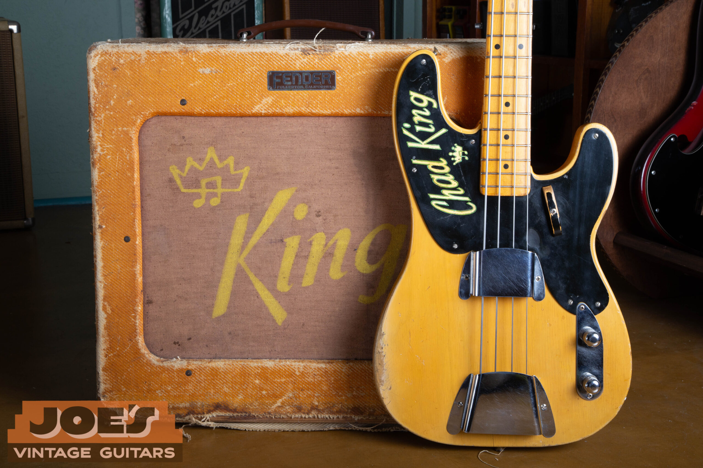

Vintage Fender Precision Bass comparisons span $2,100 to $40,000 across 1951 to 1979, with exceptional early examples potentially exceeding that range. The existing reference for original 1951 to 1953 slab-body basses is $20,000 to $40,000 or more; the late-1970s comparison is $2,100 to $4,000. I first identify which version of the Precision is present, then account for its finish, pickup, repairs and case.

For the earliest design, my [1951, 1952 and 1953 Precision Bass authentication guide](/post/1952-fender-precision-bass-guide/) explains the original construction and dating evidence. This page supplies the model-wide price comparisons. It covers a bass with one continuous model name but several different designs.

## Fender Precision Bass Values By Year

As of October 2026, the annual table preserves the site's existing early slab-body reference. The remaining bands combine the 2025 edition of The Official Vintage Guitar Magazine Price Guide with two independently verified completed transactions per era. Where those transactions are older, that limitation is stated below.

Amounts are in U.S. dollars. Repeated annual ranges use shared era evidence, not a separate set of same-year sales. The 1957 transition has two rows because the single-coil and redesigned split-pickup instruments require different comparisons.

| Year | Value Range | Shared Comparison And Condition |
| --- | --- | --- |
| 1951 | $20,000 to $40,000 or more | Existing 1951 to 1953 original slab-body reference; Excellent to Very Good |
| 1952 | $20,000 to $40,000 or more | Existing 1951 to 1953 original slab-body reference; Excellent to Very Good |
| 1953 | $20,000 to $40,000 or more | Existing 1951 to 1953 original slab-body reference; Excellent to Very Good |
| 1954 | $12,000 to $18,000 | Mid-1954 to 1957 contoured single-coil era; published excellent-original reference, older auction context |
| 1955 | $12,000 to $18,000 | Mid-1954 to 1957 contoured single-coil era; published excellent-original reference, older auction context |
| 1956 | $12,000 to $18,000 | Mid-1954 to 1957 contoured single-coil era; published excellent-original reference, older auction context |
| 1957 | $12,000 to $18,000 | Mid-1954 to 1957 contoured single-coil era; published excellent-original reference, older auction context |
| 1957 | $13,500 to $25,000 | 1957 to 1959 gold-guard sunburst era; Very Good to Excellent, service-part and case allowances |
| 1958 | $13,500 to $25,000 | 1957 to 1959 gold-guard sunburst era; Very Good to Excellent, service-part and case allowances |
| 1959 | $13,500 to $25,000 | 1957 to 1959 gold-guard sunburst era; Very Good to Excellent, service-part and case allowances |
| 1960 | $10,000 to $17,500 | 1960 to 1964 era; Very Good to Excellent sunburst, guard and hardware allowances |
| 1961 | $10,000 to $17,500 | 1960 to 1964 era; Very Good to Excellent sunburst, guard and hardware allowances |
| 1962 | $10,000 to $17,500 | 1960 to 1964 era; Very Good to Excellent sunburst, guard and hardware allowances |
| 1963 | $10,000 to $17,500 | 1960 to 1964 era; Very Good to Excellent sunburst, guard and hardware allowances |
| 1964 | $10,000 to $17,500 | 1960 to 1964 era; Very Good to Excellent sunburst, guard and hardware allowances |
| 1965 | $6,250 to $12,500 | 1965 to 1969 era; Very Good to Excellent sunburst, control and case allowances |
| 1966 | $6,250 to $12,500 | 1965 to 1969 era; Very Good to Excellent sunburst, control and case allowances |
| 1967 | $6,250 to $12,500 | 1965 to 1969 era; Very Good to Excellent sunburst, control and case allowances |
| 1968 | $6,250 to $12,500 | 1965 to 1969 era; Very Good to Excellent sunburst, control and case allowances |
| 1969 | $6,250 to $12,500 | 1965 to 1969 era; Very Good to Excellent sunburst, control and case allowances |
| 1970 | $2,750 to $5,500 | 1970 to 1974 era; Very Good to Excellent standard finishes, serviced controls allowed |
| 1971 | $2,750 to $5,500 | 1970 to 1974 era; Very Good to Excellent standard finishes, serviced controls allowed |
| 1972 | $2,750 to $5,500 | 1970 to 1974 era; Very Good to Excellent standard finishes, serviced controls allowed |
| 1973 | $2,750 to $5,500 | 1970 to 1974 era; Very Good to Excellent standard finishes, serviced controls allowed |
| 1974 | $2,750 to $5,500 | 1970 to 1974 era; Very Good to Excellent standard finishes, serviced controls allowed |
| 1975 | $2,100 to $4,000 | 1975 to 1979 era; Good to Excellent standard finishes, wear and service allowances |
| 1976 | $2,100 to $4,000 | 1975 to 1979 era; Good to Excellent standard finishes, wear and service allowances |
| 1977 | $2,100 to $4,000 | 1975 to 1979 era; Good to Excellent standard finishes, wear and service allowances |
| 1978 | $2,100 to $4,000 | 1975 to 1979 era; Good to Excellent standard finishes, wear and service allowances |
| 1979 | $2,100 to $4,000 | 1975 to 1979 era; Good to Excellent standard finishes, wear and service allowances |

### Condition And Evidence Behind The Table

The 1951 to 1953 range is an existing site reference for all-original examples in Excellent to Very Good condition. I retain it rather than replacing it with a conflicting published guide figure. It isn't described here as a new sample of completed 2026 sales.

The contoured single-coil band is a published excellent-original reference checked against older auction results. Those comparisons include wear, later cases and localized finish touchup. One is from 2014 and one from 2023; they establish historical context and aren't represented as current transactions. Auction totals include the buyer's premium, while shipping and taxes are separate.

The gold-guard group includes original-finish sunburst examples with different degrees of wear and case completeness. A replacement nut, a minor screw and a later case occur within the supporting evidence. One comparison is from 2021, alongside a 2026 result and the published reference.

The 1960 to 1964 band combines completed 1963 and 1964 examples with the era reference. Its lower end allows a damaged original guard, case wear and minor missing hardware. The 1965 to 1969 group allows a replaced control, fret wear and a later case while retaining original finish and pickup.

The 1970s comparisons allow serviced wiring, replacement pots or pickup foam, missing covers and worn cases. They aren't bands for refinished bodies, replacement pickups or substantial routing. A clean, fully documented instrument needs to be compared within those conditions rather than automatically placed at the lowest number.

<figure>

<figcaption>An early blonde Precision Bass beside a Bassman amplifier in my archive. The table prices the bass, not an amplifier package.</figcaption>

</figure>

## The Three Precision Designs And Their Price Groups

The early slab-body bass has a flat body without the later comfort contours, a single-coil pickup and a small Telecaster-shaped headstock. The forearm and rear body contours arrive around mid-1954. The split pickup and larger headstock follow in the mid-1957 redesign.

Those changes separate the main comparisons. A 1956 Precision still belongs to the contoured single-coil design even though it has the same model name as a 1958 gold-guard bass. I don't use a later split-pickup sale as evidence for an earlier single-coil instrument without stating the difference.

If the design or year is uncertain, the [Precision Bass dating guide](/fender-precision-bass-dating-guide/) lays out that sequence. Identifying the correct group comes before choosing a number from the table. A serial number by itself doesn't establish the originality of the body, neck or pickup.

### The 1951 To 1953 Slab-Body Reference

The site's $20,000 to $40,000 or more reference applies to original early basses in the stated condition. It doesn't include the value of an amplifier simply because one appears beside the bass in a photograph. A matching historical package needs its own appraisal and documentation.

The same existing source gives $8,000 to $15,000 for modified player examples. That is a separate broad reference, not a discount formula. A replacement pickup, a refinished body and an instrument assembled from unrelated parts can require very different appraisals even within the player category.

<figure>

<figcaption>An early Precision and Bassman from my site photographs. A documented instrument and amplifier package requires a separate appraisal.</figcaption>

</figure>

I keep that distinction visible for owners who inherited an early instrument. A bass can show heavy playing wear and still retain original finish and parts. Conversely, an unusually tidy appearance can result from substantial restoration, so cleanliness alone doesn't establish the collector category.

Early 1954 slab-body examples need individual comparison. The annual 1954 row covers the later contoured single-coil version, for which the published reference and the available comparisons are more useful. I haven't silently applied that later configuration's range to every instrument carrying a 1954 date.

### Contoured Single-Coil Basses

The $12,000 to $18,000 reference covers the contoured single-coil group from mid-1954 into 1957. The source material includes blonde and sunburst instruments. It isn't a separate premium for every finish and year combination.

These basses need the correct comparison because replacing the original pickup with a later split unit can involve changes to the body and guard. A working bass with that conversion may appeal to a player, but it no longer represents the unmodified single-coil configuration. I describe the change before pricing it.

The older auction evidence doesn't prove that today's market has moved by a particular percentage. It gives documented examples and condition details to compare with the newer published reference. I haven't invented a year-by-year trend from a small number of records.

## Gold Guards, Rosewood Boards And The Sixties

The gold anodized aluminum guard identifies a familiar part of the 1957 to 1959 Precision period. The sunburst comparison is $13,500 to $25,000, spanning worn examples with service parts or later cases and cleaner, more complete originals. A gold-colored replacement guard doesn't put an otherwise different bass into that group.

<figure>

<figcaption>A 1959 Precision Bass from my archive, showing the sunburst finish, gold guard and maple fingerboard.</figcaption>

</figure>

The [gold-guard Precision Bass guide](/post/gold-guard-fender-precision-bass/) covers the period's construction in detail. Here I use those established features to choose comparable instruments. I don't reproduce the dating checklist or assign a separate dollar amount to each visible feature.

The 1959 transition can include more than one fingerboard and guard combination. A rosewood board isn't automatically evidence that a bass has lost its early identity. It does mean the configuration should be established before treating two 1959 instruments as identical comparisons.

<figure>

<figcaption>A rosewood Precision fingerboard from my archive. The actual board and guard combination helps identify the right comparison.</figcaption>

</figure>

For 1960 to 1964, the sunburst range is $10,000 to $17,500. The era includes different fingerboard construction and condition levels. The supporting completed examples are later in that group, so an exceptionally clean early slab-board instrument needs closer comparison than the broad table alone provides.

For 1965 to 1969, the range is $6,250 to $12,500. The published excellent-original reference for 1965 sits at the upper end, while worn later instruments and service-part exceptions account for the lower portion. A replacement control or case should be disclosed instead of hidden inside a blanket claim that the bass is untouched.

### Why The Pickup And Neck Stay In The Appraisal

The split pickup has two staggered sections working together. Its identity and condition belong in the price assessment along with the finish and neck. A modern replacement may sound good but doesn't establish the same collector comparison as the original pickup.

A rewind replaces the wire inside a pickup and should be recorded as work, even if the original external parts remain. I also want to know whether removed components come with the instrument. A loose original pickup can still help explain the bass's history and available restoration choices.

The neck has to function as an instrument, not simply look correct in a photograph. Fret wear, past reshaping and unresolved adjustment problems can affect the buyer's decision. I don't give an automatic clean-example price before those questions are understood.

## Seventies Precision Bass Values

The 1970 to 1974 comparison is $2,750 to $5,500. Its completed examples retain original finish and pickups but have serviced or changed controls and differing accessory completeness. The published reference provides the excellent-original context for the rest of the era.

The 1975 to 1979 comparison is $2,100 to $4,000 for standard finishes under the stated conditions. Finish wear, the working neck, retained parts and the case help narrow the appraisal. The table doesn't attach a fixed premium to every maple or rosewood fingerboard.

The Precision kept its four-bolt neck attachment through these years. I don't import the Jazz Bass's three-bolt transition into a Precision appraisal. A modern reissue or modified instrument also needs to be kept separate from original 1970s production.

Owners sometimes assume that a later bass must fall at the bottom of every comparison. A complete, well-preserved example can be a different proposition from an earlier one with a refinish, changed pickup and extra holes. The date selects a group; the actual condition determines which instruments are useful comparisons within it.

### Frets, Setup And Weight

A quality refret is accepted maintenance and preserves the all-original classification of an otherwise all-original bass. It takes the instrument out of the museum-quality category. A neck that has been reshaped or a fingerboard that has been substantially altered needs a separate description.

A setup adjusts the instrument for playing; it doesn't undo a refinish or restore removed wood. If a seller says a bass was professionally serviced, I still want to know which work was done. A written repair record is more useful than a vague promise that everything was upgraded.

Weight can influence an individual player's preference, so I include it when it's measured reliably. I don't invent a universal dollar adjustment per pound. A light instrument with unresolved problems isn't automatically a better collector example than a heavier, complete one.

## Finish And Parts Changes Without A Discount Formula

Original finish preserves a part of the bass that can't be replaced with new-old-stock hardware. A full refinish therefore changes the collector category. Localized touchup, overspray and complete stripping should be described separately because they represent different amounts of work.

I don't subtract the same percentage for every refinish. The year, retained parts, structural condition and quality of the work all affect the comparison. A bass that was refinished but otherwise remains intact shouldn't be confused with one that also has a replaced neck and enlarged pickup cavity.

Custom colors need their own evidence and matching comparisons. The [Fender custom color authentication guide](/post/fender-custom-color-authentication-guide/) explains that evidence. I haven't added a blanket custom-color multiplier to the ordinary-finish table.

<figure>

<figcaption>Wear on the gold anodized guard of a Precision Bass in my archive. The appraisal distinguishes wear from replacement.</figcaption>

</figure>

Wear to an original gold guard can be part of an otherwise intact instrument. A replacement guard may cover extra holes or simply replace a damaged original, and those are different situations. I want the change described accurately before deciding which comparison applies.

A small screw replacement is also different from a replaced pickup or a routed body. Grouping all of them under one modified label hides the differences between instruments. The appraisal should name the changes and explain their effect on the available comparison.

## Cases, Covers And Provenance

The original case helps establish a complete package, but its own wear still needs to be recorded. The photograph below shows a tweed case from my Precision archive. It illustrates the item being discussed; it doesn't assign that particular case a separate price.

<figure>

<figcaption>A tweed case from my 1959 Precision Bass archive. Case condition and originality stay in the appraisal.</figcaption>

</figure>

Chrome covers, a finger rest, paperwork and retained loose parts can help explain what remains with the bass. I don't assign each accessory an automatic premium without matching evidence. A newly purchased vintage-looking case also shouldn't be presented as the case that originally accompanied the instrument.

Provenance means a documented ownership history. Receipts, photographs and repair records can support it. A name on a case or an unverified story doesn't by itself establish a connection to a particular musician.

If a bass and amplifier have remained together, preserve the records and photographs that connect them. Don't assume their combined asking price establishes the value of the bass alone. The annual table covers instruments, not every possible historical package.

## Comparing An Offer With A Market Range

A market comparison and a purchase offer answer different questions. The comparison describes similar instruments under stated conditions; an offer has actual terms, included accessories and responsibilities. I explain those terms rather than presenting a guide range as a guaranteed check amount.

When comparing offers, confirm whether each includes the case, loose parts and shipping arrangements. For a private sale, consider fees, packing, shipping and any agreed repair work as well as the negotiated price. An advertised retail number doesn't describe the seller's eventual proceeds.

I use completed transactions for sale evidence and published guides as references. A listing marked sold can still display its former asking price, so that visible number isn't automatically the realized amount. The transaction-history or auction result needs to supply the price used in the research record.

Collectibility also doesn't guarantee appreciation. The price paid, originality, future condition and eventual sale costs affect the outcome. I don't describe a vintage Precision as a risk-free investment or promise that a particular year will outperform the rest.

## Getting Your Precision Bass Appraised

For an initial appraisal, send photographs of the full front and back, headstock, pickup area, controls, case and known damage. Include the serial number and any repair history you have. Leave unfamiliar disassembly to someone who can do it without damaging the instrument.

If you inherited the bass, tell me what you know and what you don't. You don't have to guess whether the finish is original or promise that the electronics work. I can begin with the visible evidence and explain which questions remain open.

Keep removed parts, old receipts and photographs together. Avoid refinishing, polishing away marks or replacing components just to make the bass appear newer before an appraisal. Its present condition is the information I need to select useful comparisons.

Request a [free Precision Bass appraisal](/free-appraisal/) for a specific instrument. My [Fender buying process](/sell-my-fender-guitar/) explains how a direct sale works. I buy vintage guitars and basses nationwide from Mesa, Arizona.

This reference was reviewed in October 2026. The price record identifies the existing site anchor, the 2025 published guide and the dates and conditions of the completed comparisons. Older observations remain labeled with their actual dates.
