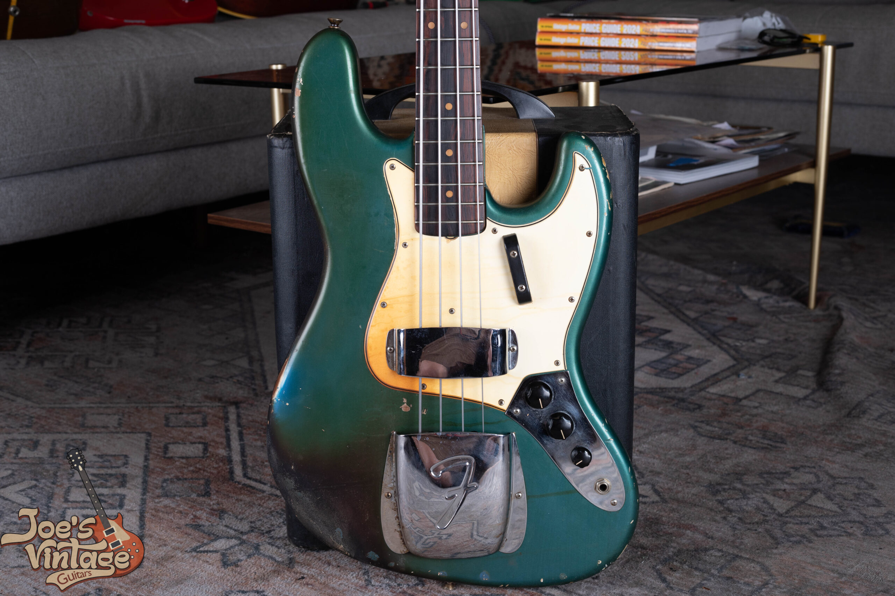

Vintage Fender values vary by model, year and condition: this site's reference for an excellent original 1954 Stratocaster with its original case is $68,000 to $220,000, while its 1964 to 1965 Mustang reference is $2,200 to $4,000. Those are selected examples, not the endpoints of one market for every Fender.

I use this hub to direct you to the right model and annual table. A guitar's age alone doesn't select a price, and a bass shouldn't be priced from a guitar guide. Start with the model, then read the configuration and condition assumptions.

## Vintage Fender Values By Model

These selected references are reviewed as of October 2026. Each row represents a particular era or configuration from the relevant model guide. It isn't the whole model's value range.

| Model | Example Era Or Configuration | Reference Range | Basis |
|---|---|---|---|
| Stratocaster | 1954, standard original finish | $68,000 to $220,000 | Existing published site reference |
| Esquire | 1955 to 1957 blonde | $28,500 to $37,500 | Existing published site reference |
| Jazzmaster | 1958: 1958 Fender Jazzmaster | $12,000 to $20,000 | Selected example; see the Jazzmaster guide |
| Jaguar | 1962: 1962 Sunburst Comparisons | $6,300 to $10,000 | Selected example; see the Jaguar guide |
| Precision Bass | 1951: Original slab-body blonde | $20,000 to $40,000 or more | Selected example; see the Precision Bass guide |
| Jazz Bass | 1960: Original stack-knob sunburst | $23,000 to $31,500 | Selected example; see the Jazz Bass guide |
| Mustang | 1964 to 1965 standard | $2,200 to $4,000 | Existing published site reference |

The underlying guides use established site anchors, published references and completed comparisons with stated conditions. Some transaction sets include older sales or examples with changed parts. Read those qualifications before comparing an individual instrument with the table.

The Stratocaster and Telecaster guides retain their existing year coverage. The new offset and bass guides extend through 1979 where the model remained in production. This hub doesn't imply that every existing guide already contains every later year.

<figure>

<figcaption>A sunburst Jazzmaster with a gold guard and white pickup covers. Photo by Joe Dampt.</figcaption>

</figure>

## Stratocaster, Telecaster And Esquire

The [Stratocaster value guide](/vintage-fender-stratocaster-value-guide/) connects the existing year pages and separates standard finish references from other configurations. Choose the year and condition before applying a range. An early example with exceptional preservation belongs in a different comparison from a modified player guitar.

The [Telecaster value guide](/vintage-fender-telecaster-value-guide/) includes the Broadcaster, Nocaster and Telecaster year guides. Those names identify different parts of the family history and price coverage. Use the relevant year page rather than treating the earliest family range as a value for every Telecaster.

The [Esquire value guide](/vintage-fender-esquire-value-guide/) provides its own references. I don't automatically turn a Telecaster price into an Esquire price by subtracting a fixed amount. Originality and the correct configuration still need to be established.

If the exact model or year is uncertain, keep that uncertainty open while collecting photographs. A neck, body and set of electronics assembled from different periods don't become a coherent original guitar because one number falls in a desirable year.

## Jazzmaster And Jaguar Values

The [Jazzmaster value guide](/vintage-fender-jazzmaster-value-guide/) supplies the model's annual reference table. The [Jaguar value guide](/vintage-fender-jaguar-value-guide/) does the same for the Jaguar. Their shared offset appearance doesn't make their price tables interchangeable.

The year rows can repeat a shared era band when the evidence is grouped that way. That is a way to locate a year in the table, not a claim that three separate sales exist for every row. The source and condition notes explain how each band was established.

<figure>

<figcaption>An Olympic White Jaguar body from my site archive, with its tortoiseshell pickguard, two pickups and chrome control plates.</figcaption>

</figure>

An unusual finish also needs to be established before it enters a custom-color comparison. The [Fender custom-color authentication guide](/post/fender-custom-color-authentication-guide/) handles the finish evidence. This hub doesn't reproduce that inspection process or assign a premium from a photograph alone.

Changed pickups, routing, a replaced guard and altered hardware should be described separately from cosmetic wear. A guitar can remain useful to a player while differing from the original collector condition in the guide. I want those differences identified before choosing a price comparison.

## Mustang Values

The [Mustang history and value guide](/post/fender-mustang-history-value/) keeps the model's established page address and places annual values near the top. Standard and Competition configurations need the matching reference. A broad model label isn't enough to choose between them.

That page retains existing site anchors and labels their basis. It doesn't claim that every established range has been rebuilt from a fresh set of completed sales. Its condition discussion helps separate original examples from refinished or modified instruments.

A finish name or competition stripe alone doesn't establish factory originality. Use the model's identification resources for that question. Once the configuration is established, the value reference becomes a more useful starting point.

## Precision Bass And Jazz Bass Values

The [Precision Bass value guide](/vintage-fender-precision-bass-value-guide/) provides model-level annual references, including the early slab-body group. The [Jazz Bass value guide](/vintage-fender-jazz-bass-value-guide/) separates its covered configurations and eras. Neither should be priced from a six-string Fender table.

Case completeness, pickups, controls, finish and repairs all belong in the condition description. A replacement nut or normal maintenance may be allowed in a specific comparison set, while other changes aren't. The guide states the actual assumption rather than relying on a broad condition label.

<figure>

<figcaption>A Lake Placid Blue Jazz Bass from my archive, with its white guard, chrome covers and three controls.</figcaption>

</figure>

When an old bass comes with an amplifier, describe the two separately. A photograph showing both doesn't turn the bass range into a package price. Accessories and associated equipment need their own identification and valuation.

<figure>

<figcaption>An early blonde Precision Bass beside a Bassman amplifier in my archive. The table prices the bass, not an amplifier package.</figcaption>

</figure>

## Originality And Condition In A Price Table

Excellent original condition isn't the same as freshly restored condition. The finish and major parts need to support the description. A guitar can look clean after substantial work, and an original guitar can show honest playing wear.

Under this site's grading approach, a quality refret preserves otherwise all-original classification and removes museum-quality status. Neck reshaping, refinishing and structural repairs are separate issues. I don't collapse them into the same category as routine fret maintenance.

The source notes also identify when completed comparisons fall outside the clean-original assumption. An old sale remains an old sale, even when it is the best documented example available. I don't silently update it for inflation or call it a new transaction.

### Standard Finish And Custom Color

A rare color can change which comparison group is relevant, but only after the finish is authenticated. A seller's color name or a faded photograph doesn't settle that question. Finish verification belongs on the authentication page.

If the guitar has been refinished, describe that directly. A later color doesn't acquire the collector status of a factory custom color merely because the shade is similar. Its value needs comparisons with similarly altered instruments.

### Repair Allowances

There isn't one supported percentage for every replacement part or repair. The effect depends on the model, the work and what remains original. Several changes can also interact rather than producing a simple sum of deductions.

Keep the guitar's history and removed parts together. Photographs taken before repairs can help explain what changed, while invoices can identify the work performed. Those records are useful context without becoming an automatic guarantee of originality.

## Asking Prices, Completed Sales And Offers

An asking price is an advertised amount. A completed transaction is a different record, and a sold listing may not disclose the negotiated total. I keep those categories identified so an advertised ceiling doesn't become a false sale comparison.

A purchase offer also reflects the particular instrument and sale terms. It isn't a promise to pay the upper endpoint of a reference table. The owner's proceeds can differ from a retail transaction total after selling expenses.

I can begin an appraisal from clear photographs and the history you know. Include the whole instrument, identifying numbers, both sides of the headstock, the case and any visible repairs. Don't disassemble the guitar just to begin that conversation.

## Coverage And Source Dates

This hub connects the existing and new model guides reviewed as of October 2026. The selected examples retain the original page's assumptions and evidence. They aren't a new brand-wide estimate or a forecast.

Use a model's full table for year coverage and its source notes for the research date. Where a range spans an era, the page says so. Where an unusual configuration needs individual appraisal, a broad nearby range shouldn't be used to fill the gap.
