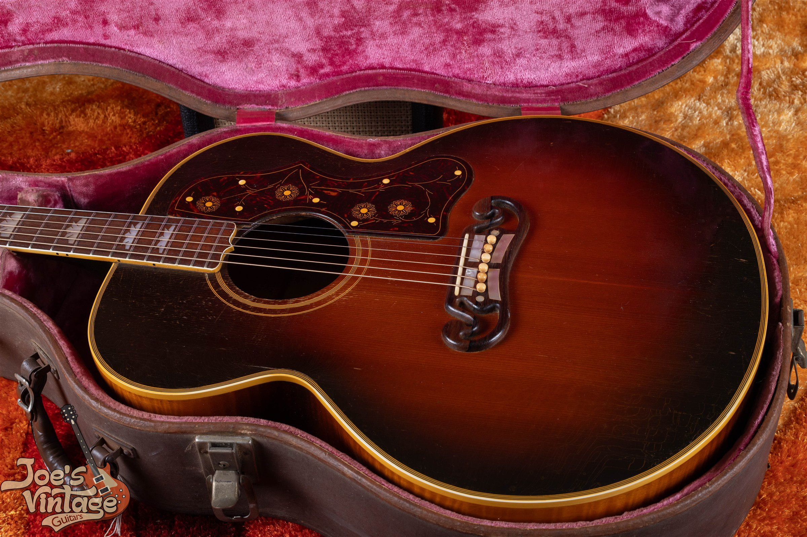

Vintage Gibson acoustic references differ sharply by model: a 1955 to 1959 J-45 uses a published excellent-condition range of $7,500 to $10,000, while a 1950s J-200 uses $16,500 to $21,500. Both assume an original guitar with its original case. They aren't interchangeable estimates for a large old Gibson acoustic.

I use this hub to connect the model guides and explain which table fits which guitar. The references are reviewed as of October 2026, with source dates and condition differences retained on the model pages. A repaired or modified guitar needs its own comparison.

## Gibson Acoustic Values By Model

The rows below are selected examples, not complete model-wide ranges. Open the appropriate guide for annual coverage and the source notes behind each band. Several annual rows can share an era reference without implying separate sales for every year.

| Model | Example Era Or Configuration | Reference Range | Basis |
|---|---|---|---|
| J-45 | 1957: Large-guard sunburst era | $7,500 to $10,000 | Selected example; see the J-45 guide |
| J-45 | 1975: Square-shoulder J-45 and Deluxe | $2,250 to $3,000 | Selected example; see the J-45 guide |
| J-200 | 1957: Standard natural or sunburst | $16,500 to $21,500 | Selected example; see the J-200 guide |
| J-200 | 1975: J-200 and Artist period | $4,750 to $6,250 | Selected example; see the J-200 guide |
| LG-0 | 1958: LG-0, broad original-run reference | $850 to $1,875 | Selected example; see the LG-0 guide |
| LG-1 | 1943: LG-1, broad original-run reference | $2,000 to $4,500 | Selected example; see the LG-1 guide |
| LG-2 | 1957: LG-2, later original production | $3,500 to $6,500 | Selected example; see the LG-2 guide |
| LG-3 | 1942: LG-3, broad original-run reference | $3,750 to $8,500 | Selected example; see the LG-3 guide |
| Hummingbird | 1960 to 1962 | $8,000 to $12,000 | Existing published site reference |

The J-45, J-200 and LG references use the 2025 published guide with completed comparisons. The Hummingbird example preserves an existing site anchor. Those sources have different dates and condition assumptions, which remain visible on the model pages.

<figure>

<figcaption>My 1950s J-45 archive photograph shows the body, bridge, pickguard and case together. Visible wear is part of its description, not a reason to assign a price without inspection.</figcaption>

</figure>

## J-45 Values And The Slope-Shouldered Family

The [Gibson J-45 value guide](/vintage-gibson-j-45-value-guide/) covers every year from 1942 through 1979. Its table distinguishes the wartime, postwar and later groups with explicitly shared era ranges. It doesn't assign a new independent price curve to each year.

The [J-45, J-50 and Southern Jumbo identification guide](/post/identify-vintage-gibson-j45-j50-sj/) handles the family comparisons. Use it when the model itself is uncertain. A natural finish, a label or a familiar body outline needs to be read with the rest of the instrument.

This wave doesn't establish dedicated J-50 or Southern Jumbo price tables. I don't apply a fixed premium or discount to the J-45 range as a substitute. Those models need their own matching comparisons for an individual appraisal.

The J-45 guide also labels its comparison photographs. A J-50 or Southern Jumbo photograph can help explain the family, but it isn't evidence that the J-45 table applies to the guitar pictured. Model identity comes before price selection.

## J-200 And SJ-200 Values

The [Gibson J-200 value guide](/vintage-gibson-j-200-value-guide/) supplies annual postwar references from 1947 through 1979. It separates the early maple period, the 1950s, the 1960s and the later J-200 and Artist period. Its six archive photographs show the actual instruments identified in the captions.

<figure>

<figcaption>My 1948 SJ-200 archive photograph shows the sunburst front, bridge and decorated pickguard together. This postwar guitar is not a prewar rosewood example.</figcaption>

</figure>

The prewar research gap remains explicit. The available ordinary-market completed evidence doesn't yet clear the required bar for a prewar range, so the guide doesn't invent one. A modern historic reissue or a celebrity-associated result can't automatically fill that gap.

SJ-200 means Super Jumbo in this family. It shouldn't be confused with the Southern Jumbo merely because both names can be shortened to SJ. Check the full model before using either guide.

A converted saddle or changed internal structure also affects the comparison with an original collector example. I don't assign an automatic premium because a seller describes a modification as an improvement. The actual work and current condition need to be recorded.

## Hummingbird Values

The [Gibson Hummingbird history and value guide](/post/vintage-gibson-hummingbird-history-value-guide/) keeps its existing page address and puts the annual table near the top. The early reference shown here is only one part of its coverage. Later configurations need the appropriate row.

That guide preserves the site's existing price anchors and identifies their source basis. It doesn't recast them as a new set of verified transactions. Read the condition notes before treating a broad reference as an estimate for a repaired guitar.

The name on the model guide also defines the scope. A related acoustic with similar decoration doesn't automatically share the same price. I need the model, year and construction established well enough to choose matching comparisons.

## LG-0, LG-1, LG-2 And LG-3 Values

The [Gibson LG-series value guide](/vintage-gibson-lg-series-value-guide/) separates the four models and their documented production coverage. Some bands describe a broad original-run envelope, while others are divided by era. The table labels that distinction.

<figure>

<figcaption>My LG-2 photograph shows a rectangular bridge and large pickguard. The image is context for an appraisal, not a certificate of untouched construction.</figcaption>

</figure>

Don't assume that every small Gibson acoustic belongs in the least or most valuable LG category. The model differences need to be established before choosing a range. The existing identification article carries the construction walkthrough; the value guide handles the pricing.

The shared LG ranges also have evidence limits. A set of completed comparisons concentrated in one decade doesn't create a separate wartime sales sample. The guide retains those qualifications instead of treating every repeated annual row as independent research.

An individual guitar may have changed tuners, bridge work, a repaired seam or an added pickup. Those details can put it outside the published excellent-condition assumption. A small body doesn't make repair history irrelevant to the comparison.

## Repairs And The Condition Assumption

The clean references generally assume original finish and major parts, excellent condition and the original case. Some completed comparisons describe different conditions, and those records remain labeled. A broad condition word isn't a substitute for the repair details.

A neck reset, a bridge replacement and a small repaired crack are different kinds of work. Their effect depends on the instrument and the quality and extent of the repair. I don't apply one automatic percentage deduction to all three.

### Neck Angle And Current Playability

A clean exterior doesn't establish that a guitar is ready to play. The present setup and any work still needed belong in the condition description. A low advertised price can be less informative if the repair needs are unclear.

An old repair invoice helps explain work already done, but it doesn't establish the current state by itself. I consider the guitar as it is now. If the condition is uncertain, the initial appraisal remains provisional.

### Bridges, Plates And Internal Changes

The visible bridge is only part of the structure. A description may also involve the saddle, bridge plate, braces or repaired top. Those changes should be documented rather than hidden behind a general statement that the guitar has been serviced.

Keep removed parts with the instrument where possible. Their presence can help explain the history, even when they cannot simply be reinstalled. It doesn't automatically restore the guitar's original condition category.

### Finish, Wear And Fretwork

Wear, localized finish touchup and a complete refinish aren't equivalent descriptions. I need to know what is known about the finish and where the uncertainty remains. A photograph alone doesn't establish all of that history.

Under this site's grading approach, a quality refret preserves otherwise all-original status while removing museum-quality status. Neck reshaping and structural work are separate alterations. They shouldn't be described as routine fret maintenance.

## What The Numbers Do And Do Not Represent

A published reference is a dated estimate for a defined category. A completed transaction records an actual sale with its own condition and terms. An advertised amount is an asking price, which isn't automatically the amount paid.

The underlying model guides preserve those distinctions. Older comparisons remain dated, and altered examples aren't described as untouched originals. The references reviewed in October 2026 aren't all transactions from that month or year.

An owner's net proceeds can also differ from a retail transaction total. Selling costs and the terms of a direct purchase affect the amount received. The upper endpoint of a guide isn't a guaranteed purchase offer.

## Starting An Acoustic Appraisal

I can begin with the full front and back, both sides of the headstock, the bridge area, identifying numbers and any visible damage. Include the case and any repair documents or removed parts. Tell me what you know and what you're unsure about.

You don't need to authorize repairs or make the guitar look newer first. Documenting its present state gives the appraisal a clear starting point. If closer inspection is needed, I can explain which details remain unresolved.

For electric and archtop models, use the [Gibson value hub](/vintage-gibson-value-guide/). This acoustic hub keeps its comparison focused on the flat-top families above. The model pages remain the place to check the complete annual table and research qualifications.
