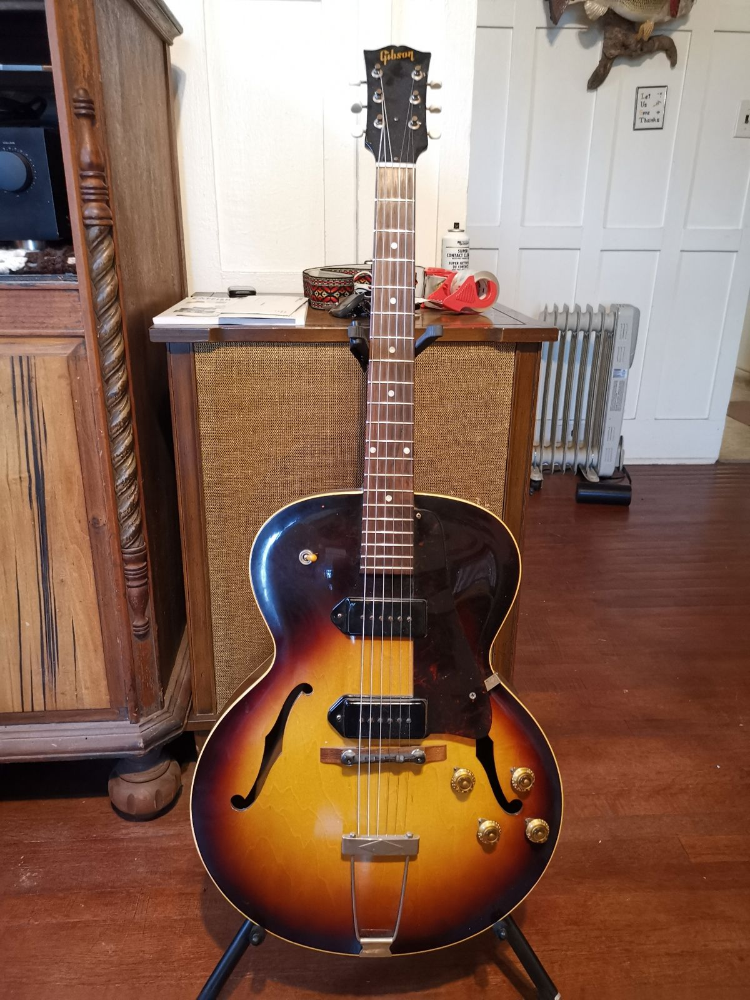
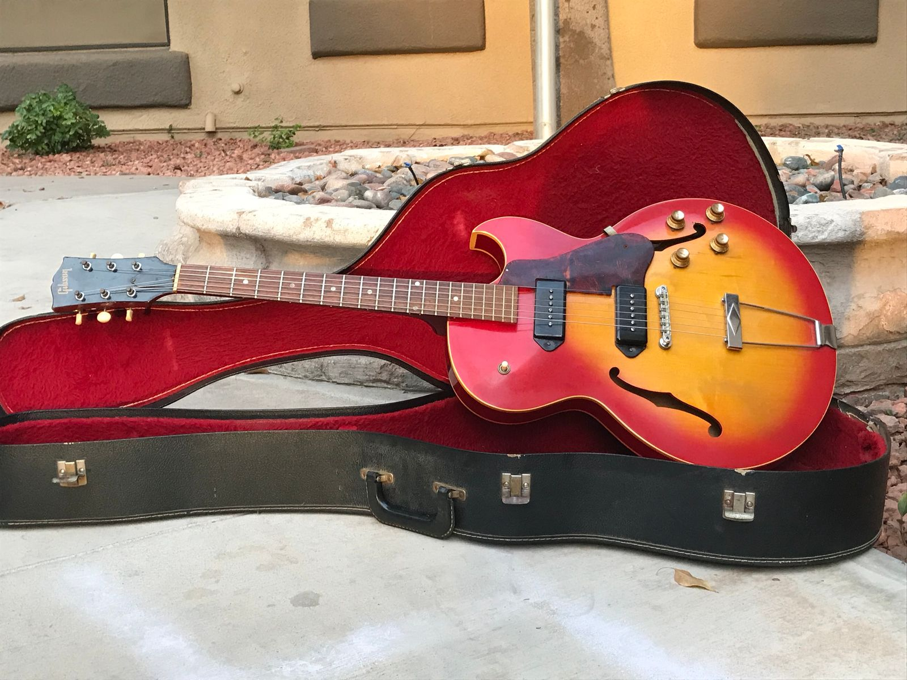
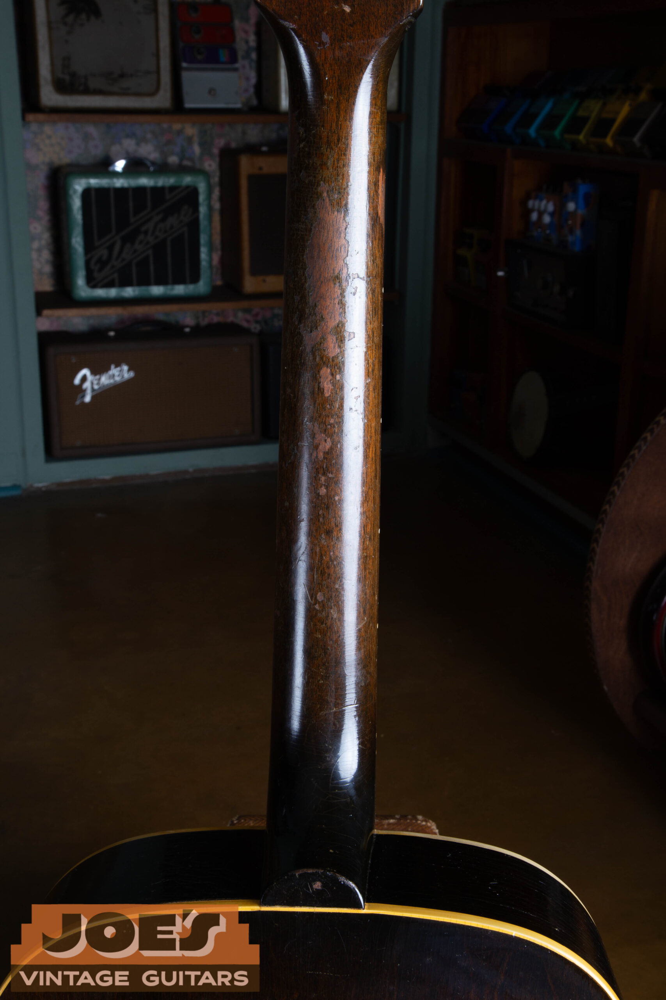
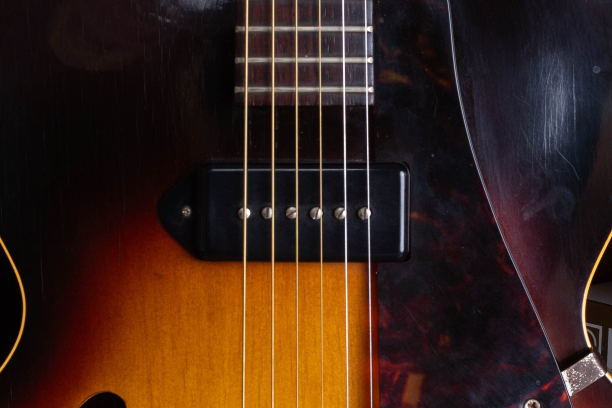
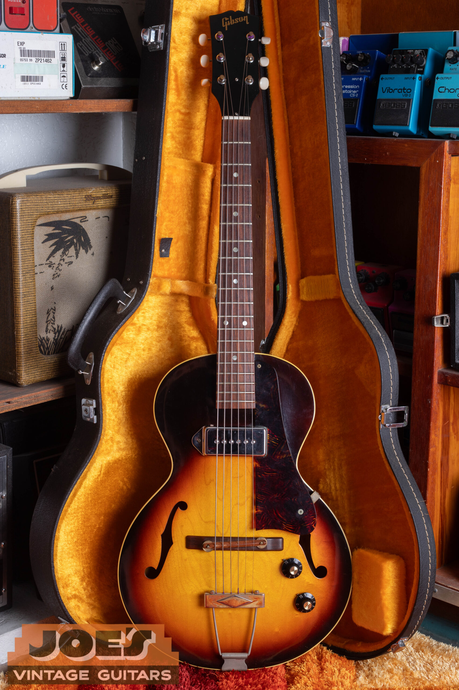

A clean, original, full-depth Gibson ES-125 from the 1950s has a guide range of $2,500 to $3,000 in excellent condition with its original case. The standard single-pickup model from 1960 to 1970 sits at $1,500 to $2,500. A thin-body cutaway or two-pickup version needs its own appraisal.

I buy vintage Gibsons nationwide from Mesa, Arizona. With an ES-125, I establish the complete model name before applying a range because the extra letters describe different instruments. My [Gibson ES-125 identification and authentication guide](/post/gibson-es-125-guide/) covers those variants, dates and originality details.

## Values By Year

The following ranges are reviewed **as of October 2026**. They cover the full-size, full-depth, single-pickup sunburst ES-125 in all-original, excellent condition with its original case and no structural repair. A quality refret is accepted maintenance, but the guitar then falls outside museum-quality condition.

The table groups similar configurations into era ranges. Adjacent years can share a range without every guitar being worth the same amount. I narrow the appraisal around condition, originality and the included case.

| Year | Configuration | Value Range |
| --- | --- | --- |
| 1941 | Early full-depth single-pickup sunburst | $2,500 to $3,500 |
| 1942 | Early full-depth single-pickup sunburst | $2,500 to $3,500 |
| 1946 | Postwar full-depth, nonadjustable P-90 | $2,500 to $3,500 |
| 1947 | Postwar full-depth, nonadjustable P-90 | $2,500 to $3,500 |
| 1948 | Postwar full-depth, nonadjustable P-90 | $2,500 to $3,500 |
| 1949 | Postwar full-depth, nonadjustable P-90 | $2,500 to $3,500 |
| 1950 | Full-depth single-pickup sunburst | $2,500 to $3,000 |
| 1951 | Full-depth single-pickup sunburst | $2,500 to $3,000 |
| 1952 | Full-depth single-pickup sunburst | $2,500 to $3,000 |
| 1953 | Full-depth single-pickup sunburst | $2,500 to $3,000 |
| 1954 | Full-depth single-pickup sunburst | $2,500 to $3,000 |
| 1955 | Full-depth single-pickup sunburst | $2,500 to $3,000 |
| 1956 | Full-depth single-pickup sunburst | $2,500 to $3,000 |
| 1957 | Full-depth single-pickup sunburst | $2,500 to $3,000 |
| 1958 | Full-depth single-pickup sunburst | $2,500 to $3,000 |
| 1959 | Full-depth single-pickup sunburst | $2,500 to $3,000 |
| 1960 | Full-depth single-pickup sunburst | $1,500 to $2,500 |
| 1961 | Full-depth single-pickup sunburst | $1,500 to $2,500 |
| 1962 | Full-depth single-pickup sunburst | $1,500 to $2,500 |
| 1963 | Full-depth single-pickup sunburst | $1,500 to $2,500 |
| 1964 | Full-depth single-pickup sunburst | $1,500 to $2,500 |
| 1965 | Full-depth single-pickup sunburst | $1,500 to $2,500 |
| 1966 | Full-depth single-pickup sunburst | $1,500 to $2,500 |
| 1967 | Full-depth single-pickup sunburst | $1,500 to $2,500 |
| 1968 | Full-depth single-pickup sunburst | $1,500 to $2,500 |
| 1969 | Full-depth single-pickup sunburst | $1,500 to $2,500 |
| 1970 | Full-depth single-pickup sunburst | $1,500 to $2,500 |

Original ES-125 production spans 1941 and 1942, then resumes in 1946 and continues through 1970. The early postwar guitars share a range; originality and condition narrow the value within it.

Changed tuners, replaced hardware, repaired cracks and a later case can put a guitar outside the clean-original category. I consider those details before applying the table.

## Start With The Complete Model

An ES-125 listing can refer to a full-depth guitar, a thinline, a cutaway or a two-pickup instrument. “Thinline” means the body is shallower from front to back. A cutaway is the indentation beside the neck that gives the player's hand access to higher frets.

The standard guitar in the price table has one pickup and no cutaway. The T suffix indicates a thin body, D indicates two pickups and C indicates a cutaway. Those letters belong in the comparison before the year and finish are considered.

A small-body, short-scale example is a separate category. It isn't simply a worn or inexpensive version of the full-size guitar. I confirm its proportions and playing dimensions before choosing a range.

The pickup and body configuration need to match the model being appraised. Those features may place the guitar in a different market, but the amount depends on the exact variant, era and condition. A fabricated multiplier would give a precise-looking answer to the wrong question.

The photographs here show several family members so you can see why the name needs to be complete. The two-pickup photographs aren't presented as examples of the single-pickup range. Their purpose is to keep unlike guitars out of the same comparison.

<figure>

<figcaption>This two-pickup example shows why the suffix and control layout belong in the appraisal description. It is outside the single-pickup price table.</figcaption>

</figure>

## Early And Postwar Values

The prewar guitar differs from the later P-90 model. I keep its annual rows separate instead of treating every ES-125 made before 1950 as one interchangeable instrument. A listing placed in the wrong product category can otherwise distort the comparison.

A marketplace category or seller's date can be wrong. I confirm the actual model and construction before applying the prewar or postwar range.

The early postwar group also needs its stated pickup configuration. A nonadjustable-pole pickup and a later adjustable example should not be confused solely because both are called P-90s. The identification guide has the detail needed to establish which guitar you have.

Mahogany-body examples occur within the ES-125 family. I identify the construction and compare similarly built guitars in matching condition before placing an unusual example within a range.

Repairs and missing parts can dominate an early ES-125's appraisal. A crack repair, replacement tailpiece or uncertain case history needs to be described clearly. Those details can place it outside the clean-original range.

## The 1950s Single-Pickup Model

The 1950 to 1959 rows share a $2,500 to $3,000 range for excellent originals with their original cases. Replacement tuners, later cases and substantial wear need to be considered separately.

The one-pickup layout is part of this model's identity. It doesn't make the guitar incomplete. Adding a second pickup would change the instrument rather than move it automatically into the factory two-pickup market.

A changed tuner set should be described with the work involved. Replacement machines installed without other alteration are different from a headstock that was drilled or enlarged. Keeping the original tuners helps document the history even when their buttons have deteriorated.

I also separate the condition of the frets from the condition of the neck itself. Worn frets can need maintenance; a neck angle problem may call for more substantial work. The original-case reference doesn't absorb an unspecified repair bill.

## Thin Bodies And Cutaways

The ES-125T, TC and TDC have different body and pickup configurations and need separate appraisals. A guitar described as a “1960s ES-125” could belong to one of those groups. A front view, side view and control photograph usually clarify which comparison needs further work.

The pointed cutaway is visible in the TDC photograph below. Two pickups and their controls are visible as well. Those details identify the photographed configuration without proving the originality of every part.

The original family guide also includes full-depth cutaway versions. Body depth remains a separate feature from the cutaway itself. A photograph that shows only the front can leave that distinction unresolved.

I follow the instrument's documented features when identifying a variant. A mistaken model name can lead to the wrong price range, so I check the construction and condition before assigning a value.

<figure>

<figcaption>The TDC photograph shows the pointed cutaway, two black pickups and four controls. Its configuration needs a separate value comparison.</figcaption>

</figure>

## Repairs And The Playing Condition

The ES-125 is a hollow archtop, so the neck joint and body condition deserve a clear description. A guitar can have original finish and still need a neck reset. The clean reference assumes an instrument that doesn't need structural repair.

I ask about the current action, which is the height of the strings above the frets, and any written repair assessment. A repair estimate should describe the actual problem. It shouldn't be replaced by an automatic percentage copied from another model.

Cracks, open seams and binding repairs need clear descriptions. A stable repaired crack differs from an open crack that still needs work. The size, location and quality of the repair affect my appraisal.

The range doesn't promise that a heavily repaired guitar will sell at its lower endpoint. Both endpoints assume the stated condition. A substantial repair can put the guitar in a different value category.

Good maintenance should be described accurately too. A quality refret preserves the all-original classification of an otherwise original guitar, while removing museum-quality status. Reshaping a neck or replacing a fingerboard is different work.

<figure>

<figcaption>This rear view records wear along the neck and the heel area. A photograph documents the surface without proving the full repair history.</figcaption>

</figure>

## Original Finish And Replaced Parts

Surface wear is evidence to document, not something to erase before an appraisal. An original sunburst with checking and playing wear can occupy a different collector category from a fresh refinish. Originality can make a worn instrument more valuable than a shinier refinish.

A pickup cover tells only part of the story. The visible P-90 cover, pole screws and mounting arrangement can be photographed without removing the pickup. Existing repair photographs can help explain a rewind or replacement if that work is already known.

The electronics description should distinguish the pickup, controls and wiring. A working pickup doesn't establish that the pots are original, and replaced pots don't automatically mean the pickup was changed. Keeping those facts separate produces a more useful appraisal.

The bridge and tailpiece should also be recorded separately. A later wooden bridge, replaced trapeze or extra mounting holes can appear on an otherwise appealing instrument. A period-looking replacement isn't necessarily the part that left the factory with that guitar.

The extent of each alteration determines its effect on value. Several changes together can alter the buyer's expectations more than one isolated part. The whole instrument needs a comparison with similarly documented guitars.

<figure>

<figcaption>The pickup close-up shows the black cover, six pole screws and adjacent pickguard. The internal coil is not visible.</figcaption>

</figure>

## The Case And The Short-Scale Version

The price table assumes the original case. A modern hard case or uncertain case history changes that assumption. I check the case separately instead of treating every included case as original.

A case that fits well is useful for transport, but that does not establish its originality. If you're uncertain, photograph its inside and outside and describe what you know. An old family photograph or receipt may help establish the connection.

The smaller ES-125 3/4 needs a separate appraisal. The fraction is a model designation, not a formula for multiplying the full-size guitar's price. Its body, scale and original configuration determine which category fits.

Keep any removed parts and paperwork with the instrument. They help explain changes and can prevent a future owner from repeating a mistaken originality claim. There is no need to reinstall questionable parts merely to prepare photographs.

<figure>

<figcaption>The short-scale example from my model archive illustrates another configuration outside the full-size reference table.</figcaption>

</figure>

## From A Guide Range To An Offer

The ranges are in U.S. dollars and exclude separately charged shipping and taxes. They aren't guaranteed buying offers or the amount an owner will receive after selling costs.

An Excellent condition label isn't an originality certificate. Replacement tuners, repaired cracks and later cases still belong in the description. I check those details before deciding whether the guitar fits the clean-original range.

The 1960s rows share a broad era range. An annual listing helps you find the year, but doesn't imply a fixed price change between adjacent dates.

An ES-125's future resale value depends on demand, originality and condition. Repairs, selling costs, time on the market and the final buyer's preferences affect the result. An appraisal starts with the guitar's present condition.

## Sending An ES-125 For Review

Send clear photographs of the front, back, side depth, headstock, neck heel, pickup, controls, bridge, tailpiece and case. Include the serial number or factory marking if you can photograph it without disassembly. Tell me about repairs and replacement parts that are already known.

Leave cleaning, refinishing and parts changes until the instrument has been assessed. I can start with a [free vintage guitar appraisal](/free-appraisal/) and explain which details need a closer look. I buy nationwide, and a complete description helps us move from a broad reference to the guitar's own range.

For the wider family, my [vintage Gibson value guide](/vintage-gibson-value-guide/) links the solidbody, ES, archtop and acoustic model comparisons.
