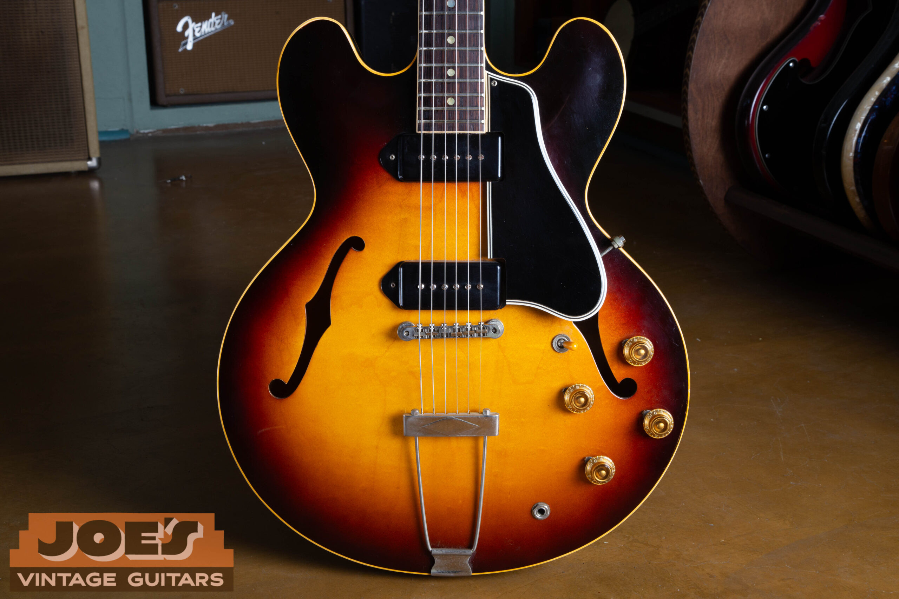
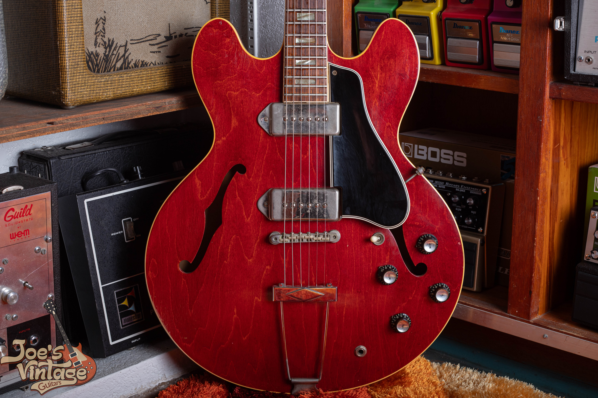
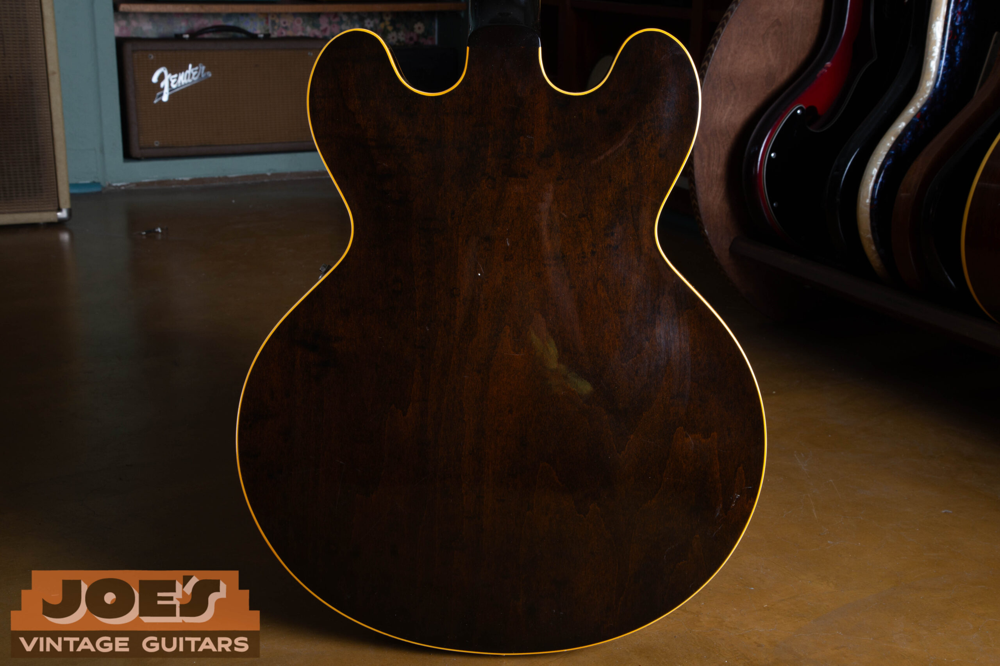
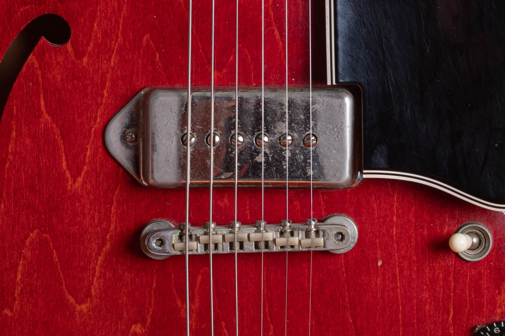
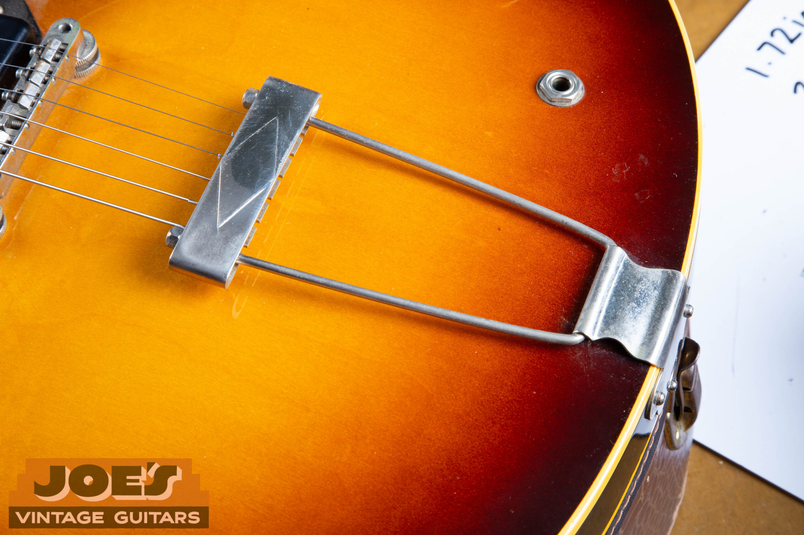
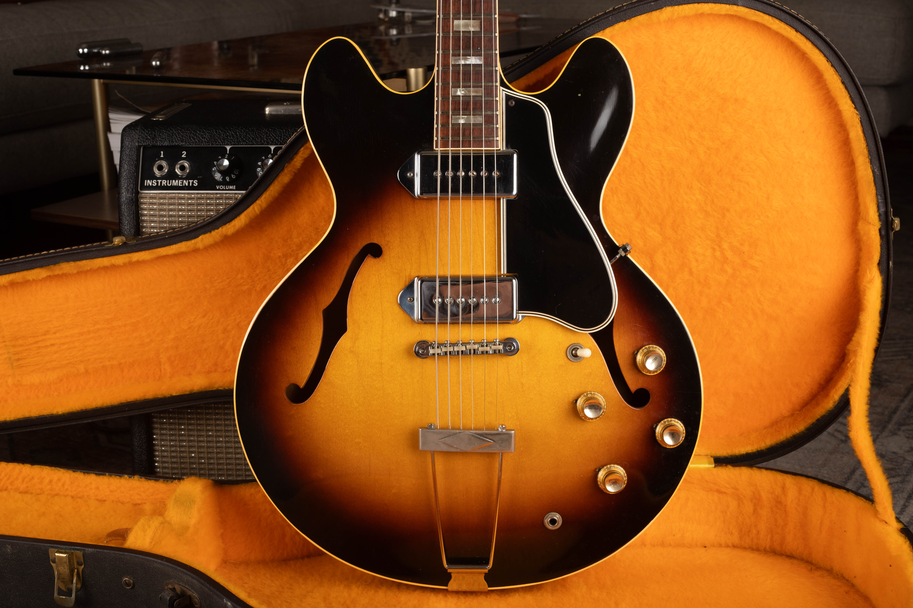

A clean, original two-pickup Gibson ES-330 from the 1959 to 1962 dot-neck era has a guide range of $9,000 to $11,500 in sunburst or cherry. Standard-finish 1966 to 1972 examples sit at $5,250 to $6,500. Those figures assume excellent condition and the original case; I assess repairs and changes separately.

I buy vintage ES-330s and compare them by their own construction, condition and production period. My [Gibson ES-330 dating guide](/gibson-es-330-dating-guide/) covers the features and original parts needed to establish the year. Here, I'll keep the focus on price and the differences that change an appraisal.

## Gibson ES-330 Values By Year

These U.S. dollar ranges were reviewed **as of October 2026**. I identify the year, pickup configuration and condition before using the table.

The table assumes original finish and parts, excellent condition, an original case and no structural repairs. A quality refret is accepted maintenance on an otherwise original guitar, but it removes museum-quality status. Refinished, repaired or substantially modified instruments need a different comparison.

| Year | Configuration | Value Range |
| --- | --- | --- |
| 1959 | Two pickups, dots, sunburst or cherry | $9,000 to $11,500 |
| 1960 | Two pickups, dots, sunburst or cherry | $9,000 to $11,500 |
| 1961 | Two pickups, dots, sunburst or cherry | $9,000 to $11,500 |
| 1962 | Two pickups, dots, sunburst or cherry | $9,000 to $11,500 |
| 1963 | Two pickups, blocks, sunburst or cherry | $6,750 to $10,000 |
| 1964 | Two pickups, blocks, sunburst or cherry | $6,750 to $10,000 |
| 1965 | Two pickups, blocks, sunburst or cherry | $6,750 to $10,000 |
| 1966 | Two pickups, standard era finishes | $5,250 to $6,500 |
| 1967 | Two pickups, standard era finishes | $5,250 to $6,500 |
| 1968 | Two pickups, standard era finishes | $5,250 to $6,500 |
| 1969 | Two pickups, standard era finishes | $5,250 to $6,500 |
| 1970 | Two pickups, standard era finishes | $5,250 to $6,500 |
| 1971 | Two pickups, standard era finishes | $5,250 to $6,500 |
| 1972 | Two pickups, standard era finishes | $5,250 to $6,500 |

Several years share an era range. The 1963 to 1965 range is broad enough to cover differences within that period. I don't apply a fixed annual increase or decrease without inspecting the guitar.

Changed bridges, tuners and nuts, or a case of uncertain originality, can put a guitar outside the excellent-original category. Those details affect the appraisal even when the guitar plays well.

This table ends with the original production period in 1972. It doesn't treat later reissues as 1970s originals or add rows for years when this model wasn't in regular production. A guitar with an uncertain date should be identified before a value is assigned.

<figure>

<figcaption>My archive photograph shows the sunburst top, black pickup covers, four gold-colored controls and trapeze tailpiece.</figcaption>

</figure>

## Two Pickups And One Pickup Belong In Different Comparisons

The ES-330TD has two P-90 pickups, four controls and a pickup selector. The ES-330T has one pickup and a different control arrangement. A P-90 is the single-coil unit that converts string movement into the electrical signal sent to an amplifier.

The annual ranges above cover the two-pickup model in the stated finishes and configurations. I haven't transferred those figures to a single-pickup guitar. A seller's shortened “ES-330” description can conceal that distinction, so a full front photograph is more useful than the model name alone.

The pickup count also helps avoid a poor comparison with an altered instrument. A one-pickup guitar that has been modified for a second pickup doesn't become a factory ES-330TD. Its changed wood and electronics remain part of its history.

For an appraisal, tell me if a pickup has been replaced, rewound or reinstalled. Those are separate conditions. If you don't know, send the photographs you have and leave the question open.

## Where The Early Dot-Neck Range Applies

The early range is for the two-pickup dot-neck configuration in sunburst or cherry. “Dot neck” refers to the round position markers on the fingerboard. It identifies a comparison group, but a set of dots alone doesn't prove a production date.

An early natural-finish guitar needs its own assessment. So does a transitional instrument that combines features from adjoining periods. I haven't assigned an unsupported natural-finish premium or treated every 1962 guitar as the same configuration.

The [dot-neck ES-330 photo reference](/post/complete-dot-neck-es-330-guide-1959-1962/) documents the early instruments in more detail. That helps establish what the guitar is before the price range is narrowed. The value table doesn't replace that identification work.

With a complete original guitar, preservation can account for a substantial difference within the range. Clean surfaces, a well-preserved fingerboard, intact parts and the correct case make a different package from a guitar with several replaced items. I describe those differences individually rather than hiding them behind the word “vintage.”

## Block-Neck Guitars And The Later Production Years

Small block fingerboard markers replace the early dots during the model's development. Metal pickup covers also appear, but the pickups remain P-90s. Those visible features help place the guitar in a broad period without supplying a complete date by themselves.

The middle-era range covers 1963 to 1965. The exact year, neck dimensions and condition can narrow it further. A comfortable neck to one player may feel narrow to another, so I don't assume every buyer wants the same example.

Later ES-330s also include a changed neck-to-body arrangement. The term “long neck” describes the later joint and upper-fret access, not a new scale length. The late-era table uses a shared reference without claiming a fixed premium for that layout.

The original run covered here ends in 1972. If a guitar is described as a 1974 or 1975 original, I want to establish its actual model and date before using this table.

<figure>

<figcaption>The cherry finish, metal covers and small block inlays appear together in this 1965 ES-330 photograph.</figcaption>

</figure>

## The ES-330 And ES-335 Have Separate Markets

The ES-330 is fully hollow. The ES-335 has a solid center block running through its body, along with a different pickup design. Their similar outline doesn't make their markets interchangeable.

The [ES-335 value guide](/vintage-gibson-es-335-value-guide/) covers that separate model. A high asking price for an early ES-335 doesn't establish the value of an ES-330 from the same year. I keep the model, configuration and condition together when selecting comparisons.

The hollow construction also gives the ES-330 its own playing appeal. Buyers may be looking for its acoustic response and P-90 sound rather than a substitute for another Gibson. That interest still has to be matched to the actual guitar's condition.

For an owner, the practical step is simple: photograph the whole instrument and any model markings that are safely visible. Don't assume the model from the outline alone. Establishing the correct comparison prevents a much larger pricing error than choosing the wrong end of a range.

## Original Finish And Visible Wear

Original finish is part of the table's condition assumption. A refinish is a different category even when the replacement finish looks attractive. Local touch-up, added clear coat and a complete refinish also need to be described separately.

Wear doesn't have to be hidden before an appraisal. Clear photographs of the back, edges and neck can show the guitar's present condition more accurately than a polished front-only picture. I don't need the owner to remove the evidence of use.

Finish color can change with lighting and camera processing. A photograph that makes cherry look orange or a sunburst look unusually dark doesn't establish a special finish. Natural indirect light and several angles give me a better basis for assessing it.

The back photograph below belongs to the same sunburst guitar shown earlier. It records the brown finish and wood figure visible in that image. It isn't being used to prove originality from a single view.

<figure>

<figcaption>The back view shows the brown finish and visible wood figure on the sunburst ES-330 from my archive.</figcaption>

</figure>

## P-90s, Covers And Changed Electronics

Black and metal covers both appear on vintage ES-330 pickups. A shiny metal cover doesn't mean the guitar has a humbucker. The cover, pickup and wiring can each have their own replacement history.

For value, I want to know what remains original and what has been changed. A replacement cover is different from a replacement pickup; a replaced pickup is different from a body routed for a larger unit. Those descriptions shouldn't be collapsed into one general “upgraded” label.

Keep any removed pickups, controls or covers with the instrument. They may help explain its history even if they aren't currently fitted. Their presence doesn't automatically make the assembled guitar untouched, but it gives the appraisal more information.

I don't ask an owner to remove the electronics through a hollow body to obtain an initial estimate. Existing service photographs or repair records are useful when available. Exterior views can establish the first questions without disturbing old wiring.

<figure>

<figcaption>The close view shows a metal dogear cover, its six pole screws and the bridge below it.</figcaption>

</figure>

## Tailpieces And Vibrato Changes

The trapeze tailpiece anchors the strings at the body edge. A vibrato adds a mechanism that lets the player change string tension with an arm. Both the type of unit and its installation history affect which comparisons fit.

A factory vibrato, an added unit and a removed unit with remaining holes are different situations. Replacing an added vibrato with a period-looking trapeze doesn't remove the extra holes or restore the original history. That distinction belongs in the description before any price is discussed.

I don't apply one fixed Bigsby premium or parts-change deduction across every year and condition. The installation history and the rest of the guitar determine the appraisal.

The tailpiece close-up below shows the hardware as photographed in my archive. It gives an owner a useful view to include in an appraisal request. It isn't a parts-dating checklist.

<figure>

<figcaption>The trapeze tailpiece extends from the body edge and carries a diamond outline on its crossbar.</figcaption>

</figure>

## Repairs, Fretwork And The Condition Assumed

A stable repaired guitar can still be a useful instrument, but the repair must be included in its valuation. A headstock break, neck-joint work and damage to the thin body aren't interchangeable repairs. The location, extent and quality of the work determine which comparisons are relevant.

Tell me what you know about the repair and include any invoice or earlier photograph. If the history is uncertain, say that. A limited accurate account is more useful than an unsupported “never repaired” claim.

A quality refret is accepted maintenance under this site's grading approach. An otherwise original guitar can retain its all-original classification after that work, while losing museum-quality status. Neck reshaping or a replaced fingerboard is a different alteration.

Playability also deserves its own description. Worn frets, a stiff control or a setup problem shouldn't be described as if the guitar is ready for every buyer's use. The table assumes excellent condition; an appraisal accounts for the guitar in front of us.

## Cases And The Rest Of The Package

The ranges assume the original case. A later protective case can be practical for transport, but it isn't the same collector accessory. An old case with a Gibson logo also needs to be identified rather than assumed original to the instrument.

Photograph the case exterior, lining, handle and latches. If it contains hang tags, receipts or removed parts, keep those with the guitar and show them separately. Their relationship to the instrument can be reviewed without assigning an invented paperwork premium.

If the case's originality is uncertain, describe it that way. A seller's assumption doesn't establish that it came with the guitar when new.

<figure>

<figcaption>This wider view keeps the block-neck ES-330 and the open orange-lined case together.</figcaption>

</figure>

## Reading The Range Before Choosing A Selling Price

A range describes a guitar category under stated conditions. It doesn't guarantee the final selling price or the owner's net proceeds. Selling costs, repairs and the terms of a transaction can affect that result.

An advertised asking price may differ from the amount a buyer pays. I check the model, year and condition before discussing an offer.

For an individual appraisal, send photographs of the guitar, its case and any known repairs. I can explain which condition group fits and what needs a closer look.

If you'd like an individual comparison, request a [free vintage guitar appraisal](/free-appraisal/) with front and back photographs, the headstock, neck joint, tailpiece and case. Include the serial number and any known repairs or replaced parts. I can then explain which reference applies and what remains to be checked.
