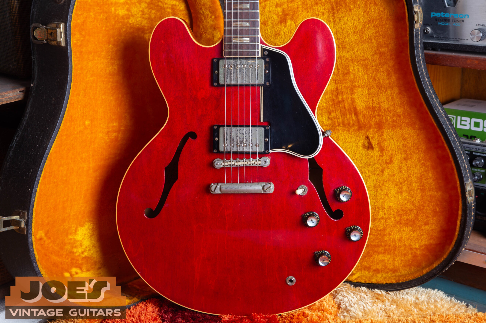
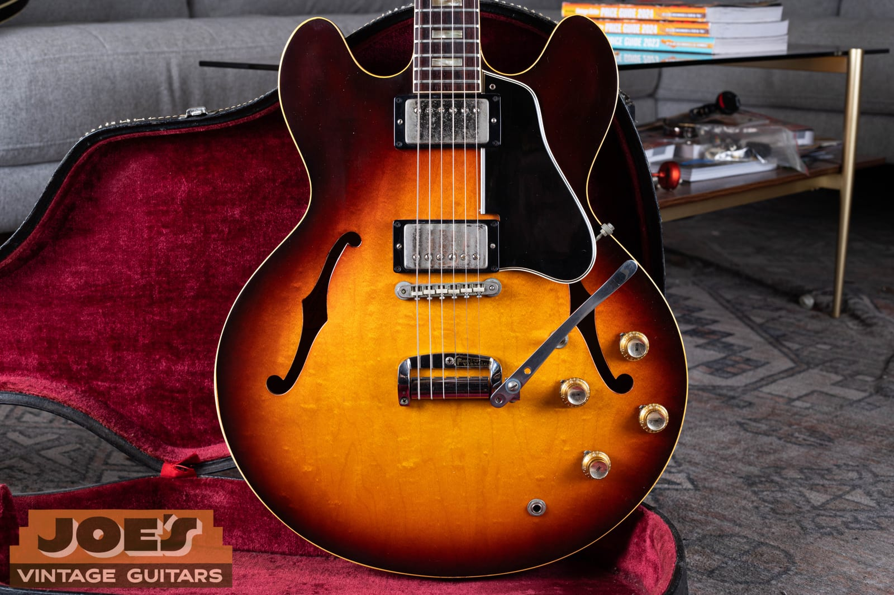
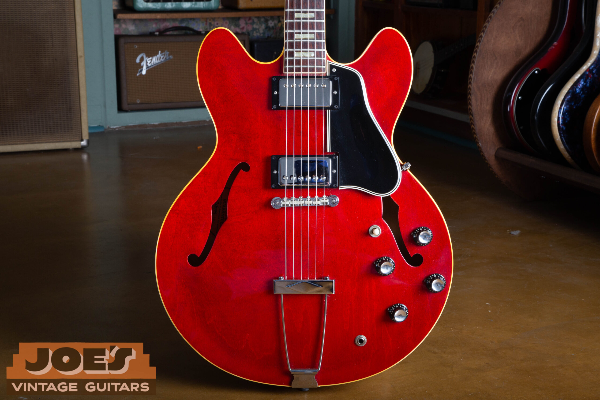
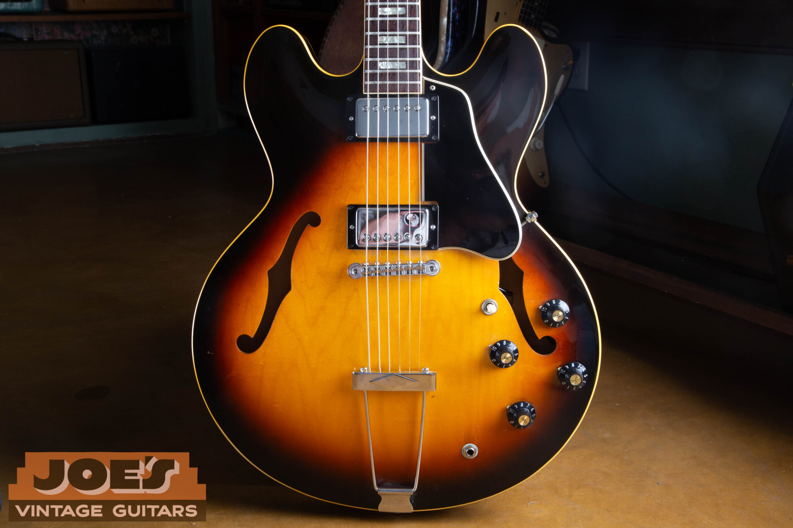
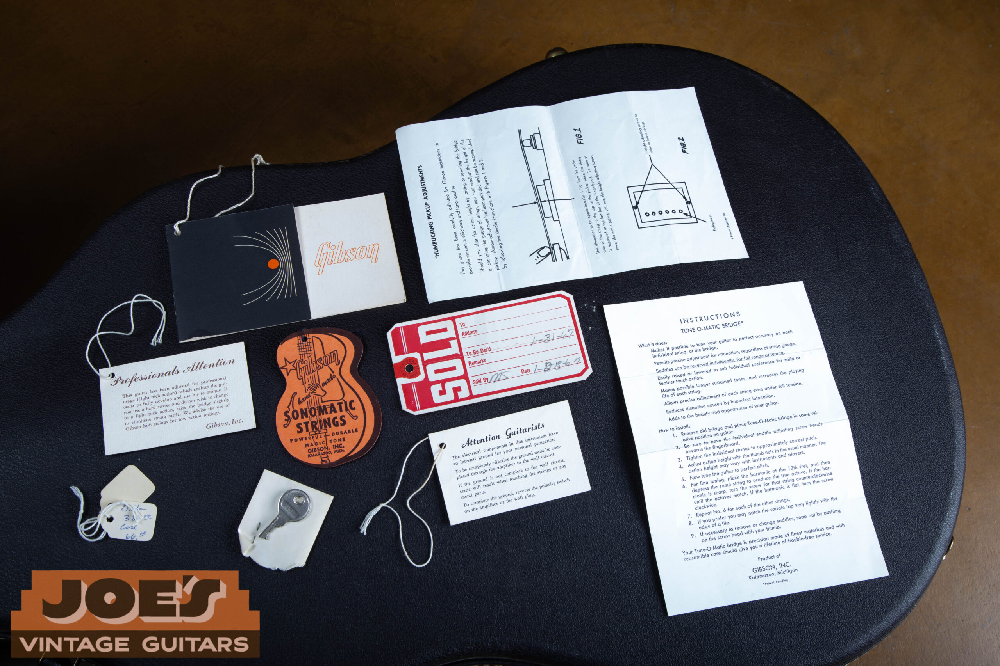

Vintage Gibson ES-335 guide values run from $3,000 to $5,000 for typical 1970s examples to $30,000 to $63,000 for early dot-neck guitars, reviewed in October 2026. The broader all-original dot-neck market spans $27,000 to $72,000+, so the table isn't a ceiling for a rare or exceptional guitar.

For the year and original specification, use my [Gibson ES-335 dating and identification guide](/gibson-es-335-345-355-dating-guide/#es-335). This guide covers market value and the features that move it.

## Gibson ES-335 Values By Year

**Reviewed October 2026. US dollars.** Adjacent years can share a range. Read the condition notes with the table.

| Year | Value Range | Configuration And Year Notes |
| --- | --- | --- |
| 1958 | $30,000 to $63,000 | Launch year; early unbound fingerboard and long guard. |
| [1959](/post/1959-gibson-es-335-authentication-guide/) | $30,000 to $63,000 | Sunburst dot neck; natural examples excluded here. |
| 1960 | $30,000 to $63,000 | Cherry joins sunburst; neck profile changes within the year. |
| 1961 | $30,000 to $63,000 | Dot inlays and PAFs; factory tailpiece affects value. |
| 1962, Early Dot Neck | $30,000 to $63,000 | PAF dot-neck reference; block guitars use the next row. |
| [1962](/post/1962-gibson-es-335-guide/) Block Neck | $23,000 to $34,000 | Dot to block transition; use the matching row. |
| 1963 | $23,000 to $34,000 | Block inlays; check original pickup and tailpiece combination. |
| 1964 | $23,000 to $34,000 | Wide nut and early block-neck construction. |
| [1965](/post/1965-gibson-es-335-short-maestro-vibrola/) | $12,000 to $14,000 | Wide to narrow nut transition; both widths are included. |
| [1966](/post/1966-gibson-es-335-authentication-guide/) | $4,500 to $7,000 | Narrow nut and trapeze; played-original reference. |
| 1967 | $4,500 to $7,000 | Trapeze era; factory custom finishes excluded. Played original. |
| [1968](/post/1968-gibson-es-335-guide/) | $6,500 to $7,500 | Clean-original condition; one-piece neck and long tenon. |
| 1969 | $4,500 to $7,000 | Multi-piece neck and shorter tenon transition. Played original. |
| 1970 | $3,000 to $5,000 | Later construction; ordinary ES-335TD reference. |
| 1971 | $3,000 to $5,000 | ES-335TD; retain the actual factory tailpiece. |
| 1972 | $3,000 to $5,000 | Walnut and sunburst examples in the configuration group. |
| 1973 | $3,000 to $5,000 | Original pickups and repairs drive the range. |
| 1974 | $3,000 to $5,000 | Standard TD configurations; condition remains decisive. |
| 1975 | $3,000 to $5,000 | Original finish and working electronics assumed. |
| 1976 | $3,000 to $5,000 | Check working controls and disclosed service needs. |
| 1977 | $3,000 to $5,000 | Case and hardware completeness affect placement. |
| 1978 | $3,000 to $5,000 | Later controls vary; working electronics affect value. |
| 1979 | $3,000 to $5,000 | ES-335 Pro, CRS and CRR excluded. |

Natural finishes need a separate appraisal from the sunburst and cherry guitars in the table. The 1965 range includes both 1 11/16 inch and 1 9/16 inch nuts without assigning a fixed wide-neck premium. The 1966 and 1969 ranges allow played condition and minor parts changes; the 1968 range assumes a clean original. I wouldn't read those differences as a fixed annual gain or loss.

### Condition Behind The Ranges

**1958 To 1961 Dot-Neck Era:** Original sunburst finish, or cherry from 1960 onward, with original PAF pickups and no disclosed structural repair. Clean to lightly played; quality refret or replacement tuner tips/tuners can be present. Case completeness varies. Natural finishes excluded.

**1962 To 1964 Block-Neck Era:** Clean original-finish guitars with original humbuckers and no disclosed structural repair. Factory stopbar or vibrato, including unusually clean examples. Case completeness varies; minor replaced strap buttons accepted.

**1965 ES-335, Factory Trapeze, Cherry Or Sunburst:** Original finish and pickups, original case, no reported structural break. Minor changes can include a replacement nut, period replacement tuners or a filled neck dent. Wide and narrow nuts are included; this isn't an untouched collector category.

**1966 To 1969 Trapeze Era:** Played original-finish guitars with original pickups and no disclosed structural repair. Replacement tuners or switch accepted; case can be replaced. Factory trapeze configuration.

**1970 To 1979 Standard ES-335TD:** Original-finish guitars with vintage Gibson pickups, no disclosed structural break, normal wear or minor hardware changes. Case originality varies. 1979 CRS and CRR, ES-335 Pro, refinishes and replacement pickup sets excluded. Some lower-priced examples require minor control servicing; a fully functioning guitar should be compared accordingly.

## Why Dot-Neck ES-335s Bring More

The early ES-335 combines a maple body with a solid center block, two humbuckers and a mahogany neck. The center block separates it from a fully hollow Gibson, and the early PAF pickups are part of the collector appeal. PAF refers to the Patent Applied For decal used on these early humbuckers.

The dot-neck market also contains several distinct guitars. An early 1958 can have an unbound fingerboard; the 1959 is associated with the fuller neck many buyers seek; the 1960 neck becomes slimmer. A long pickguard and the original pickup pair add to the complete early appearance, but replacing a short guard with a reproduction long one doesn't create an earlier guitar.

The broader all-original dot-neck market spans $27,000 to $72,000+. A clean 1959 and a heavily played early example can sit far apart within it. I consider the year, finish, pickups and maintenance history together.

### Sunburst, Natural And Early Cherry

The 1958 and 1959 rows cover sunburst. Natural, often called blonde, was a separate early production finish and needs its own appraisal. Cherry joins during 1960; the 1959 sunburst range assumes that original finish.

Cherry enters the ES-335 finish chronology in 1960. An unusual original finish can widen the market considerably, while the original pickup set and repair history still determine the guitar's condition group.

## Block Inlays And Factory Tailpieces

<figure>

<figcaption>A 1962 cherry ES-335 with block inlays and a stopbar. From my archive.</figcaption>

</figure>

The 1962 change to block inlays creates a useful market boundary without erasing the early construction underneath. Original humbuckers, the wider nut and the factory tailpiece keep clean 1962 to 1964 guitars in a different group from later played trapeze examples. That's why an early 1962 dot neck has its own line above the block-neck row.

A stopbar anchors the strings to two studs in the top. A factory Bigsby adds a vibrato, sometimes with a Custom Made plaque covering the stopbar stud positions. A documented factory Bigsby and a later conversion are different purchase histories, even when the hardware looks similar from across the room.

The plaque isn't a modern Custom Shop designation. I value an intact factory combination as a whole: guitar, original mounting, pickups and hardware. Drilling a later trapeze guitar for a stopbar may appeal to a player, but it doesn't give that instrument the collector standing of a factory stopbar example.

### The Two Neck Widths In 1965

The nut is the small slotted piece at the headstock end of the fingerboard. The ES-335 moves from roughly 1 11/16 inch toward 1 9/16 inch during 1965, and buyers feel that difference immediately. The 1965 range covers both widths; I assess the neck and the rest of the guitar before assigning a premium.

The trapeze also becomes the usual non-vibrato tailpiece around this period. Calendar year, neck width and tailpiece need to be considered together. The 1965 and 1966 rows allow different condition levels, so the change between them isn't a fixed annual loss in value.

<figure>

<figcaption>The unusual factory short Maestro on My documented 1965 ES-335. This configuration needs an individual appraisal. From my archive.</figcaption>

</figure>

The factory short Maestro shown here sits outside the ordinary trapeze category. I assess that unusual hardware combination individually, together with the guitar's finish, pickups and repair history.

## The Later 1960s And The 1970s

<figure>

<figcaption>A trapeze tailpiece on a 1966 ES-335. From my archive.</figcaption>

</figure>

Later 1960s ES-335s offer original Gibson humbuckers and the familiar semi-hollow construction at a lower entry point than the dot-neck group. Narrower nuts, later pickup specifications and trapeze tailpieces help explain the market separation. Original finish and an intact neck still distinguish the better examples from heavily altered players.

The 1968 row gives a $6,500 to $7,500 range for clean originals. Its one-piece mahogany neck and long tenon are the construction features described in the linked year guide. The 1969 row is separate because the multi-piece neck and shorter tenon transition changes the reference, even though condition can make individual prices overlap.

<figure>

<figcaption>A sunburst 1968 ES-335 with its later 1960s hardware. From my archive.</figcaption>

</figure>

For the 1970s, the $3,000 to $5,000 band covers ordinary ES-335TD guitars with original finish and pickups. Lower-priced examples may need control servicing or have minor hardware changes. A clean, fully functioning example should be judged accordingly.

The 1979 Country Rock Stereo, abbreviated CRS, the CRR and the ES-335 Pro are excluded from this ordinary TD band. Likewise, a 1981 dot reissue is outside the 1958 to 1979 scope. Dot inlays on a later guitar don't put it in the original PAF dot-neck market.

## Repairs, Original Parts And Value

For condition comparisons beyond this model, I explain [how repairs and replaced parts affect vintage guitar value](/what-lowers-vintage-guitar-value/).

An unbroken neck, original finish and factory pickups are the baseline for a collector ES-335. A repaired headstock, a full refinish and a missing pickup change different parts of that package. Normal playing wear and a good refret deserve a separate assessment from structural damage.

Repairs and alterations affect the guitar as a whole. A guitar that's already priced as played, serviced or altered has some of those differences reflected in its starting range. A quality refret preserves an otherwise all-original guitar's classification while taking it out of the museum-quality category.

## The Case And A Selling Price

<figure>

<figcaption>Hang tags, instructions and a case key with a 1966 ES-335. From my archive.</figcaption>

</figure>

An original case, hang tags and paperwork complete the package, especially on a clean early guitar. Case wear is usually easier to accept than a broken latch that puts the instrument at risk. Keep the tags and loose original parts together; their history is harder to reconstruct after they're separated.

<figure>

<figcaption>The lining and maker's badge inside the case accompanying a 1959 ES-335. From my archive.</figcaption>

</figure>

A dealer offer accounts for preparation, selling costs and margin, so it will differ from a retail sale reference. For an appraisal, I start with clear front and back photographs, the headstock, tailpiece, case and any known repair. Send those through the [free guitar appraisal](/free-appraisal/) page with the history you know.

For the wider family, my [vintage Gibson value guide](/vintage-gibson-value-guide/) links the solidbody, ES, archtop and acoustic model comparisons.

The stereo Varitone [ES-345 value guide](/post/gibson-es-345-history-value/) and the [ES-355 value guide](/vintage-gibson-es-355-value-guide/) cover their own electronics, finishes and factory vibratos.
