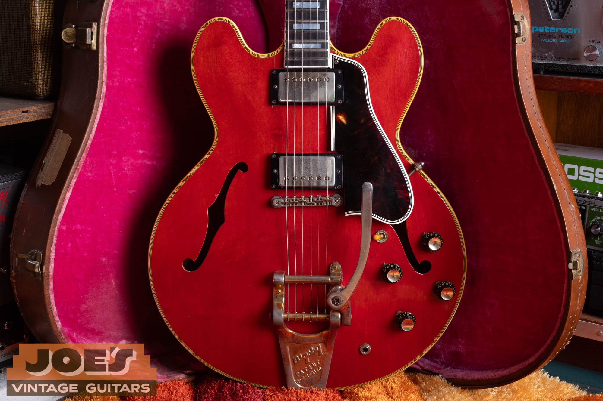
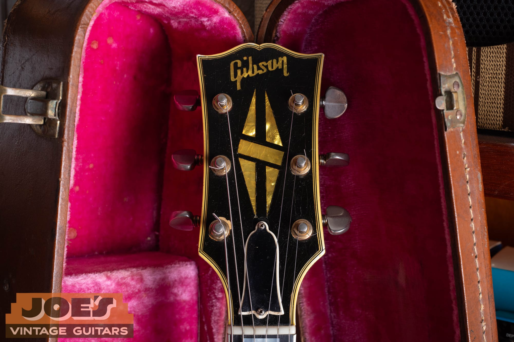
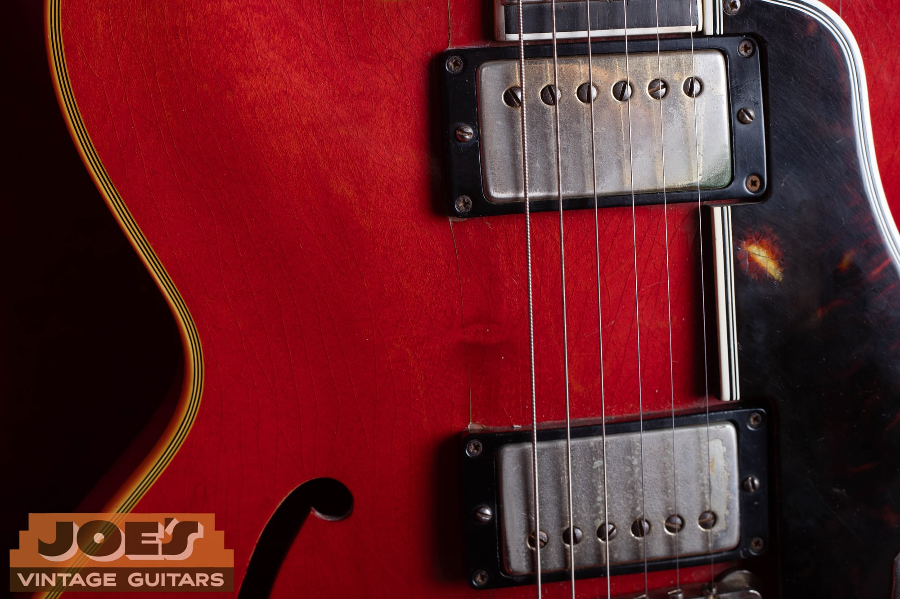
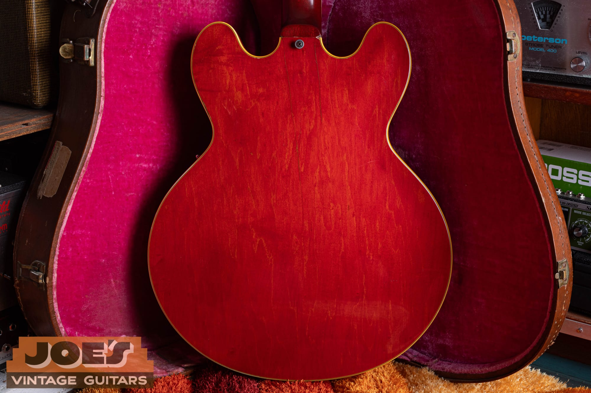
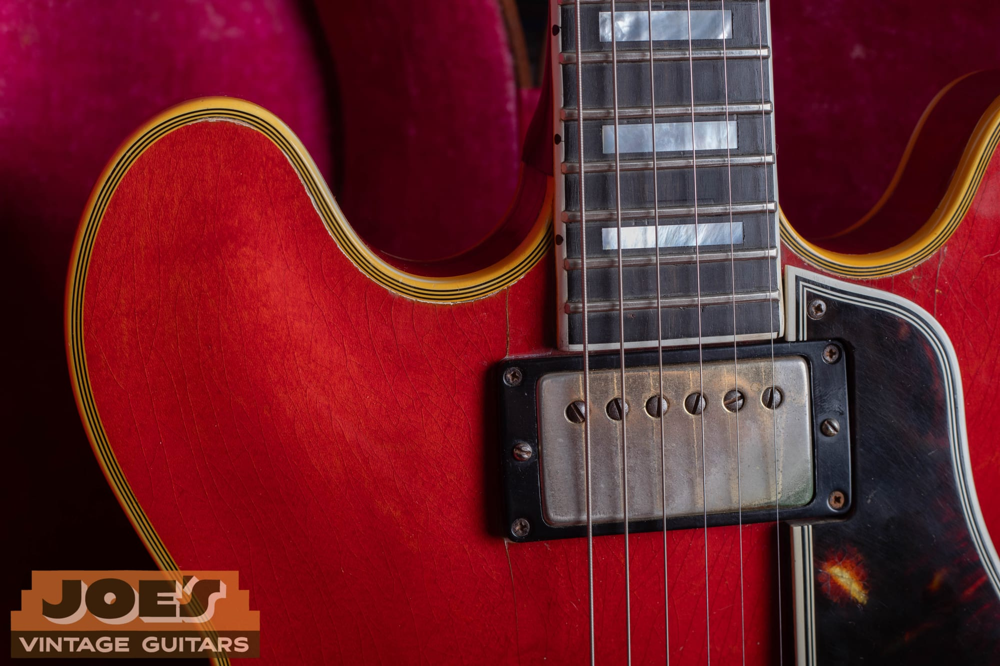
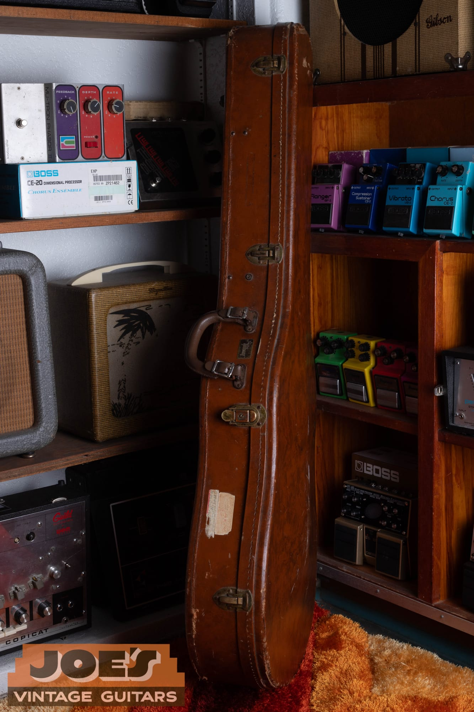

A clean, original 1959 Gibson ES-355 in cherry has a reference range of $30,000 to $45,000 with factory mono wiring and a Bigsby, or $22,000 to $38,000 with stereo Varitone electronics. Standard-finish stereo examples from the 1970s have a published excellent-condition reference of $5,500 to $7,000. The year alone won't put a guitar into one of those ranges.

I buy vintage Gibsons nationwide from Mesa, Arizona. This guide separates the price references from the identification work, because a factory mono guitar and a later mono conversion can look similar in a listing. For the construction, electronics and dating details, use my [1959 Gibson ES-355 authentication guide](/post/1959-gibson-es-355-history-value/).

## Values By Year

These ranges are reviewed **as of October 2026**. They assume an all-original guitar in excellent condition with its original case and no structural repair. A quality refret is accepted maintenance under the site's grading approach, although the guitar then falls outside museum-quality condition.

The two 1959 ranges preserve this site's existing price references. Other rows use the 2025 edition of *The Official Vintage Guitar Magazine Price Guide*, checked against completed Reverb or Heritage results. Several completed comparisons are older or have modifications, so these are published clean-condition references, not a claim that untouched guitars sold within every band during 2026.

| Year | Configuration | Reference Range | Basis |
|---|---|---|---|
| 1958 | Mono, cherry, factory Bigsby | $36,000 to $45,000 | 1958 to 1958 published era reference |
| 1959 | Mono, cherry, factory Bigsby | $30,000 to $45,000 | Existing site anchor |
| 1959 | Stereo Varitone, cherry, factory Bigsby | $22,000 to $38,000 | Existing site anchor |
| 1959 | Factory mono stop-tail, existing reference | $45,000 to $60,000 | Existing site anchor |
| 1960 | Stereo Varitone, PAFs, factory vibrato | $22,000 to $27,500 | 1960 to 1962 published era reference |
| 1961 | Stereo Varitone, PAFs, factory vibrato | $22,000 to $27,500 | 1960 to 1962 published era reference |
| 1962 | Stereo Varitone, PAFs, factory vibrato | $22,000 to $27,500 | 1960 to 1962 published era reference |
| 1963 | Stereo Varitone, Patent Number pickups | $15,000 to $18,500 | 1963 to 1964 published era reference |
| 1964 | Stereo Varitone, Patent Number pickups | $15,000 to $18,500 | 1963 to 1964 published era reference |
| 1965 | Stereo, wide or narrow neck; combined span | $7,500 to $15,000 | 1965 to 1965 published era reference |
| 1966 | Stereo, standard finishes; combined span | $6,000 to $8,500 | 1966 to 1969 published era reference |
| 1967 | Stereo, standard finishes; combined span | $6,000 to $8,500 | 1966 to 1969 published era reference |
| 1968 | Stereo, standard finishes; combined span | $6,000 to $8,500 | 1966 to 1969 published era reference |
| 1969 | Stereo, standard finishes; combined span | $6,000 to $8,500 | 1966 to 1969 published era reference |
| 1970 | Stereo, standard finishes, factory vibrato | $5,500 to $7,000 | 1970 to 1979 published era reference |
| 1971 | Stereo, standard finishes, factory vibrato | $5,500 to $7,000 | 1970 to 1979 published era reference |
| 1972 | Stereo, standard finishes, factory vibrato | $5,500 to $7,000 | 1970 to 1979 published era reference |
| 1973 | Stereo, standard finishes, factory vibrato | $5,500 to $7,000 | 1970 to 1979 published era reference |
| 1974 | Stereo, standard finishes, factory vibrato | $5,500 to $7,000 | 1970 to 1979 published era reference |
| 1975 | Stereo, standard finishes, factory vibrato | $5,500 to $7,000 | 1970 to 1979 published era reference |
| 1976 | Stereo, standard finishes, factory vibrato | $5,500 to $7,000 | 1970 to 1979 published era reference |
| 1977 | Stereo, standard finishes, factory vibrato | $5,500 to $7,000 | 1970 to 1979 published era reference |
| 1978 | Stereo, standard finishes, factory vibrato | $5,500 to $7,000 | 1970 to 1979 published era reference |
| 1979 | Stereo, standard finishes, factory vibrato | $5,500 to $7,000 | 1970 to 1979 published era reference |

The table covers every year from the model's 1958 introduction through 1979. Repeated ranges are shared era references, not separate estimates created from one sale per year. The 1965 row spans the published narrow-neck and wide-neck references; the 1966 to 1969 row combines the endpoints for standard finishes across those years.

Match the configuration before using a number. A later PAF-equipped guitar, a factory mono example from the 1960s or a rare finish can need a comparison outside the main stereo rows. I've left those separate premiums unpriced where the verified evidence doesn't support a second band.

<figure>

<figcaption>My 1959 mono ES-355 photograph shows the four controls and Bigsby against the pink case lining. The existing model guide documents later reflector knobs on this example.</figcaption>

</figure>

## Mono, Stereo And The Price Difference

A factory mono ES-355 sends a conventional combined guitar signal to an amplifier. The stereo version sends the pickups to separate output channels and carries the Varitone, a rotary tone-filter system. That distinction changes the comparison group before wear, repairs or originality enter the discussion.

A stereo instrument converted to mono isn't a factory mono instrument. It may be convenient for the player, but its wiring history belongs in the description. If the original harness remains with the guitar, keep it together and include it in the photographs.

I don't assume that a mono conversion includes the same work on every guitar. One owner may have changed the output connection while retaining the original components. Another may have installed a complete replacement harness, removed the Varitone or drilled an extra control hole.

Those changes cannot be priced by reading “mono” in a listing title. The appraisal needs the original configuration, the work performed and the parts that survive. A guitar can be an excellent player while falling outside the clean-original reference.

The standard vibrato also needs its own context. A Bigsby was part of the early ES-355 package, so its presence doesn't automatically call for a discount. A later added vibrato with extra holes is a different situation.

## Early Cherry Examples

The first annual row is a mono guitar because the earliest ES-355 belongs to that configuration. The 1959 rows split mono and stereo rather than folding both into one large number. I keep the site's established ranges for that year even though the published reference uses different endpoints.

The 1960 to 1962 main row covers stereo examples with PAF pickups and a factory vibrato. PAF means Patent Applied For, the name taken from the decal used on those early Gibson humbuckers. It identifies a pickup family, not a guarantee that everything under a cover is untouched.

The completed early comparisons used in the research include changed electronics, repaired or separated wood and other condition limitations. They help test whether the published reference is plausible, but they don't replace a clean-original reference with a single modified-guitar result. Older results also carry their original sale dates in the research ledger.

Factory stop-tail instruments require a separate review. This site's existing 1959 mono stop-tail discussion places them around $45,000 to $60,000, with exceptional examples outside that reference. That is an inherited site range for an unusual configuration, not a premium to add to any guitar with a stop tailpiece.

An added tailpiece and plugged vibrato holes do not establish factory stop-tail status. I need the construction evidence before deciding which market comparisons belong. The authentication guide handles that inspection; this page keeps the financial consequence separate.

<figure>

<figcaption>The headstock photograph shows the split-diamond inlay, Gibson logo and multiple binding lines.</figcaption>

</figure>

## The Middle And Late 1960s

The 1963 and 1964 rows use the stereo reference for Patent Number pickups. Some gold-hardware instruments retained earlier pickup stock, so a year label does not settle the pickup configuration. A guitar documented with a different factory pickup set needs a matching comparison.

The 1965 range is deliberately broad. The published guide distinguishes the earlier wider nut from the later narrower neck, and those variants share the calendar year. A measurement and the guitar's original configuration do more for the appraisal than choosing the higher endpoint because the serial number says 1965.

For 1966 to 1969, the annual rows use a combined standard-finish stereo range. The published reference has slightly different endpoints within that period; the combined band makes the limited evidence explicit. It doesn't establish a separate premium for every color or vibrato style.

The completed late-1960s comparisons include a neck reset and guitars converted to mono. Those facts explain why the research ledger distinguishes condition checks from the all-original assumption printed above the table. I won't describe a repaired or rewired instrument as proof of an untouched market.

Sparkling Burgundy and other less common configurations need additional evidence. A finish name on its own isn't enough to price an instrument, and a refinished guitar shouldn't inherit the reference for an original custom finish. I haven't assigned a fixed color percentage here.

<figure>

<figcaption>This close view shows worn metal pickup covers and visible checking in the cherry finish. It does not establish the unseen pickup internals.</figcaption>

</figure>

## A 1970s ES-355 In Context

The 1970 to 1979 rows use the published $5,500 to $7,000 reference for a standard-finish stereo guitar with its factory vibrato. The value section stops at 1979 to keep the requested vintage coverage consistent. That cutoff doesn't claim that ES-355 production ended in that year.

The completed comparisons reviewed for this group include a missing pickguard and a mono conversion with a replacement guard. Their dates are recent, but their condition still differs from the printed clean-original assumption. A recent sale doesn't become an exact match merely because the year falls inside the same decade.

I look at the working guitar as well as its parts. A straight neck, usable frets, functional electronics and a stable body help establish what the buyer will receive. A guitar that needs a repair estimate belongs in a separate appraisal, even if its finish photographs beautifully.

Age alone doesn't turn a replacement into an original part. A replacement installed decades ago may have similar wear to the guitar. The appraisal should describe what it is, what evidence supports that conclusion and whether the removed original survives.

## Condition Without A Stack Of Automatic Deductions

Original finish, original pickups and structural condition are separate parts of the appraisal. A worn original finish and a glossy refinish can represent very different collector positions. I don't treat shine as a substitute for a documented history.

A repaired headstock needs a description of the break, the repair and any related finish work. A stable repair can leave a useful instrument, but it takes the guitar outside the no-structural-repair assumption in the annual table. The appropriate comparison is another documented repaired example.

Multiple changes should be assessed together. Adding a finish deduction, a pickup deduction and a wiring deduction mechanically can produce a number that doesn't resemble the market for the complete guitar. I compare the resulting instrument with other instruments in similar condition.

The old model article used percentage deductions for several issues. This value guide doesn't turn those broad figures into a universal calculator. The price reference is a starting condition, and a repair or alteration calls for a matching comparison rather than a guaranteed percentage.

A good refret is handled differently from a reshaped neck or a damaged fingerboard. Under the site's grading approach, a quality refret preserves an otherwise all-original classification while removing museum-quality status. The work still needs to be disclosed.

<figure>

<figcaption>The full back view records the red finish, wood figure and bound edge.</figcaption>

</figure>

## Pickups, Hardware And Included Parts

The pickup type can place an ES-355 into a different reference group. Replaced pickups, rewinds and changed wiring should be listed separately where known. An exterior photograph of a metal cover cannot settle all of those questions.

I don't ask an owner to remove covers for a first appraisal. Existing service photographs and written repair records are better starting points than unnecessary disassembly. If further inspection is needed, we can identify the specific question first.

Keep loose original hardware with the instrument. A bridge, pickguard, harness or set of tuners removed during a repair still helps explain the guitar's history. It should be included in the description instead of being assumed installed.

The photographed guitar on this page comes from my existing 1959 archive. Its black reflector knobs are discussed as later replacements in the model guide. These pictures illustrate the instrument and its details; they aren't presented as a certified untouched example of every table row.

The neck photograph also helps distinguish the model visually without turning this into a dating walkthrough. The ES-355's ebony fingerboard, block inlays and split-diamond headstock belong to its trim package. They don't make a stereo conversion equivalent to a factory mono guitar.

<figure>

<figcaption>The fingerboard close-up shows large block inlays, its bound edge and the neck pickup below.</figcaption>

</figure>

## The Case And The Guitar's History

The annual ranges assume the original case. A period-looking case supplied later and the case that accompanied the guitar originally are not necessarily the same thing. If that history is unknown, describe it as unknown.

Photograph the case exterior, interior, handle and latches. A damaged case can still be associated with the instrument, but its condition should be visible before shipping or sale. Documents and removed parts should be recorded separately so they don't disappear in the transaction.

Family history can help explain repairs and ownership without replacing an inspection. My [one-family 1959 ES-355 story](/post/one-family-1959-gibson-es-355/) documents a specific instrument and its stereo-to-mono conversion. It shows why the actual history belongs beside the model name.

I don't add a provenance premium just because a guitar has been in one family for a long time. Documentation can make its condition history clearer. A separate claim about a famous owner needs evidence of its own.

<figure>

<figcaption>The brown case photograph records its exterior, handle and latches. Case condition is assessed separately from the guitar.</figcaption>

</figure>

## Comparing An ES-355 With Its Relatives

The most decorated model isn't automatically the most expensive vintage guitar. Buyers distinguish the ES-335's familiar configuration from the ES-355's electronics and hardware choices. The models share a family resemblance, but their markets should be compared separately.

Use the [vintage Gibson ES-335 value guide](/vintage-gibson-es-335-value-guide/) for a guitar identified as an ES-335. It has its own annual rows and condition assumptions. A seller's shorthand description of “like a 335” doesn't move an ES-355 into that table.

An ES-345 also requires its own model reference. Trim, electronics and original configuration are part of what the buyer is choosing. I avoid a fixed family-wide percentage that assumes every year behaves the same way.

## Getting A Range For Your Guitar

For a first review, send the whole front and back, headstock front and back, neck heel, controls, bridge, vibrato and case. Include the serial or label photograph and any repair history you already have. You don't need to polish away evidence of wear.

Tell me about known changes even if they seem small. A replaced guard, rewired output or old tuner swap can explain why a guitar doesn't fit the clean reference. If you're unsure, an uncertainty is more useful than an unsupported claim that everything is original.

I can begin with a [free vintage guitar appraisal](/free-appraisal/). I buy nationwide and can discuss the complete instrument after reviewing the photographs. The annual table gives us a starting point; the final range belongs to the guitar in front of us.
