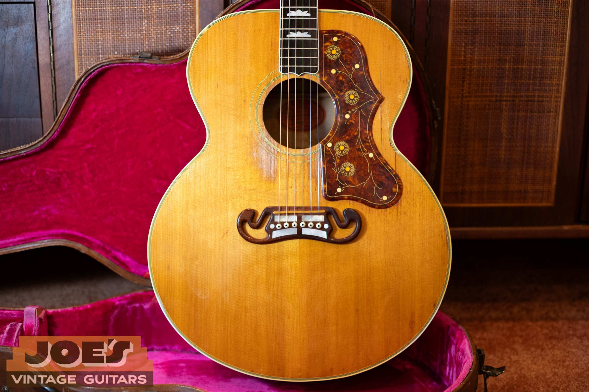
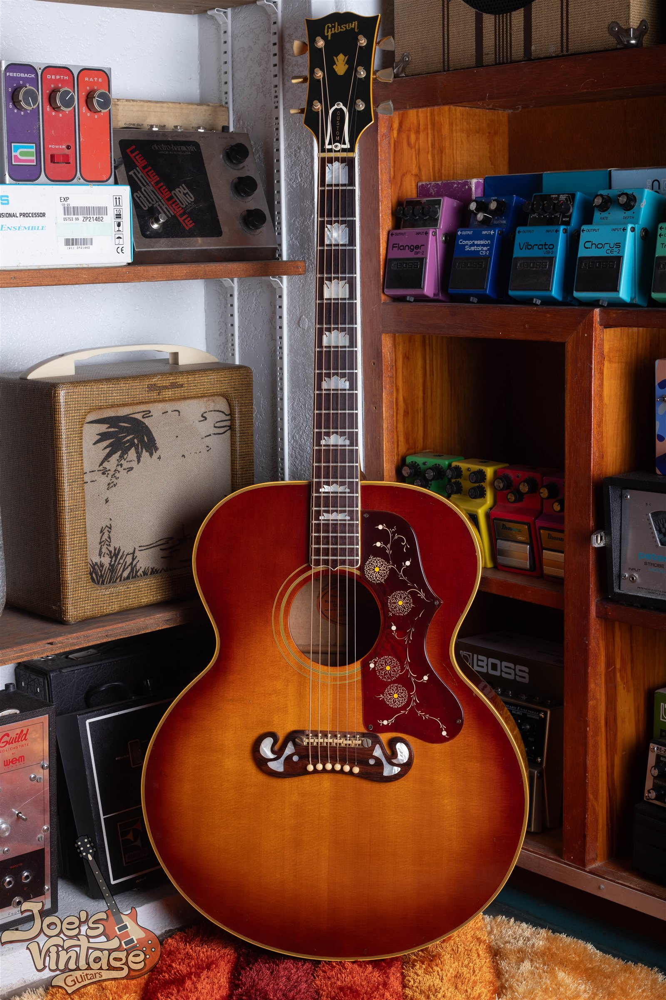
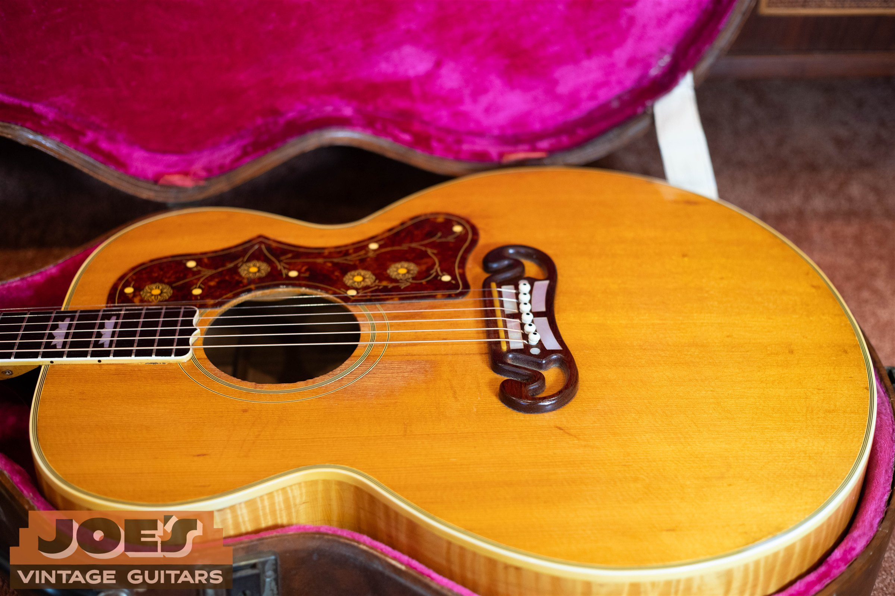
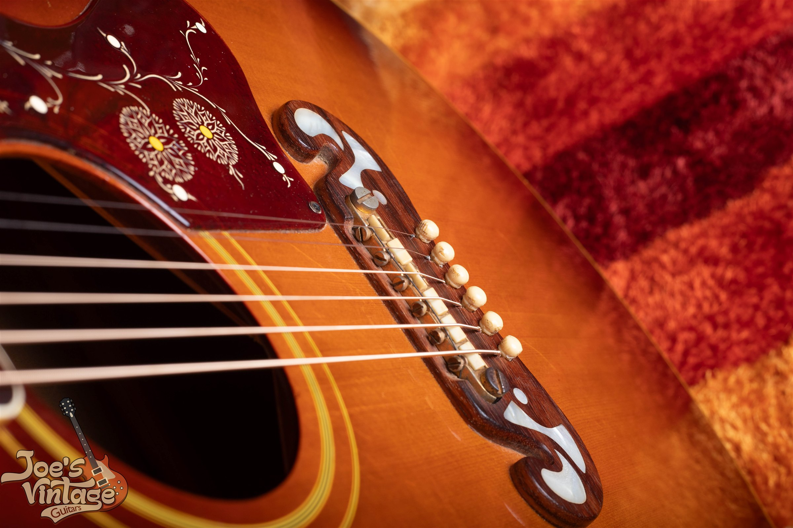
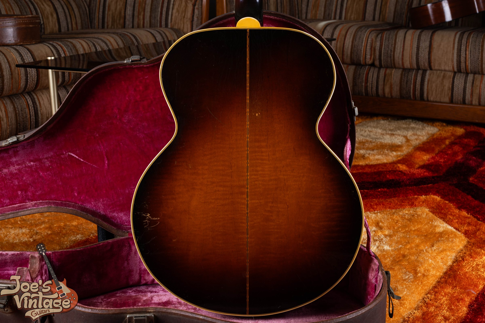

A standard postwar Gibson J-200 has published excellent-condition references from $4,750 to $25,000 across the years covered below. A 1950s example sits in the $16,500 to $21,500 reference, while 1970s examples use $4,750 to $6,250. Those are dated reference ranges for an original guitar with its original case, not guaranteed selling prices.

I reviewed the 2025 published guide and completed-sale records as of October 2026. Several completed examples have repairs or changed parts, and some transactions are older. I keep those qualifications attached to the figures instead of treating every sale as evidence for a clean original.

For model identity, construction changes and originality checks, use my [Gibson J-200 history and authentication guide](/post/gibson-j200-model-history-authentication-guide/). This page handles price references and the condition details that determine which comparisons fit.

## Gibson J-200 Values By Year

The table covers every postwar year from 1947 through 1979. Adjacent years repeat a shared era reference because the available evidence doesn't establish a separate market for every calendar year. Natural and sunburst standard examples share these published bands.

The assumption is all-original, excellent condition, with the original case and no structural repairs. Under this site's grading approach, a quality refret preserves otherwise all-original status but removes museum-quality status. A refinished, cracked or substantially modified guitar needs its own assessment.

**Prewar coverage:** The 1937 custom prototypes and the 1938 to 1943 catalog period aren't assigned a price band here. I found a published reference, but not enough independent ordinary-market completed transactions to clear the research standard. A modern reissue, an advertised price or a celebrity-associated sale can't fill that gap.

| Year | Configuration | Reference Range | Basis |
|---|---|---|---|
| 1947 | Early postwar maple | $20,000 to $25,000 | 1947 to 1949 shared era envelope |
| 1948 | Early postwar maple | $20,000 to $25,000 | 1947 to 1949 shared era envelope |
| 1949 | Early postwar maple | $20,000 to $25,000 | 1947 to 1949 shared era envelope |
| 1950 | Standard natural or sunburst | $16,500 to $21,500 | 1950 to 1959 shared era envelope |
| 1951 | Standard natural or sunburst | $16,500 to $21,500 | 1950 to 1959 shared era envelope |
| 1952 | Standard natural or sunburst | $16,500 to $21,500 | 1950 to 1959 shared era envelope |
| 1953 | Standard natural or sunburst | $16,500 to $21,500 | 1950 to 1959 shared era envelope |
| 1954 | Standard natural or sunburst | $16,500 to $21,500 | 1950 to 1959 shared era envelope |
| 1955 | Standard natural or sunburst | $16,500 to $21,500 | 1950 to 1959 shared era envelope |
| 1956 | Standard natural or sunburst | $16,500 to $21,500 | 1950 to 1959 shared era envelope |
| 1957 | Standard natural or sunburst | $16,500 to $21,500 | 1950 to 1959 shared era envelope |
| 1958 | Standard natural or sunburst | $16,500 to $21,500 | 1950 to 1959 shared era envelope |
| 1959 | Standard natural or sunburst | $16,500 to $21,500 | 1950 to 1959 shared era envelope |
| 1960 | Early 1960s standard | $13,500 to $17,500 | 1960 to 1964 shared era envelope |
| 1961 | Early 1960s standard | $13,500 to $17,500 | 1960 to 1964 shared era envelope |
| 1962 | Early 1960s standard | $13,500 to $17,500 | 1960 to 1964 shared era envelope |
| 1963 | Early 1960s standard | $13,500 to $17,500 | 1960 to 1964 shared era envelope |
| 1964 | Early 1960s standard | $13,500 to $17,500 | 1960 to 1964 shared era envelope |
| 1965 | Later 1960s, combined references | $6,500 to $11,500 | 1965 to 1969 shared era envelope |
| 1966 | Later 1960s, combined references | $6,500 to $11,500 | 1965 to 1969 shared era envelope |
| 1967 | Later 1960s, combined references | $6,500 to $11,500 | 1965 to 1969 shared era envelope |
| 1968 | Later 1960s, combined references | $6,500 to $11,500 | 1965 to 1969 shared era envelope |
| 1969 | Later 1960s, combined references | $6,500 to $11,500 | 1965 to 1969 shared era envelope |
| 1970 | J-200 and Artist period | $4,750 to $6,250 | 1970 to 1979 shared era envelope |
| 1971 | J-200 and Artist period | $4,750 to $6,250 | 1970 to 1979 shared era envelope |
| 1972 | J-200 and Artist period | $4,750 to $6,250 | 1970 to 1979 shared era envelope |
| 1973 | J-200 and Artist period | $4,750 to $6,250 | 1970 to 1979 shared era envelope |
| 1974 | J-200 and Artist period | $4,750 to $6,250 | 1970 to 1979 shared era envelope |
| 1975 | J-200 and Artist period | $4,750 to $6,250 | 1970 to 1979 shared era envelope |
| 1976 | J-200 and Artist period | $4,750 to $6,250 | 1970 to 1979 shared era envelope |
| 1977 | J-200 and Artist period | $4,750 to $6,250 | 1970 to 1979 shared era envelope |
| 1978 | J-200 and Artist period | $4,750 to $6,250 | 1970 to 1979 shared era envelope |
| 1979 | J-200 and Artist period | $4,750 to $6,250 | 1970 to 1979 shared era envelope |

These are 2025 published references reviewed as of October 2026. The completed comparisons serve as dated context, not as proof that today's market has reached every endpoint. Early postwar comparisons include 2022 and 2024 auction results; the 1950s checks include 2021 and 2023 marketplace sales.

The 1965 to 1969 rows combine narrower book entries into one disclosed envelope. That broad span shouldn't be read as evidence that a 1965 and a 1969 are interchangeable. I first establish the exact year, bridge arrangement and condition, then choose closer comparisons.

<figure>

<figcaption>My 1948 SJ-200 archive photograph shows the sunburst front, bridge and decorated pickguard together. This postwar guitar is not a prewar rosewood example.</figcaption>

</figure>

## What The Price Reference Measures

The table describes a collector condition, not simply a guitar that can be played. Original finish, the correct major parts, structural condition and the included case all belong in that description. An instrument can play well while sitting outside the table's assumptions.

An asking price records what a seller hopes to receive. A completed price records a transaction, but still needs a condition description and a date. A published reference gives another defined basis for comparison; it doesn't replace either one.

I also distinguish the displayed transaction total from an owner's proceeds. Auction results can include a buyer's premium, while marketplace histories exclude shipping and tax. Selling expenses, preparation and the terms of a direct purchase affect the amount an owner receives.

### Why A Shared Band Appears In Several Rows

A year-by-year table makes it easier to locate a guitar. It doesn't create a new set of completed sales for each row. Where the source groups several years, I repeat that group and label it rather than manufacturing annual increases.

The earlier and later ends of a broad reference aren't automatic prices for the first and last year. Condition, configuration and the available comparisons decide where a particular instrument belongs. If those details aren't established, I keep the appraisal provisional.

### What The Completed Comparisons Can Establish

The early postwar checks include guitars with an added pickup, heavy wear, deteriorating parts or repairs still needed. The 1960s checks include a brief ownership description as well as documented crack repairs, resets and saddle changes. Those records show why a condition category can't be inferred from a marketplace label alone.

The 1970s sample also includes replaced tuners, bridge work, pickup installations and higher action. I haven't called those guitars untouched originals. Their transactions help describe the market for actual surviving instruments, while the published table retains its narrower excellent-condition assumption.

## Postwar Maple Guitars And The 1950s Reference

The earlier SJ-200 name and the later J-200 name can appear within the postwar family. I don't add a premium merely because a seller uses the longer name. The guitar's construction, date and originality need to support the comparison.

The shared early postwar reference is $20,000 to $25,000. The 1950 to 1959 reference is $16,500 to $21,500. Both come from the 2025 guide and were reviewed with dated completed comparisons, including examples whose condition differs from the table.

An early guitar with an original-looking exterior can still have bridge-plate changes, an old neck reset or repaired cracks. Those details affect its collector category even when they don't stand out in a full-front photograph. I want the repair description before assuming it belongs in the clean reference.

<figure>

<figcaption>This 1950s natural J-200 shows the pale front and decorated bridge. Natural and sunburst share the reference band used here.</figcaption>

</figure>

Natural finish doesn't automatically outrank sunburst in this table. The published postwar entries group the two finishes together. A specific guitar can still be more desirable because of its condition and appearance, but that calls for matching examples rather than a blanket finish premium.

The original case is another part of the comparison. A worn original case and a later protective case serve different purposes. If both survive, describe both; the modern case doesn't erase the value of the original accessory.

## The 1960s Bridge And Condition Questions

The early 1960s reference is $13,500 to $17,500 for the standard model in the stated condition. The combined later 1960s envelope is $6,500 to $11,500. A broad table can't settle where a transitional or modified example belongs.

Before I use either group, I need to know what bridge and saddle arrangement is present and whether it has been changed. The price question concerns the guitar being offered now. A conversion doesn't become original because it resembles a familiar earlier design.

<figure>

<figcaption>This 1962 J-200 shows a different bridge arrangement from the 1950s example. Identify the actual configuration before comparing prices.</figcaption>

</figure>

A player may prefer a different saddle or internal arrangement. That preference and collector originality are separate parts of an appraisal. I don't assign an automatic price increase to a modification described as an improvement.

Keep any removed parts and repair records with the guitar. They can help explain what happened and what remains reversible. Their presence doesn't by itself return an altered guitar to the all-original category.

### The Bridge Is Part Of A Larger Repair History

Bridge work can involve more than the visible wooden part. A repair description may include the saddle, pins, bridge plate, top or bracing. I read those details together before comparing a repaired example with the published condition standard.

A properly disclosed repair gives a buyer something concrete to assess. An unexplained statement that a guitar has been serviced is less useful. The work, its date and its result should be described as specifically as the available records allow.

<figure>

<figcaption>The open bridge ends and fixed saddle are visible in this 1950s archive view. The photograph records the configuration; it does not establish every part as original.</figcaption>

</figure>

The photograph above records one bridge configuration in my archive. It isn't a universal originality checklist and doesn't prove that another guitar should have the same bridge. Use the existing authentication guide for those construction questions.

## The 1970s J-200 And Artist Period

The 1970 to 1979 reference is $4,750 to $6,250 for an all-original excellent example with its original case. The same range appears in each annual row because the published source groups the period. It isn't a separate estimate calculated from that year's sales.

Confirm the complete model name when describing a 1970s guitar. Artist, standard and related family names can appear in listings, sometimes inconsistently. I won't value a different rosewood model or a later reissue from this standard vintage table.

The completed records I checked include instruments that would need a separate condition allowance. Higher action, a changed guard, replacement tuners or a repaired body can't be ignored because the seller selected Excellent or Very Good. I use the written details as well as the category label.

A 1980 or 1986 example doesn't establish a 1970s price simply because a marketplace places it in a broad category. I excluded those out-of-period listings from the comparison set used here. The coverage ends at 1979.

## How Repairs Change The Comparison

There isn't a supported percentage that can be deducted for every neck reset, crack or replaced bridge. The quality and extent of the work differ. Multiple changes also interact, so adding separate arbitrary deductions can produce a misleading result.

I start with the closest model and era, then describe how the actual guitar differs from the reference. A stable documented repair, an unresolved structural issue and an uncertain repair history are different cases. They shouldn't receive the same automatic adjustment.

### Neck Work And Playing Condition

A guitar can look clean and still need work before it plays comfortably. Action, available saddle height and the repair history help establish the current condition. A photograph of an attractive top doesn't settle those questions.

An old neck reset also needs context. I want to know how the guitar plays now and whether there are related repairs or alterations. The presence of the phrase neck reset isn't enough to determine a price by itself.

### Original Finish And Local Repairs

A complete refinish and a small documented area of finish touchup aren't the same description. The affected area and the reason for the work belong in the appraisal. I don't infer an exact discount from either phrase.

Wear also differs from repair. Finish wear may be visible without telling the full structural story, while a structural repair can be difficult to see in a general photograph. Describe what is known and leave uncertain details open for examination.

<figure>

<figcaption>The individual metal saddles are visible on this 1962 bridge. A later conversion belongs in the guitar’s condition description.</figcaption>

</figure>

### Changed Hardware And Added Electronics

Replacement tuners, an added pickup and a changed saddle belong in the condition record. Some changes may leave extra holes or involve additional work. Others may be simpler to reverse, but reversibility still needs to be established.

Don't authorize new work solely to make the guitar fit a price table. First document it as it stands and gather any removed parts. I can then explain which details need a closer look before making an offer.

## Why Prewar Examples Need Separate Research

The prewar rosewood Super Jumbo belongs to a different comparison group from the familiar postwar maple guitar. A later instrument with a historic model name isn't a prewar original. A modern reissue date in a listing title can otherwise create a false comparison.

My present research doesn't support a publishable prewar band under the required evidence standard. The gap is disclosed here because hiding it inside a large model-wide range would give the impression of support that isn't available. It also wouldn't help the owner of an unusual early guitar understand what needs checking.

Custom features and documented artist associations require additional care. They can make an instrument less comparable to the ordinary market, even when the sale itself is real. I keep those examples out of the standard postwar ranges.

For an early guitar, begin with clear photographs and any records that came with it. Don't assume that a family story is false, and don't turn it into established provenance without documentation. An individual review can separate what the guitar shows from what its history still needs to establish.

<figure>

<figcaption>This 1948 back view shows figure, the center strip and wear. I consider the back together with the top, neck and repair history.</figcaption>

</figure>

## Preparing A J-200 For An Individual Appraisal

I can begin with photographs of the full front and back, both sides of the headstock, the label, the bridge area and any known damage. A view of the case and any loose original parts helps complete the description. Include repair invoices if you have them.

Tell me what you know about changes and what you're unsure about. An honest unknown is more useful than an unsupported claim that everything is original. You don't need to disassemble the guitar for the first conversation.

The table gives a dated starting reference. An actual offer depends on the instrument, its condition and the terms of the sale. I won't represent researched market figures as my own purchase or sale history.

## Sources And Dates Behind These Ranges

The table uses *The Official Vintage Guitar Magazine Price Guide*, 2025 edition, page 168, together with completed Reverb Price Guide records and Heritage auction results. The source records preserve each comparison's year, sale date, condition notes and reference link. No dealer asking price was converted into a realized sale.

The early postwar auction checks date to 2022 and 2024. The 1950s marketplace checks date to 2021 and 2023; the 1960s checks include 2024 and 2025 transactions, and the 1970s checks span 2023 through 2026. These dates are part of the evidence, so the table isn't presented as a set of fresh 2026 clean-condition sales.

The prices remain published references reviewed as of October 2026. Where a guitar differs from the reference or the available comparisons are too sparse, I use an individual assessment. That keeps the range attached to a defined condition instead of turning the model name into a guaranteed price.
