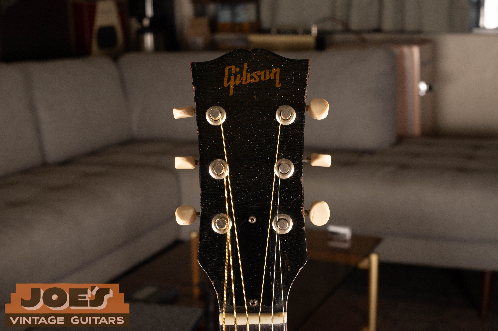
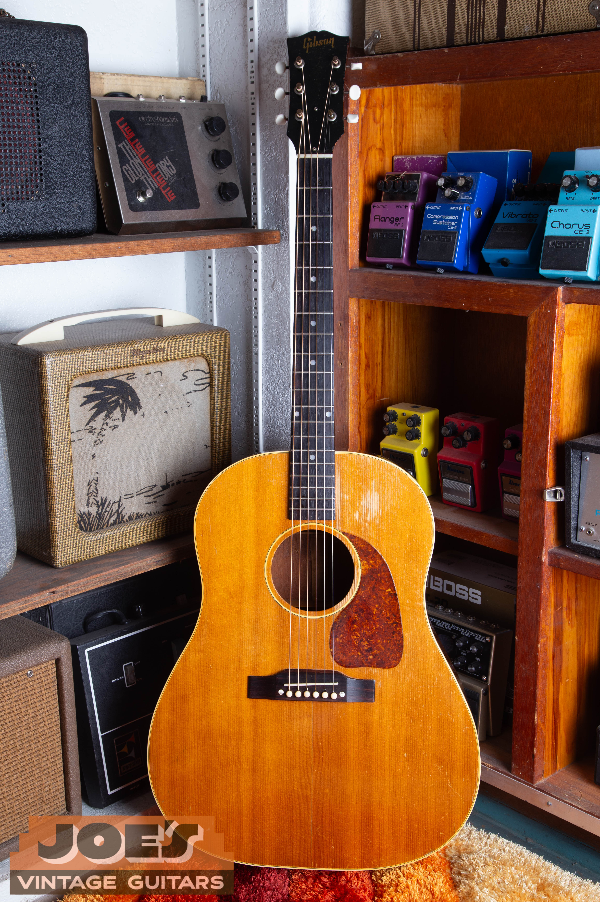
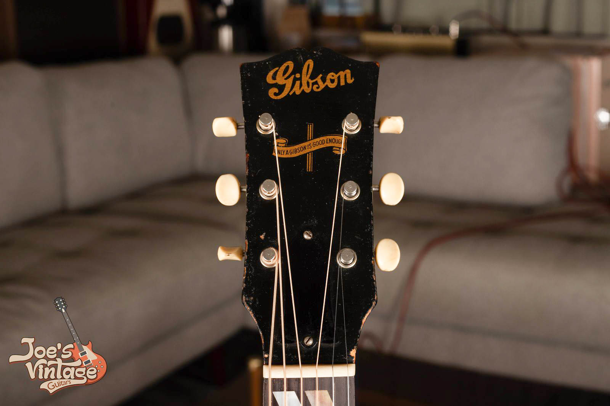
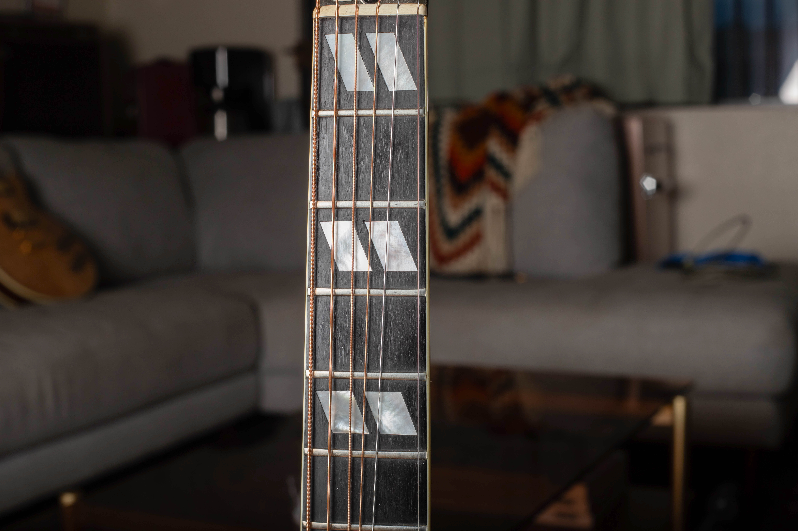

A clean 1955 to 1959 Gibson J-45 has a guide range of $7,500 to $10,000 in excellent condition with original parts and the original case. Earlier Banner guitars and later square-shoulder examples sit in different ranges. I reviewed these values in October 2026 and assess repairs and originality separately.

For model identification, use my [Gibson J-45, J-50 and Southern Jumbo identification guide](/post/identify-vintage-gibson-j45-j50-sj/). This page assumes the guitar has been identified and focuses on its value, the condition the ranges require and what an owner needs for an appraisal.

## J-45 Values By Year

Every year from 1942 through 1979 appears below. Several years share an era range. I still assess the guitar's exact configuration and condition before narrowing its value.

The figures assume an all-original guitar in excellent condition with its original case and no structural repairs. A quality refret is accepted maintenance under my grading approach, although it removes museum-quality status. Changed parts, damaged wood and uncertain work histories require different comparisons.

| Year | Configuration | Value Range |
| --- | --- | --- |
| 1942 | Banner, combined wood references | $11,000 to $18,500 |
| 1943 | Banner, combined wood references | $11,000 to $18,500 |
| 1944 | Banner, combined wood references | $11,000 to $18,500 |
| 1945 | Banner, combined wood references | $11,000 to $18,500 |
| 1946 | Early postwar and small-guard era | $8,500 to $14,500 |
| 1947 | Early postwar and small-guard era | $8,500 to $14,500 |
| 1948 | Early postwar and small-guard era | $8,500 to $14,500 |
| 1949 | Early postwar and small-guard era | $8,500 to $14,500 |
| 1950 | Early postwar and small-guard era | $8,500 to $14,500 |
| 1951 | Early postwar and small-guard era | $8,500 to $14,500 |
| 1952 | Early postwar and small-guard era | $8,500 to $14,500 |
| 1953 | Early postwar and small-guard era | $8,500 to $14,500 |
| 1954 | Early postwar and small-guard era | $8,500 to $14,500 |
| 1955 | Large-guard sunburst era | $7,500 to $10,000 |
| 1956 | Large-guard sunburst era | $7,500 to $10,000 |
| 1957 | Large-guard sunburst era | $7,500 to $10,000 |
| 1958 | Large-guard sunburst era | $7,500 to $10,000 |
| 1959 | Large-guard sunburst era | $7,500 to $10,000 |
| 1960 | Standard sunburst, including body transition | $3,250 to $7,500 |
| 1961 | Standard sunburst, including body transition | $3,250 to $7,500 |
| 1962 | Standard sunburst, including body transition | $3,250 to $7,500 |
| 1963 | Standard sunburst, including body transition | $3,250 to $7,500 |
| 1964 | Standard sunburst, including body transition | $3,250 to $7,500 |
| 1965 | Standard sunburst, including body transition | $3,250 to $7,500 |
| 1966 | Standard sunburst, including body transition | $3,250 to $7,500 |
| 1967 | Standard sunburst, including body transition | $3,250 to $7,500 |
| 1968 | Standard sunburst, including body transition | $3,250 to $7,500 |
| 1969 | Standard sunburst, including body transition | $3,250 to $7,500 |
| 1970 | Square-shoulder J-45 and Deluxe | $2,250 to $3,000 |
| 1971 | Square-shoulder J-45 and Deluxe | $2,250 to $3,000 |
| 1972 | Square-shoulder J-45 and Deluxe | $2,250 to $3,000 |
| 1973 | Square-shoulder J-45 and Deluxe | $2,250 to $3,000 |
| 1974 | Square-shoulder J-45 and Deluxe | $2,250 to $3,000 |
| 1975 | Square-shoulder J-45 and Deluxe | $2,250 to $3,000 |
| 1976 | Square-shoulder J-45 and Deluxe | $2,250 to $3,000 |
| 1977 | Square-shoulder J-45 and Deluxe | $2,250 to $3,000 |
| 1978 | Square-shoulder J-45 and Deluxe | $2,250 to $3,000 |
| 1979 | Square-shoulder J-45 and Deluxe | $2,250 to $3,000 |

The Banner range covers several top-wood configurations. The 1960s range includes the standard sunburst model's body transition, with rare factory colors and special provenance assessed separately. I identify those features before placing a guitar within a band.

The ranges assume clean, original guitars in the condition described above. Repairs, replacement parts and substantial wear need separate consideration.

<figure>

<figcaption>My 1950s J-45 archive photograph shows the body, bridge, pickguard and case together. Visible wear is part of its description, not a reason to assign a price without inspection.</figcaption>

</figure>

## The Banner Years

The 1942 to 1945 Banner range is $11,000 to $18,500 across the wood configurations covered here. The decal alone doesn't establish that value. Construction, originality and repairs determine which part of the range fits.

I keep the Banner group separate from postwar J-45s. A seller's broad wartime date can be enough to begin research, but it isn't enough to claim a precise year or a specific wood premium. The identification page handles those questions before a final valuation.

Changed parts, bridge-plate work and unresolved service needs affect the appraisal. A broad condition label doesn't erase those details. I want to understand the actual work and current playing condition.

An instrument with a celebrity story also needs separate treatment. A claimed association isn't an ordinary model characteristic and doesn't belong in a general price band. I haven't added a provenance premium to this table.

## Early Postwar And Small-Guard Guitars

The 1946 to 1954 range is $8,500 to $14,500. It covers several configurations, so a confirmed year and condition assessment help narrow the value. I don't treat the entire period as one identical guitar.

The distinction between an original finish and a refinished guitar can be larger than the difference between adjacent years. I don't let an attractive date substitute for a complete description. A well-repaired instrument may be an appealing player while belonging outside the clean reference.

A replacement bridge, added pickup or more extensive repair can put a guitar below the clean-original range. The quality and extent of the work matter, so I don't use a universal repair deduction.

<figure>

<figcaption>This J-45 headstock view records the logo, tuner buttons and surrounding finish. A photograph alone does not establish the guitar as entirely original.</figcaption>

</figure>

### The Case Belongs In The Description

The table assumes the original case. A modern flight case or newer Gibson case can provide good protection, but it doesn't meet that assumption. A period-looking case also needs more evidence before it is described as original to the guitar.

I keep case details separate from the instrument's structural condition. A missing original case doesn't explain a repaired headstock, and a desirable case doesn't cancel a changed bridge. Both belong in the appraisal record.

## Later 1950s Values

For 1955 to 1959, the guide range is $7,500 to $10,000. Each year uses that shared band. I assess condition and originality before assigning a value within it.

This is a useful place to separate a guitar's age from its present state. An original finish, documented maintenance and a clear parts history make comparisons easier. A listing that says only that the guitar plays well leaves several valuation questions unanswered.

Replacement tuners may be accompanied by the originals, or the original parts may be gone. That distinction should be recorded without assuming the instrument can simply be returned to untouched condition. Any related holes or other alterations are part of the actual guitar.

I don't advise an owner to reinstall parts before sending photographs. The first appraisal should describe the instrument as it is. Removed parts and repair receipts can be photographed alongside it.

## A 1960s J-45 Needs Its Configuration

The standard sunburst 1960s envelope is $3,250 to $7,500. That is the widest construction span in this table: it includes earlier round-shoulder examples and the later body transition. A confirmed configuration is needed before choosing a narrower comparison.

The site's identification guide explains the dating markers. Here, the consequence is that a late square-shoulder guitar shouldn't be compared automatically with an early round-shoulder one. Sharing the J-45 name doesn't make every specification or market category identical.

Adjustable-bridge examples and guitars converted to fixed saddles also need clear descriptions. A saddle is the piece that supports the strings at the bridge. A conversion can affect the appraisal even when the owner prefers the way the guitar plays.

### Factory Colors And Altered Finishes

The main table covers standard sunburst guitars in the configurations described. I don't use a fixed rare-color percentage. An unusual finish needs authentication and an individual appraisal.

A faded finish and a replaced finish aren't the same condition. Nor does a bright-looking guitar automatically belong at the top of the range. The appraisal depends on what the finish is, its history and the rest of the instrument.

A transition-year guitar needs its actual construction checked. I wouldn't force uncertain features into one category merely because a serial number suggests a particular year.

## Square-Shoulder J-45 And Deluxe Values

The combined 1970 to 1979 reference is $2,250 to $3,000. These guitars have their own market context, so I haven't borrowed a 1950s range to make the later years look more expensive. Each annual row repeats the clearly labeled 1970s reference.

A clean, playable early example differs from one with high action or binding work. The table assumes the guitar is structurally sound and properly playable. I assess repair and service needs separately.

The table stops at 1979 because that is the vintage span covered here. Later originals and modern reissues aren't included. A model name on a newer guitar doesn't place it in one of these rows.

## The J-50 And Southern Jumbo Are Separate Models

The J-50, Southern Jumbo and J-45 share enough family resemblance to cause mistaken comparisons. I keep their identities separate before discussing price. A natural top or more elaborate trim doesn't create an automatic addition to the J-45 range.

<figure>

<figcaption>This is a J-50 from my archive, shown for comparison. It is not a J-45 and does not use the J-45 price table.</figcaption>

</figure>

The J-50 photograph above is included to show that distinction. It is not a substitute photograph for a J-45, and this page doesn't assign it a value from the J-45 table. Its model and condition need their own comparison.

<figure>

<figcaption>This Banner headstock belongs to a Southern Jumbo, not a J-45. Shared era features do not make the models interchangeable.</figcaption>

</figure>

A Banner feature can also appear on another model in the family. The Southern Jumbo headstock shown here demonstrates why the logo alone isn't a complete identification. I don't turn shared era details into shared prices.

<figure>

<figcaption>These split-parallelogram inlays illustrate the family comparison discussed here. They are not presented as a J-45 feature.</figcaption>

</figure>

The split-parallelogram inlays in the comparison photograph aren't J-45 appointments. Their role here is to keep the wrong guitar out of the wrong table. Detailed identification remains with the family guide linked above.

## How I Handle Repairs And Changed Parts

I look for a description of the work, its extent and the instrument's present condition. A professionally repaired guitar can be useful and desirable without matching a clean-original reference. That is a separate comparison category, not a reason to dismiss the instrument.

The word restoration can cover very different work. It might refer to a setup and careful maintenance, or it might conceal a replacement fingerboard, refinishing and altered bracing. The actual work needs to be named before a value range means much.

### Neck Resets And Frets

A neck reset adjusts how the neck sits against the body so the guitar can achieve an appropriate setup. A completed, documented reset and a guitar that still needs one present different costs and uncertainties to a buyer. I don't use a fixed percentage for both.

A quality refret is accepted maintenance under this site's grading approach. It preserves the all-original classification of an otherwise original guitar and removes museum-quality status. Neck reshaping, a changed fingerboard or a structural repair must be assessed separately.

### Bridges And Bridge Plates

A replacement bridge changes the originality description even when the work was done well. The bridge plate is the reinforcement inside the body beneath the bridge. Changes there can be less visible in ordinary photographs, so repair records help explain the instrument.

I don't recommend cosmetic or structural work merely to prepare for an appraisal. Start with photographs of the present guitar and any records you have. That lets the assessment account for the actual condition before money is spent.

### Cracks And Finish Work

A repaired crack needs a location, an extent and a description of the repair. It isn't useful to treat every crack as an identical deduction. The same applies to overspray, which means additional finish over an existing surface, and to a full refinish.

A heavily rebuilt instrument belongs outside the clean-original category. The extent of the repairs, retained parts and current condition determine its appraisal.

## Asking Prices, Offers And Selling Proceeds

An asking price is a seller's requested amount. A completed-sale figure records a transaction, and an owner's net proceeds may differ after selling expenses. None of those figures automatically equals a direct purchase offer.

The guide ranges are starting points for an appraisal. I examine the guitar and explain the condition assumptions before making an offer.

I don't promise that an old J-45 will increase in value. Future repairs, demand and the time required to sell can affect the result. An appraisal describes the guitar in its present condition.

## Getting An Appraisal For Your J-45

Send clear views of the front, back, headstock, bridge and any known repairs, along with the case and available paperwork. Describe what you know about changed parts and what remains uncertain. You don't need to guess a year before asking for help.

I buy vintage guitars nationwide from Mesa, Arizona. My [free guitar appraisal](/free-appraisal/) is a starting point for an individual review, and the [Gibson selling page](/sell-my-gibson-guitar/) explains the purchase process. A final offer depends on the guitar's actual condition and identity.
