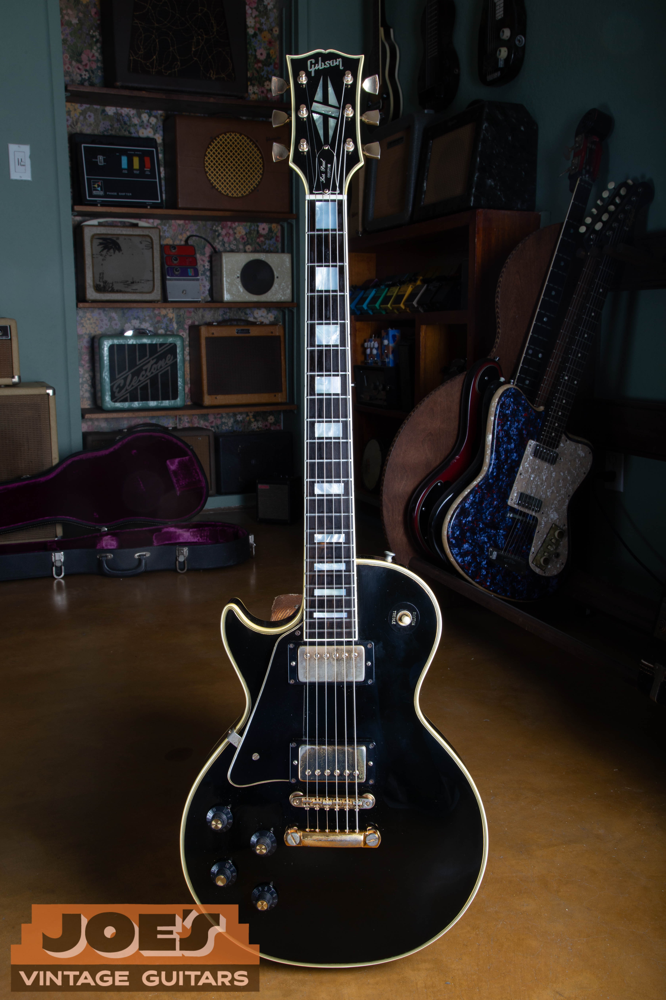
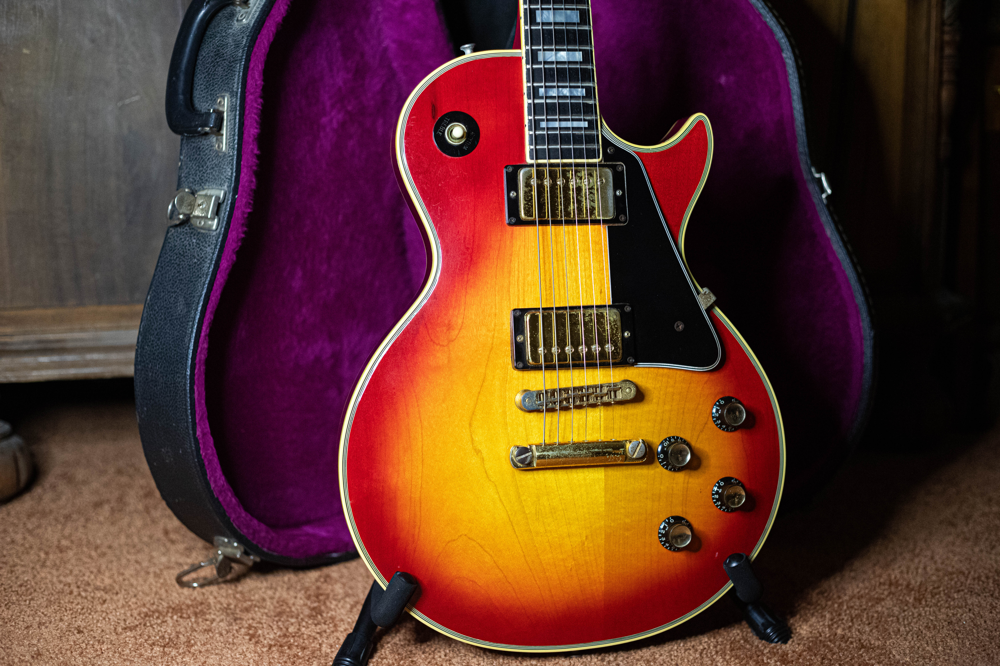
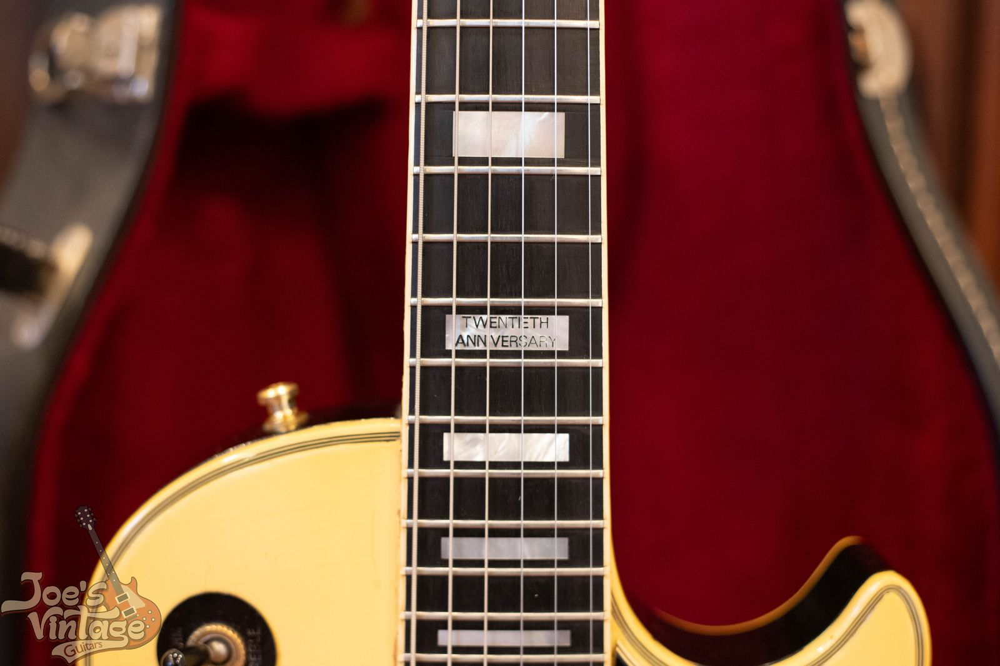
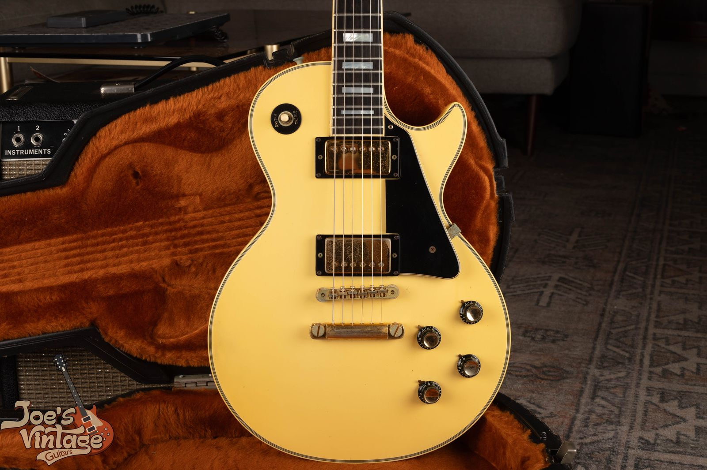
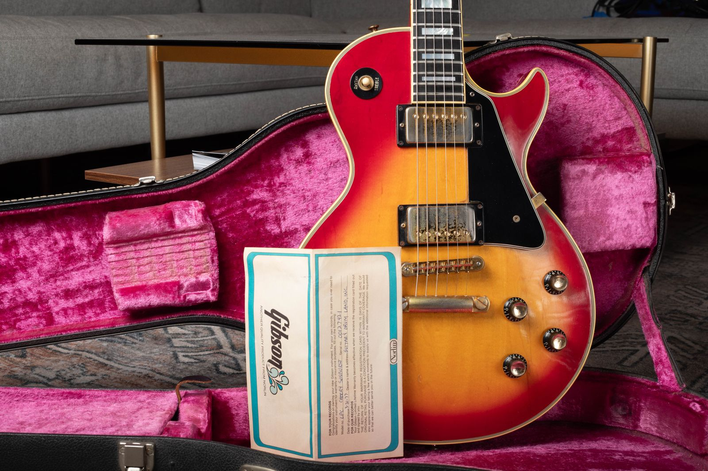

A clean, original 1968 or 1969 Gibson Les Paul Custom carries a $12,000 to $18,000 reference range on this site. For standard two-pickup Customs from 1975 through 1979, the published clean-condition reference is $5,000 to $6,500. A 1950s Custom belongs in a different market, with its original pickup configuration separating the price bands below.

I buy vintage Les Paul Customs and start by separating the original 1950s carved-body guitars from the model that returned in 1968. If you haven't established the year, use the [Les Paul Custom dating and construction guide](/post/norlin-les-paul-custom-year-guide/) before choosing a row. The table here handles value; that guide handles the evidence behind the date.

## Gibson Les Paul Custom Values By Year

These are U.S. dollar references reviewed **as of October 2026**. Unless stated otherwise, they assume an excellent, all-original guitar with its original case, no structural repairs and the factory pickup configuration. A quality refret is accepted maintenance on an otherwise original guitar, although it removes the instrument from the museum-quality category.

Each production year has its own row. Repeated amounts mean the years share a published era reference, not that a separate group of same-year sales established an identical price. The 1950s and 1968 to 1969 amounts preserve this site's existing figures. The 1970s amounts come from the 2025 Official Vintage Guitar Magazine Price Guide, checked against completed transactions observed in 2026.

| Year | Configuration | Reference Range | Basis |
|---|---|---|---|
| 1954 | Staple neck pickup And P-90 bridge | $25,000 to $55,000 | Early single-coil reference |
| 1955 | Staple neck pickup And P-90 bridge | $25,000 to $55,000 | Early single-coil reference |
| 1956 | Staple neck pickup And P-90 bridge | $25,000 to $55,000 | Early single-coil reference |
| 1957 | Staple neck pickup And P-90 bridge | $25,000 to $55,000 | Early single-coil reference |
| 1957 | Original factory humbuckers | $60,000 to $225,000 | Broad 1950s humbucker reference |
| 1958 | Original factory humbuckers | $60,000 to $225,000 | Broad 1950s humbucker reference |
| 1959 | Original factory humbuckers | $60,000 to $225,000 | Broad 1950s humbucker reference |
| 1960 | Original factory humbuckers | $60,000 to $225,000 | Broad 1950s humbucker reference |
| 1968 | Two humbuckers, standard carved body | $12,000 to $18,000 | 1968 to 1969 shared site reference |
| 1969 | Two humbuckers, standard carved body | $12,000 to $18,000 | 1968 to 1969 shared site reference |
| 1970 | Standard two-pickup Custom | $7,000 to $9,500 | 1970 to 1974 published era reference |
| 1971 | Standard two-pickup Custom | $7,000 to $9,500 | 1970 to 1974 published era reference |
| 1972 | Standard two-pickup Custom | $7,000 to $9,500 | 1970 to 1974 published era reference |
| 1973 | Standard two-pickup Custom | $7,000 to $9,500 | 1970 to 1974 published era reference |
| 1974 | Standard two-pickup Custom | $7,000 to $9,500 | 1970 to 1974 published era reference |
| 1975 | Standard two-pickup Custom | $5,000 to $6,500 | 1975 to 1979 shared published reference |
| 1976 | Standard two-pickup Custom | $5,000 to $6,500 | 1975 to 1979 shared published reference |
| 1977 | Standard two-pickup Custom | $5,000 to $6,500 | 1975 to 1979 shared published reference |
| 1978 | Standard two-pickup Custom | $5,000 to $6,500 | 1975 to 1979 shared published reference |
| 1979 | Standard two-pickup Custom | $5,000 to $6,500 | 1975 to 1979 shared published reference |

The later comparison sample includes guitars with missing or replaced small parts and differences in case condition. Those sales help test the published reference but don't become clean-original examples merely because a seller selected “Excellent.” I haven't raised an altered guitar into a collector category to make its sale fit a table.

The $60,000 to $225,000 early humbucker range is a broad family reference. It doesn't promise that every three-pickup Custom reaches the top, or that two-pickup examples and guitars fitted with a vibrato have interchangeable demand. Original configuration, preservation and the actual pickup set need individual review.

The 1968 to 1969 site reference also spans different construction. The 2025 book places some earlier one-piece-body examples above that range. I've retained the site's established range here; a particularly clean early guitar needs a narrower appraisal before you use it as a selling target.

<figure>

<figcaption>This 1958 Custom from my archive shows three covered pickups and a Bigsby vibrato, with wear visible on the lower body.</figcaption>

</figure>

## The Three Custom Markets

### The Original Black Beauty

The first Custom family covered here has a carved mahogany body, an ebony fingerboard and the elaborate binding associated with the Black Beauty name. The fingerboard is the separate playing surface beneath the strings. The binding is the contrasting trim around the body and headstock.

The early pickup combination pairs a staple-style Alnico neck pickup with a P-90 at the bridge. Both are single-coil pickups, even though they don't look alike. From 1957, Customs with humbuckers form another category; a humbucker uses two coils to reduce electrical hum.

I need that distinction before I compare values. A later replacement pickup may sound excellent while leaving the instrument outside the original-pickup reference. A guitar that has been cut for a different pickup arrangement also needs its own comparison, even if the replacement parts resemble a more expensive version.

The [Les Paul family identification guide](/post/vintage-gibson-les-paul-family-guide/) places the Custom alongside the Standard, Junior and Special. Their names share a history, but a price from one model doesn't transfer to another merely because the year matches.

### The Return In 1968 And The 1969 Transitions

The single-cutaway Custom returned in 1968 with a maple top over a mahogany back and two humbuckers. That return is the reason I don't treat a 1968 Custom as a continuation of an unchanged 1958 specification. The two guitars have different construction and different collector markets.

During 1969, several construction details changed, and early and late examples can differ. The table's shared 1968 to 1969 reference is a starting point. An appraisal needs to place a particular guitar within that transition before making a closer comparison.

The existing [1968 Custom guide](/post/1968-gibson-les-paul-custom-guide/) and [1969 Custom guide](/post/1969-gibson-les-paul-custom-guide/) show those years in detail. You don't need to remove the pickups yourself to request a value opinion. Start with the photographs you can safely take and any service records already available.

<figure>

<figcaption>The 1969 Custom has two covered pickups, a separate bridge and stopbar, and block fingerboard inlays.</figcaption>

</figure>

### The 1970s Production Guitars

A 1970s Custom can be a heavily used working guitar, an altered instrument or a carefully preserved original. “Norlin era” identifies an ownership period; it doesn't tell me which of those guitars is in front of me.

For the table, I've separated the early 1970s published reference from the later standard two-pickup range. Finish options, neck construction and hardware changed during the decade. A single year doesn't settle every feature, and a serial number shouldn't be used to force a transitional guitar into the most expensive neighboring category.

I look at the individual Custom's original finish, pickups, electronics, structural condition and included case. Weight and playing feel can influence which buyer wants it. They don't create a universal dollar premium that I can apply without comparable instruments.

The [1970 Les Paul Custom guide](/post/1970-gibson-les-paul-custom-guide/) covers the early part of that period. For a later guitar, keep the model designation and full serial number with your photographs so I can compare the right production group.

<figure>

<figcaption>This body view shows the sunburst finish, two covered pickups, four controls and the surrounding binding.</figcaption>

</figure>

## Finish And Configuration Change The Comparison

Black, sunburst and white Customs shouldn't automatically be treated as one identical transaction sample. The table gives a standard production reference with its basis stated. It doesn't include a separate premium for every color.

Silverburst, maple-fingerboard versions, three-pickup variants and the early 1970s '54 reissue need configuration-specific review. I haven't inserted unsupported additional premiums for them. The '54 reissue, for example, borrows an earlier pickup arrangement; its appearance doesn't make it an original 1950s guitar.

A white finish can look cream or yellow after years of aging. Color in a photograph also depends on the light and camera. I don't grade finish originality or assign a color premium from one indoor photograph.

### Anniversary Markings

The twentieth-anniversary fingerboard inscription is a recognizable feature of the 1974 anniversary version. It helps describe which guitar is being compared. The inscription by itself doesn't establish a fixed premium over another Custom.

For a valuation, I still need the rest of the guitar: its parts, condition, finish and repairs. A worn anniversary guitar and a very clean ordinary production Custom don't become equivalent because one carries commemorative lettering.

<figure>

<figcaption>The fingerboard close-up shows the Twentieth Anniversary inscription on this 1974 Custom.</figcaption>

</figure>

## Original Pickups And Electronics

Original pickups can account for much of the difference between two otherwise similar Customs, especially in the 1950s humbucker market. The table assumes the factory pickup set remains with the guitar. If it doesn't, tell me what is fitted now and whether the removed pickups survive.

A pickup replacement and a pickup repair are separate histories. A rewind, changed cover or shortened lead should be described accurately. I won't assume that a pickup is untouched because the metal cover looks old or because someone called it a PAF.

The same care applies to the controls. Pots are the components behind the volume and tone knobs. Replaced pots can leave a guitar fully usable, but they change the originality comparison even when the original pieces are kept in the case.

I don't recommend disturbing solder joints just to obtain an initial estimate. If a repairer has already photographed the interior, include those images. If not, a first appraisal can identify what still needs a qualified inspection.

### Keep Removed Parts Together

A bag of removed hardware is part of the guitar's documentation. Label it by instrument if you own more than one Custom, and keep any repair invoice with it. An old part found in a case isn't automatically original to that guitar, but losing it removes an opportunity to establish its history.

Reinstalling parts solely to improve a sales description can create another round of damage or uncertainty. Tell me what changed first. I can assess the guitar in its present state and explain which questions affect the comparison.

## Wear, Fretwork And Structural Repairs

Finish wear, a refret and a repaired headstock describe different conditions. A guitar can show extensive use and retain its original finish and electronics. A shiny guitar can have a replacement finish or concealed structural work.

I separate those issues before applying the table. The clean-original reference isn't a calculator where every flaw receives the same deduction. The nature of the repair, its stability, the extent of finish work and the remaining original parts all affect the appropriate comparison.

A quality refret preserves the all-original classification of an otherwise original guitar under this site's grading approach. It does remove museum-quality status. Neck reshaping, a replaced fingerboard or substantial work to the binding are different alterations and need to be disclosed separately.

### Low Frets And Playing Preference

The Custom's Fretless Wonder reputation comes from its low fretwire, not from an absence of frets. Some players want that original feel; others prefer a well-executed refret. For a guitar being sold, describe what is present without assuming every buyer has the same preference.

I also want to know about buzzing, a nonworking truss rod or an action problem you already know exists. Those are useful facts for an appraisal. You don't need to authorize a repair before sending photographs.

### Refinished And Repaired Examples

A refinished Custom needs comparison with other refinished guitars of the same general era and configuration. A repaired headstock requires a repair description, not just a photograph of the front. If you have an invoice or photographs from before the work, keep them with the instrument.

I haven't assigned a fixed percentage discount here because the available evidence doesn't support a universal one. A carefully repaired guitar with original pickups and an extensively modified instrument shouldn't receive the same adjustment. An individual appraisal can describe that difference without pretending the two histories are interchangeable.

<figure>

<figcaption>This Alpine White Custom appears cream-colored in the archive photograph, alongside its black guard and gold-colored hardware.</figcaption>

</figure>

## The Case And Paperwork

The table's clean-condition assumption includes the original case. A later Gibson case, another brand's case and the factory case are different descriptions. Case condition also varies: damaged latches, a replaced handle and interior deterioration should be included in the photographs.

Original paperwork can help connect the instrument with its history. It doesn't prove that every part is still original. Keep receipts, warranty material and service records together, and avoid separating them from the guitar before an appraisal.

The photograph below shows how useful a wider view can be. The body, case interior and paperwork are visible together. It gives me context that a close view of the serial number alone can't supply.

<figure>

<figcaption>The wider photograph keeps the Custom, Gibson paperwork and open case together in view.</figcaption>

</figure>

## Asking Price, Completed Price And Your Proceeds

A listing price is what a seller requests. A completed transaction records an agreement, subject to the condition described and the terms of that sale. The numbers aren't interchangeable.

The published references here describe a market category. They aren't a promise of what you will receive after selling costs, and they aren't an offer from me. Shipping, marketplace fees, preparation and the work needed to document a guitar can affect the owner's eventual proceeds.

For completed Reverb comparisons, I use the transaction-history final price and then read the corresponding listing. A “sold” label on its own doesn't tell me whether a displayed asking price was accepted. Auction comparisons also need their buyer's-premium treatment understood before being compared with another venue.

I haven't used artist ownership or celebrity provenance to set these standard production ranges. A documented association can create a separate market. An ordinary Custom shouldn't inherit that result simply because its finish and year look similar.

## Get A Value Opinion On Your Custom

For a [free vintage guitar appraisal](/free-appraisal/), send a full front and back view, both sides of the headstock, the body edges and the case. Include the serial number as it appears, any known repairs and photographs of removed parts. A picture of the whole guitar keeps a close detail from being interpreted in the wrong context.

Natural indirect light helps show the finish without hiding it under glare. Keep the files at their original resolution when possible. There is no need to scrape a surface, loosen the neck or dismantle the electronics to begin.

If you're comparing several inherited guitars, photograph each instrument and its case separately. That keeps one Custom's paperwork or loose parts from being assigned to another. Once the year, configuration and condition are established, the price reference becomes a useful starting point for discussing the guitar you actually own.
