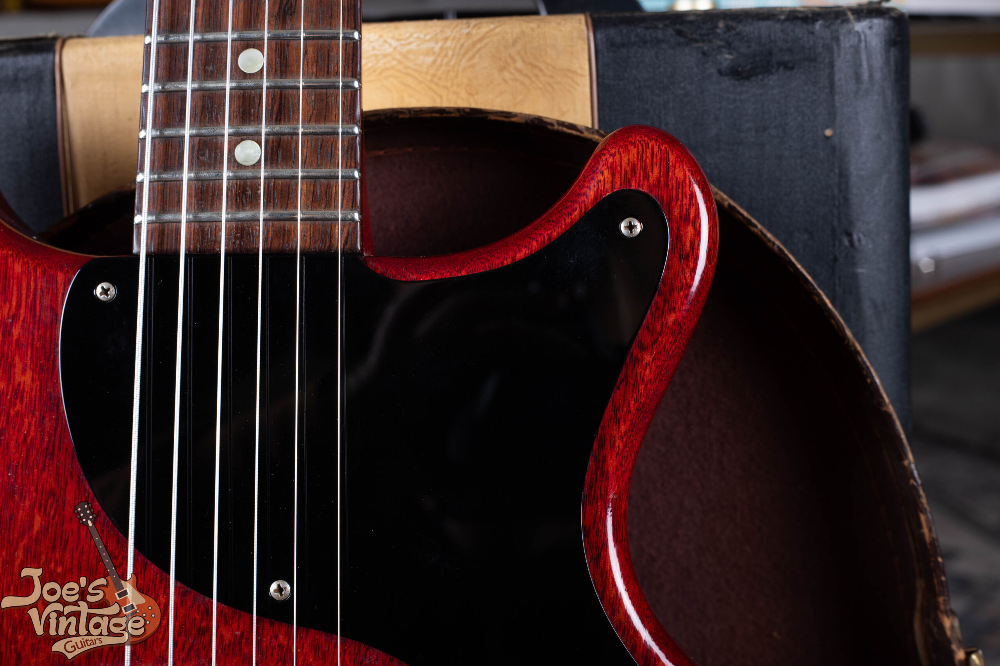
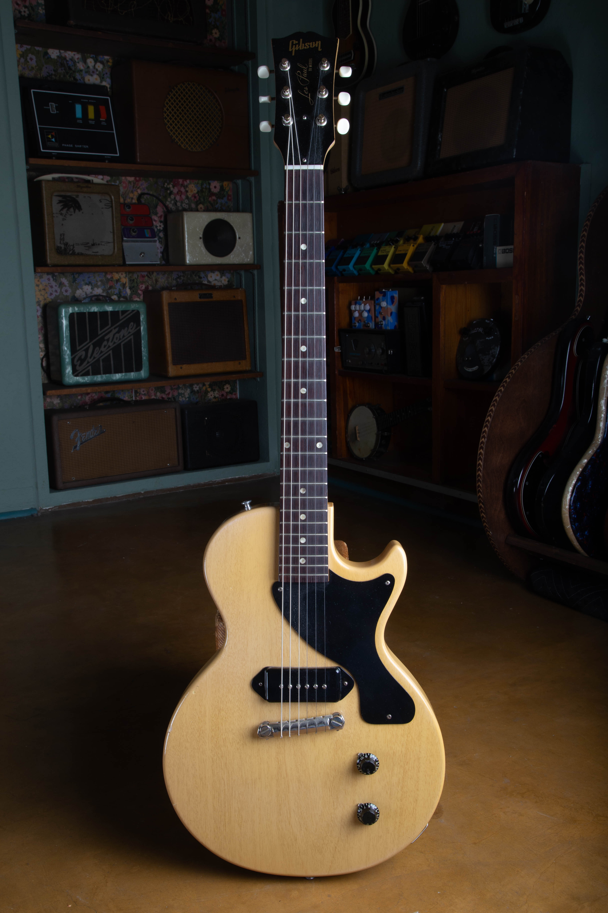
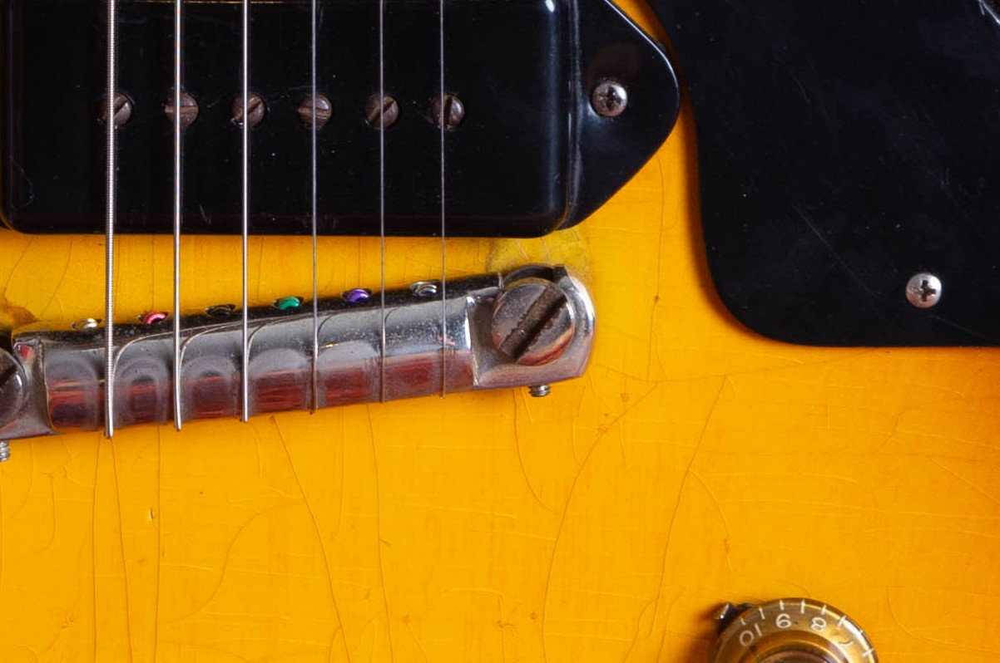
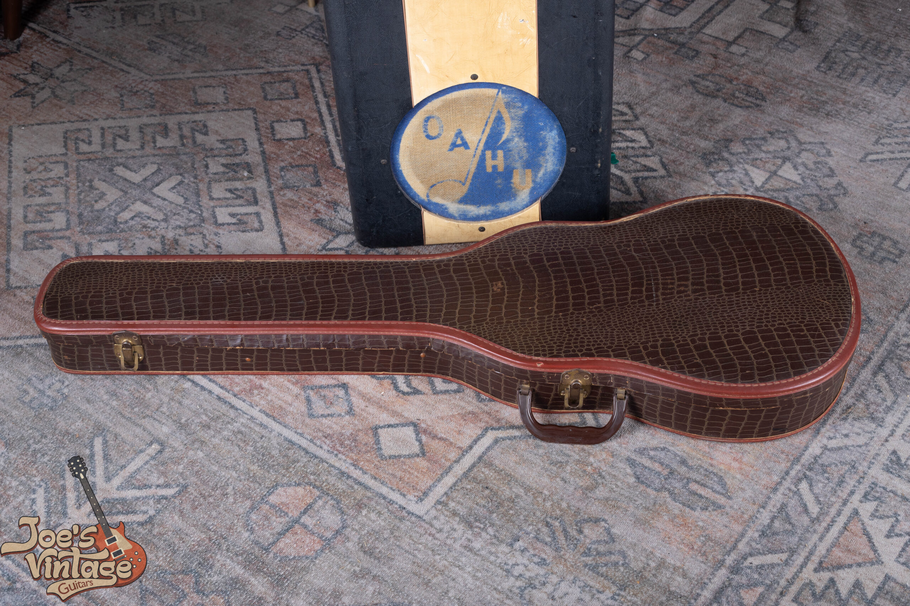
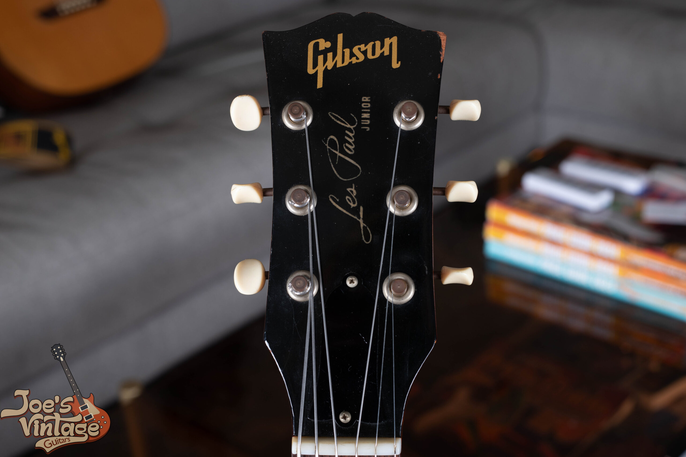

A vintage Gibson Les Paul Junior with its original sunburst finish has a $5,500 to $12,000 guide range for 1954 to 1958 single-cutaway guitars. The corresponding single-cutaway TV Model reference is $9,000 to $18,000. I start with the body style and finish, then narrow the comparison around the pickup, repairs, wear and case.

I cover the earlier slab-body Junior and its one-pickup TV counterpart. For serials, parts and construction evidence, use my [Les Paul Junior dating and authentication guide](/post/gibson-les-paul-junior-guide/). A guitar with the later pointed SG body belongs in a separate comparison, even when its headstock still says Les Paul Junior.

## Gibson Les Paul Junior Values By Year

These guide ranges were reviewed as of October 2026. I separate single-cutaway sunburst, TV Model and cherry double-cutaway guitars because their configurations affect value.

The table assumes an all-original guitar in excellent condition with its original case. A quality refret preserves the all-original classification of an otherwise all-original guitar, although it takes it out of the museum-quality category. Missing cases, replacement parts, refinishing and structural repairs require a separate appraisal.

| Year | Configuration | Value Range |
| --- | --- | --- |
| 1954 | Single-cutaway sunburst | $5,500 to $12,000 |
| 1955 | Single-cutaway sunburst | $5,500 to $12,000 |
| 1955 | Single-cutaway TV Model | $9,000 to $18,000 |
| 1956 | Single-cutaway sunburst | $5,500 to $12,000 |
| 1956 | Single-cutaway TV Model | $9,000 to $18,000 |
| 1957 | Single-cutaway sunburst | $5,500 to $12,000 |
| 1957 | Single-cutaway TV Model | $9,000 to $18,000 |
| 1958 | Single-cutaway sunburst | $5,500 to $12,000 |
| 1958 | Single-cutaway TV Model | $9,000 to $18,000 |
| 1958 | Rounded double-cutaway cherry | $9,500 to $13,000 |
| 1959 | Rounded double-cutaway cherry | $9,500 to $13,000 |
| 1960 | Rounded double-cutaway cherry | $9,500 to $13,000 |

Adjacent years can share a configuration range. That doesn't make every guitar from the era worth the same amount. The two 1958 body styles appear separately because the shape changes the value category.

A worn double-cutaway Junior with a bent tuner or missing original case belongs in a different condition group from a clean, complete example. I check those details before applying the excellent-condition range.

An unusually clean single-cutaway sunburst or TV Model needs an individual appraisal. Its condition and completeness can distinguish it from a typical guitar in the broad range.

## Match The Body Style Before Comparing Prices

The Junior has one pickup, but the name covers more than one guitar. The original single-cutaway body, the later rounded double-cutaway body and the pointed SG body need separate comparisons. A listing that says only “vintage Les Paul Junior” leaves out information I'd need before valuing it.

For this table, single-cutaway means one opening beside the neck. The rounded double-cutaway has an opening on each side and a slab body. The later SG has pointed horns and a thinner, contoured shape. Those broad distinctions are enough to choose a pricing family; the detailed year and component checks belong in the authentication guide.

### Single-Cutaway Sunburst

The 1954 to 1958 sunburst reference covers the familiar flat mahogany body with one black P-90 pickup and a wraparound bridge. A P-90 is the pickup design; “dog ear” describes the cover's mounting tabs. The bridge also anchors the strings, so there's no separate tailpiece behind it.

Within the shared range, I'd compare a clean instrument with another clean instrument before accounting for wear or changed parts. The finish, pickup and intact body belong in that comparison together. A replacement bridge on an otherwise original guitar is a different question from a replaced pickup and an enlarged pickup cavity.

The first production year doesn't automatically supply a fixed premium. Neither does a seller's description of a particularly large neck. A guitar's year helps establish the group, but condition and retained components determine where it can sit within it.

### Rounded Double-Cutaway Cherry

The rounded double-cutaway became part of the Junior line in 1958. Cherry is the configuration covered by the additional reference in this guide. An unusual finish, a TV example or a guitar with a changed body finish needs its own comparison.

An excellent, all-original cherry example with its original case has a guide range of $9,500 to $13,000. I wouldn't apply that clean category automatically to a worn guitar, one with a repaired neck or one with altered pickup mounting.

Rounded double-cutaway Juniors and TV Models continued into 1961. My TV Model chronology records 29 double-cutaway TV shipments for that year. A 1961 rounded-body guitar belongs with this earlier design; its finish, originality and condition need an individual appraisal.

<figure>

<figcaption>Cherry double-cutaway upper body and black pickguard with cream-colored dot inlays visible.</figcaption>

</figure>

### Les Paul Branding On An SG Body

Early SG-shaped Juniors can still carry Les Paul Junior lettering. The lettering doesn't make them equivalent to the earlier slab-body guitars in this table. Compare them using the [Gibson SG Junior value guide](/vintage-gibson-sg-junior-value-guide/), which follows the later model's production years.

That distinction also keeps a 1960s guitar from being valued against a 1950s sunburst simply because both have one pickup. Later SG-shaped and reissue Juniors need their own model comparisons. Later reissues require another comparison again.

## What TV Yellow Changes

For condition comparisons beyond this model, I explain [how repairs and replaced parts affect vintage guitar value](/what-lowers-vintage-guitar-value/).

The one-pickup Les Paul TV Model shares the Junior's basic role, but its finish and model identity create a separate collector comparison. For the 1955 to 1958 single-cutaway examples covered here, the guide range is $9,000 to $18,000. The range assumes original finish and the condition stated above.

TV Yellow doesn't mean every pale Gibson has the same value. The one-pickup TV Model and the two-pickup Les Paul Special are different models. My [Les Paul TV Model guide](/post/gibson-les-paul-tv-model-guide/) covers that identity, while the [single-cutaway Les Paul Special guide](/post/1955-1958-tv-yellow-les-paul-special-guide/) shows the two-pickup instrument.

A refinished sunburst Junior doesn't acquire the original TV Model comparison because somebody painted it yellow. I'd retain its actual identity in the appraisal and describe the finish work. A color can be attractive to a player without supplying the history a collector is paying for.

The fretboard dots on the Junior and TV Model are cream-colored celluloid dot inlays. I wouldn't describe them as pearl or use a supposed change from pearl to plastic to justify a year premium. The ordinary appointments are part of these student models' identity.

<figure>

<figcaption>Full front of a single-cutaway TV Model with a pale finish, one black pickup and two black knobs.</figcaption>

</figure>

The table's TV range is confined to the single-cutaway configuration. It isn't a price for every later rounded or SG-shaped TV guitar. A double-cutaway TV Model needs an individual appraisal.

## Original Parts And Repairs Move The Comparison

A Junior's short parts list makes a description like “mostly original” too vague to price. I need to know which part changed, what work accompanied the change and whether the removed original survives. The same phrase can describe a replaced strap button or a different pickup installed after wood was removed.

An appraisal should account for the whole guitar. Adding separate deductions for the same underlying alteration can count the damage twice. A refinished neck repair, for example, needs one assessment of the repair, refinishing and remaining original material together.

### The Pickup And Its Mounting

The Junior's single pickup does the electrical work for the whole instrument. An original pickup, a rewound original and a modern replacement need to be described separately. A working pickup alone doesn't settle its history.

I also distinguish a reversible component change from altered wood. A replacement cover or mounting screw can be addressed differently from a pickup cavity enlarged for another design. Returning a P-90 to an altered cavity doesn't put the removed wood back.

Keep any removed pickup, cover or hardware with the guitar. I can assess what survives before you decide to reinstall anything. A bag of loose parts needs its own review; it doesn't automatically prove that every part left the factory on that instrument.

### The Bridge And Tuners

The wraparound bridge affects the playing setup as well as the collector description. I want to know if a later bridge was fitted, if the original is included and if its mounting was changed. The answer can differ from a guitar that simply needs an ordinary setup.

Tuners need the same distinction. A working replacement set with no further alteration is a different case from enlarged holes or additional screw holes. Reinstalling old-looking machines doesn't erase earlier modifications.

<figure>

<figcaption>Close view of the wraparound bridge, black pickup cover and checked sunburst finish.</figcaption>

</figure>

### Neck Repairs And Fretwork

A repaired headstock or neck joint moves the guitar out of the clean, unrepaired table category. I need clear photographs of the repair and any available work records before choosing a comparison. The location, extent and present condition of the work affect the appraisal.

A quality refret is accepted maintenance and preserves the all-original classification of an otherwise all-original guitar. It does mean the guitar is no longer museum quality. I keep that separate from neck reshaping, a replaced fingerboard or other changes to the wood.

If the guitar plays badly, that doesn't establish that it needs a refret or a structural repair. Have the problem identified before approving work. For an initial valuation, photographs and a description of the symptoms are more useful than a guess about what a repair shop might charge.

## Wear, Refinishing And The Top Of The Range

Original finish with visible playing wear belongs in a different comparison from fresh replacement lacquer. A glossy guitar can have extensive work beneath that appearance. I confirm finish originality and condition before using the clean-original bracket.

The same applies to faded cherry. Color saturation is one visible characteristic, while originality, condition and repairs remain separate questions. A bright color doesn't establish an untouched finish, and fading by itself doesn't tell me the guitar's complete history.

I use the highest part of a clean range only when the guitar supports it. The case, retained parts, structural condition and finish all need to fit the comparison. Calling an instrument “collector grade” in an advertisement supplies none of that evidence by itself.

A modified Junior can still suit a player very well. That doesn't make the work disappear from its collector description. An accurate account of the modifications gives both sides a usable basis for discussing its price.

### How Refinishing Changes Junior Value

The effect of refinishing depends on what else remains. An otherwise intact Junior with documented finish work is different from a routed guitar with a replaced pickup, changed bridge and neck repair. The combined condition determines the final appraisal.

The same problem appears when several generic discounts are added together. A guide can identify the direction of the change, but the modified guitar needs comparable modified instruments. The clean table gives me a reference category, not a formula for every possible repair combination.

## The Case And Paperwork Belong With The Guitar

The case is part of the condition assumption in the table. If it's missing, replaced or damaged, say so before comparing a guitar with a complete example. A modern protective case and the original case serve different collector needs.

A surviving original case doesn't have to be suitable for shipping. Its collector role and its ability to protect the instrument in transit are separate questions. Keep it with the guitar while planning transport around the instrument's actual support and protection needs.

<figure>

<figcaption>Closed brown patterned guitar case with a handle and metal latches.</figcaption>

</figure>

Receipts, old photographs and repair records can help establish a guitar's history. They don't replace an examination of the instrument. I compare what the records show with the guitar as it exists today.

An old photograph may document a finish or show that a particular alteration was already present. It may also be too distant to establish any specific part. Clear photographs and repair records help establish what remains original.

Keep the records together, including notes about work you know was done. You don't need a continuous ownership history before requesting an appraisal. An honest account of what you know and what remains uncertain is enough to start.

## Read Sale Comparisons On The Same Terms

A completed sale records an outcome; an asking price records a seller's request. I keep those categories separate. An unsold advertisement at the top of a search result doesn't establish the current market for every Junior with a similar appearance.

Condition labels also need the underlying description. “Excellent” can still accompany a disclosed replacement part, while “Very Good” can describe an original guitar with playing wear. I read the repair, finish and case information before deciding how a result applies.

The double-cutaway range assumes excellent condition, original parts and the original case. Wear, missing accessories and structural repairs need separate consideration.

Single-cutaway sunburst and TV Model guitars have their own ranges. For other Les Paul models, the [Les Paul family value guide](/vintage-gibson-les-paul-market-value-guide/) helps you choose the right category.

### Sale Price, Proceeds And An Offer

The amount a buyer pays and the amount a seller keeps can differ. Fees, shipping, insurance and the agreed terms need to be considered before comparing routes to sale. A private-sale listing and a direct offer also place different responsibilities on the owner.

The table isn't a standing purchase offer. I need the particular guitar's details before discussing what I can offer for it. When comparing offers, include the case and loose parts consistently so you're comparing the same package.

An insurance replacement figure serves a different purpose from a sale estimate. Tell the appraiser which question you need answered. A number prepared for one purpose shouldn't silently become the answer to another.

## Photograph The Guitar Before Changing It

Start with clear photographs of the whole front and back, the headstock from both sides, the bridge and pickup, and any known repair. Include the case and loose parts. Natural light and sharp focus help me see the instrument more clearly than a dark photograph with heavy color correction.

You don't need to take the pickup apart or disturb old wiring for an initial appraisal. If internal photographs are needed, I can explain what would help and discuss having the work done by someone comfortable with vintage instruments. Preserve the guitar's present condition while documenting it.

<figure>

<figcaption>Black headstock face with Gibson and Les Paul Junior lettering and six light-colored tuner buttons.</figcaption>

</figure>

Tell me if you know of a refret, finish work, tuner change, pickup repair or neck damage. If you don't know, say that. I won't treat an uncertain family account as a guarantee that nothing has ever changed.

My [free vintage guitar appraisal](/free-appraisal/) is a place to begin with those photographs. I buy vintage Gibsons nationwide from Mesa, Arizona, and can discuss the particular guitar after reviewing what you have.

TV Models also exist from 1954 and are scarce. I appraise those first-year examples individually rather than assuming the later TV range applies unchanged.

For the wider family, my [vintage Gibson value guide](/vintage-gibson-value-guide/) links the solidbody, ES, archtop and acoustic model comparisons.
