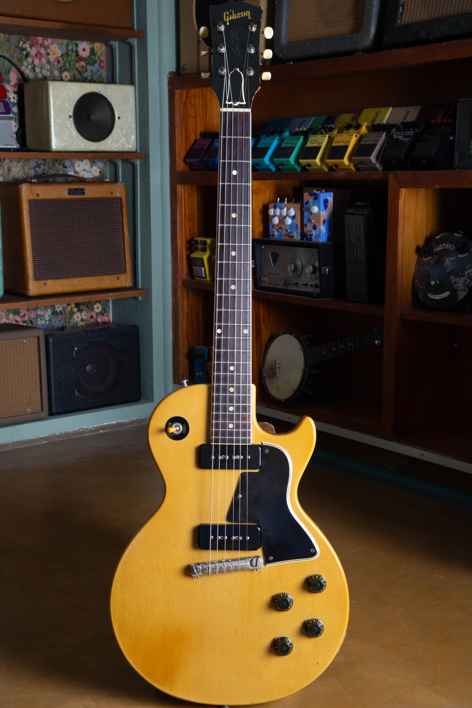
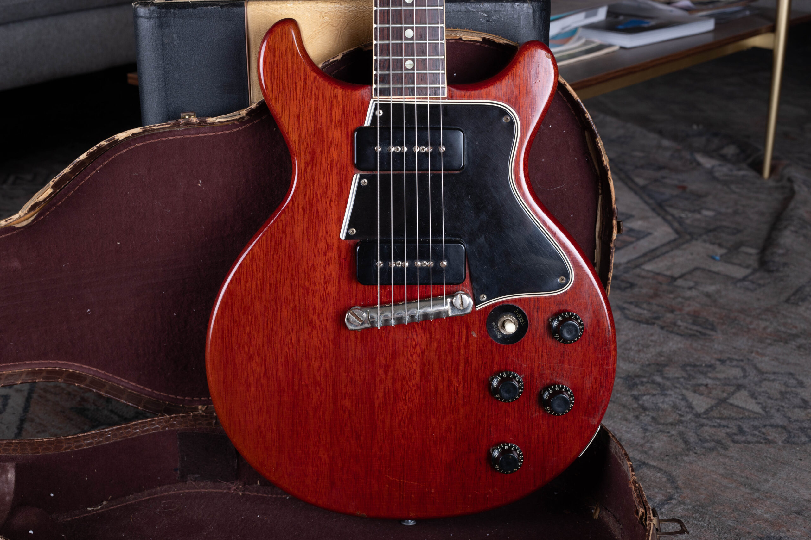
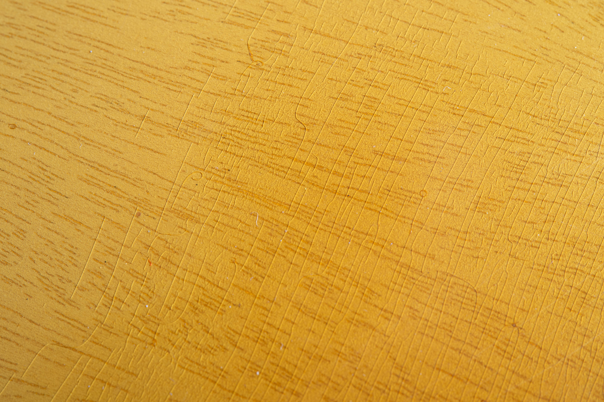
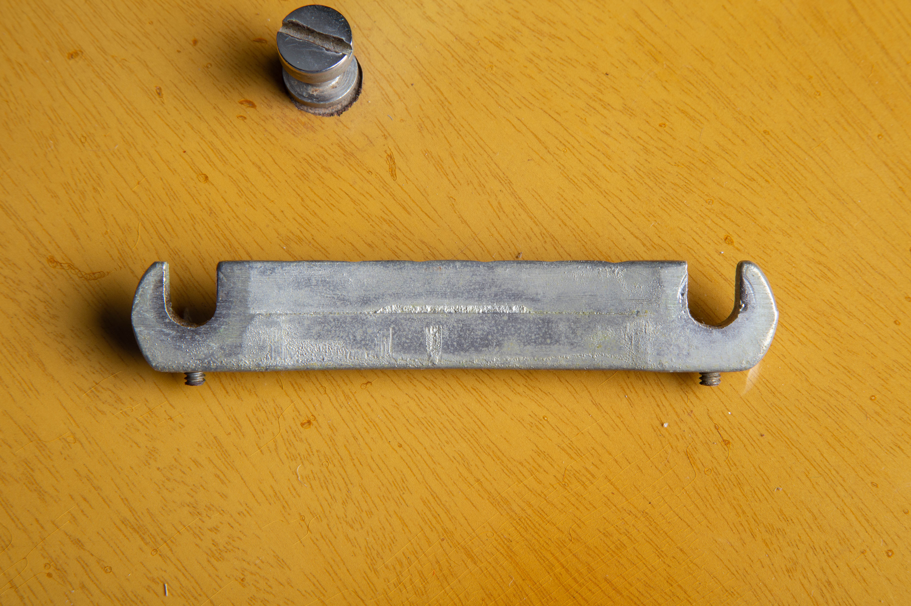
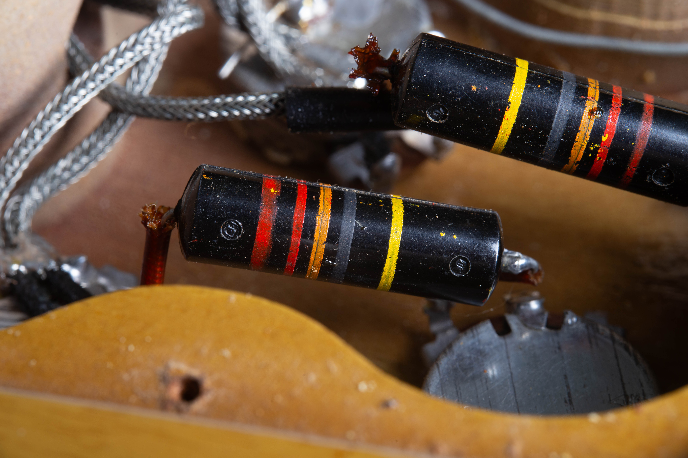
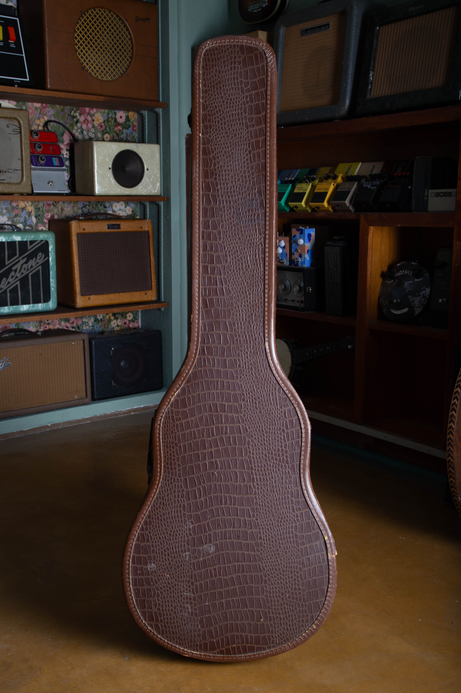

A clean, original TV Yellow Gibson Les Paul Special from 1955 to 1959 carries a $13,000 to $21,000 reference range on this site. The existing reference for a 1959 cherry Special is $8,000 to $15,000. Later 1970s single-cutaway reissues belong in a separate price group, covered year by year below.

I buy vintage Specials and first establish which body style, finish and production period I'm comparing. For the original single-cutaway instruments, my [1955 to 1958 Les Paul Special authentication guide](/post/1955-1958-tv-yellow-les-paul-special-guide/) covers the construction and original parts. This page explains the price references and the condition behind them.

## Gibson Les Paul Special Values By Year

The table gives U.S. dollar references reviewed **as of October 2026**. They assume an excellent, all-original instrument with its original case and no structural repairs. A quality refret is accepted maintenance on an otherwise original guitar, but it removes museum-quality status.

Years that share a range use a shared era reference. They aren't separate claims about an identical set of same-year sales. The early TV Yellow and 1959 cherry figures preserve the existing site anchors; the pricing note explains the references used for later rows.

| Year | Configuration | Reference Range |
| --- | --- | --- |
| 1955 | TV Yellow, single-cutaway | $13,000 to $21,000 |
| 1956 | TV Yellow, single-cutaway | $13,000 to $21,000 |
| 1957 | TV Yellow, single-cutaway | $13,000 to $21,000 |
| 1958 | TV Yellow, single-cutaway | $13,000 to $21,000 |
| 1959 | TV Yellow, rounded double-cutaway | $13,000 to $21,000 |
| 1959 | Cherry, rounded double-cutaway | $8,000 to $15,000 |
| 1960 | Cherry, rounded slab body | $10,000 to $12,500 |
| 1974 | Les Paul 55, single-cutaway sunburst | $2,250 to $4,100 |
| 1976 | Les Paul 55, single-cutaway sunburst | $2,250 to $4,100 |
| 1977 | Les Paul 55, single-cutaway sunburst | $2,250 to $4,100 |
| 1978 | Les Paul 55, single-cutaway sunburst | $2,250 to $4,100 |
| 1979 | Les Paul 55, single-cutaway sunburst | $2,250 to $4,100 |

**Pricing note:** Reviewed as of October 2026. TV Yellow and 1959 cherry ranges retain this site's existing references. The 1960 row uses the 2025 guide with older auction checks; 1970s rows combine the published guide and completed sales. Ranges assume an all-original, excellent-condition guitar with its original case.

The 1960 cherry row uses the 2025 Official Vintage Guitar Magazine Price Guide, where the rounded slab-body guitar appears under SG Special. Its two auction comparisons are older and in lower condition. That row is a published clean-condition reference reviewed now, not a claim that a current clean 1960 sales sample has been established.

For the 1970s single-cutaway guitars, the range combines the 2025 published sunburst reference with two completed sales of described original examples from 2025 and 2026. The resulting band is wider than the book's range alone. I haven't used repaired examples or guitars with added vibratos to set its upper end.

The 1970s rows follow the published production periods for the Les Paul 55. No 1975 row is shown, and the later SG-shaped Special belongs in the [Gibson SG Special value guide](/vintage-gibson-sg-special-value-guide/). A 1970s double-cutaway reissue also needs its own comparison; it isn't included in the single-cutaway range.

<figure>

<figcaption>The full view shows the single cutaway, two pickups, wraparound bridge and four black controls.</figcaption>

</figure>

## Special, Junior And TV Model Are Different Names

The vintage Special has two P-90 pickups and separate volume and tone controls for each. A P-90 is a single-coil pickup, the unit beneath the strings that sends their vibration to an amplifier. On a Special, the familiar rectangular covers are often called soapbars.

The Junior is a one-pickup model. The TV Model is also a one-pickup member of that family. TV Yellow describes a finish found on the two-pickup Special as well, which is why the words “TV” and “Special” need to be read carefully in a listing.

I don't transfer the price of a TV Model to a Special just because both guitars are yellow. The [Les Paul Junior value guide](/vintage-gibson-les-paul-junior-value-guide/) handles the one-pickup instruments, including the TV Model. Here, TV Yellow remains a finish variant within the Special's own price table.

If you aren't sure which one you have, count the pickups and photograph the whole front before focusing on the headstock lettering. That gives an appraisal a useful starting point. The [Les Paul family guide](/post/vintage-gibson-les-paul-family-guide/) compares the related models without assigning one guitar another model's identity.

## Body Shape Sets The First Comparison

### The Single-Cutaway Originals

The original Special uses a flat mahogany body with one cutaway, the opening beside the upper end of the fingerboard. It has a bound fingerboard, two pickups and a wraparound bridge. The binding is the narrow contrasting trim along the fingerboard's edge.

For value, I want the body, finish and pickup arrangement to remain consistent with an original Special. A guitar altered to resemble another Les Paul model doesn't become that model. Repairs and changed parts need to be compared with other altered examples.

The early TV Yellow reference spans several years. It leaves room for preservation, completeness and individual differences without inventing a price step for each birthday. An unusually clean guitar and one with extensive wear shouldn't be described as identical merely because they share a year.

### The Rounded Double-Cutaway Guitars

The later rounded double-cutaway body has an opening on both sides of the neck. Cherry becomes part of the comparison alongside TV Yellow. That body family also crosses a naming change: the SG Special designation appears before the familiar pointed SG body.

This is why I don't value a guitar by the letters on its headstock alone. A rounded slab-body Special and a thin, pointed SG Special belong in different groups. Their construction needs to be established before their price references are compared.

The 1959 and 1960 cherry rows are deliberately identified separately. The former preserves this site's existing reference; the latter uses the published rounded-body SG Special entry. The difference in source basis is visible instead of being hidden behind a smooth-looking table.

<figure>

<figcaption>The rounded double-cutaway body has two black pickup covers and four controls, shown here in an open case.</figcaption>

</figure>

### The Les Paul 55 Reissues

A 1970s Les Paul 55 returns to the single-cutaway Special idea. It is a vintage guitar in its own right, but it isn't a 1955 original. A seller may use “55” to describe the model while the actual production date is decades later.

The table covers the sunburst single-cutaway reissues through 1979. It doesn't assign every color or hardware arrangement the same premium. For TV finishes, double-cutaway versions or an uncertain configuration, I need to narrow the comparison further.

Keep the full serial number and photographs of the whole guitar together. A listing title can omit a reissue designation or put a guitar in the wrong product category. I check the individual instrument behind a completed result before counting it as evidence.

## What TV Yellow Adds To The Valuation

TV Yellow is part of the Special's identity and part of its market description. An original finish needs to be distinguished from a later recreation before the early TV range can be used. A convincing color in a photograph isn't enough to settle that question.

Age, lighting and camera settings can make two photographs of the same finish look different. For an appraisal, I prefer natural indirect light and views of the front, back and edges. I don't need a heavily edited photograph that makes the guitar look more yellow.

The existing site range is retained even where a published reference takes a different view of a particular early configuration. That disagreement is a reason to examine the guitar more closely. It isn't a reason to replace the established figures silently.

<figure>

<figcaption>The finish close-up shows wood grain beneath the yellow color and crossing lines in the lacquer.</figcaption>

</figure>

## Pickups, Controls And Changed Hardware

The table assumes the original pickup set. If a pickup has been replaced or rewound, describe that history and keep the removed parts with the guitar. A great-sounding replacement can still leave the instrument outside the original-pickup price category.

A conversion to humbuckers can involve removing wood around the pickup openings. That work is different from replacing a component that fits the existing mounting. I compare an altered instrument on its actual history rather than treating it as a cleaner guitar with a different sound.

The four controls also belong in the description. Pots are the parts behind the volume and tone knobs; capacitors work with the tone controls. Replacement electronics may keep a guitar working well while changing its collector comparison.

### The Wraparound Bridge

The original-style bridge combines the string anchor and bridge in one piece. A replacement can improve a player's experience, but the appraisal still needs to record what is fitted. If the old bridge survives, leave it with the guitar.

A photograph of the installed bridge and its mounting points helps establish the situation. You don't need to remove the bridge or disturb the setup for a first value opinion. Existing repair photographs are useful if the guitar has already been serviced.

<figure>

<figcaption>This archive view shows the underside of the detached wraparound bridge and its small adjustment screws.</figcaption>

</figure>

### Original Wiring And Service History

A clear interior photograph can support a parts assessment when one is already available. It doesn't turn the price page into an instruction to dismantle a vintage instrument. I can begin with exterior photographs and identify which unanswered questions affect the valuation.

Keep service receipts that describe replaced controls, pickup work or changes to the wiring. The record may explain why a guitar differs from an untouched example. It also helps prevent a minor repair from being confused with a much larger alteration.

<figure>

<figcaption>Two black capacitors with colored stripes and braided wiring are visible inside the control cavity.</figcaption>

</figure>

## Repairs And Playability Need Their Own Description

The price of a repaired Special depends on the actual work. A headstock repair, a neck-joint repair and a refinish aren't interchangeable conditions. I need to know which happened, how much of the original material remains and whether the instrument is stable and playable.

A repaired guitar can still be a useful instrument. It simply needs comparisons that reflect its history. Giving every repair one automatic deduction can conceal the difference between a localized repair and a guitar with several substantial alterations.

If an old invoice identifies the repairer or the work performed, include it. If you know only that the neck was repaired, say that. An accurate limited description is more useful than an unsupported claim that the guitar has never had work.

### Fretwork And The Originality Category

A quality refret preserves the all-original classification of an otherwise original instrument under this site's grading approach. It removes museum-quality status. That's different from reshaping the neck or replacing the fingerboard.

Low or worn frets also affect a buyer's intended use. I don't assume that every collector wants a refret or that every player wants untouched fretwire. Describe the present condition and any known work before deciding which comparison fits.

## Keep The Case With The Guitar

An original case is part of the condition assumed in the table. The early alligator-pattern chipboard cases and period hardshell cases aren't the same accessory. A later case should be described as later, even if it carries a Gibson name.

Photograph the exterior, lining, handle and latches. If the case contains paperwork or removed parts, show those separately as well. Keep them together until the guitar has been evaluated.

The archive photograph below shows the brown alligator-pattern covering on a period case. It doesn't establish a separate case price, and I haven't added an unsupported accessory premium to the guitar's value. Its role here is to show what should be included in the appraisal photographs.

<figure>

<figcaption>The closed case shows the brown alligator-pattern covering and the outline of the case.</figcaption>

</figure>

## How I Read The Price Evidence

A completed price belongs to one instrument in one described condition. Before applying it to another Special, I check the year, body shape, finish, repair history and parts. A recent transaction can be a poor comparison if the model or condition is wrong.

The pricing note below the annual table identifies which ranges preserve existing site references and which use a published guide plus completed comparisons. Older auction results are disclosed as older evidence. I haven't treated them as transactions from this month.

Current dealer listings can show what sellers hope to receive, but they aren't realized prices. A sold listing's old asking amount also isn't automatically the accepted amount. For Reverb comparisons, I use the transaction-history final price before reviewing the corresponding description.

The table is a reference for a category, not a promise of net proceeds. Selling costs and an individual guitar's needs affect the amount an owner ultimately receives. An offer from me follows an appraisal of the instrument itself.

## Send The Special You Have

For a [free vintage guitar appraisal](/free-appraisal/), send full front and back photographs, both sides of the headstock, the neck joint, bridge and case. Add the serial number and the repair history you know. If a part has been changed, a photograph is more useful than trying to make it look original again.

I don't need you to polish away the wear or replace hardware before the first review. The guitar's present condition gives me a clearer starting point. Once its model, era and parts are established, I can explain how it relates to the appropriate price range.
