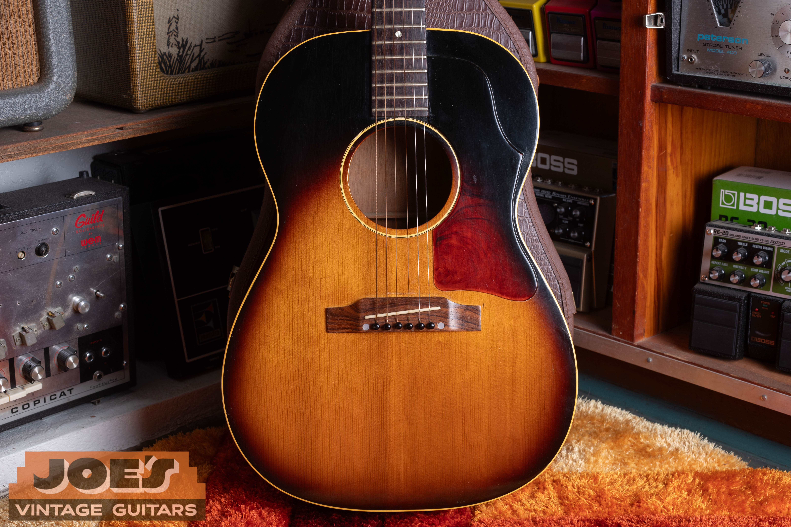
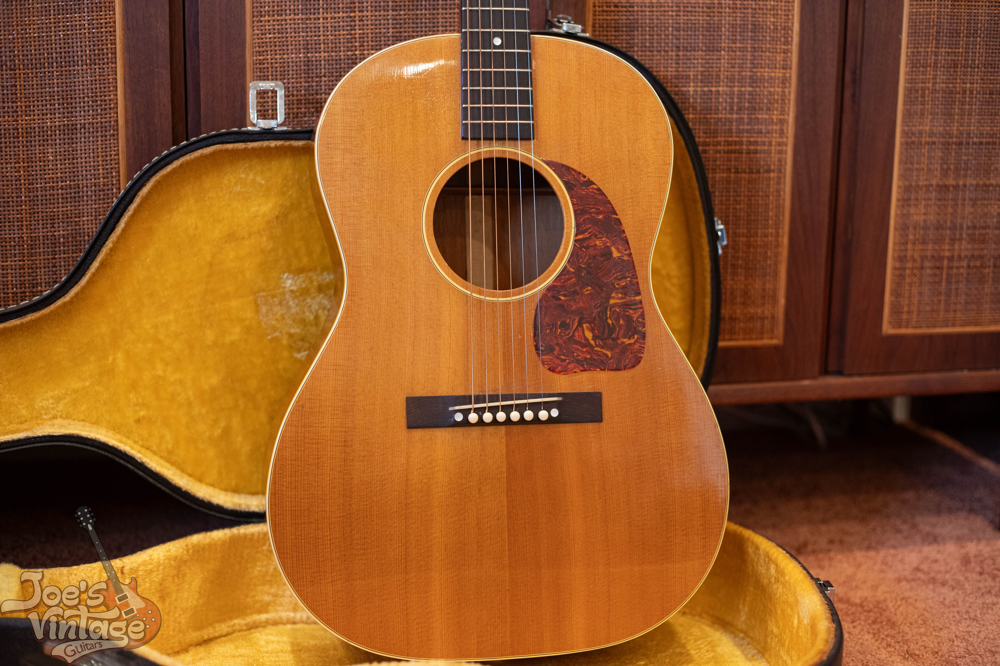
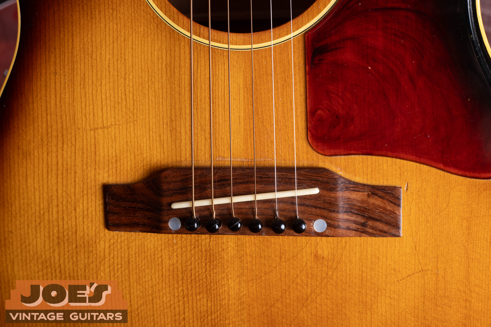
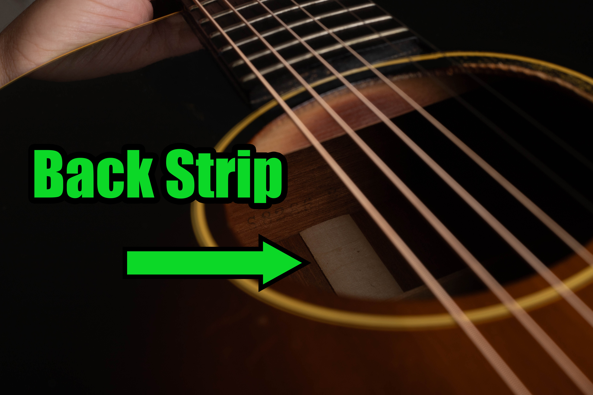

A clean vintage Gibson LG-2 has a guide range of $3,500 to $8,500 across its original eras, while the LG-0, LG-1 and LG-3 have their own ranges. These values assume excellent, original condition and the original case, reviewed in October 2026. I use the model, construction and repair history to narrow the appraisal.

If the model is uncertain, start with my [Gibson LG identification and construction guide](/post/joesvintageguitarsaz-com-identify-gibson-lg-series/). A sunburst top alone doesn't distinguish an LG-1 from an LG-2, and the price table assumes that identification has already been resolved.

## Gibson LG Values By Year

The annual rows cover each model's original production span. The LG-0, LG-1 and LG-3 use broad model ranges. I consider a guitar's actual year, features and condition before narrowing its value.

Each range assumes an all-original guitar in excellent condition, structurally sound and accompanied by its original case. A quality refret is accepted maintenance under my grading approach, although it removes museum-quality status. Refinished, repaired or substantially altered instruments need a separate comparison.

| Year | Configuration | Value Range |
| --- | --- | --- |
| 1958 | LG-0, broad original-run reference | $850 to $1,875 |
| 1959 | LG-0, broad original-run reference | $850 to $1,875 |
| 1960 | LG-0, broad original-run reference | $850 to $1,875 |
| 1961 | LG-0, broad original-run reference | $850 to $1,875 |
| 1962 | LG-0, broad original-run reference | $850 to $1,875 |
| 1963 | LG-0, broad original-run reference | $850 to $1,875 |
| 1964 | LG-0, broad original-run reference | $850 to $1,875 |
| 1965 | LG-0, broad original-run reference | $850 to $1,875 |
| 1966 | LG-0, broad original-run reference | $850 to $1,875 |
| 1967 | LG-0, broad original-run reference | $850 to $1,875 |
| 1968 | LG-0, broad original-run reference | $850 to $1,875 |
| 1969 | LG-0, broad original-run reference | $850 to $1,875 |
| 1970 | LG-0, broad original-run reference | $850 to $1,875 |
| 1971 | LG-0, broad original-run reference | $850 to $1,875 |
| 1972 | LG-0, broad original-run reference | $850 to $1,875 |
| 1973 | LG-0, broad original-run reference | $850 to $1,875 |
| 1974 | LG-0, broad original-run reference | $850 to $1,875 |
| 1943 | LG-1, broad original-run reference | $2,000 to $4,500 |
| 1944 | LG-1, broad original-run reference | $2,000 to $4,500 |
| 1945 | LG-1, broad original-run reference | $2,000 to $4,500 |
| 1946 | LG-1, broad original-run reference | $2,000 to $4,500 |
| 1947 | LG-1, broad original-run reference | $2,000 to $4,500 |
| 1948 | LG-1, broad original-run reference | $2,000 to $4,500 |
| 1949 | LG-1, broad original-run reference | $2,000 to $4,500 |
| 1950 | LG-1, broad original-run reference | $2,000 to $4,500 |
| 1951 | LG-1, broad original-run reference | $2,000 to $4,500 |
| 1952 | LG-1, broad original-run reference | $2,000 to $4,500 |
| 1953 | LG-1, broad original-run reference | $2,000 to $4,500 |
| 1954 | LG-1, broad original-run reference | $2,000 to $4,500 |
| 1955 | LG-1, broad original-run reference | $2,000 to $4,500 |
| 1956 | LG-1, broad original-run reference | $2,000 to $4,500 |
| 1957 | LG-1, broad original-run reference | $2,000 to $4,500 |
| 1958 | LG-1, broad original-run reference | $2,000 to $4,500 |
| 1959 | LG-1, broad original-run reference | $2,000 to $4,500 |
| 1960 | LG-1, broad original-run reference | $2,000 to $4,500 |
| 1961 | LG-1, broad original-run reference | $2,000 to $4,500 |
| 1962 | LG-1, broad original-run reference | $2,000 to $4,500 |
| 1963 | LG-1, broad original-run reference | $2,000 to $4,500 |
| 1964 | LG-1, broad original-run reference | $2,000 to $4,500 |
| 1965 | LG-1, broad original-run reference | $2,000 to $4,500 |
| 1966 | LG-1, broad original-run reference | $2,000 to $4,500 |
| 1967 | LG-1, broad original-run reference | $2,000 to $4,500 |
| 1968 | LG-1, broad original-run reference | $2,000 to $4,500 |
| 1942 | LG-2, spruce-top Banner | $6,500 to $8,500 |
| 1943 | LG-2, spruce-top Banner | $6,500 to $8,500 |
| 1944 | LG-2, spruce-top Banner | $6,500 to $8,500 |
| 1945 | LG-2, spruce-top Banner | $6,500 to $8,500 |
| 1946 | LG-2, early postwar | $5,500 to $7,500 |
| 1947 | LG-2, early postwar | $5,500 to $7,500 |
| 1948 | LG-2, early postwar | $5,500 to $7,500 |
| 1949 | LG-2, early postwar | $5,500 to $7,500 |
| 1950 | LG-2, later original production | $3,500 to $6,500 |
| 1951 | LG-2, later original production | $3,500 to $6,500 |
| 1952 | LG-2, later original production | $3,500 to $6,500 |
| 1953 | LG-2, later original production | $3,500 to $6,500 |
| 1954 | LG-2, later original production | $3,500 to $6,500 |
| 1955 | LG-2, later original production | $3,500 to $6,500 |
| 1956 | LG-2, later original production | $3,500 to $6,500 |
| 1957 | LG-2, later original production | $3,500 to $6,500 |
| 1958 | LG-2, later original production | $3,500 to $6,500 |
| 1959 | LG-2, later original production | $3,500 to $6,500 |
| 1960 | LG-2, later original production | $3,500 to $6,500 |
| 1961 | LG-2, later original production | $3,500 to $6,500 |
| 1962 | LG-2, later original production | $3,500 to $6,500 |
| 1942 | LG-3, broad original-run reference | $3,750 to $8,500 |
| 1943 | LG-3, broad original-run reference | $3,750 to $8,500 |
| 1944 | LG-3, broad original-run reference | $3,750 to $8,500 |
| 1945 | LG-3, broad original-run reference | $3,750 to $8,500 |
| 1946 | LG-3, broad original-run reference | $3,750 to $8,500 |
| 1947 | LG-3, broad original-run reference | $3,750 to $8,500 |
| 1948 | LG-3, broad original-run reference | $3,750 to $8,500 |
| 1949 | LG-3, broad original-run reference | $3,750 to $8,500 |
| 1950 | LG-3, broad original-run reference | $3,750 to $8,500 |
| 1951 | LG-3, broad original-run reference | $3,750 to $8,500 |
| 1952 | LG-3, broad original-run reference | $3,750 to $8,500 |
| 1953 | LG-3, broad original-run reference | $3,750 to $8,500 |
| 1954 | LG-3, broad original-run reference | $3,750 to $8,500 |
| 1955 | LG-3, broad original-run reference | $3,750 to $8,500 |
| 1956 | LG-3, broad original-run reference | $3,750 to $8,500 |
| 1957 | LG-3, broad original-run reference | $3,750 to $8,500 |
| 1958 | LG-3, broad original-run reference | $3,750 to $8,500 |
| 1959 | LG-3, broad original-run reference | $3,750 to $8,500 |
| 1960 | LG-3, broad original-run reference | $3,750 to $8,500 |
| 1961 | LG-3, broad original-run reference | $3,750 to $8,500 |
| 1962 | LG-3, broad original-run reference | $3,750 to $8,500 |
| 1963 | LG-3, broad original-run reference | $3,750 to $8,500 |
| 1964 | LG-3, broad original-run reference | $3,750 to $8,500 |

The LG-0 reference combines $850 to $1,875 across its original run. The broad LG-1 envelope is $2,000 to $4,500, and the LG-3 envelope is $3,750 to $8,500. Those wide ranges span changes in age and configuration; they aren't interchangeable quotes for every example.

For the LG-2, the spruce-top Banner reference is $6,500 to $8,500, early postwar production is $5,500 to $7,500, and the combined later-production reference is $3,500 to $6,500. A mahogany-top Banner guitar needs its own comparison. I haven't assigned it the spruce-top range.

The LG-3 table runs through 1964. A guitar near that boundary needs its exact model established before you apply a range. Later B-25 guitars aren't automatically included under the LG-2 name.

<figure>

<figcaption>My LG-2 photograph shows a rectangular bridge and large pickguard. The image is context for an appraisal, not a certificate of untouched construction.</figcaption>

</figure>

## How To Use The Value Ranges

The table gives you a starting range. It doesn't make an uncertain model, repaired top or incomplete guitar an excellent original. A useful playing instrument can still belong outside the clean-condition category.

Refinishes, replacement bridges, repaired cracks, added pickups and newer cases all affect the condition description. I assess those details individually rather than treating every guitar with the same model name as equivalent.

The ranges describe guitars under the stated condition assumptions. I wouldn't apply a clean-original value to a heavily repaired instrument without a separate appraisal.

### Broad Model Ranges Need A Second Step

The LG-0, LG-1 and LG-3 each span more than one construction period. Their broad ranges help you choose the model category. I then assess the actual features and condition to narrow the value.

Early LG-1 and LG-3 examples need individual assessment. I don't place a guitar at the top of the range simply because its date is older; its construction, originality and condition need to support the appraisal.

The LG-2 table separates the spruce-top Banner period, early postwar examples and later production. Several annual rows can share a range, while individual guitars differ in condition and construction.

## Choosing The Correct LG Model

I begin an appraisal with the model designation and the evidence supporting it. An old receipt, a family description and a seller's listing title can help, but they can also repeat a mistake. A guitar described as an LG-2 for years can still need closer examination.

Don't borrow another model's range because two guitars look similar from the front. The LG-0, LG-1, LG-2 and LG-3 have their own value categories. I establish the model before using the table.

<figure>

<figcaption>This LG-1 from my archive has the same general body outline as an LG-2. Model identity has to be settled before selecting a range.</figcaption>

</figure>

### The LG-0

The LG-0 occupies the lowest broad reference in this group. That doesn't mean every inexpensive-looking Gibson is an LG-0, or that an owner's instrument should be assigned the bottom figure without an inspection. Bridge work, playability and condition can change the comparison considerably.

The LG-0 coverage begins in 1958. If a guitar is described as an earlier LG-0, I check its model and date before assigning a value.

A later guitar with uncertain wood or model identity needs a closer appraisal. I don't identify its construction from a listing title or extend one guitar's features to every year.

### The LG-1

An LG-1 can resemble an LG-2 closely enough that owners compare the wrong model. The broad LG-1 reference here remains separate, even where both instruments share a sunburst finish. It covers original-condition guitars rather than every repaired student-model acoustic offered under the name.

A changed bridge or a pickup installation should be described directly. Calling an instrument a good player doesn't answer whether its finish, bridge and internal structure match the reference condition. I want those details before narrowing a price.

### The LG-2 And LG-3

The LG-2's sunburst appearance and the LG-3's natural top provide familiar visual context, but a photograph doesn't settle everything an appraisal needs. I still need the condition and work history. An attractive top can sit above repaired braces or a changed bridge plate.

The LG-3 range is deliberately broad across the original run. I haven't applied a fixed percentage premium to the LG-2 or assumed that any natural-finish guitar is worth more. The model, era and condition have to support that conclusion.

<figure>

<figcaption>My LG-3 photograph shows the natural top and rectangular bridge. The photographed case is not used to establish a price premium.</figcaption>

</figure>

## Repairs That Change The Comparison

Old acoustics often arrive with maintenance records, replacement parts or work whose history is unknown. I separate those situations from the clean reference instead of giving every repair the same deduction. The extent and quality of the work determine which other guitars make useful comparisons.

A disclosed repair is easier to assess than a vague statement that a guitar was serviced. A receipt naming a neck reset, bridge replacement or brace repair helps explain the instrument's present condition. It also prevents unrelated work from being grouped together.

### Bridges And The Surrounding Top

A bridge holds the strings at the soundboard, and a replacement affects both the instrument's setup and its originality description. A well-made replacement may be a sensible repair. It still isn't the same evidence as an untouched original bridge.

I don't recommend replacing a bridge simply to prepare an instrument for an appraisal. Photograph the guitar as it stands and provide any repair information you have. A specialist can then assess whether work is needed and how the current condition compares with the reference.

On examples associated with plastic bridges, a wood replacement may be part of the instrument's known history. That history should stay with the guitar. The correct value comparison describes the actual bridge rather than treating all examples from the same year as identical.

<figure>

<figcaption>A close photograph records the bridge and surrounding finish for an individual assessment. It does not establish what work occurred beneath the bridge.</figcaption>

</figure>

### Neck Work And Playability

A neck reset changes the neck's seating angle so the guitar can be set up properly. A documented reset and an instrument that still needs one present different situations to a buyer. I don't assign a universal deduction to the phrase alone.

Frets are another separate question. Under this site's grading approach, a quality refret preserves the all-original classification of an otherwise original guitar, but it removes museum-quality status. Neck reshaping, a broken headstock and changed hardware need their own descriptions.

### Cracks, Braces And Bridge Plates

A repaired crack, a missing brace and a changed bridge plate aren't interchangeable repairs. The bridge plate is the reinforcement beneath the bridge inside the body. Its condition belongs in an acoustic appraisal even when the outside photographs look clean.

I use repair records and appropriate photographs to understand the work. I don't assume that a small visible line is harmless, or that every repaired crack has the same price effect. The clean table isn't a substitute for that assessment.

<figure>

<figcaption>This annotated archive image records the interior back strip. Internal condition and model identification belong with the other appraisal evidence.</figcaption>

</figure>

## Original Finish, Cases And Added Pickups

An original finish, an overspray and a full refinish need separate descriptions. Overspray means additional finish applied over an existing surface. It can accompany other repairs, so I don't isolate a discount without understanding the whole guitar.

The ranges assume the original case. A newer case may protect an instrument well, but it doesn't satisfy that condition assumption. A seller calling a case vintage also doesn't establish that it left the factory with that guitar.

An added pickup can be useful to a working musician. Its installation may involve a changed endpin, a jack or other alterations that belong in the appraisal record. I don't turn that practical usefulness into an automatic collector premium.

Keep removed original parts and any dated receipts together with the guitar. Those items can explain what changed even when they aren't currently installed. Don't reinstall parts merely to make the instrument resemble a reference photograph.

## Reading The Market Without Mixing Categories

An asking price can differ from the amount a buyer ultimately pays. A direct buying offer also depends on the guitar's actual condition and the terms of the sale.

I assess the guitar as it stands now, including repairs, changes and any included original parts. An attractive advertised price doesn't replace that inspection.

These guide ranges were reviewed in October 2026. Send photographs and the repair history for an individual appraisal of your guitar.

I don't promise an investment return from these ranges. Ownership costs, future repair needs and the time needed to find a buyer all affect the outcome. The useful question is how the actual guitar compares with documented instruments today.

## Preparing An Individual Appraisal

Start with clear photographs of the front, back, headstock, bridge and any known repairs. Include the case and any paperwork that explains the guitar's history. If a date or model name came from a family member rather than a documented inspection, say so.

You don't need to fill in uncertain details before contacting me. An honest unknown is more useful than a confident guess that directs the appraisal toward the wrong model. I can begin with the photographs and explain what additional information would narrow the comparison.

I buy vintage guitars nationwide from my shop in Mesa, Arizona. A [free guitar appraisal](/free-appraisal/) can establish the next step, and my [Gibson selling information](/sell-my-gibson-guitar/) explains the purchase process. The price references here help frame that conversation; the offer depends on the individual instrument.
