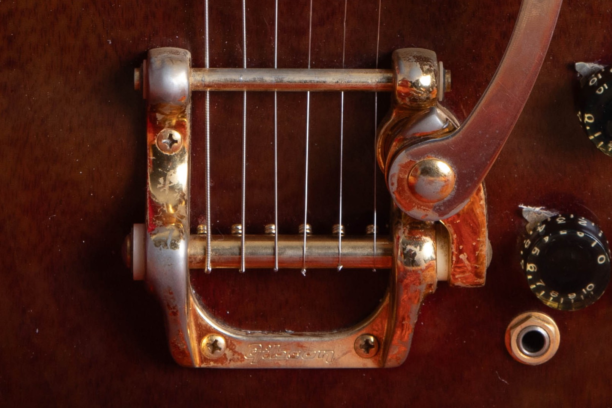

Vintage Gibson SG Custom reference values run from $3,000 to $6,600 for typical 1970s walnut guitars to $17,000 to $24,000 for early white small-guard examples, reviewed in October 2026. The early range includes older sales; three original humbuckers, factory finish and an unbroken neck remain the starting point.

For the year and original specification, use my [Gibson SG Custom dating and identification guide](/gibson-sg-dating-guide/#sg-custom). This guide covers market value and the features that move it.

## Gibson SG Custom Values By Year

**Reviewed October 2026. US dollars.** Repeated numbers are shared era references, not separate measurements for each year. Read the condition notes with the table.

| Year | Value Range | Configuration And Year Notes |
| --- | --- | --- |
| 1961 | $17,000 to $24,000 | White finish, three humbuckers and early vibrato. |
| 1962 | $17,000 to $24,000 | White finish, three humbuckers and early vibrato. |
| 1963 | $17,000 to $24,000 | White small-guard Custom; lyre or factory Bigsby. |
| 1964 | $17,000 to $24,000 | White small-guard Custom; lyre or factory Bigsby. |
| 1965 | $17,000 to $24,000 | White small-guard Custom; lyre or factory Bigsby. |
| 1966 | $6,500 to $14,000 | Small to large guard transition; match actual version. |
| 1967 | $6,500 to $14,000 | White large-guard Custom; no walnut assumption. |
| 1968 | $6,500 to $14,000 | White large-guard Custom; no walnut assumption. |
| 1969 | $6,500 to $14,000 | White to walnut transition; finish changes the comparison. |
| 1970 | $6,500 to $14,000 | Walnut large-guard reference; white priced separately. |
| 1971 | $6,500 to $14,000 | Large and later small-guard configurations overlap. |
| 1972 | $3,000 to $6,600 | Walnut Custom; factory Bigsby or stopbar. |
| 1973 | $3,000 to $6,600 | Walnut Custom; factory Bigsby or stopbar. |
| 1974 | $3,000 to $6,600 | Walnut Custom; factory Bigsby or stopbar. |
| 1975 | $3,000 to $6,600 | Walnut Custom; factory Bigsby or stopbar. |
| 1976 | $3,000 to $6,600 | Walnut Custom; factory Bigsby or stopbar. |
| 1977 | $3,000 to $6,600 | Walnut Custom; factory Bigsby or stopbar. |
| 1978 | $3,000 to $6,600 | Walnut Custom; factory Bigsby or stopbar. |
| 1979 | $3,000 to $6,600 | Walnut Custom; factory Bigsby or stopbar. |

White is the finish reference through 1968, with walnut joining later in the decade. The $6,500 to $14,000 large-guard envelope combines played white and walnut guitars; its upper observation is white, so it is not a walnut ceiling. The evidence is too small and too mixed to measure a reliable white-finish percentage premium. A later small-guard 1971 guitar should use the 1970s configuration reference. The early $17,000 to $24,000 group includes 2022 and 2023 transactions alongside a 2025 result, so the lower edge remains a historical reference.

### Condition Behind The Ranges

**1961 To 1965 Small-Guard Custom:** Original white finish and seller-described original pickups, no disclosed structural repairs. Clean to lightly played; refret, replacement knob or uncertain truss rod cover accepted. Case can be replaced.

**1966 To 1971 Large-Guard Custom:** Original white or walnut finish and seller-described original pickup set. Played examples; minor wiring, tuners, knobs, added pickup rings or localized finish touch-up accepted. No disclosed structural break or full refinish. Case can be replaced and hardware may need servicing.

**1972 To 1979 Small-Guard Custom:** Original walnut finish and pickups, no disclosed neck or headstock repair. Played to excellent. Factory Bigsby or stopbar; refrets and replaced pots accepted. Case originality varies.

### How These Ranges Were Built

I checked Reverb Price Guide final prices against the linked instrument descriptions. The records span 2022 to 2026, with at least three records per researched era group. Shipping and tax are excluded; auction totals include the buyer's premium. These are sale references, not dealer buying offers.

<figure>

<figcaption>A walnut SG Custom with three humbuckers, gold hardware and a Bigsby. Photo by Joe Dampt.</figcaption>

</figure>

## The Early White Custom

The SG Custom combines three humbuckers, an ebony fingerboard, block inlays, a split-diamond headstock and gold hardware. Early examples retain Les Paul branding on the pointed SG shape. The white finish often ages toward cream, which is different from proving a separate factory color.

The early $17,000 to $24,000 band assumes original white finish and the seller-described original pickup set, with no disclosed structural repair. It allows a quality refret and minor changes noted in the records. Two supporting transactions are from 2022 and 2023, so the lower edge remains a historical reference rather than a newly measured 2026 floor.

Refinished Customs and guitars with replacement pickups can sell for substantially less. Those are altered instruments, with different condition assumptions from the early original-finish group. The full pickup set and repair history explain more than the Custom name alone.

### Three Original Humbuckers

Replacing one of three pickups changes part of the Custom's collector package even if the other two are original. Early gold-plated PAFs can persist differently from the Standard's nickel-plated pickups. The presence of a particular decal therefore doesn't supply a complete model year or price on its own.

The exact pickup set, original white finish and repair history have to travel together. A clean early Custom with three confirmed original PAFs may need a narrower comparison than the broad band here. I haven't turned that distinction into an unsupported fixed premium.

## White And Walnut Large-Guard Customs

The large guard arrives during 1966. Early small-guard examples remain part of that transition, and should be valued by their actual configuration. White is the finish reference through 1968; walnut belongs to the later part of the decade and the 1970s.

The $6,500 to $14,000 large-guard envelope mixes played white and walnut guitars. The upper observation is white, while the walnut records sit lower. That describes this small evidence group; it doesn't measure a universal white-finish percentage premium because condition, repairs and parts also differ.

The 1971 row needs particular care. A Custom with the later small guard and front control arrangement belongs with the later construction reference. The name stays Custom through the period when the Standard and Special names briefly give way to Deluxe and Pro.

## The 1970s Walnut Custom

<figure>

<figcaption>Worn gold plating on the Bigsby of a 1972 SG Custom. Photo by Joe Dampt.</figcaption>

</figure>

The 1970s band covers walnut guitars with original pickups and no disclosed neck or headstock repair. Factory Bigsby and stopbar versions appear in the evidence. A Bigsby isn't automatically an aftermarket addition, and worn gold plating doesn't by itself mean the hardware is replaced.

The broad harmonica bridge and later neck construction distinguish these guitars from the early white Custom. A small pickguard on a 1972 guitar doesn't restore the earlier market category. The later instrument has its own appeal and its own sale record.

<figure>

<figcaption>The raised volute behind the nut on a later SG Custom. Photo by Joe Dampt.</figcaption>

</figure>

The raised wood behind the nut is the volute. It belongs to the later neck construction and is visible on the photographed Custom. It isn't a defect to remove, and reshaping the area would alter the original neck.

<figure>

<figcaption>Six gold waffleback tuners on a walnut SG Custom. Photo by Joe Dampt.</figcaption>

</figure>

The gold waffleback tuners complete the later headstock appearance on this example. Servicing a stiff tuner is a different choice from drilling the headstock for another style. Original parts kept in the case can preserve options for the next owner.

## Repairs, Original Parts And Value

An unbroken neck, original finish and factory pickups are the baseline for a collector SG Custom. A repaired headstock, a full refinish and a missing pickup change different parts of that package. Normal playing wear and a good refret deserve a separate assessment from structural damage.

For scale, the site's [published Les Paul condition benchmarks](/vintage-gibson-les-paul-market-value-guide/) give the following deductions. They're Les Paul figures, not measured SG Custom discounts; I use matching SG Custom sales to price the actual repair or alteration.

| Published Les Paul Benchmark | Deduction From A Comparable Original |
| --- | --- |
| Repaired Headstock | Roughly 40 To 50% |
| Refinished Body Or Neck | Roughly 40 To 50% |
| Pickup Swap Without Routing | Roughly 25% |
| P-90 To Humbucker Routing | Roughly 35 To 40% |
| Quality Refret | Often 5 To 10% |

These aren't deductions to add together. A guitar that's already priced as played, serviced or altered has some of those differences reflected in its starting range. A quality refret preserves an otherwise all-original guitar's classification while taking it out of the museum-quality category.

## Complete Hardware And A Selling Decision

The Custom's decorative trim and three-pickup layout create more opportunities for missing or mismatched parts than a Junior. Covers, knobs, vibrato parts and original case all contribute to the complete package. New plating or a fresh white finish can improve appearance while reducing originality.

The [SG value overview](/vintage-gibson-sg-value-guide/) explains how the Custom sits beside the other models, and the [SG family guide](/post/vintage-gibson-sg-family-guide/) provides their construction context. For this guitar, use the [free guitar appraisal](/free-appraisal/) page with photographs and repair history. A retail reference is distinct from a buying offer that includes preparation, selling costs and margin.
