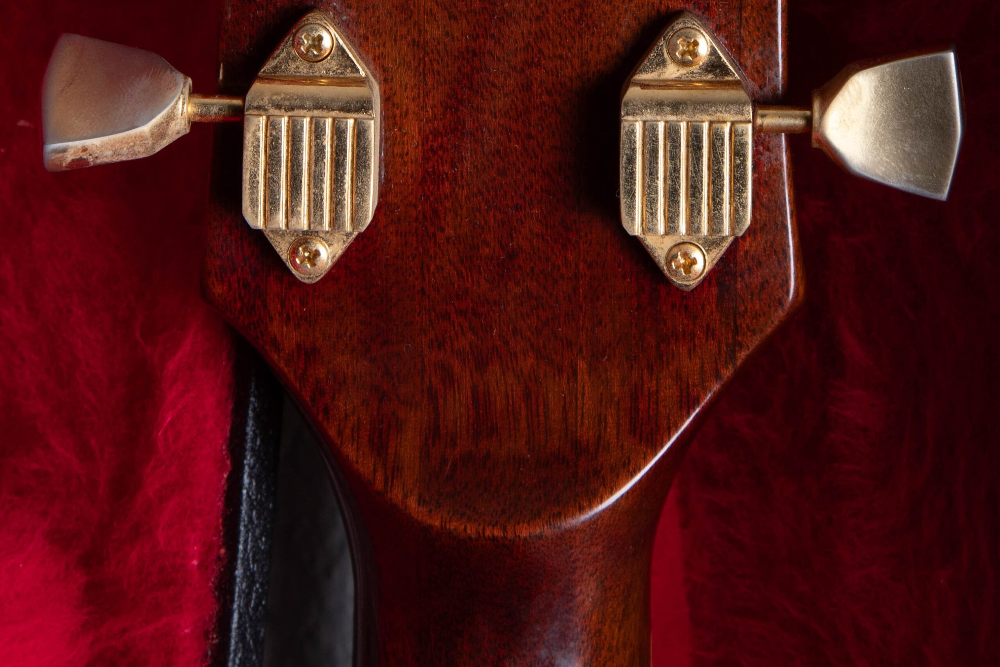
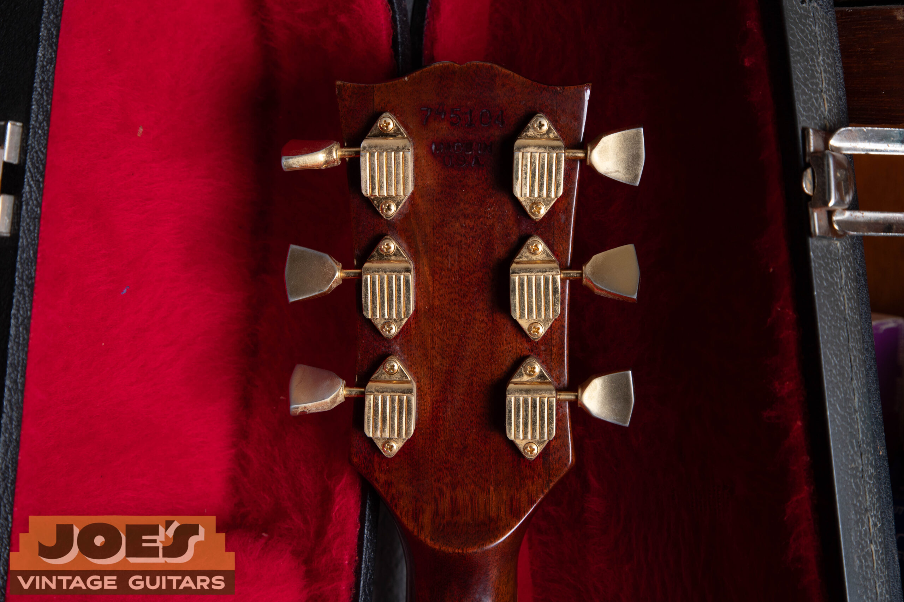

A played walnut 1968 to 1969 Gibson SG Custom with its original pickups and case falls around $6,500 to $10,500 in the completed-sale comparisons reviewed as of October 2026. This band allows minor wiring changes and localized finish touch-up; I don't use it for an excellent, untouched early Custom.

For model and year identification, use my [Gibson SG dating and authentication guide](/gibson-sg-dating-guide/). This page covers the information that belongs in a value appraisal after that work is established.

## SG Custom Price Ranges

**As of October 2026. All ranges are in US dollars.** These are rounded completed-sale comparisons, excluding shipping and tax. They aren't dealer buying offers or guaranteed selling prices.

| Year And Configuration | Range | Condition Assumed |
| --- | --- | --- |
| 1968 To 1969 SG Custom, Walnut, Played Examples | $6,500 to $10,500 | Original finish and pickup set with original case; visible wear and minor wiring or hardware changes. Localized finish touch-up allowed. No reported structural break or full refinish. Not an excellent all-original band. |

The sample is walnut, large-guard production with three original humbuckers and an original case. The guitars show playing wear, with changes such as pickup polarity work, replacement knobs with originals retained, or small finish touch-ups. That makes this a useful played-guitar comparison, not a clean-original collector quote.

White finishes, early small-guard Customs and artist provenance stay outside this row. So do a full refinish or a structural break. The observed sales run from 2024 through 2025; the review date doesn't turn them into 2026 transactions.

The range is grounded in at least three separate completed transactions from the Reverb Price Guide, with each linked description checked for finish, pickups, repairs and case. Seller descriptions provide the condition evidence; they aren't a substitute for examining your guitar. I haven't used current asking prices to fill missing rows.

<figure>

<figcaption>Three covered humbuckers and gold hardware on this walnut-finish SG Custom. Photo by Joe Dampt.</figcaption>

</figure>

## What The Custom Adds

The traditional SG Custom combines three humbuckers with an ebony fingerboard, block inlays, gold hardware and elaborate headstock trim. Those appointments distinguish it from the familiar Standard, Special and Junior. They don't establish the condition of a particular surviving guitar.

I compare complete instruments with the same sort of factory configuration. A clean later Custom and a heavily altered early one offer different things to a buyer. The older date alone isn't enough to choose between their value comparisons.

My [SG family reference](/post/vintage-gibson-sg-family-guide/) explains the model differences. The [vintage SG value hub](/vintage-gibson-sg-value-guide/) keeps the separate appraisals together without combining them into a single average.

## Early Les Paul-Branded Customs

The pointed SG body arrived while Gibson still used Les Paul branding on the Custom. An early example can therefore be described under either part of that history. It needs to be distinguished from the earlier single-cutaway Les Paul Custom when searching completed sales.

The original pickup set and vibrato belong in the comparison alongside the year. A guitar that has been converted to another tailpiece carries that alteration in its history, even if the resulting layout resembles a factory option.

I also distinguish a modern reissue from an instrument made during the original production period. A reissue's model-year name describes the design it references. It isn't evidence that the guitar itself was manufactured in that year.

## Three Pickups Need Three Descriptions

A humbucker uses two coils to reduce hum. The Custom's pickup set needs to be described as a set, with any replacement, rewind or cover work recorded. Three old covers don't establish that all three pickups are original and unaltered.

An original pickup that has been rewound has a different repair history from one with its original coil wire. A period replacement also differs from a pickup installed at the factory. I keep those distinctions visible instead of reducing the description to vintage pickups.

The [Gibson PAF and Patent Number pickup guide](/post/gibson-paf-patent-number-pickup-guide/) covers examination. Don't unsolder covers for an initial appraisal; start with the guitar's photographs and any existing records of pickup work.

I don't value the Custom by adding three loose-pickup asking prices to the price of a body. That method ignores the instrument's overall condition, structural history and the difference between asking prices and transactions. A complete guitar needs complete-guitar comparisons.

## Finish And Gold Hardware

Aging, wear and later finish work need separate descriptions. Original white finish can change in appearance over time, but an aged-looking surface isn't proof of its factory history. For the price comparison, I want the finish status established rather than inferred from color alone.

The same applies to gold hardware. Wear to plating is a condition detail, while replacement or replating is a different history. A shiny part shouldn't be described as original simply because it looks good in the photograph.

I don't recommend refinishing or replating an instrument to prepare it for the first appraisal. Those changes may remove evidence that helps explain the guitar. Document the present condition and discuss the work before authorizing it solely for a sale.

<figure>

<figcaption>The Bigsby and its worn gold plating are visible on this 1972 Custom. Plating wear is different from replacement hardware. Photo by Joe Dampt.</figcaption>

</figure>

## Later Customs And Their Own Market

Later SG Customs need completed-sale comparisons from the appropriate production period. I don't apply an early Custom range to a 1970s guitar because both have three pickups. Construction, hardware and the buyer's alternatives differ.

The factory vibrato or tailpiece also has to be described accurately. A Bigsby on a later Custom, for example, needs to be evaluated as part of that instrument's established configuration. The name of the hardware doesn't establish the price on its own.

If a guitar has several changes, I keep the description specific. A replaced bridge, a repaired neck and a refinished body are different facts. They should remain visible throughout the valuation instead of disappearing behind a general condition grade.

<figure>

<figcaption>The raised area behind the headstock is visible on this later Custom. Later construction belongs in a later-era comparison. Photo by Joe Dampt.</figcaption>

</figure>

## Repairs, Frets And The Neck

Headstock and neck-joint repairs belong in the initial appraisal notes. Their stability, extent, appearance and documentation affect the comparison. If an owner doesn't know what a line in the finish represents, it can remain an open question until examined.

A quality refret is accepted maintenance and preserves the all-original classification of an otherwise all-original Custom. It takes the guitar out of the museum-quality category. I keep neck reshaping separate because it changes the original wood rather than replacing worn frets.

I don't use a universal repair percentage for every Custom. The repair, finish, pickups and era interact in the complete instrument being offered. A supported comparison is more useful than arithmetic built on an unverified starting price.

<figure>

<figcaption>The gold tuner housings and metal buttons are visible here. Keep the complete hardware set in view when comparing Customs. Photo by Joe Dampt.</figcaption>

</figure>

## The Case And Ownership Records

The original case and any included original parts are part of the package. I distinguish them from later replacements. A useful modern case can protect a guitar without being part of its original history.

Repair invoices, old photographs and purchase paperwork can help explain changes or ownership. They don't automatically establish everything about the guitar. I match the records to the instrument and leave uncertain points open.

Keep removed parts with the Custom, even if they're worn or not working. They may help clarify what was changed. Reinstalling them isn't a prerequisite for requesting an appraisal.

## Comparing Selling Options For A Custom

An advertised retail figure is different from a completed sale, and both differ from the amount a seller keeps after costs. I keep those categories separate when discussing an offer. Otherwise, comparing two headline numbers can conceal the fees or work behind one of them.

Artist ownership can also produce a different kind of transaction from an ordinary vintage model sale. I don't use a celebrity result to promise a similar amount for another Custom with matching specifications. The guitar and its documented history have to be evaluated together.

For an appraisal, send the front, back, headstock and case, with close photographs of any known repairs. Add the pickup or finish history you know and say plainly where information is missing.

I buy vintage Gibsons nationwide from Mesa, Arizona. Start with a [free SG Custom appraisal](/free-appraisal/) or read about [selling a Gibson to Joe](/sell-my-gibson-guitar/) if you're ready to discuss an offer.
