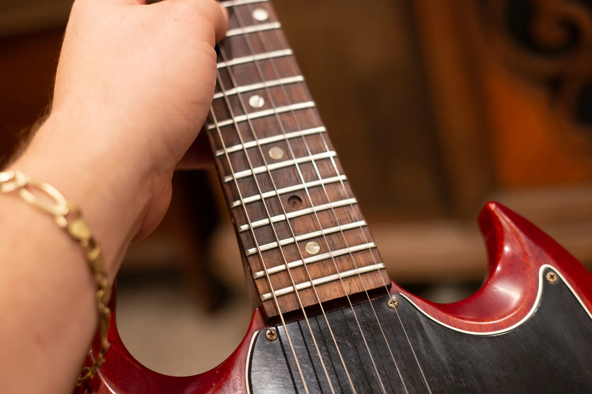
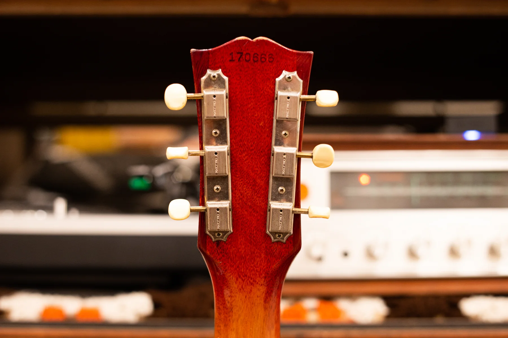

Vintage Gibson SG Junior reference values run from $2,300 to $4,000 for later large-guard guitars to $6,000 to $8,500 for early small-guard examples, as of October 2026. These are cherry guitars with their original P-90 and finish, with the wear and maintenance noted below.

For the year and original specification, use my [Gibson SG Junior dating and identification guide](/gibson-sg-dating-guide/#sg-junior). This guide covers market value and the features that move it.

## Gibson SG Junior Values By Year

**Reviewed October 2026. US dollars.** Repeated numbers are shared era references, not separate measurements for each year. Read the condition notes with the table.

| Year | Value Range | Configuration And Year Notes |
| --- | --- | --- |
| 1961 | $6,000 to $8,500 | Small guard, dog-ear P-90 and wraparound bridge. |
| 1962 | $6,000 to $8,500 | Small guard, dog-ear P-90 and wraparound bridge. |
| 1963 | $6,000 to $8,500 | Small guard and dog-ear P-90; lightning-bar bridge. |
| 1964 | $6,000 to $8,500 | Small guard and dog-ear P-90; lightning-bar bridge. |
| 1965 | $6,000 to $8,500 | Small guard and dog-ear P-90; lightning-bar bridge. |
| 1966 | $2,300 to $4,000 | Small to large guard transition; match actual version. |
| 1967 | $2,300 to $4,000 | Large guard and soapbar P-90; factory vibrato reference. |
| 1968 | $2,300 to $4,000 | Large guard and soapbar P-90; factory vibrato reference. |
| 1969 | $2,300 to $4,000 | Large guard and soapbar P-90; factory vibrato reference. |
| 1970 | $2,300 to $4,000 | Large guard and soapbar P-90; factory vibrato reference. |
| 1971 | $2,300 to $4,000 | Large guard and soapbar P-90; factory vibrato reference. |
| 1972 | Outside Original Run | Outside this original Junior run. |
| 1973 | Outside Original Run | Outside this original Junior run. |
| 1974 | Outside Original Run | Outside this original Junior run. |
| 1975 | Outside Original Run | Outside this original Junior run. |
| 1976 | Outside Original Run | Outside this original Junior run. |
| 1977 | Outside Original Run | Outside this original Junior run. |
| 1978 | Outside Original Run | Outside this original Junior run. |
| 1979 | Outside Original Run | Outside this original Junior run. |

The early range uses three confirmed completed sales after two ended listings were removed. Small and large guards overlap during 1966; match the actual pickup mounting and guard before choosing the era. Cream or white SG TV instruments are excluded from these cherry Junior ranges. The table marks 1972 to 1979 outside the original run rather than assigning later student models a Junior price.

### Condition Behind The Ranges

**1961 To 1965 Small-Guard Junior:** Original cherry finish and P-90, no disclosed structural repair. Played to excellent; disclosed shielding changes and quality refrets accepted. Case originality varies.

**1966 To 1971 Large-Guard Junior:** Original cherry finish and P-90, factory vibrato, no disclosed structural repairs or modifications. Light to normal playing wear. Case completeness varies.

### How These Ranges Were Built

I checked Reverb Price Guide final prices against the linked instrument descriptions. The records span 2025 to 2026, with at least three records per researched era group. Shipping and tax are excluded; auction totals include the buyer's premium. These are sale references, not dealer buying offers.

<figure>

<figcaption>One dog-ear P-90, two controls and a wraparound bridge on a cherry SG Junior. Photo by Joe Dampt.</figcaption>

</figure>

## What Buyers Want In An Early SG Junior

The early Junior is a direct package: one bridge-position P-90, one volume, one tone and a wraparound bridge. Its mahogany body and neck have the pointed SG outline, with a small guard and an unbound rosewood fingerboard. An original pickup and finish carry much of the collector appeal because there are so few parts to begin with.

The early $6,000 to $8,500 band allows quality refrets and disclosed maintenance while retaining the original cherry finish and P-90. It isn't a museum-quality ceiling. An unusually complete early example deserves a closer match than a worn player with changed parts.

### Dog-Ear Pickup And Wraparound Bridge

<figure>

<figcaption>The compensated wraparound bridge and dog-ear P-90 on an SG Junior. Photo by Joe Dampt.</figcaption>

</figure>

The dog-ear P-90 has mounting tabs at the ends of its black cover. Early bridges can be smooth wraparounds; the later lightning-bar pattern adds a stepped ridge to improve intonation. A modern replacement can make an old Junior easier to set up, but the original bridge should stay with the instrument.

Some Juniors have a factory short vibrato behind the bridge. A guitar with that equipment removed isn't automatically the same as one that left the factory without it. For value, the complete original configuration is more useful than a claim that every Junior should have one preferred bridge arrangement.

## Large-Guard Juniors Use A Soapbar P-90

The guard and pickup mounting change during 1966. The later large-guard Junior carries a soapbar-style P-90 mounted through the guard, rather than the earlier dog-ear arrangement. It still has one pickup and two controls.

The $2,300 to $4,000 later band covers original cherry large-guard guitars with factory vibratos. A small-guard 1966 needs the earlier configuration considered. A Special with a pickup removed also doesn't become a Junior; the factory model remains part of what is being valued.

<figure>

<figcaption>The neck joint and rear control cover on a cherry SG Junior. Photo by Joe Dampt.</figcaption>

</figure>

The original run covered here ends in 1971. The SG 100 and other later student models need their own names and sale evidence. I leave 1972 to 1979 marked outside this run rather than attaching a Junior figure to an unrelated guitar.

## Cherry Juniors And The SG TV

These bands are for original cherry instruments. Cream or white guitars associated with the SG TV category sit outside that ordinary cherry reference. The site's [TV shipment section](/post/gibson-shipping-totals-1948-1979/#tv-yellow-sg-62-68) records those related instruments; confirm the original model and finish before using a TV comparison.

That naming issue doesn't justify an automatic white-finish premium. The finish has to be original, and the guitar's configuration has to support the comparison. A refinished cherry Junior won't acquire TV-model collector value from its new color.

### The Fingerboard And Original Trim

<figure>

<figcaption>Cream-colored dots and an empty inlay recess on an SG Junior fingerboard. Photo by Joe Dampt.</figcaption>

</figure>

Junior dot inlays are cream-colored celluloid. They aren't pearl, and there is no pearl-to-plastic dating transition to price. A missing dot can be repaired, but the material and surrounding fingerboard should be described accurately.

The simple strip tuners are another part of the complete early appearance. Replacements can improve operation, though extra screw holes or enlarged peg holes are more lasting than a reversible swap. Keep the original tuners if they survive.

<figure>

<figcaption>Two strips of Kluson tuners with cream buttons on an SG Junior. Photo by Joe Dampt.</figcaption>

</figure>

## Repairs, Original Parts And Value

An unbroken neck, original finish and factory pickups are the baseline for a collector SG Junior. A repaired headstock, a full refinish and a missing pickup change different parts of that package. Normal playing wear and a good refret deserve a separate assessment from structural damage.

For scale, the site's [published Les Paul condition benchmarks](/vintage-gibson-les-paul-market-value-guide/) give the following deductions. They're Les Paul figures, not measured SG Junior discounts; I use matching SG Junior sales to price the actual repair or alteration.

| Published Les Paul Benchmark | Deduction From A Comparable Original |
| --- | --- |
| Repaired Headstock | Roughly 40 To 50% |
| Refinished Body Or Neck | Roughly 40 To 50% |
| Pickup Swap Without Routing | Roughly 25% |
| P-90 To Humbucker Routing | Roughly 35 To 40% |
| Quality Refret | Often 5 To 10% |

These aren't deductions to add together. A guitar that's already priced as played, serviced or altered has some of those differences reflected in its starting range. A quality refret preserves an otherwise all-original guitar's classification while taking it out of the museum-quality category.

## An Original Pickup And An Honest Repair History

With one pickup, a rewind or replacement changes the whole pickup set. That doesn't make a repaired Junior unusable, but it does separate it from the original-P-90 assumptions above. An unbroken headstock and neck joint remain distinct from a stable professional repair.

The [SG value overview](/vintage-gibson-sg-value-guide/) compares the Junior with the other three principal models. To value your guitar, send front and back photographs, the headstock, bridge and known repairs through the [free guitar appraisal](/free-appraisal/) page. The case and original parts should accompany the guitar, and a dealer offer will account for selling costs and margin.
