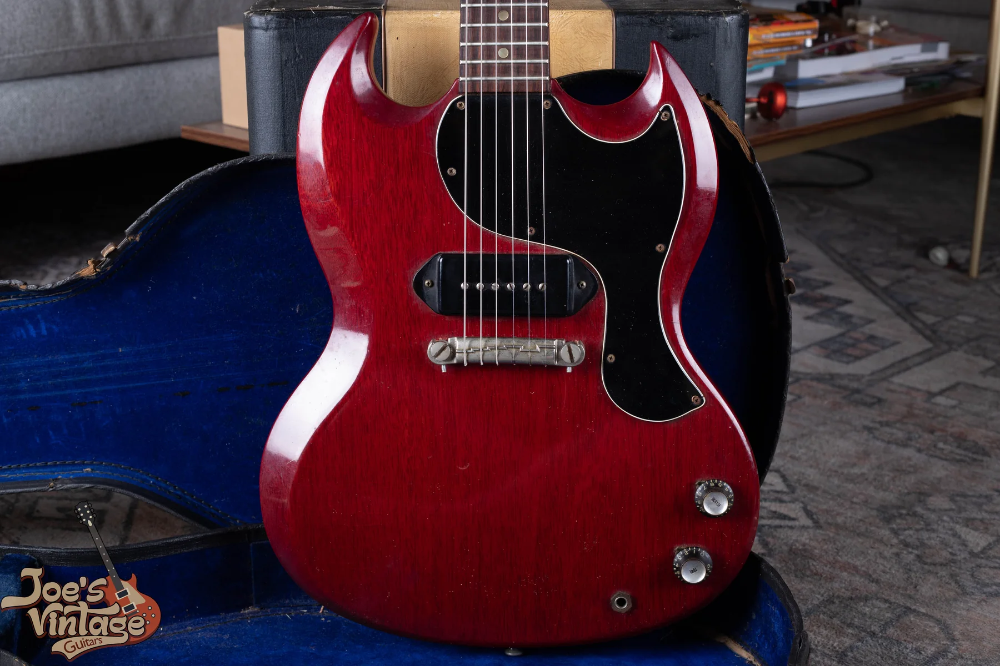
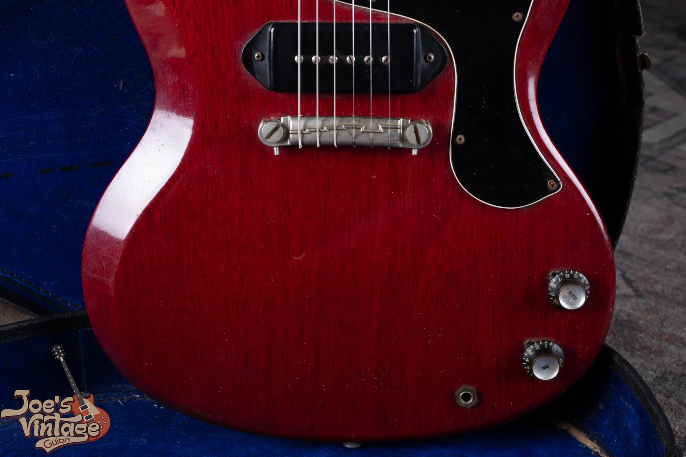
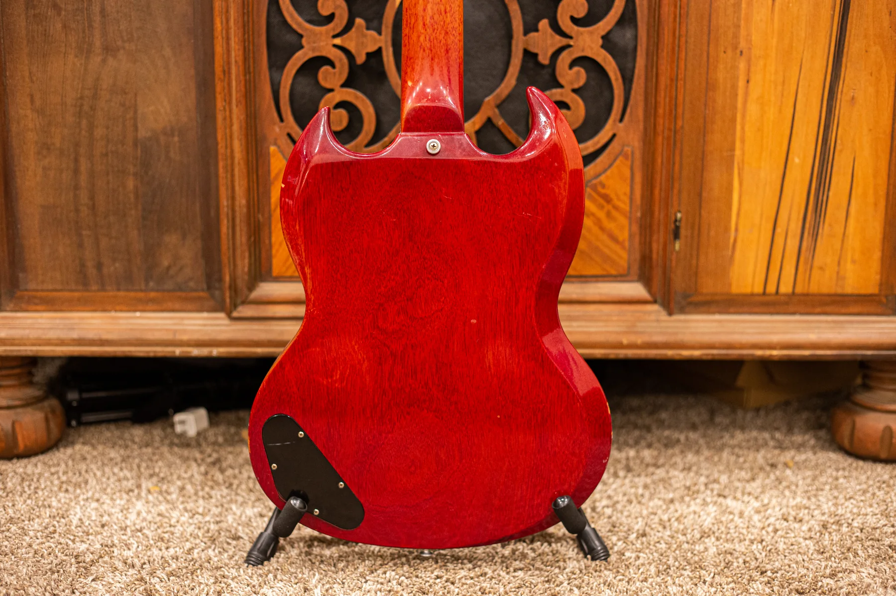

A cherry 1962 to 1964 Gibson SG Junior with its original finish and P-90, original case and minor parts changes falls around $6,000 to $8,500 as of October 2026. That comparison allows a replacement guard or bridge and doesn't establish the price of an untouched collector example.

My [Gibson SG dating and authentication guide](/gibson-sg-dating-guide/) covers the model and year checks. Once those are settled, this guide explains what belongs in the value comparison.

## SG Junior Price Ranges By Era

**As of October 2026. All ranges are in US dollars.** These are rounded completed-sale comparisons, excluding shipping and tax. They aren't dealer buying offers or guaranteed selling prices.

| Year And Configuration | Range | Condition Assumed |
| --- | --- | --- |
| 1962 To 1964 SG Junior, Cherry, Minor Changes | $6,000 to $8,500 | Original finish and P-90, original case, no reported structural repair. Allows replacement pickguard or bridge with original part retained, or added shielding. Not an untouched collector band. |

This is a comparison for guitars that retain their original finish and pickup but have limited changes elsewhere. The supporting descriptions include replacement pickguards, a replacement bridge with the original retained, and added removable shielding. These changes are disclosed in the comparison group instead of being described as untouched.

An original case is included, and the records report no structural repairs. I don't use this band for a refinished Junior, a routed body or a repaired headstock. A completely untouched example also needs its own comparison.

The range is grounded in at least three separate completed transactions from the Reverb Price Guide, with each linked description checked for finish, pickups, repairs and case. Seller descriptions provide the condition evidence; they aren't a substitute for examining your guitar. I haven't used current asking prices to fill missing rows.

<figure>

<figcaption>A single dog-ear P-90, two controls and a wraparound bridge on this SG Junior. Photo by Joe Dampt.</figcaption>

</figure>

## A Factory Junior Has Its Own Identity

The Junior's single P-90 and two controls are its factory design. A P-90 is a single-coil pickup, and the dog-ear version has mounting ears at the sides of its cover. The Junior isn't valued as a Standard with a missing pickup.

The fingerboard uses cream-colored celluloid dot inlays. They aren't pearl, and a supposed pearl-to-plastic transition isn't a reason to assign the guitar a different year or value group. I keep model identification grounded in the guitar's actual features.

The [Les Paul Junior reference](/post/gibson-les-paul-junior-guide/) covers the earlier Junior family and the move into the SG body. The slab-body Les Paul Juniors need separate price comparisons from the thin, pointed SG-shaped instruments discussed here.

## Early Names And Later Reissues

Gibson kept Les Paul branding on the earliest SG-shaped Juniors. That naming history can confuse an owner searching for comparable sales. A listing for a Les Paul Junior might describe an earlier body style or an SG-shaped guitar, so I read the instrument details rather than the title alone.

A modern model named after an early year is another separate category. The year in its marketing name doesn't turn it into an instrument manufactured in that year. Before comparing results, I establish which production period the seller is describing.

I don't assign extra value from a name on a replacement cover. The construction and established history determine the comparison. The label can help describe the guitar after those facts are clear.

## The Pickup And The Rest Of The Electronics

With only one pickup, its identity and condition are direct parts of the Junior's description. I distinguish the original pickup, a rewound original and a replacement. If the removed pickup is still in the case, I want to know that too.

Rewinding means replacing the wire in the pickup coil. It can restore a working instrument, but it needs to be disclosed in a collector appraisal. An original cover alone doesn't describe the history of what is beneath it.

The controls also belong in the record. A repaired wire and a complete replacement harness are different amounts of work. Owners don't need to inspect the wiring themselves before contacting me; a clear account of known changes is enough to start.

## Bridges, Vibratos And Added Pickups

A wraparound bridge both supports the strings and anchors their ends. Junior bridge arrangements changed during the vintage period, and some examples also have vibratos. I establish the factory configuration before comparing sale prices.

Later hardware can be useful for playing without being original to the guitar. I distinguish a reversible replacement from changes that required drilling or removing wood. The original part, if retained, should remain with the instrument.

Adding a second pickup changes the Junior's factory layout. Even if the added pickup is old, the routing and wiring work remain part of the appraisal. I wouldn't compare that guitar directly with an untouched one-pickup example.

<figure>

<figcaption>The Junior's single pickup and wraparound bridge define a different comparison from the two-pickup SG models. Photo by Joe Dampt.</figcaption>

</figure>

## Original Finish And Repair History

A Junior with ordinary wear to its original finish has a different history from a refinished guitar. I keep full refinishes, localized touch-up and overspray distinct. A single phrase such as good condition can hide those differences.

A headstock or heel repair also needs to be described early. The location, stability, appearance and documentation help define the instrument a buyer is considering. A clear picture of a known repair is useful; a distant image that conceals it isn't.

I don't assign a universal percentage deduction for every repaired Junior. The underlying era, other changes and comparable sale conditions need to be considered together. The goal is a supported comparison, not a string of guessed discounts.

A quality refret is accepted maintenance and preserves an otherwise all-original Junior's all-original classification. It takes it out of the museum-quality category. A reshaped neck is a separate change and should be named explicitly.

<figure>

<figcaption>A full back view documents areas a front photograph misses, including the neck joint and control cover. Photo by Joe Dampt.</figcaption>

</figure>

## Cases And Original Parts

Keep the case, loose parts and paperwork together. An original case is a different inclusion from a later replacement, even if both protect the guitar well. A case's condition and history belong in the package description.

Old photographs and repair invoices can help explain what happened during ownership. They don't establish every original feature by themselves. I use them alongside the instrument's condition and known changes.

Don't discard a worn bridge or a damaged pickup because it is no longer installed. It may explain the guitar's history. You can leave those pieces as they are while the initial appraisal is being discussed.

<figure>

<figcaption>This close view shows the fingerboard and an empty dot recess. Small missing parts should be described alongside the guitar's overall condition. Photo by Joe Dampt.</figcaption>

</figure>

## Reading The Market For A Junior

A dealer's asking price is a ceiling check, not a completed transaction. I use verified realized results to support a band and record their condition details. Listings marked sold can still show an old asking amount rather than the final negotiated price.

The seller's proceeds also differ from the buyer's total cost when selling fees or other expenses apply. If you are considering several options, compare what you expect to keep and when you expect to receive it. That makes an immediate offer and a possible future sale easier to evaluate.

The [vintage SG value hub](/vintage-gibson-sg-value-guide/) connects this guide with the other three core models. The [SG family reference](/post/vintage-gibson-sg-family-guide/) handles broader model comparisons.

<figure>

<figcaption>The back of the headstock helps document the tuners and surrounding wood before an appraisal. Photo by Joe Dampt.</figcaption>

</figure>

## Getting Your Junior Appraised

Start with complete front and back photographs and both sides of the headstock. Include the case, any removed parts and close-ups of known repairs. Tell me what you know about the guitar without filling gaps in its history with guesses.

I buy vintage SG Juniors nationwide from Mesa, Arizona. You can request a [free SG Junior appraisal](/free-appraisal/) and read about [selling your Gibson](/sell-my-gibson-guitar/) before choosing the next step.

