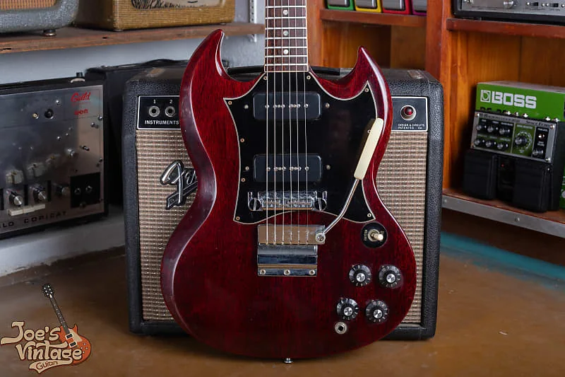
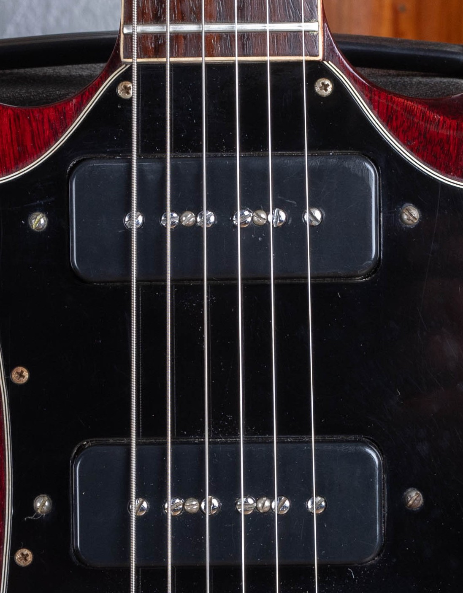
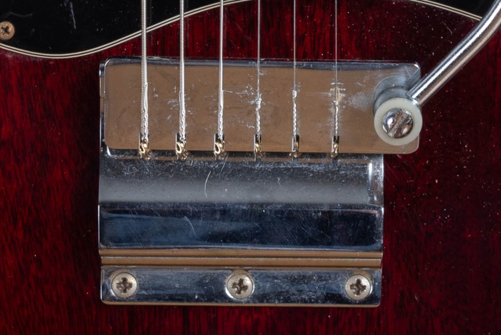
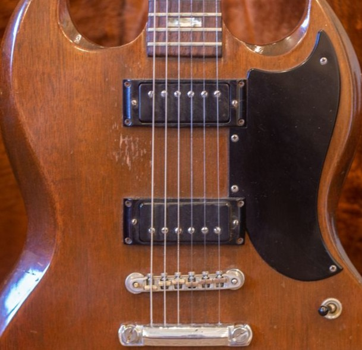

Vintage Gibson SG Special reference values run from $2,000 to $2,500 for the 1970s mini-humbucker version to $6,000 to $11,000 for clean original early P-90 guitars, as of October 2026. I list the years through 1979 below and flag the later dates that need confirmation.

For the year and model details, start with my [Gibson SG dating and authentication guide](/gibson-sg-dating-guide/). This page deals with how those established facts affect the appraisal.

## Gibson SG Special Values By Year

**As of October 2026. All ranges are in US dollars.** Each year is listed separately. **Repeated ranges are shared era references**, supported by at least three independent completed sales per comparison group, not three sales for every individual year. Match the condition notes below before applying a range.

| Year | Value Range | Comparison Group |
| --- | --- | --- |
| 1961 | $6,000 to $11,000 | Small Guard, P-90s |
| 1962 | $6,000 to $11,000 | Small Guard, P-90s |
| 1963 | $6,000 to $11,000 | Small Guard, P-90s |
| 1964 | $6,000 to $11,000 | Small Guard, P-90s |
| 1965 | $6,000 to $11,000 | Small Guard, P-90s |
| 1966 | $3,000 to $6,600 | Large Guard, P-90s |
| 1967 | $3,000 to $6,600 | Large Guard, P-90s |
| 1968 | $3,000 to $6,600 | Large Guard, P-90s |
| 1969 | $3,000 to $6,600 | Large Guard, P-90s |
| 1970 | $3,000 to $6,600 | Large Guard, P-90s |
| 1971 | $3,000 to $6,600 | Large Guard, P-90s |
| 1972 | $2,000 to $2,500 | Factory Mini-Humbuckers |
| 1973 | $2,000 to $2,500 | Factory Mini-Humbuckers |
| 1974 | $2,000 to $2,500 | Factory Mini-Humbuckers |
| 1975 | $2,000 to $2,500 | Factory Mini-Humbuckers |
| 1976 | $2,000 to $2,500* | Factory Mini-Humbuckers, Date Unconfirmed |
| 1977 | $2,000 to $2,500* | Factory Mini-Humbuckers, Date Unconfirmed |
| 1978 | Not Cataloged | No Original-Run Special Range |
| 1979 | Not Cataloged | No Original-Run Special Range |

The 1960s ranges apply to cherry P-90 Specials. The later range applies to factory mini-humbuckers, with original finish and the disclosed minor changes below. The brief SG Pro is a separate model; I don't price it from a Special row just because the body looks similar.

**About 1976 and 1977:** Reverb groups the mini-humbucker Special through 1977, while the period Gibson catalog and price-list record ends in 1975. Those two rows are conditional references for the same version, not confirmation that a guitar was built in that year. A purchase receipt or warranty date can be later than manufacture. No regular original-run Special is priced for 1978 or 1979 here.

### Condition Behind The Ranges

**1961 To 1965 SG Special, Cherry:** All-original examples in excellent condition with original case and no structural repairs. Includes factory wraparound and short-vibrato configurations; case wear varies.

**1966 To 1971 Large-Guard P-90 Special:** Original cherry finish and P-90s, no disclosed structural repair. Played to exceptionally clean, original or period case. Minor screw or tuner changes accepted.

**1972 To 1977 Mini-Humbucker Special Reference:** Original finish and factory mini-humbuckers, no disclosed structural repair. Light to normal wear; replaced tuners, a pot or strap buttons accepted. Case can be replaced or absent.

I use rounded Reverb Price Guide final transaction prices and Heritage auction results, checked against the instrument descriptions. The records span 2020 to 2026, depending on the group; the review date doesn't turn an older sale into a current transaction. Auction totals include the buyer's premium. Shipping and tax are excluded, and these aren't dealer buying offers or guaranteed selling prices.

Seller descriptions supply the condition evidence behind these comparisons. I still need to examine the actual guitar before treating its finish, pickups or repair history as established. A repeated era range is a starting point for that appraisal, not a separate sale record for each year.

<figure>

<figcaption>The two P-90 pickups and large pickguard on this SG Special are visible from the front. Photo by Joe Dampt.</figcaption>

</figure>

## The Two-P-90 Special

A P-90 is a single-coil pickup. The classic vintage Special uses two of them, with a selector switch and separate controls. That gives it its own configuration within the SG family rather than making it an unfinished Standard.

When comparing two Specials, I want the pickup arrangement to remain comparable. Replacing the pickups, rewinding one or routing the body for a different type changes the description. An old P-90 in a modified guitar doesn't automatically make the complete instrument original.

The bridge and vibrato belong in that description too. A guitar retaining its factory arrangement presents a different history from one converted later. I don't assume that a convenient modern bridge is a factory feature because it fits the posts.

<figure>

<figcaption>The Special uses two P-90 pickups in this configuration. Replacing them with humbuckers changes the instrument being valued. Photo by Joe Dampt.</figcaption>

</figure>

## Small-Guard And Large-Guard Examples

The small-guard and large-guard periods are useful market groupings once the instrument has been identified. They aren't condition grades. Either period can include exceptionally preserved guitars, worn originals and substantially altered examples.

I compare within the relevant group before considering the individual differences. An early date isn't a reason to ignore a repaired neck, and a later date isn't a reason to discount a clean instrument without comparable sales.

A guitar's visible appearance can also be shaped by replacement parts. The price discussion should follow the established construction and history, rather than the resemblance to a photograph of a more expensive example.

<figure>

<figcaption>The short vibrato assembly differs from the long covered Maestro used on many Standards. I record which parts remain with the guitar. Photo by Joe Dampt.</figcaption>

</figure>

## Mini-Humbucker Specials

Some early 1970s Specials received mini-humbuckers at the factory. A mini-humbucker is a smaller two-coil pickup. Those guitars need their own comparisons instead of being treated as changed P-90 Specials automatically.

The exact model still needs to be settled, because other SG relatives can also have unfamiliar pickups or control layouts. I use the [SG family reference](/post/vintage-gibson-sg-family-guide/) to keep the model history separate from the valuation.

I don't infer a price relationship from pickup size alone. What supports a band is a set of completed sales for comparable guitars, with the relevant condition details recorded. A broader label can conceal differences that an owner needs explained.

<figure>

<figcaption>This later Special has small humbuckers and a separate stopbar. It needs a different comparison from a 1960s P-90 Special. Photo by Joe Dampt.</figcaption>

</figure>

## Original Finish And Unusual Colors

Original finish means the coating applied to the guitar when it was made. Refinish and overspray describe later work, and I keep them separate. A guitar can be visually attractive while still needing a changed-finish comparison.

An unusual color needs established factory history before it receives a special comparison group. I don't apply a color premium from a photograph alone. Lighting, aging and later work can all complicate what an owner is seeing.

For an initial appraisal, clear photographs in ordinary indirect light are enough to begin. Keep any older pictures or written records with the guitar. They can help explain changes over time without replacing an examination of the instrument itself.

## Neck Repairs And Other Changes

The location and quality of a structural repair belong in the appraisal description. A repaired headstock, a repaired heel and a finish crack aren't interchangeable conditions. If you're unsure what you're looking at, describe the uncertainty and send a close photograph.

I also separate permanent modifications from replaceable parts. Extra routing or drilled holes remain part of the guitar even if someone later installs period hardware. A restored appearance doesn't erase the work that preceded it.

A quality refret preserves the all-original classification of an otherwise all-original Special. It removes the guitar from the museum-quality category. Neck reshaping is a separate alteration, so it shouldn't disappear under the phrase fret work.

No single repair deduction fits every Special. I compare the whole guitar with completed sales whose condition is documented. Stacking unsourced discounts for each issue can make the arithmetic look more certain than the evidence.

## Playing Condition And The Included Case

An appraisal needs a straightforward account of how the guitar works. Tell me if either pickup cuts out, a control is noisy or a note buzzes. You don't need to remove components or guess at the repair before making contact.

Include the case in the photographs. An original case, a later Gibson case and a modern replacement describe different packages. Loose original parts and repair records should stay with the instrument, even if they aren't currently installed.

I wouldn't buy replacement vintage parts just to prepare an SG Special for an initial appraisal. The cost of those parts isn't guaranteed to return in the sale price. Start by documenting the guitar as it stands.

## Comparing A Sale With An Offer

Completed sale prices and dealer asking prices answer different questions. The first records a transaction; the second describes what is being requested. I keep both the amount and its terms visible when discussing a comparison.

An owner should also distinguish the buyer's total payment from the seller's proceeds after costs. Selling fees, repairs and shipping can change what remains. A cash offer and a possible future retail sale need that context before their numbers can be compared fairly.

For the other core models, use the [vintage SG value hub](/vintage-gibson-sg-value-guide/). It keeps the Special's appraisal separate from the Junior, Standard and Custom.

## An Appraisal For Your SG Special

Send the front, back and both sides of the headstock, then include the case and any known repairs. Add what you know about the pickups, finish or previous work. It's fine if the history is incomplete.

I buy vintage Gibsons nationwide from Mesa, Arizona. A [free SG Special appraisal](/free-appraisal/) is the starting point for discussing the instrument, and my [Gibson selling page](/sell-my-gibson-guitar/) explains the buying process.
