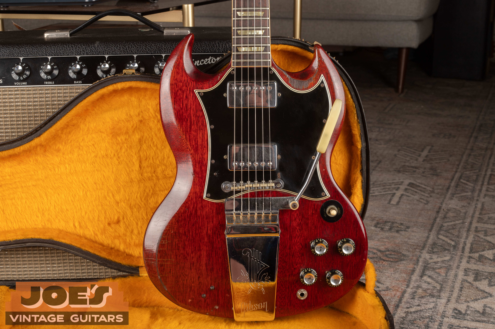

Vintage Gibson SG Standard guide values run from $2,500 to $3,000 for typical 1970s cherry guitars to $13,000 to $23,000 for early small-guard examples, as of October 2026. Original humbuckers, the factory vibrato and an unbroken neck put the strongest examples near the top of their group.

For the year and original specification, use my [Gibson SG Standard dating and identification guide](/gibson-sg-dating-guide/#sg-standard). This guide covers market value and the features that move it.

## Gibson SG Standard Values By Year

**Reviewed October 2026. US dollars.** Adjacent years can share a range. Read the condition notes with the table.

| Year | Value Range | Configuration And Year Notes |
| --- | --- | --- |
| 1961 | $13,000 to $23,000 | Small guard, early humbuckers and sideways vibrato. |
| 1962 | $13,000 to $23,000 | Small guard, early humbuckers and sideways vibrato. |
| 1963 | $13,000 to $23,000 | Small guard; long lyre Vibrola becomes familiar. |
| 1964 | $13,000 to $23,000 | Small guard; long lyre Vibrola becomes familiar. |
| 1965 | $11,000 to $13,000 | Nut-width and plating transition; small guard. |
| 1966 | $4,500 to $7,500 | Small to large guard transition; match actual version. |
| 1967 | $4,500 to $7,500 | Large guard, full-size humbuckers and lyre Vibrola. |
| 1968 | $4,500 to $7,500 | Large guard, full-size humbuckers and lyre Vibrola. |
| 1969 | $4,500 to $7,500 | Large guard, full-size humbuckers and lyre Vibrola. |
| 1970 | $4,500 to $7,500 | Large guard, full-size humbuckers and lyre Vibrola. |
| 1971 | $4,500 to $7,500 | Large-guard Standard only; SG Deluxe excluded. |
| 1972 | $2,500 to $3,000 | Standard returns; identify it separately from Deluxe. |
| 1973 | $2,500 to $3,000 | Small guard, block inlays and later bridge configurations. |
| 1974 | $2,500 to $3,000 | Small guard, block inlays and later bridge configurations. |
| 1975 | $2,500 to $3,000 | Small guard, block inlays and later bridge configurations. |
| 1976 | $2,500 to $3,000 | Small guard, block inlays and later bridge configurations. |
| 1977 | $2,500 to $3,000 | Small guard, block inlays and later bridge configurations. |
| 1978 | $2,500 to $3,000 | Small guard, block inlays and later bridge configurations. |
| 1979 | $2,500 to $3,000 | Small guard, block inlays and later bridge configurations. |

The 1966 large-guard range applies after the redesign; an early small-guard guitar needs the earlier configuration considered. The later 1960s range includes cherry and walnut. The 1971 row excludes the SG Deluxe, and 1972 applies to the returning Standard. The 1970s range covers cherry; other finishes need a separate appraisal.

### Condition Behind The Ranges

**1961 To 1964 Small-Guard Standard:** Original cherry finish and vintage original pickups, no disclosed structural repair, original case. Very Good to Excellent. Minor binding maintenance, a damaged knob or missing pickup decal can be present. Factory vibrato versions included.

**1965 SG Standard, Cherry, Small Guard And Maestro:** Clean, all-original examples with original case and no structural repairs; normal light wear accepted. Comparable seller grades range from Very Good to Excellent.

**1966 To 1971 Large-Guard Standard:** Original cherry or later walnut finish, pickups and principal hardware, original case, no disclosed structural repair. Normal light wear; a replacement nut can be present.

**1972 To 1979 SG Standard:** Cherry or faded cherry, original finish and pickups, original case, no disclosed structural break. Played to excellent; replacement strap buttons accepted. Non-cherry finishes excluded.

<figure>

<figcaption>Two humbuckers and a sideways vibrato on an early SG Standard. Photo by Joe Dampt.</figcaption>

</figure>

## Early Standards: Pickups And The Factory Vibrato

The early Standard combines two humbuckers, a bound rosewood fingerboard, trapezoid inlays and an ABR-1 bridge. Its small pickguard leaves the pickups in separate mounting rings. On a collector example, those original parts and an unbroken neck belong together.

PAF means Patent Applied For, the wording on early Gibson pickup decals. PAF and Patent Number examples overlap in the first SG years, so the early band covers more than one pickup combination. It doesn't assign every 1961 or 1962 guitar the same premium merely for its date.

<figure>

<figcaption>The sideways vibrato with its folded arm. Photo by Joe Dampt.</figcaption>

</figure>

The sideways vibrato is a distinctive part of the earliest Standard. Some players prefer the later spring-style lyre Vibrola, but replacing one system with another can leave a guitar with changed parts and extra holes. A complete original sideways assembly still belongs with the guitar even if its owner uses the arm sparingly.

### The Long Lyre Vibrola

Around 1963 the long Maestro assembly with the engraved lyre cover becomes familiar on the Standard. Its cover, arm and mounting hardware form one factory package. A missing arm is a different issue from a drilled stopbar conversion or an altered top.

<figure>

<figcaption>The Gibson lettering and engraved lyre on the Vibrola cover. Photo by Joe Dampt.</figcaption>

</figure>

The 1965 band uses cherry small-guard guitars with their original cases. Nut widths and nickel-to-chrome hardware change around this period. That's a narrower comparison than the early range, which includes more pickup and vibrato variation.

## Large Guards And Later Finishes

<figure>

<figcaption>A large-guard SG Standard with a long lyre Vibrola. Photo by Joe Dampt.</figcaption>

</figure>

The batwing guard surrounds the pickups and supports them through the guard. It appears during 1966, with early small-guard guitars still requiring the earlier configuration considered. The later look usually includes the long lyre Vibrola and eventually taller witch-hat knobs.

The $4,500 to $7,500 range includes original cherry and walnut guitars. I don't treat it as a fixed finish premium or discount. The guard, finish, pickup set and repairs determine where an individual Standard belongs.

Later Patent Number and T-Top humbuckers are part of the correct period specification. T-Top refers to a molded marking on the pickup bobbin, not a promise that the exterior decal alone can date it. An original later pickup pair shouldn't be valued as though it were a pair of early PAFs.

## The Returning 1970s Standard

The SG Deluxe briefly takes the Standard's place during the early 1970s. When the Standard returns in 1972, it has a small guard again, with smaller block inlays and later construction. The broad rectangular bridge is often called a harmonica bridge.

The $2,500 to $3,000 band is based on cherry or faded-cherry guitars with original pickups and cases. Non-cherry finishes are excluded from that specific band. Walnut, natural, tobacco sunburst and white shouldn't be called aftermarket colors simply because the table prices cherry.

### Color Outside The Cherry Band

<figure>

<figcaption>Blue-green finish around four reflector knobs and the pickup switch. Photo by Joe Dampt.</figcaption>

</figure>

Factory color can change who is looking for a Standard and what they will pay for it. A rare original finish is also a different market from a later respray in the same color. The [SG family comparison guide](/post/vintage-gibson-sg-family-guide/) supplies the broader model and finish context.

Non-cherry finishes need an individual appraisal. I consider the original color, retained parts and condition together before placing a guitar outside the cherry range.

## Repairs, Original Parts And Value

An unbroken neck, original finish and factory pickups are the baseline for a collector SG Standard. A repaired headstock, a full refinish and a missing pickup change different parts of that package. Normal playing wear and a good refret deserve a separate assessment from structural damage.

Repairs and alterations affect the guitar as a whole. A guitar that's already priced as played, serviced or altered has some of those differences reflected in its starting range. A quality refret preserves an otherwise all-original guitar's classification while taking it out of the museum-quality category.

## Keep The Complete Standard Together

Original tuners, pickup covers, the vibrato arm and case can be difficult to replace with the right period parts. Keep removed originals even if the guitar currently wears replacements. A well-executed refret is maintenance; a reshaped neck is a more permanent change to what the buyer receives.

For the other models, the [SG value overview](/vintage-gibson-sg-value-guide/) puts Standard, Special, Junior and Custom side by side. For this guitar, send photographs and repair history through the [free guitar appraisal](/free-appraisal/) page. A retail reference and a dealer buying offer serve different purposes, with selling costs and margin included in the latter.
