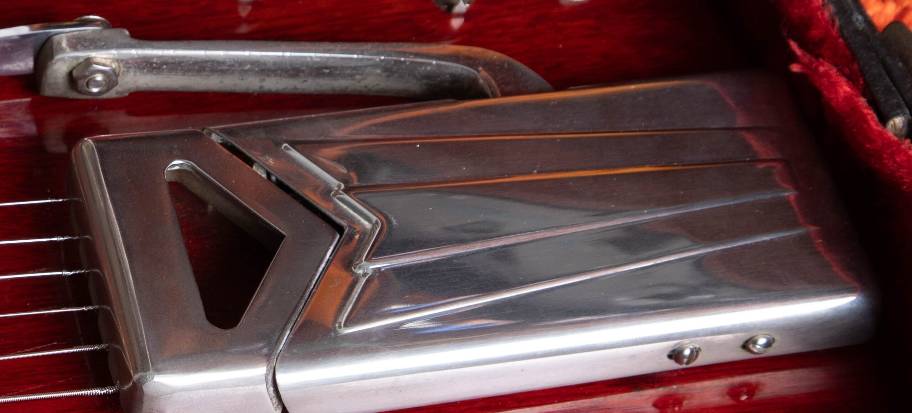
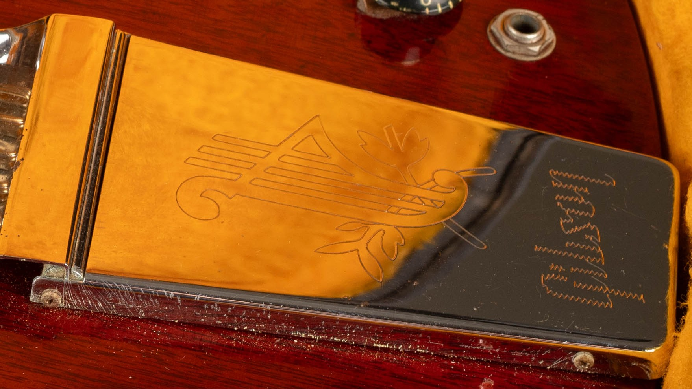

Vintage Gibson SG Standard reference values run from $2,400 to $3,000 for typical 1970s guitars to $13,500 to $25,000 for early small-guard examples, as of October 2026. I list each year from 1961 through 1979 below, with separate comparisons for the major configurations.

My [Gibson SG dating and authentication guide](/gibson-sg-dating-guide/) covers the identification steps. Once the model and period are settled, the appraisal can focus on what a buyer would actually receive.

## Gibson SG Standard Values By Year

**As of October 2026. All ranges are in US dollars.** Each year is listed separately. **Repeated ranges are shared era references**, supported by at least three independent completed sales per comparison group, not three sales for every individual year. Match the condition notes below before applying a range.

| Year | Value Range | Comparison Group |
| --- | --- | --- |
| 1961 | $13,500 to $25,000 | Small Guard, Factory Vibrato |
| 1962 | $13,500 to $25,000 | Small Guard, Factory Vibrato |
| 1963 | $13,500 to $25,000 | Small Guard, Factory Vibrato |
| 1964 | $13,500 to $25,000 | Small Guard, Factory Vibrato |
| 1965 | $12,000 to $14,000 | Small Guard And Maestro |
| 1966 | $5,000 to $8,000 | Large Guard, Cherry |
| 1967 | $5,000 to $8,000 | Large Guard, Cherry |
| 1968 | $5,000 to $8,000 | Large Guard, Cherry |
| 1969 | $5,000 to $8,000 | Large Guard, Cherry |
| 1970 | $5,000 to $8,000 | Large Guard, Cherry |
| 1971 | $5,000 to $8,000 | Large Guard, Cherry |
| 1972 | $2,400 to $3,000 | Standard, Cherry |
| 1973 | $2,400 to $3,000 | Standard, Cherry |
| 1974 | $2,400 to $3,000 | Standard, Cherry |
| 1975 | $2,400 to $3,000 | Standard, Cherry |
| 1976 | $2,400 to $3,000 | Standard, Cherry |
| 1977 | $2,400 to $3,000 | Standard, Cherry |
| 1978 | $2,400 to $3,000 | Standard, Cherry |
| 1979 | $2,400 to $3,000 | Standard, Cherry |

For 1971, the row applies to a Standard retaining the large-guard configuration. The short-lived SG Deluxe belongs in its own comparison; a 1972 instrument should be identified as the returning Standard before using that row. The early range includes both PAF and Patent Number pickup examples, so it doesn't assign a fixed premium to every early year.

The 1965 band is narrower because the comparisons match cherry small-guard, Maestro-equipped guitars with original cases. The surrounding era bands cover more condition variation. Factory custom colors and repaired or refinished instruments need separate comparisons.

### Condition Behind The Ranges

**1961 To 1964 Small-Guard Standard:** Original cherry finish and vintage original pickups, no disclosed structural repair, original case. Very Good to Excellent. Minor binding maintenance, a damaged knob or missing pickup decal can be present. Factory vibrato versions included.

**1965 SG Standard, Cherry, Small Guard And Maestro:** Clean, all-original examples with original case and no structural repairs; normal light wear accepted. Comparable seller grades range from Very Good to Excellent.

**1966 To 1971 Large-Guard Standard:** Original cherry finish, pickups and principal hardware, original case, no disclosed structural repair. Normal light wear; a replacement nut can be present.

**1972 To 1979 SG Standard:** Cherry or faded cherry, original finish and pickups, original case, no disclosed structural break. Played to excellent; replacement strap buttons accepted. Factory custom colors excluded.

I use rounded Reverb Price Guide final transaction prices and Heritage auction results, checked against the instrument descriptions. The records span 2020 to 2026, depending on the group; the review date doesn't turn an older sale into a current transaction. Auction totals include the buyer's premium. Shipping and tax are excluded, and these aren't dealer buying offers or guaranteed selling prices.

Seller descriptions supply the condition evidence behind these comparisons. I still need to examine the actual guitar before treating its finish, pickups or repair history as established. A repeated era range is a starting point for that appraisal, not a separate sale record for each year.

<figure>

<figcaption>Two covered pickups, four controls and the sideways vibrato on an early SG Standard. Photo by Joe Dampt.</figcaption>

</figure>

## Early Les Paul-Branded Standards

The pointed body arrived while Gibson was still using the Les Paul name. An early guitar can therefore belong to the SG Standard family without being labeled the way a later SG is. A new guitar with a 1961 reissue designation is a separate instrument from one made in 1961.

For the appraisal, I want the original pickup configuration and vibrato described along with the year. A sideways vibrato is the early mechanism whose arm moves across the face of the guitar. Its presence is part of the configuration, but it doesn't establish the originality of the rest of the instrument.

A completed sale for a heavily repaired early Standard can be relevant to another repaired early Standard. It shouldn't be used without qualification to establish the range for an excellent, unrepaired example. The original pickups alone don't erase changed tuners, finish work or structural repairs.

<figure>

<figcaption>The sideways vibrato is part of the early SG configuration. Its originality and completeness belong in the appraisal. Photo by Joe Dampt.</figcaption>

</figure>

## Small Guards And Later Standards

The small-guard period includes changes that affect the comparison between instruments. I keep the actual neck, hardware and pickup combination in the appraisal record. I don't assign every guitar a standard premium merely because a listing names a desirable year.

A long Maestro vibrato, a factory Bigsby and a later stopbar conversion need different descriptions. A replacement that improves playability for one owner can still change the collector comparison. The appraisal should explain that distinction without dismissing the guitar as an instrument.

The large-guard period also needs its own completed-sale evidence. I don't work backward from an early Standard's price by subtracting a guessed percentage. That calculation would conceal the differences between the examples rather than measure them.

<figure>

<figcaption>This later Standard has the large pickguard and long Maestro assembly. I keep it separate from the small-guard comparison. Photo by Joe Dampt.</figcaption>

</figure>

## Original Humbuckers And Their History

A humbucker uses two coils to reduce electrical hum. The Standard's full-size humbuckers are part of its identity, but the exact installed set still needs to be established. Early PAF, Patent Number and later pickups shouldn't be treated as interchangeable entries in a price comparison.

Original covers, replaced covers, rewound coils and replacement pickups are distinct descriptions. If an owner has an invoice or photographs from previous work, I keep those with the instrument's record. The goal is a description that follows the guitar through a sale.

My [Gibson PAF and Patent Number pickup reference](/post/gibson-paf-patent-number-pickup-guide/) covers pickup examination. I don't need an owner to unsolder covers or disturb original wiring to get an initial value opinion.

A loose vintage pickup's asking price isn't an amount I automatically add to an SG. The instrument is being sold as a whole, with its neck, finish, electronics and history. Adding a parts catalog together can produce an inflated figure that no comparable guitar sale supports.

<figure>

<figcaption>The long engraved Maestro cover is one part of the complete assembly. A missing arm or changed tailpiece needs its own description. Photo by Joe Dampt.</figcaption>

</figure>

## Finish, Repairs And Collector Condition

An original cherry finish with wear and a later cherry refinish may look similar in a small photograph. They represent different histories and need different comparisons. I keep full refinishing, localized touch-up and clear overspray separate in the description.

Structural repairs need the same care. A headstock repair and a neck-joint repair aren't interchangeable just because both involve glue. Clear photographs, repair records and an account of the guitar's current stability help define what is being valued.

I don't apply a universal repair percentage. A guitar with multiple changes has to be compared as a complete instrument, because those changes don't necessarily behave like independent deductions. Repair quality and the underlying model both affect the comparison.

A quality refret is accepted maintenance and preserves the all-original classification of an otherwise all-original guitar. It takes the guitar out of the museum-quality category. Removing wood to change the neck profile is a separate alteration and needs its own disclosure.

## Factory Hardware And Later Conversions

Replacing a bridge without changing the wood is a different event from drilling for a different tailpiece. I record what happened and whether the removed original parts are included. Reinstalling an old part doesn't undo holes or other permanent changes.

A vibrato arm, original bridge or set of tuners stored in the case can clarify the history. Leave those parts together with any paperwork. You don't need to put them back on before sending the first photographs.

I also avoid assuming that a period part was installed at the factory. A correct older replacement can be useful, but the description should still identify it as a replacement when that is known. Accurate wording makes the price comparison easier to defend.

## The Standard Within The SG Family

A Standard shouldn't be priced from Special or Custom sales solely because the body outline looks similar. The models have different pickup arrangements and appointments. My [vintage SG value hub](/vintage-gibson-sg-value-guide/) connects the four model appraisals.

The [SG family reference](/post/vintage-gibson-sg-family-guide/) covers the wider history. SG Deluxe, numbered SG models and later reissues also require their own identification before they enter a value comparison.

If the model is uncertain, I would rather leave the appraisal conditional than label the guitar from one familiar feature. That keeps a mistaken name from becoming the foundation of a price estimate.

<figure>

<figcaption>This close view shows the color around the controls. A photograph records appearance; establishing a factory custom finish needs the guitar's wider history. Photo by Joe Dampt.</figcaption>

</figure>

## What To Send With An SG Standard

Photograph the complete front and back, both sides of the headstock, and the case. Add a close view of any known repair or altered area. Include loose parts and records, even if you don't know whether they originally came with the guitar.

Tell me what you know about ownership and work done to it. Plain language is fine: the bridge was changed, the pickup stopped working, or the neck was repaired before you bought it. Those facts are more useful than a condition grade without an explanation.

You can request a [free SG Standard appraisal](/free-appraisal/) before deciding how to sell. If you're already considering an offer, my [Gibson buying page](/sell-my-gibson-guitar/) explains the process.
