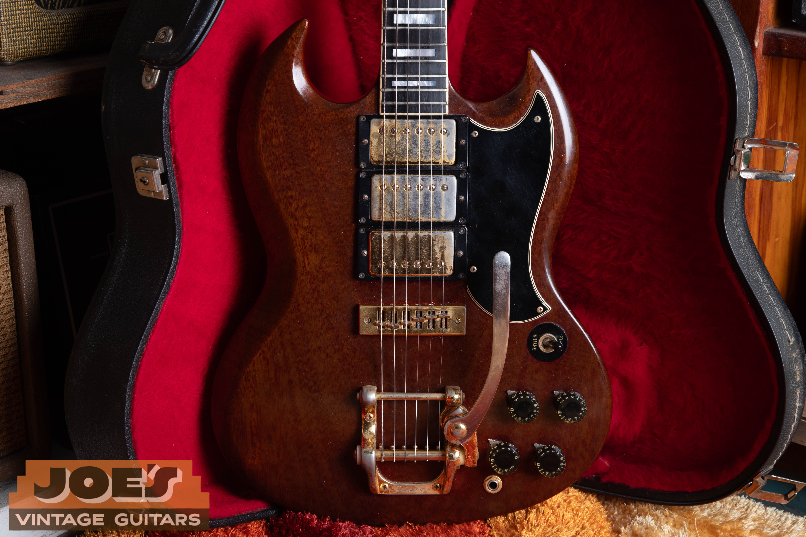
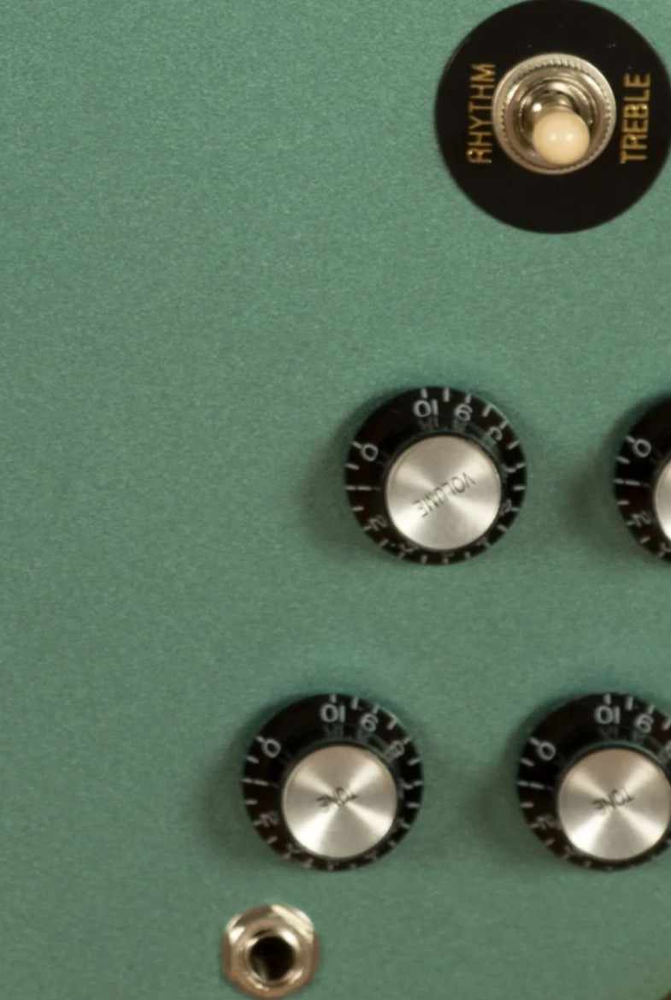

Vintage Gibson SG guide values range from $2,000 to $2,500 for 1970s mini-humbucker Specials to $16,950 to $24,350 for early Standards, as of October 2026. The model, pickups, finish and repair history explain the spread; I've listed the four main models through 1979 below.

For the year and original specification, use my [Gibson SG dating and identification guide](/gibson-sg-dating-guide/). This guide covers market value and the features that move it.

## SG Values By Year And Model

**Reviewed October 2026. US dollars.** Adjacent years can share a range. Read the condition notes with the table.

| Year | Standard | Special | Junior | Custom | Year Notes | Shipments |
| --- | --- | --- | --- | --- | --- | --- |
| 1961 | $19,600 to $24,350 | $5,500 to $10,000 | $5,500 to $8,000 | $16,000 to $22,000 | Pointed SG body; earlier rounded Special excluded. | Not listed |
| 1962 | $13,000 to $23,000 | $5,500 to $10,000 | $5,500 to $8,000 | $16,000 to $22,000 | Small-guard era; factory pickups and vibratos. | Standard: 1,449; Special: 1,336; Junior: 2,395; Custom: 298 |
| 1963 | $16,950 to $21,650 | $5,500 to $10,000 | $5,500 to $8,000 | $20,700 to $27,400 | Small-guard era; factory pickups and vibratos. | Standard: 1,445; Special: 1,391; Junior: 2,318; Custom: 264 |
| 1964 | $13,000 to $23,000 | $5,500 to $10,000 | $5,100 to $6,600 | $19,800 to $26,400 | Small-guard era; factory pickups and vibratos. | Standard: 1,375; Special: 2,022; Junior: 3,364; Custom: 130 |
| 1965 | $13,500 to $17,400 | $4,900 to $6,400 | $3,750 to $5,000 | $12,600 to $16,650 | Small-guard era; factory pickups and vibratos. | Standard: 1,731; Special: 2,618; Junior: 3,570; Custom: 236 |
| 1966 | $8,150 to $10,550 | $3,000 to $6,000 | $3,300 to $4,350 | $9,450 to $12,600 | Guard transition; small and large versions overlap. | Standard: 1,046; Special: 1,870; Junior: 1,928; Custom: 125 |
| 1967 | $7,550 to $9,800 | $3,000 to $6,000 | $3,250 to $4,300 | $9,150 to $12,200 | Large guards; later finishes and neck changes. | Standard: 1,154; Special: 1,664; Junior: 1,021; Custom: 43 |
| 1968 | $6,050 to $7,650 | $3,000 to $6,000 | $3,350 to $4,400 | $9,250 to $12,300 | Large guards; later finishes and neck changes. | Standard: 1,340; Special: 1,461; Junior: 561; Custom: 264 |
| 1969 | $4,500 to $7,500 | $3,000 to $6,000 | $3,400 to $4,500 | $5,100 to $6,750 | Large guards; later finishes and neck changes. | Standard: 3,354; Special: 2,378; Junior: 751; Custom: 451 |
| 1970 | $3,400 to $4,550 | $3,350 to $4,400 | $2,500 to $4,000 | $3,350 to $4,600 | Large guards; later finishes and neck changes. | Standard: 5,048; Special: 2,862; Junior: 938; Custom: 317 |
| 1971 | $3,350 to $4,350 | $3,400 to $4,450 | $2,500 to $4,000 | $2,850 to $4,050 | Deluxe and Pro excluded; Custom changes configuration. | Special: 1,571; Custom: 395 |
| 1972 | $2,500 to $3,000 | $2,000 to $2,500 | Outside Original Run | $2,900 to $4,050 | Standard and mini-humbucker Special return. | Standard: 1,009; Special: 749; Custom: 400 |
| 1973 | $2,500 to $3,000 | $2,000 to $2,500 | Outside Original Run | $2,850 to $4,050 | Later small guards; factory model determines the range. | Standard: 3,009; Special: 3,534; Custom: 775 |
| 1974 | $2,500 to $3,000 | $2,000 to $2,500 | Outside Original Run | $2,500 to $3,350 | Later small guards; factory model determines the range. | Standard: 2,295; Special: 2,183; Custom: 939 |
| 1975 | $2,500 to $3,000 | $2,000 to $2,500 | Outside Original Run | $2,450 to $3,350 | Later small guards; factory model determines the range. | Standard: 2,042; Special: 593; Custom: 149 |
| 1976 | $2,500 to $3,000 | $2,000 to $2,500 | Outside Original Run | $2,550 to $3,150 | 549 Special shipments. | Standard: 2,834; Special: 549; Custom: 376 |
| 1977 | $2,500 to $3,000 | $2,000 to $2,500 | Outside Original Run | $2,500 to $3,150 | 232 Special shipments. | Standard: 2,618; Special: 232; Custom: 279 |
| 1978 | $2,500 to $3,000 | $2,000 to $2,500 | Outside Original Run | $2,500 to $3,100 | Two Special shipments. | Standard: 2,503; Special: 2; Custom: 217 |
| 1979 | $2,500 to $3,000 | No Range | Outside Original Run | $2,450 to $3,050 | No original-run Junior or Special range. | Not listed |

The Special shipment dates above come from my [Gibson shipment record](/post/gibson-shipping-totals-1948-1979/#sg-jr-spec-62-78). Shipping can follow manufacture. A small-guard 1966, a later small-guard 1971 Custom, an SG Deluxe or an SG Pro needs the correct configuration identified before a range is applied.

### Condition Behind The Ranges

Each model has its own condition limits: early Standards include intact factory vibratos; early Specials are clean P-90 guitars; early Juniors allow disclosed maintenance; early Customs include older white-finish sales. The later bands generally include more wear and minor changes. The model sections below explain those differences.

## Start With The SG Model

The SG body is shared by guitars built for very different buyers. A Standard has two full-size humbuckers, a Special has two P-90s in its classic 1960s form, and a Junior has one P-90. The Custom adds a third humbucker, ebony fingerboard, elaborate binding and gold hardware.

The pointed design arrived in 1961. Les Paul branding remains on some early SG-shaped models. A Les Paul name on the guitar therefore doesn't turn it into the earlier single-cutaway design.

The SG TV also belongs in the family discussion. Cream and white TV instruments aren't included in these ordinary cherry Junior or Special bands. Establish the original model and finish before applying a color-specific value.

### Standard: The Two-Humbucker Reference

Small-guard Standards with early pickups and their factory vibratos sit at the upper end of this group's ordinary production ranges. PAF and Patent Number pickups overlap in the early period; the complete original pair and the guitar around it carry more information than a decal alone. The sideways vibrato and the later long lyre Vibrola also create different buying preferences.

My [SG Standard value guide](/vintage-gibson-sg-standard-value-guide/) separates early small guards, the 1965 transition, large guards and the returning 1970s model. It keeps the brief SG Deluxe apart from the Standard.

### Special: P-90s Or Mini-Humbuckers

<figure>

<figcaption>A cherry SG Special with two P-90 pickups and a large pickguard. From my archive.</figcaption>

</figure>

The 1960s Special's two soapbar P-90s and bound fingerboard give it its own place between Junior and Standard. It isn't a Standard with cheaper pickups. Changing those P-90s to full-size humbuckers can also involve cutting wood, which affects the collector market beyond the cost of replacing two parts.

Mini-humbuckers were standard on the returning Special from 1972. Those smaller humbuckers define the later version, rather than an occasional option on the P-90 guitar. The [SG Special value guide](/vintage-gibson-sg-special-value-guide/) covers both and follows its continuing production through the later 1970s.

### Junior: One Original Pickup

<figure>

<figcaption>A small-guard SG Junior with a dog-ear P-90 and wraparound bridge. From my archive.</figcaption>

</figure>

A Junior concentrates much of its collector appeal in a simple package: original P-90, cherry finish, wraparound bridge and unbroken neck. Early versions use a dog-ear pickup cover with mounting tabs; the large-guard version uses a soapbar-style P-90. The simpler layout makes a modified pickup or added control especially visible.

The [SG Junior value guide](/vintage-gibson-sg-junior-value-guide/) covers the original run through 1971. Later single-pickup student models need their own model names rather than a borrowed Junior price.

### Custom: White, Walnut And Three Pickups

<figure>

<figcaption>A walnut SG Custom with three humbuckers and gold hardware. From my archive.</figcaption>

</figure>

The early white Custom's three original humbuckers and gold hardware are expensive parts of the complete instrument. A replaced pickup or stripped finish changes the package substantially. Ordinary gold-plating wear is different from replacing the whole hardware set.

Later walnut Customs belong to a different market from early white small-guard examples. My [SG Custom value guide](/vintage-gibson-sg-custom-value-guide/) covers both finishes and the later factory Bigsby and stopbar configurations.

## The Changes That Divide SG Values

For condition comparisons beyond this model, I explain [how repairs and replaced parts affect vintage guitar value](/what-lowers-vintage-guitar-value/).

The large batwing pickguard arrives during 1966, so that year includes both guard types. Early small-guard guitars shouldn't automatically receive the later large-guard range. By the early 1970s, the return of small guards doesn't signal a return to the original 1961 construction.

The Deluxe and Pro briefly occupy the Standard and Special roles. The Custom continues through that redesign, while the original Junior run ends. These changes explain why the model name and actual pickup layout come before a general claim that a guitar is a 1971 or 1972 SG.

### Factory Color And An Unbroken Neck

<figure>

<figcaption>Blue-green finish around an SG's reflector knobs and pickup switch. From my archive.</figcaption>

</figure>

Cherry, white and walnut have different roles in these tables. White is the usual early Custom finish but a different question on a Junior; walnut belongs to later configurations. Other factory colors need individual appraisals.

The thin mahogany body and exposed neck joint also make repair history central to an SG purchase. A stable repair can leave a useful player's guitar, but it moves the instrument out of an unbroken collector comparison. Original pickups and finish may still preserve substantial value.

## SG Family Repairs And Original Parts

An unbroken neck, original finish and factory pickups are the baseline for a collector SG. A repaired headstock, a full refinish and a missing pickup change different parts of that package. Normal playing wear and a good refret deserve a separate assessment from structural damage.

Repairs and alterations affect the guitar as a whole. A guitar that's already priced as played, serviced or altered has some of those differences reflected in its starting range. A quality refret preserves an otherwise all-original guitar's classification while taking it out of the museum-quality category.

## Selling An SG With Its History Intact

The original case, removed parts and dated paperwork help keep the instrument's history together. Preserve those materials before deciding on a sale, consignment or setup work. Replacing a working old part simply to improve its appearance can remove something the next owner wants.

I can start with front and back photographs, the headstock, neck joint, pickups, bridge and any repairs. The [free guitar appraisal](/free-appraisal/) page gives you a place to send them. A buying offer includes costs and margin, so it won't simply equal the top retail reference in the table.

Shipment counts follow my [Gibson shipping totals](/post/gibson-shipping-totals-1948-1979/#sg-std-cust-62-78). They total the listed finishes for each model and year. A blank record means no count is listed, rather than zero production. Shipment year and build date can differ.

My [vintage Gibson value guide](/vintage-gibson-value-guide/) connects the other model families and their condition comparisons.
