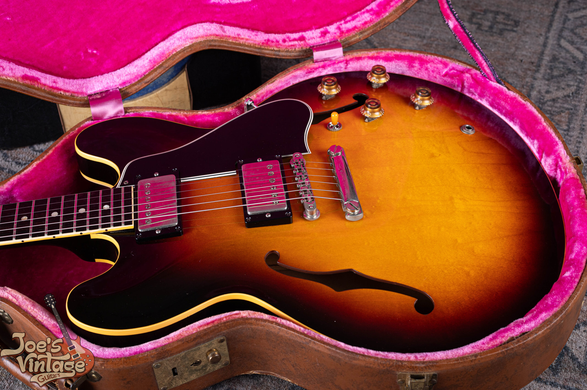
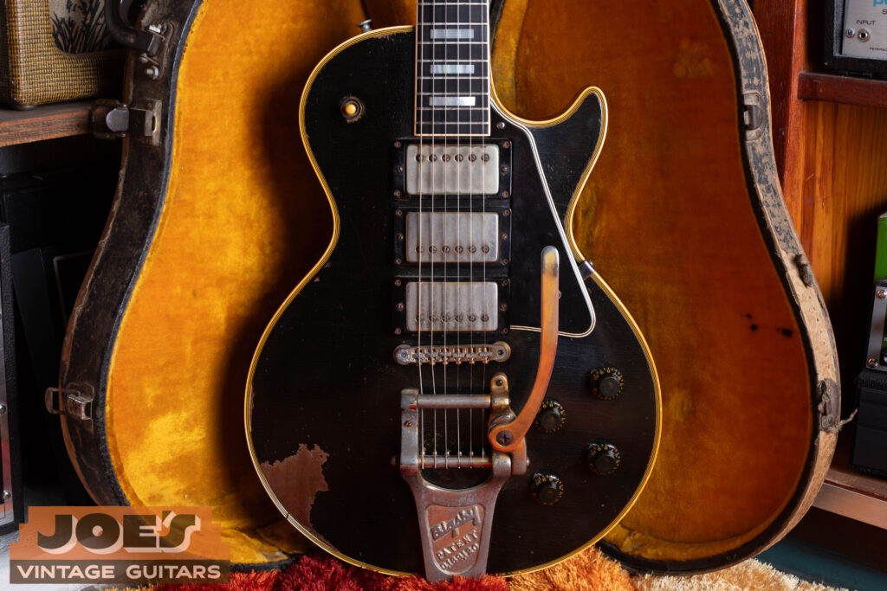
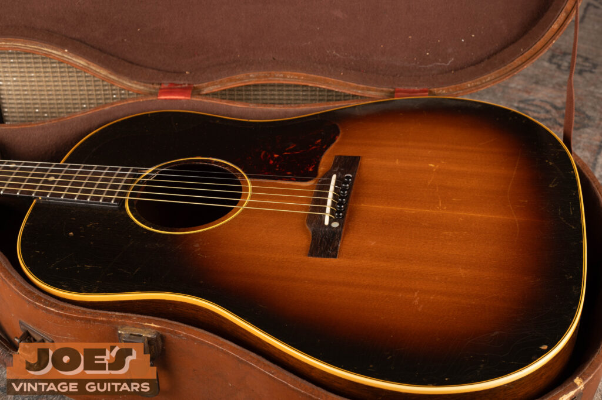
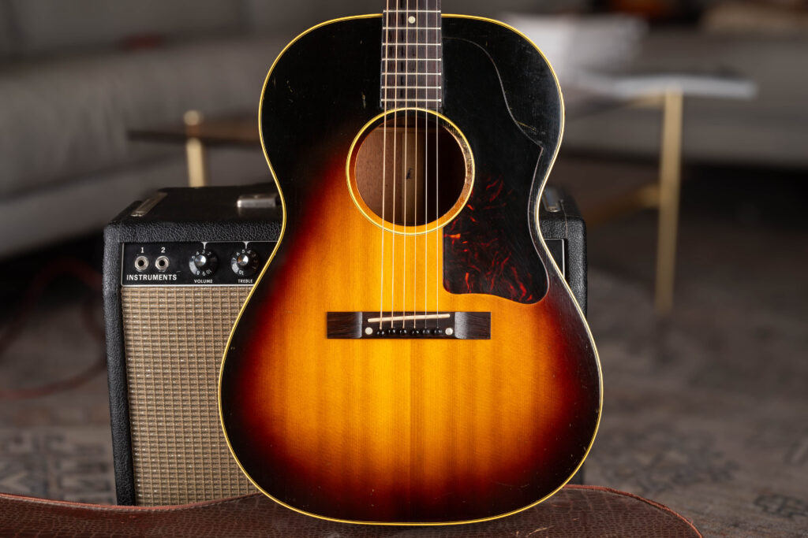

Vintage Gibson values depend on the model and configuration: this site's reference for a 1952 to 1953 Les Paul Standard is $20,000 to $40,000, while the 1950s J-200 reference shown below is $16,500 to $21,500. Those examples describe different guitars and defined conditions. They aren't a price range for every old Gibson.

I use this page to help you find the right model guide. Start with the instrument's identity, then move to the annual table and condition notes for that model. If the name or year is uncertain, keep that uncertainty in the description instead of choosing the most valuable match.

## Vintage Gibson Values By Model

These selected references are reviewed as of October 2026. Each row is an example configuration from its linked model guide, not the entire model's price range. The guides retain their source dates, condition assumptions and any gaps in the available evidence.

| Model | Example Era Or Configuration | Reference Range | Basis |
|---|---|---|---|
| Les Paul Standard | 1952 to 1953 Goldtop | $20,000 to $40,000 | Existing published site reference |
| Les Paul Junior | 1954: Single-cutaway sunburst | $6,000 to $13,000 | Selected example; see the Les Paul Junior guide |
| Les Paul Special | 1955: TV Yellow, single-cutaway | $13,000 to $21,000 | Selected example; see the Les Paul Special guide |
| Les Paul Custom | 1954: Staple neck pickup And P-90 bridge | $25,000 to $55,000 | Selected example; see the Les Paul Custom guide |
| SG Standard | 1961: 1961 Gibson SG Standard | $13,500 to $25,000 | Selected example; see the SG Standard guide |
| ES-335 | 1958: 1958 Gibson ES-335 | $33,000 to $70,000 | Selected example; see the ES-335 guide |
| ES-330 | 1959: Two pickups, dots, sunburst or cherry | $9,000 to $11,500 | Selected example; see the ES-330 guide |
| ES-355 | 1958: Mono, cherry, factory Bigsby | $36,000 to $45,000 | Selected example; see the ES-355 guide |
| ES-125 | 1941: Early full-depth single-pickup sunburst | $2,625 to $3,500 | Selected example; see the ES-125 guide |
| J-45 | 1957: Large-guard sunburst era | $7,500 to $10,000 | Selected example; see the J-45 guide |
| J-200 | 1957: Standard natural or sunburst | $16,500 to $21,500 | Selected example; see the J-200 guide |
| LG-0 | 1958: LG-0, broad original-run reference | $850 to $1,875 | Selected example; see the LG-0 guide |

Some references come from this site's established anchors. Others use a published guide with completed comparisons, or a disclosed range of completed transactions. Those bases aren't interchangeable: an excellent original guitar with its original case differs from a played example with changed parts or repairs.

Use the links below for the complete coverage. A selected first-year example shouldn't be applied to a later guitar merely because both carry the same model name.

<figure>

<figcaption>A sunburst ES-335 with dot inlays, covered pickups and a stopbar. Photo by Joe Dampt.</figcaption>

</figure>

## Les Paul Values

The [Les Paul Standard market value guide](/vintage-gibson-les-paul-market-value-guide/) connects the Goldtop, Sunburst and later Standard references with the existing year guides. Pickup configuration and construction era determine which part of that guide applies. A familiar finish alone doesn't identify the correct price category.

The other Les Paul models have their own value pages:

- [Les Paul Junior value guide](/vintage-gibson-les-paul-junior-value-guide/) for the original Junior configurations and documented finish distinctions.
- [Les Paul Special value guide](/vintage-gibson-les-paul-special-value-guide/) for the Special, including TV finish variants and the covered 1970s return.
- [Les Paul Custom value guide](/vintage-gibson-les-paul-custom-value-guide/) for the early and later Custom periods through 1979.

I don't use a Standard price as a multiplier for a Junior, Special or Custom. The market comparisons and condition questions are specific to each model. A replacement pickup or a repaired neck also changes the comparison with an original example.

<figure>

<figcaption>This 1958 Custom from my archive shows three covered pickups and a Bigsby vibrato, with wear visible on the lower body.</figcaption>

</figure>

## SG Values

The [Gibson SG value hub](/vintage-gibson-sg-value-guide/) separates the four model families. Use it if you know the guitar is an SG but haven't established which version it is. Once the model is known, its dedicated page keeps the price references together.

- [SG Standard values](/vintage-gibson-sg-standard-value-guide/)
- [SG Special values](/vintage-gibson-sg-special-value-guide/)
- [SG Junior values](/vintage-gibson-sg-junior-value-guide/)
- [SG Custom values](/vintage-gibson-sg-custom-value-guide/)

The guides cover the original production periods and include later years through 1979 where the model continued. They don't manufacture rows for years outside the documented run. Adjacent years may share a clearly labeled era range.

Before choosing a range, distinguish the model from any modifications. Added pickups, changed bridges and repaired neck joints belong in the condition description. An instrument that began as one model doesn't automatically enter another model's collector category after alterations.

## ES And Hollowbody Values

The [ES-335 value guide](/vintage-gibson-es-335-value-guide/) is the starting point for annual ES-335 references. The [ES-345 value guide](/post/gibson-es-345-history-value/) keeps that model's existing URL and identifies the basis of its price references, including established asking references. The [ES-355 value guide](/vintage-gibson-es-355-value-guide/) separates its documented configurations.

I wouldn't move between those tables by applying a simple trim premium. Model, electronics, hardware, finish and condition all affect which comparisons fit. A conversion also needs to be described as a conversion.

The [ES-330 value guide](/vintage-gibson-es-330-value-guide/) and [ES-125 value guide](/vintage-gibson-es-125-value-guide/) cover different model families. The ES-125 page states the full-size, full-depth single-pickup scope of its table. Related thinline or cutaway models shouldn't inherit that range without separate evidence.

For larger electric archtops, use the [ES-5 and Switchmaster value guide](/post/gibson-es-5-switchmaster-history-value/), [L-5 CES value guide](/post/gibson-l5-ces-value-guide/) and [Super 400 guide](/post/gibson-super-400-ces-history-authentication-value/). Those pages retain their model context alongside the value references. A similar body outline doesn't make the models interchangeable.

## Firebird Values

The [Gibson Firebird value guide](/post/gibson-firebird-history-authentication-value/) separates the model numbers and construction groups covered by the existing article. Start with that model distinction before selecting a band. The highest range in a family isn't a reference for every instrument in it.

Originality and repairs still need to be established on the actual guitar. The guide keeps existing site references identified rather than presenting them as newly verified transaction data. Its source notes also state where fresh comparison evidence remains limited.

## Gibson Acoustic Values

The [Gibson acoustic value hub](/vintage-gibson-acoustic-value-guide/) connects the J-45, J-200, Hummingbird and LG guides. It also explains where related models have identification coverage without a dedicated price table. That prevents a J-50 or Southern Jumbo from being assigned a J-45 value by default.

For a known model, go directly to the [J-45 value guide](/vintage-gibson-j-45-value-guide/), [J-200 value guide](/vintage-gibson-j-200-value-guide/), [Hummingbird value guide](/post/vintage-gibson-hummingbird-history-value-guide/) or [LG-series value guide](/vintage-gibson-lg-series-value-guide/).

<figure>

<figcaption>My 1950s J-45 archive photograph shows the body, bridge, pickguard and case together. Visible wear is part of its description, not a reason to assign a price without inspection.</figcaption>

</figure>

On an acoustic, the condition record needs more than cosmetic wear. Neck work, bridge and bridge-plate changes, cracks and internal repairs can affect the comparison. I don't apply the same automatic percentage adjustment to every repair.

The early J-200 evidence gap is disclosed on its model page. A rare instrument doesn't become easier to price because fewer examples are available. In that situation, an individual review is more useful than a broad unsupported number.

## Reading The Condition Behind A Range

All-original, excellent, with the original case is a defined assumption, not a description of every vintage guitar. The model guides say when a comparison set uses a different condition. Check those notes before using its lower or upper endpoint.

A quality refret preserves otherwise all-original classification under this site's grading approach, while removing museum-quality status. Refinishing, structural repairs, replaced pickups and neck reshaping are separate changes. They need their own description.

An attractive guitar can also have incomplete evidence. If the finish, parts or year hasn't been established, I keep the estimate provisional. A serial number or a clean photograph alone doesn't establish every condition in a price table.

<figure>

<figcaption>My LG-2 photograph shows a rectangular bridge and large pickguard. The image is context for an appraisal, not a certificate of untouched construction.</figcaption>

</figure>

## From A Reference To An Offer

A published range, an advertised price, a completed transaction and a purchase offer answer different questions. The guide identifies which kind of number it uses. An owner's proceeds can also differ from the transaction total after selling costs.

I can begin with clear photographs and the history you know. Include the full front and back, both sides of the headstock, identifying numbers, the case and any known repairs. Keep removed original parts and documents with the instrument.

You don't need to make the guitar look newer before that first review. Describe it as it is, including uncertainty. That gives me a better basis for choosing the correct model guide and the comparisons that fit the actual instrument.

## How These References Are Maintained

This hub carries selected examples from the model guides reviewed in October 2026. It doesn't establish a new brand-wide price curve or replace their research records. The source ledger preserves each selected range and its condition basis.

Where annual rows share an era band, the model guide says so. Where the evidence is historical, altered-condition or insufficient, it keeps that limit visible. Use the model page for the complete table before relying on an example from this overview.
